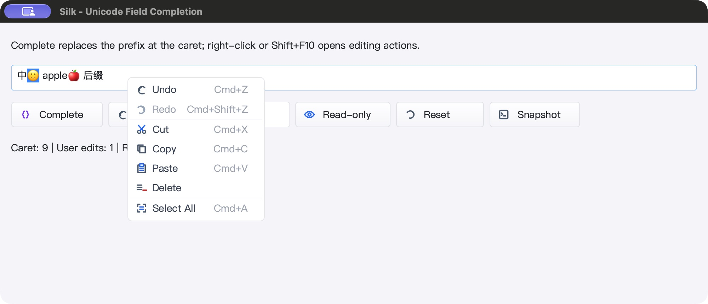
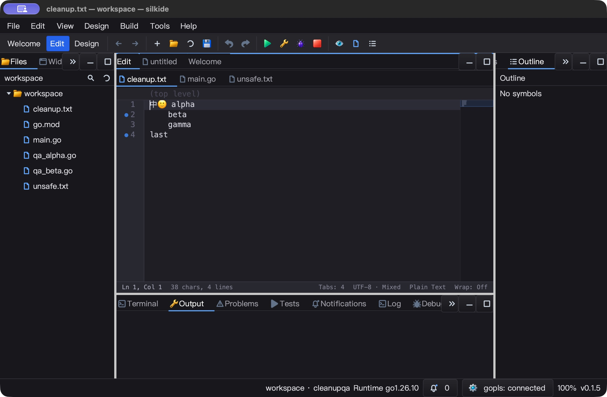
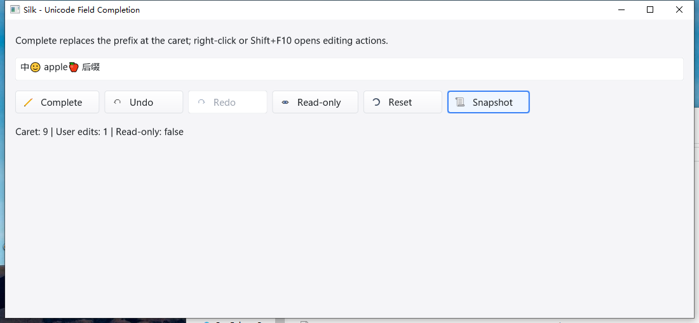
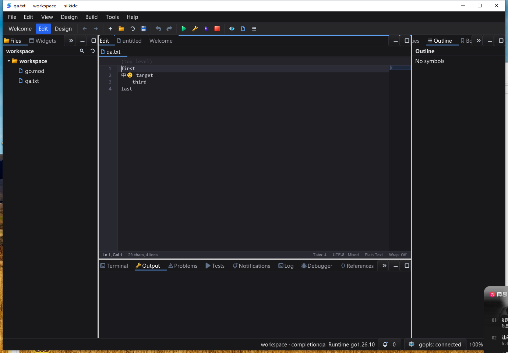
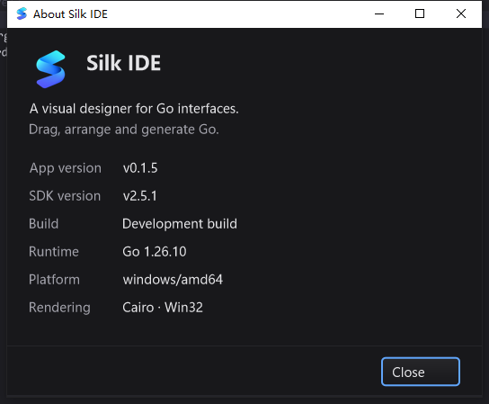

# 窗口缩放与原生绘制资源生命周期 QA — 2026-10-25

## 本轮修复

GLFW 后端在缩放和销毁窗口时仅替换／清空 Go 引用，旧 Cairo 表面与 context 仍
依赖 finalizer。原生像素内存并不完整计入 Go heap，这种延迟回收容易在连续缩放时
累积；旧辅助路径还会保留绑定旧表面的画笔，或者被相同缓存尺寸挡住缺失表面的重建。

先加入回归，旧代码的三个测试均失败，再进行修复：

- `Window.ensureBackBuffer` / `releaseBackBuffer` 统一 UI 线程独占资源的生命周期：
  先关闭画笔，再关闭表面，然后分配新表面；缓存对象缺失时即使尺寸相同也重建。
- 同尺寸帧保留原画笔、表面和像素，不新增分配；尺寸改变必定使旧像素失效。
- GLFW 保持精确 framebuffer 大小，不用有损缩放掩盖步长错误；Windows 保留 16 像素
  分配粒度及既有主动释放语义，使用相同资源管理实现。
- GLFW 同一窗口的递归 paint 改为请求下一帧全量重绘；Draw 内关闭窗口延迟到当前
  帧退出后再释放，不在仍使用的 painter/context 下执行销毁，也不呈现已请求关闭的帧。
- 原生渲染测试本身同样显式释放资源。无新定时器、轮询、后台 worker 或公开接口变化。

## macOS 自动验证

Go 1.26.10，`GOMAXPROCS=2`，最终冻结 **1684** 个源码输入：

- paint、gui、ged、prop、cmd/silkide、三个示例 race-short：
  **5591 pass / 46 skip / 0 fail**，包括子测试，不代表全仓所有长时间集成测试。
- 根包 race-short、八包 `go vet -composites=false`、IDE RequireBundle 与 SDK 原生构建通过。
- 强制附带 gopls 的三项集成：**3 pass / 0 skip**。
- 强制原生 GL 探针：**4 pass / 0 skip**；包含已有全量／局部上传、菜单 alpha 以及新
  backbuffer 生命周期测试。默认 short 中跳过的原生探针在此单独强制执行。
- 新探针通过实际窗口 `SetSize` 连续执行 **48 次缩放**，PBO／直接上传各 24 次，
  逐行读取实际 GL 纹理对照 Cairo，并检查新右下区域已经完整绘制。
- 保留所有 48 对旧 Go wrapper 的强引用，每次缩放后立即检查 native 表面已退役、
  画笔保存栈已清理，避免 GC 恰巧运行造成假通过。
- 每次缩放后追加同尺寸局部重绘，确认对象复用并静止；递归 paint 下一帧收敛；
  Draw 中关闭后继续绘图成功，帧退出时才释放资源。
- 深浅菜单边缘、92 个分数 alpha 像素、普通窗口不透明属性与图表混合回归继续通过。

```sh
SILK_TEST_NATIVE_RENDER=1 SILK_TEST_NATIVE_POPUP_ALPHA=1 \
SILK_TEST_NATIVE_BACKBUFFER=1 GOTOOLCHAIN=go1.26.10 GOMAXPROCS=2 \
  go test -race ./gui -count=1 -v \
  -run '^Test(GLFWNative(RenderTransfers|PopupSurfaceAlpha|BackbufferLifecycle)|PopupFramebufferHintDoesNotLeakToForms)$'
```

## macOS 真实桌面验证

SDK：实际拖动窗口缩小／放大，截图尺寸从 2000×864 到 1684×656、2000×860。
缩放后中文和彩色 emoji、选区、圆角菜单正常；六个 JSON 快照精确确认补全、同文本
复用、Undo、Redo 和只读拒绝修改，编辑计数为 0／1／1／2／3／0。

IDE：2560×1704 → 2200×1440 → 2560×1704，编辑器与停靠区重排；无需重新点击
正文即可输入 X 并保存。再打开 About，Escape 关闭后直接输入 Y，文件等于 `XY`
加原始混合换行文本；连续撤销保存恢复原始字节。两个精确 QA PID 均正常退出。

自动化边界：一次批量拖拽遇到工具的窗口坐标失效，一次菜单关闭后遇到 AX 错误；
均重新截图确认真实状态后继续，不把未执行的动作算成通过。原生循环的 48 次
断言与手动边缘拖动分别记录，不混为同一种测试。

仍观察到窄停靠标签在滚动边界被部分裁切，留作下一轮 UI 细节改进；本轮不声称
所有布局／图标问题已经完成。





## 性能测量边界

- 同尺寸 backbuffer 复用约 **1.95 ns/op，0 B/op、0 allocs/op**，只是资源检查路径，
  不等于整帧绘制零分配。
- 菜单表面约 25 µs/op；光标约 53.8–53.9 ns/op，两者基准仍为 0 分配。
- 缩放后 SDK 静置 5.004 秒，CPU 增加 0.04 秒（约单核 0.80%）；IDE 5.001 秒，
  CPU 增加 0.05 秒（约 1.00%）。不含 gopls，不代表整机长期占用或 FPS 保证。
- SDK 观察区间 RSS 为 118256 → 125104 KiB；驱动、字体与分配器可能保留缓存，
  不把显式资源释放表述为操作系统 RSS 必须即时下降，也没有声称所有卡顿根因已解决。

## Windows 验证

本轮恢复连接后，在 Windows 10 22H2 真机补验同一源码：不可变基线 1801 个输入，
413 个 overlay 输入逐项 SHA-256 核对，测试后再次核验。交互桌面为 session 1、
1600×1200；构建／非 UI 测试走 SSH session 0，不把二者混淆。

- 原生 Cairo IDE（RequireBundle）及 SDK 构建、附带工具清单校验通过。
- paint、gui、ged、IDE、edit-completion、editor-goto 六包定向
  `go test -race -short -count=3` 通过；范围是资源／菜单／文本／编辑／外观等指定测试，
  **不是全量 Windows 测试，也不声称零 skip**。
- 强制使用附带 gopls 的三个集成 **3 pass / 0 skip**：未保存 Unicode 补全与格式化、
  未保存定义随文件重命名、类型／定义／实现跳转及返回。随后使用全新 APPDATA／data
  再跑三项，仍为 3 pass / 0 skip，stderr 为空；与 UI 上的 connected 状态分开验收。
- SDK、IDE 各完成 24 次原生 MoveWindow 尺寸断言，再各实际拖动一次窗口边缘：
  SDK 1000×450 → 1100×510；IDE 1280×900 → 1380×960。48 次采样全部 Responding，
  原生程序化缩放与鼠标拖动分开计数。
- SDK 七个快照精确确认补全、快捷键 Undo／Redo、菜单 Delete／Undo、只读拒绝；
  编辑次数为 0／1／2／5／6／7／0。中文／彩色 emoji 与不透明方角菜单截图正常。
- IDE 缩放后的输入、Go To 输入框局部 Undo／Redo、正文 Undo 均通过保存字节回读；
  混合换行、中文和 emoji 保持原样。
- 从已确认可编辑的正文开始，同一个交互任务连续验证 About 的 Escape／Enter／Close：
  每次关闭后 **不再点击正文、不重新激活窗口**，直接输入 Y、保存、Undo、再保存；
  三份文件均精确等于 Y 加基线，撤销后 SHA-256 恢复。原生线程的 Active／Focus／
  Foreground 均回到 owner HWND，owner 重新启用。
- 最终四个验收任务均 `Ready / LastTaskResult=0`，且有各自成功 marker；SDK PID 1432、
  IDE PID 3744 通过正常窗口关闭退出，并由独立进程查询确认不再运行。
- 静置约 5 秒：SDK CPU 增加 0.015625 秒（约单核 0.31%），IDE 增加 0.09375 秒
  （约 1.87%）。只含目标进程、不是长时间性能保证，不能推导所有 Windows 卡顿均已修复。

自动化失败与边界也保留：跨任务操作曾丢失 Help 菜单；skill 的 Get-AllWindows 遇到
PowerShell 只读 `$PID` 冲突，改用有明确 owner 的句柄查询。首次跨任务 About 关闭后
输入失败，随后连前置正文输入检查也失败；点击正文建立并验证输入基线后，同任务
三条关闭路径全部通过。因此不把首次失败归因为已证实的 modal 回归，也不将该次记为通过；
跨任务焦点前置条件仍需后续专项复现。gopls 启动脚本先遇到未引用 `-test.v` 参数解析，
随后 PowerShell 把 stderr 警告当终止异常；改为明确引用参数、独立 stdout/stderr 文件、
核验原生进程退出码后通过，原失败日志未删除。首次重跑的历史异常退出警告在全新
隔离目录中未再出现；没有据此修改产品代码或吞掉 stderr。

Windows amd64 `silk_pure_go` gui 测试二进制交叉编译亦通过，独立于上述实机证据。
Windows DPI 缩放、Linux 原生桌面及完整发布包闭包未在本轮验收；停靠标签裁切仍未修复。







## 证据索引

目录：`bin/qa-artifacts/backbuffer-lifetime-20261025/`

- `before-regression.log`：旧实现三项失败；`native-focused.log`：修复后通过。
- `after-focused.log`：首次测试清理后遗留 unused import 的编译错误，已修正并完整重跑。
- `phase-source.diff`、`phase-changed-files.json`：相对上一轮冻结源码的本轮独立差异。
- `mac-gates.exit` = 0，marker `MAC_BUILD_RACE_GOPLS_NATIVE_BACKBUFFER_OK`。
- `mac-test-summary.json`、`native-gl-race.log`、`mac-bundled-gopls.log`、`mac-benchmark.log`。
- `sdk-ui-readback.json`、`ide-ui-readback.json`、`ide-resize-saved.txt`、`ide-about-saved.txt`。
- `sdk-idle.json`、`ide-idle.json`、`mac-source-hashes.json`。
- `windows-evidence-final.tar.gz` / `windows-evidence/`：远端原始日志、UI 读回、截图与输入清单。
- Windows `evidence/build-ui-only.ok`、`targeted-tests.log`、`gopls.ok`、`gopls-integration.log`。
- Windows `ui-evidence/final-task-status.json`、`sdk-snapshots.json`、`*-resize.json`、
  `ide-about-readback.json`、`ide-about-native-focus.jsonl` 和三份 `ide-about-*-saved.txt`。
- `final-artifact-readback.json` / `phase-status.json`：最终源码、产物和验收断言摘要。
- Windows IDE SHA-256：`1e81e9ec690864b996d6adc6fdef1f356bece7ff07099b24d4ca36df6df8e066`
- Windows SDK SHA-256：`9e6debba1857e36e6ff8f8ced4090089dcb3bc28f46de57837ff033c06037e29`
- SDK SHA-256：`f29feb3263355ce16601ba90f968f3d2482c039b6fb11199937bde80562dcc7d`
- IDE SHA-256：`9c83f530aabd88ad3a0097d1e305c477563dca3afac20935fe3e3cf21e0e844c`

未 commit、push 或发布；持续迭代目标保持进行中。
