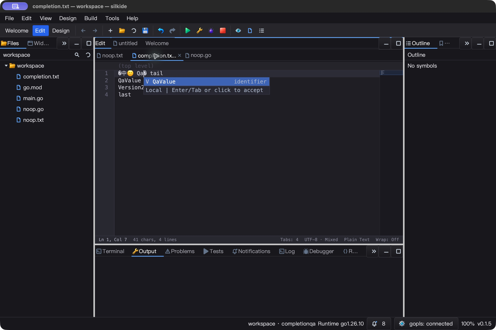
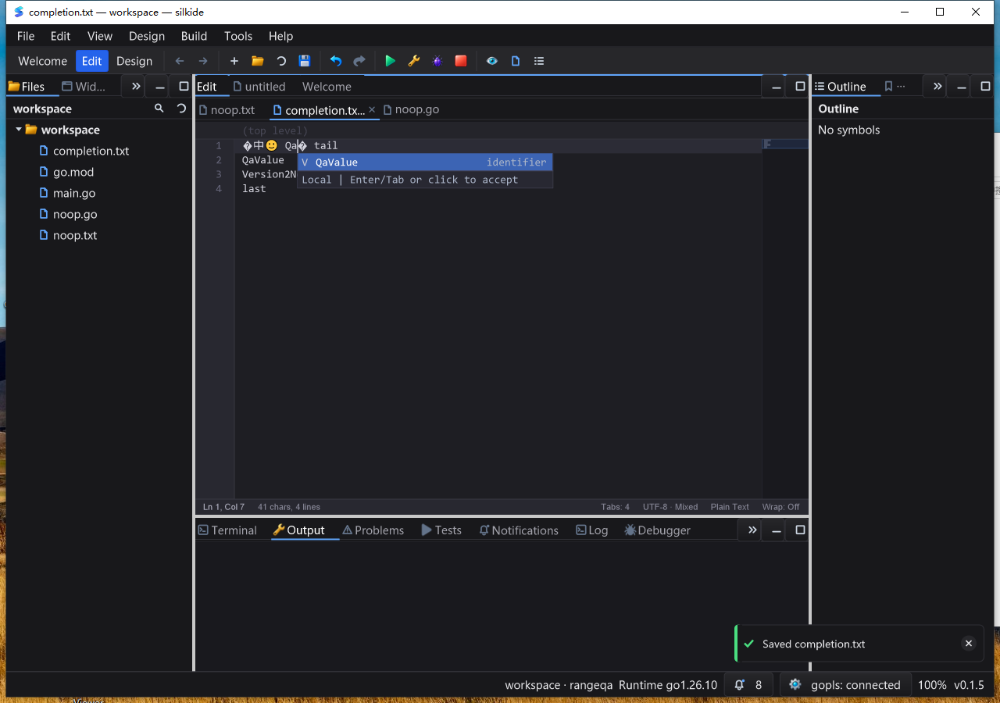

# 补全意图、无效候选与字节事务验收

本轮源于上一阶段原生截图：输入完整单词后，补全框仍提供同一个单词。继续检查发现接受字面补全还会经 rune 转换改写未编辑的非法 UTF-8，并把整篇文件放入撤销历史。本轮不是全部 Qt Creator 功能对齐或发布认证。

## 实现

- 仅在 popup 过滤无效果的字面候选，不改变独立 `RankCompletions` API。大小写修正和具有 `Apply` 的不透明动作保留；相同标签不等于相同编辑。
- 新增 `CompletionActive()`：候选为空但仍等待结果时为真，`CompletionVisible()` 只表示当前绘制。IDE 接收已校验的 LSP 响应时依据意图刷新，不能因为本地列表为空漏掉远程结果。
- 待处理的空列表也响应 Escape、导航、滚动、显式跳转、失焦取消；数字后继续提供有效补全。后台 Top-K 多取一个候选，剔除唯一的原样前缀后仍可填满 50 项。
- 接受字面候选使用单个字节事务，拒绝失效前缀／非法候选索引；保留未编辑 bytes、CRLF/LF、Unicode 和非法 UTF-8。一次文本通知，一次撤销动作；恢复光标、选区、附加光标。既有不透明 provider 动作仍由宿主负责。
- 历史只保存替换片段，前后片段均克隆。补查曾发现候选子串仍引用整篇原文件；新增指针范围测试复现该保留，克隆后重新冻结、构建和验收最终产物，未用首轮结果替代最终版本。
- LSP 一次响应只读取一次当前行位置；候选过滤按替换短文本校验，避免为每个候选生成整篇文档。只有文本和光标均不改变且无附加编辑时才过滤；自动导入、其他编辑范围、向后推进光标和未知操作保留。IDE 的纯文本协商不变，不新增 LSP snippet 支持。

## 证据范围与自动回归

本轮证据目录：`bin/qa-artifacts/completion-intent-20261026/`。最终冻结 1,775 个源码输入，相对上一阶段 10 个源码／测试文件变化；`before-source/` 与 `phase-source.diff` 分离保存，未覆盖此前工作树修改。初次构建及 UI 证据在 `r1/`，最终验收必须核对新产物哈希。

最终 macOS `go test -race -short -json -count=1 -p 1` 七包回归：6,222 个 pass、48 个 skip，本轮特性相关 38 个 pass 事件（含子用例）。定向 race 连跑三遍、纯 Go 路径、真实 gopls Unicode 补全／格式化集成测试、构建和随包工具校验均通过。

`go vet -composites=false` 七包通过。默认 vet 前后各 452 项既有诊断，无新增、无移除，不宣称默认 vet 全绿。旧实现重放本轮测试可复现失败，候选子串内存保留测试单独先红后绿。Windows 最终版同样的七包非缓存 race 回归：6,011 个 pass、70 个 skip，本轮相关 38 个 pass 事件；定向 race 连跑三遍、构建与随包工具校验通过。Windows 使用独立 R2 目录和绝对 Go overlay，回读确认 1,801 个基线文件未改动、527 个覆盖输入与本机一致。

## 原生 UI 与保存语义

三个隔离测试文件覆盖：纯文本完整单词的 Enter／Tab，含非法 UTF-8 的补全接受（鼠标／Enter／Tab），以及连接 gopls 的 Go 文档。macOS 与 Windows 最终版各 24 项精确字节断言全部通过，均含逐步撤销和三份基线恢复。不是只凭截图判断通过。

Go 文件保存会执行既有 gofmt。最初未格式化的 fixture 导致预期不匹配，已保留原始 fixture 与回读，改为 gofmt 格式的基线。Enter 的新空行保存时移除行内缩进，验证时先撤销格式化、再撤销 Enter。Tab 后输入 `QAINVALID` 作为临时语法哨兵，令 gofmt 拒绝这段未完成语句并保存原始字节，证明 Tab 确实插入；再撤销哨兵与 Tab。没有改变产品保存行为来迁就测试。

首轮 macOS 自动化对美元字符的两次输入未见效果，改用实际可见的 ASCII 哨兵；不据此归因到产品。最终一轮从重置基线重放，通过全部断言。一次鼠标补全后的立即文件回读早于 UI 处理完成，观察 UI 后未追加输入即得到正确回读；测试记录明确保留这一自动化时序问题。原生 UI 不包含 LSP RPC payload 记录；协议候选与 UTF-16 编辑另由真实 gopls 集成测试、无操作证明单测验证。

## 性能与剩余范围

macOS 五次固定 100 次迭代的补全接受基准，中位数：

| 文档行数 | 修复前耗时 | 最终版耗时 | 修复前分配 | 最终版分配 |
| --- | ---: | ---: | ---: | ---: |
| 1,000 | 78.877 µs | 54.170 µs | 79,900 B/op | 28,860 B/op |
| 100,000 | 3.856 ms | 1.964 ms | 7,563,211 B/op | 2,648,170 B/op |

每操作分配次数由 13 增至 14：克隆少量历史字节避免引用整篇原文件；分配总量约减少 65%。LSP 单个无操作证明中位数 14.92 ns、0 B/op；不代表整个补全请求耗时。macOS 最终版 IDE 进程短时空闲 CPU 采样为单核 0.80%（5.016 秒，不含独立的 gopls 进程），正常退出。

Windows 最终版 IDE 进程空闲采样为单核 0.94%（5.005 秒），`Responding=true`；正常关闭后，该 QA 目录中的 IDE／工具进程均为零。六个交互式计划任务均为 `Ready / Result=0`，执行脚本哈希一致。macOS 同样确认测试 IDE 与随包工具无残留进程。两端均无 `panic`／`DATA RACE` 日志。

基准是同一输入下的补全接受操作，不包含系统键入或整帧耗时。即便历史片段变小，正常文本重建仍有文档规模成本，不能宣称所有编辑变为 O(1)。

未覆盖 Linux 桌面、Windows 高 DPI／多显示器、所有 IME 和长时高负载时序；短 CPU 采样不保证帧率或输入延迟。此阶段不 commit、push 或发布，保持原 HEAD。

## 可重复校验

- `python3 bin/qa-artifacts/completion-intent-20261026/verify-local.py`：源码、自动回归、24 项 macOS 文件断言、进程退出、基准和最终二进制一致性。
- `python3 bin/qa-artifacts/completion-intent-20261026/verify-final.py`：双端源码、构建、测试、交互任务、文件字节、截图与证据文件完整性闭环校验。
- 最终 macOS 二进制 SHA-256：`7fbeb92332ff7612938ddd0d2245c1a7f397139bb31afe64ac69b7d601ad5342`。

- 最终 Windows 二进制 SHA-256：`969e071cc7d8e45a2c555535fb6a5f52699ba74a926d92f673631ff316efa601`。

