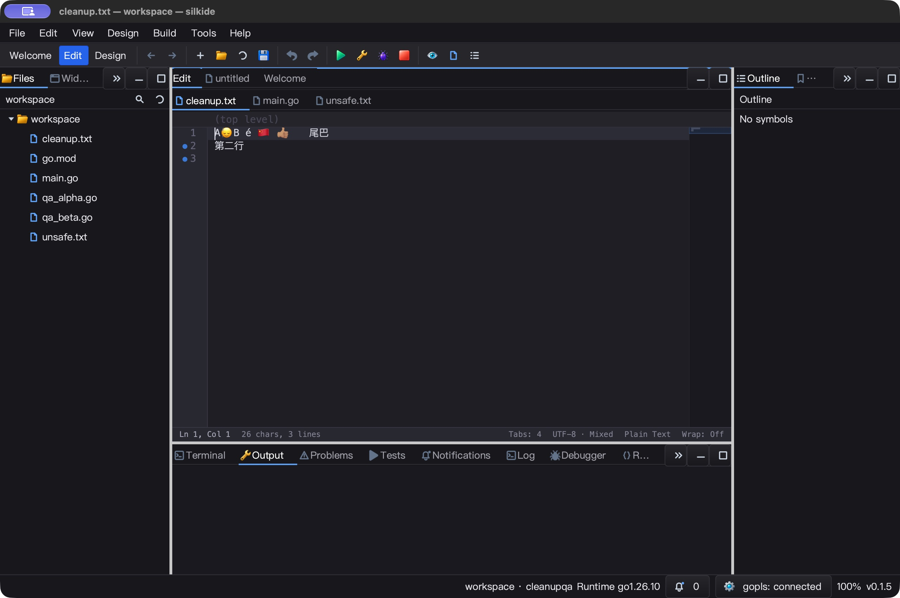
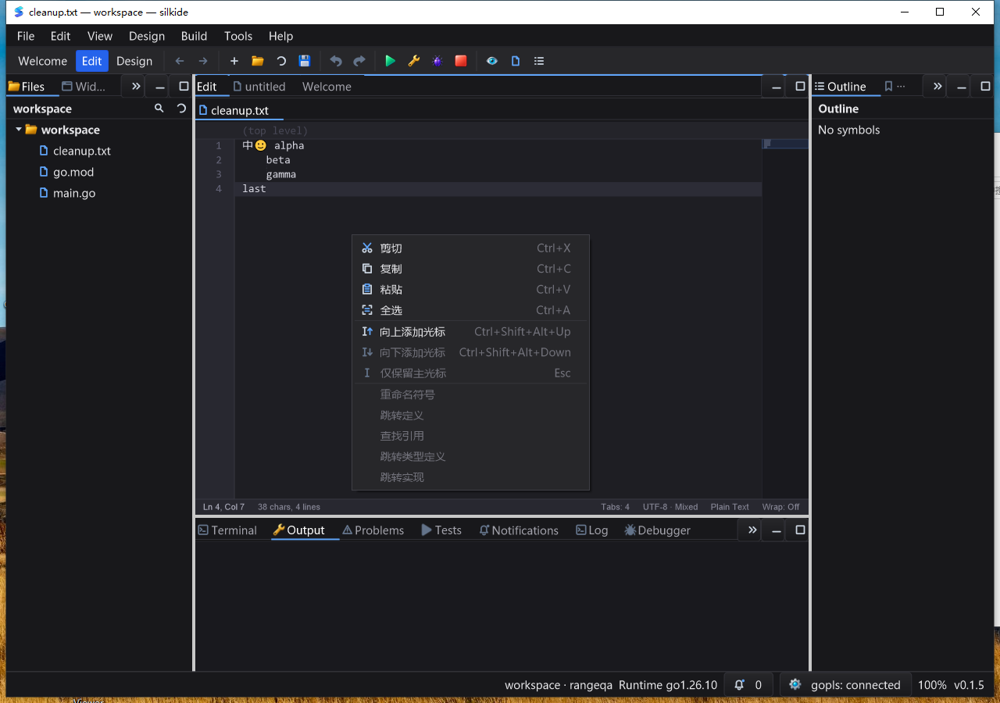

# 组合文字渲染与编辑器几何 QA（2026-10-26）

本轮修复上一阶段实际窗口中发现的 `🙂‍↕️` 拆字形问题，延伸到编辑器点击、
文字测量、语法高亮及普通输入框换行。不是完整 Qt Creator 对齐或发布包认证。
保留既有未提交工作，本阶段不进行 commit / push。

## 根因与修复

- 原先按单个代码点做 glyph 转换／字体回退，不能正确组合 ZWJ、变体选择符、
  肤色修饰符与国旗。直接测量光标之前的子串还会把完整簇重新拆开，导致宽度与点击偏移。
- macOS + cgo + Cairo Quartz 使用 Core Text 返回的 glyph runs；从实际 `CTFont`
  获取 `CGFont` 创建 Cairo 字体，不把 glyph ID 与同名字体的猜测结果混用。
  API 依据：[Core Text](https://developer.apple.com/documentation/CoreText)、
  [CTLineGetGlyphRuns](https://developer.apple.com/documentation/coretext/ctlinegetglyphruns%28_%3A%29)。
- `TextLayout.Clusters`、`Boundary`、`WrapEnd` 让显示、测量、点击与换行使用相同边界。
  超宽首簇整簇换行，不重复绘制；高亮 token 不拆开同一个组合字形。
- 普通 ASCII/CJK、私有区图标字形保持原路径；后端不可用时兼容回退。
  不删 ZWJ 或变体选择符来掩盖问题，不改原始文件字节、行尾、Tab 或历史记录。
- 真实回退字体保留小数字号，字体 face 与字形数组有明确所有权；外部布局副本不能污染缓存。
  所有缓存沿用 UI/渲染线程契约，不声称可由任意 goroutine 并发调用。
- 布局缓存上限 128 项／约 1 MiB 文本与几何负载；原生簇缓存 256 项／约 256 KiB。
  这不是全局字体缓存或进程总内存上限。不新增定时器、后台线程或轮询。

## macOS 自动验证

- 七包 `go test -race -short -json -count=1 -p 1`：**6125 pass / 48 skip**。
  范围：`paint`、`graph`、`decl`、`ged`、`gui`、`prop`、`cmd/silkide`。
- 新功能定向 `-race -count=3` 通过。覆盖 ZWJ Emoji、旗帜、肤色、组合重音、
  keycap、Hangul Jamo；缩放 1 / 1.25 / 2 的像素一致性、字体恢复、缓存副本、
  字段换行和鼠标边界。全量日志含 17 个相关测试事件，父／子测试分别计数。
- 受控关闭组合排版接入的 overlay 重放得到 `lost cluster`，开启后通过。
  这是同一源码关闭新路径的对照，不冒充完整旧提交／旧安装包测试。
- `silk_pure_go` 定向测试通过；模拟缺少 Quartz 字体后端的头文件 overlay 编译通过，
  原生专项明确 skip，未把不可用能力报为已实现。未改变宿主 Cairo 安装。
- 分数字号测试初版误把字号 13.5 当作 Emoji 应有的 advance；独立 C/Core Text
  探针证明原生字体返回 18。已改为验证真实 run 字号和字体缓存身份，不强行把系统度量改为方格。
- `go vet -composites=false` 通过；默认 vet 仍有 **452 个既有 unkeyed-fields 警告**。
  与本阶段前源码 overlay 的七包结果相同、无新增。比前一轮六包多 3 个来自新增检查的 `paint` 包。

## macOS 实际窗口

使用最终无插桩 QA app，bundled gopls 校验通过、状态栏 connected；本轮也打入 icon 资源。

1. 初始文件：`A🙂‍↕️B é 🇨🇳 👍🏽\t尾巴\r\n第二行  \n`，截图显示组合后的单个字形，无拆分箭头／占位框。
2. 点击组合 Emoji 右半侧，输入 `X` 保存，回读为 `A🙂‍↕️XB…`，不进入簇内。
3. 撤销还原，再点左半侧输入 `Y`，保存为 `AY🙂‍↕️B…`；Undo/Redo 精确往返。
4. 查找栏通过 CUA paste 输入完整序列，显示单个组合字形和 `1 / 1`；追加 X 为 `0 / 0`，
   字段局部撤销恢复 `1 / 1`，文档不变。这是粘贴查找验证，不冒充系统字符面板或真实 IME 提交。
5. 共 **7 项文件回读断言**，最终内容与原始 bytes 完全一致；应用正常退出，QA 子进程无残留。



## 性能边界

同机、顺序执行、每项 5 次、500 ms 的微基准，对照为关闭新路径的 overlay：

| 场景 | 关闭路径中位数 | 开启路径中位数 | 分配次数 |
| --- | ---: | ---: | ---: |
| 重复组合文字热缓存测量 | 128.642 µs | 1.413 µs | 402 → 1 |
| 普通 ASCII 测量 | 1.543 µs | 1.546 µs | 1 → 1 |
| 超长行可视区 find 绘制 | 7.788 µs | 7.919 µs | 29 → 29 |
| 超长行可视区 selection 绘制 | 7.721 µs | 7.838 µs | 29 → 29 |
| 超长行可视区 occurrence 绘制 | 7.736 µs | 7.841 µs | 29 → 29 |

热缓存专项提速不代表整个 IDE 提速同等倍数；ASCII 与超长行仍有约 0.2%～1.7% 的样本差异。
已避免对被认证为 fixed-cell 的超长 ASCII 行在每帧重新扫描整行；无簇文本的判定也缓存。
macOS 5.008 秒空闲样本使用 0.050 CPU 秒，约 **1.00% 单核**。
上述数据不是端到端输入延迟、帧率或长期稳定性保证；超长复杂文字的冷布局仍需后续压力验证。

## Windows 验证

- Windows 10 真机最终构建及七包 `-race -short -count=1`：**5925 pass / 70 skip**。
  `TestClusterBackendKeepsUnsupportedPath` 明确验证未启用本次原生组合排版路径。
- 验证不可变基线 **1801 个文件**、当前 **511 个 overlay 文件**，构建、测试和子进程
  统一使用绝对路径 GOFLAGS overlay；预最终构建证据单独保留，未拿旧版本代替本轮结果。
- bundled gopls 校验通过，实际编辑器 connected。Session 1 交互任务检查前台、窗口所有者、
  PID、路径和二进制 SHA，再操作菜单、键盘与工具栏。
- 上下文菜单全选、连续输入、单次 Undo/Redo、保存边界、光标移动边界、工具栏 Undo/Redo、
  `Ctrl+Space` 不修改纯文本均通过；**12 项文件回读断言**，恢复原始 UTF-8、混合行尾及空白。
- 三组快速 SendKeys 脚本均在 500 ms 内发完，用于验证合并历史边界；这是注入耗时，
  **不是用户输入到屏幕的端到端延迟**。
- 5.007 秒空闲样本消耗 0.09375 CPU 秒，约 **1.87% 单核**，窗口 Responding。
  短样本不能证明全负载、长时间性能或达到某一帧率。
- 四阶段任务均回读 `Ready / Result 0` 与专属 marker；程序及 bundled gopls 已关闭。
  基线、overlay、被测二进制和脚本 SHA 均通过最终复核。



## 已知缺口

- 此次原生组合整形仅启用 macOS Cairo Quartz；Windows/Linux 保留现有后端。
  Windows 的常规菜单／历史回归不等于其复杂文字排版已补齐。
- 文档偏移和键盘方向／删除仍按现有代码点语义工作，不是完整 grapheme 编辑器；
  不覆盖完整双向文本、阿拉伯语上下文整形或所有 Unicode 序列。
- 中文 IME 组合输入、候选框插入点定位、多显示器、Linux 原生桌面和 Windows 高 DPI 未解决／未验证。
- Windows 截图仍可见英文主界面与中文编辑器上下文菜单混用；菜单操作通过不等于本地化覆盖已补齐。
- 原生组合专项依赖系统字体及其 Unicode 版本，不能据本机七种序列宣称覆盖全部字体与系统版本。

## 可复核证据

`bin/qa-artifacts/complex-text-20261026/`：

- `source-hashes.json`、`phase-source-changes.json`：1765 个代码输入，18 个本阶段改变文件；
- `before-source/`、`feature-off-tests.log`、`capability-tests.log`：备份和红绿重放；
- `probe-fractional.c/log`、`coretext-probe-fractional.png`：独立系统字体度量；
- `mac-tests.jsonl`、`no-quartz-tests.log`、`pure-go-tests.log`、`vet-comparison.json`；
- `mac-*.txt/png`、`ide-process.json`、`mac-close.json`：最终 UI、源字节和进程／二进制关联；
- `final-before-bench.log`、`final-after-bench.log`、`bench-comparison.json`：受控微基准；
- `windows-evidence/`：最终真机 race 日志、菜单截图、12 项文件快照、任务和进程关闭证明；
- `artifact-hashes.json`、`verify-local.py` / `verify-final.py`：源码—测试—实际 UI—文件回读一致性校验。

macOS 最终 QA binary SHA-256：
`21731cee8889511f3da138b6698a2c4bdc5875184dc36a66e879c680c5432e6b`

Windows 最终 QA binary SHA-256：
`5d8b855c4b25928cbb74fcdaf2da5b3f9dea8b3e452e6daf8c9d734d89c954b2`

复核命令（仓库根目录）：
```sh
python3 bin/qa-artifacts/complex-text-20261026/verify-final.py
```
