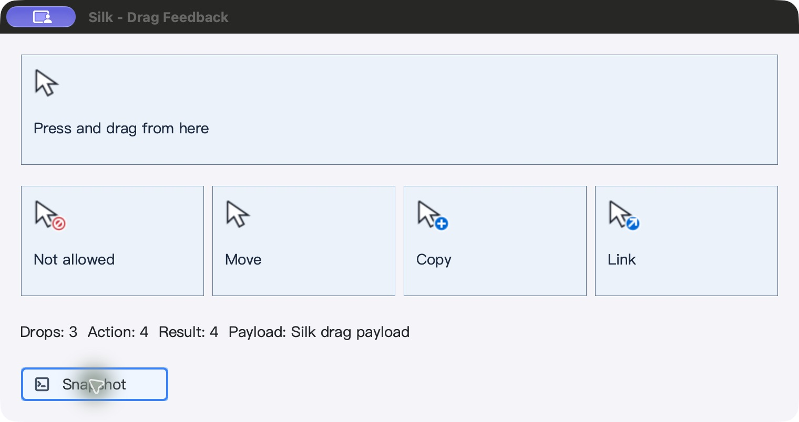
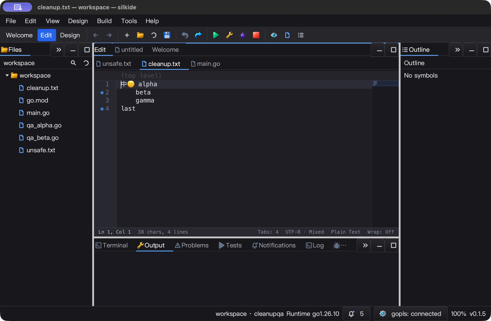
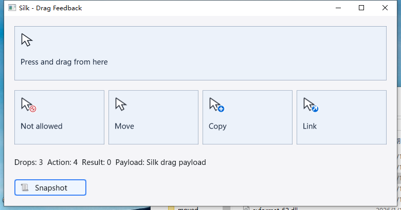
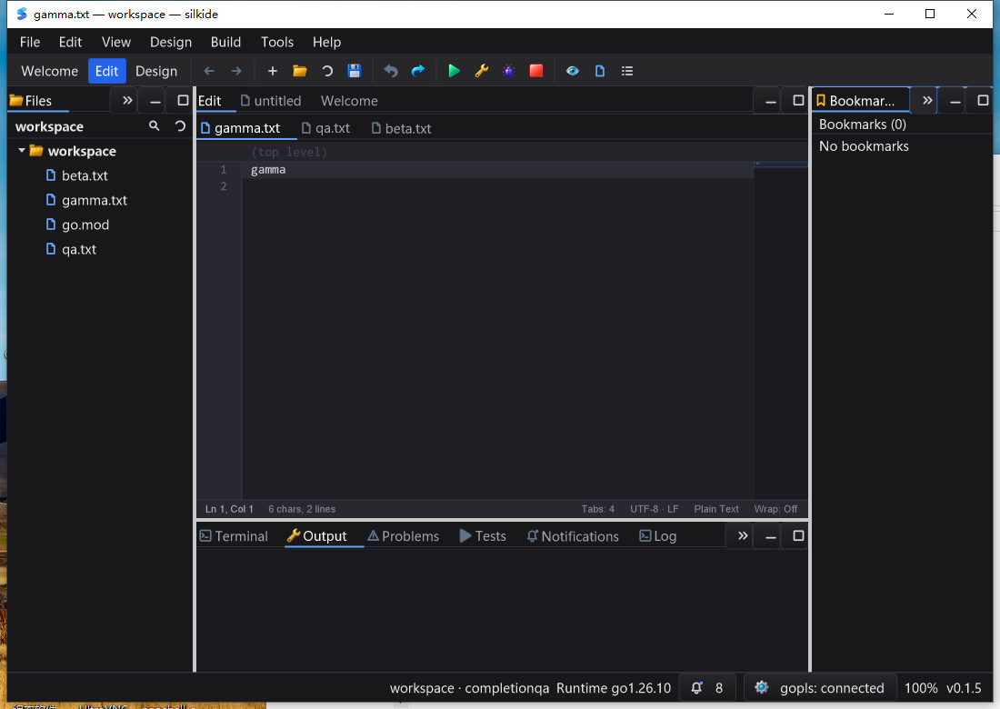

# 拖拽反馈、资源释放与输入收尾 QA — 2026-10-25

## 本轮修复

- SDK 没有 `cursor` 资源目录时，原四个拖拽光标全部失败并回退为相同箭头。
  先加入四项失败断言，再提供内建矢量生成的拒绝／移动／复制／链接图案。
  自定义 PNG 仍优先，名称不区分大小写，支持热点后缀和带下划线名称；损坏、
  超大 PNG、非法热点明确报错，不把损坏的覆盖资源误当作不存在。
- 原 `GenerateDropCursors` 只用内容尺寸分配画布，没有真正画出内容。
  现在合成实际缩略图，预览上限 80×64、保持纵横比，光标热点不随预览移动。
- 共用生成路径显式释放 Cairo 临时 painter/surface；两个平台在拖拽结束并恢复
  先前光标后释放临时 native cursor。缓存的系统／应用光标不释放，重复释放安全。
  Win32 DIB、mask 创建失败不再进入空指针写入；所有已分配的临时 bitmap 均清理。
- GLFW 拖拽去掉每毫秒 `PostEmptyEvent` 自唤醒，改为输入可中断的最长 1/60 秒等待。
  Escape 请求取消，普通字符／快捷键不流入背景编辑器；拒绝嵌套拖拽覆盖外层载荷。
- **真实 macOS 又发现拖后按钮误路由**：嵌套循环吞掉 button-up，但留下
  `toCapture`，下一次移动把旧拖拽源重新捕获。第一次试验得到 8 次 DRAG_BEGIN、
  仅 1 次快照，按钮实际上再次启动拖拽。补齐捕获、hover 和移动状态清理后，
  全新进程完整重放通过；既覆盖已经捕获，也覆盖待捕获状态。
- 新增 `examples/drag-feedback`。首轮实机发现 tile 文字误用 pen，而文本实际使用
  brush，导致字色与底色一致；加入实际像素“可见文字墨迹”失败回归后修复。
  示例子控件边界覆盖 760×370、320×240、80×60、0×0。

Windows 实机进一步确认 Escape 被忽略：第四次应取消的拖动仍新增一次 Drop。
`win32.DropSource.queryContinueDrag` 未检查 `fEscapePressed`；现优先返回取消，
包括 Escape 与按钮释放同时出现的情况，符合
[微软 QueryContinueDrag 契约](https://learn.microsoft.com/en-us/windows/win32/api/oleidl/nf-oleidl-idropsource-querycontinuedrag)。
同时修复 `DropSource.QueryInterface` 错误接受 `IID_IDropTarget`、拒绝
`IID_IDropSource` 的身份问题。新增 holding／release／三种 cancel、IUnknown／
IDropSource／拒绝 IDropTarget 与引用计数平衡测试，旧实现另做失败重放。

## 自动验证

Go 1.26.10、GOMAXPROCS=2，最终 **1701** 个本地源输入冻结并逐项 SHA-256 复核。

- macOS 十包 race-short：**5616 pass / 47 skip / 0 fail**，含子测试事件；不是全仓长测试。
- 根包 race-short、十包 vet（沿用 `-composites=false`）、原生 IDE RequireBundle／SDK 构建通过。
- 强制 native cursor：主 OS 线程运行 64 轮、每轮 4 个真实 GLFW 光标，不能使用 fallback；
  重复释放后 native pointer 为空，共享箭头仍有效。
- 四项既有强制 GL 验证继续通过：全量／局部上传、popup alpha、普通窗口 hint、
  48 次实际 resize 的像素读回／资源退役／嵌套绘制与绘制中关闭。
- 定向拖拽输入 race `-count=3`、PNG 覆盖与错误边界、内容像素、借用资源、原生失败回退、
  临时图像立即释放、控件布局与文字像素测试通过。
- 第 47 项 skip 是默认不执行的 native cursor opt-in，另一次强制运行已执行并通过。
  其余 skip 不冒充已测试功能；测试进程原有异常退出标记／可选 icon 目录告警仍保留。

## macOS 原生操作与回读

最终 SDK：6 份快照逐字段核验，拒绝不会增加计数；移动／复制／链接分别返回 2／1／4，
累计 1／2／3 次，载荷始终为 `Silk drag payload`。每次拖拽后立即点击 Snapshot，
不会再误送到源控件。另一次源区域释放保持 Drops=3、返回 Ignore。

实际按住约 **6.07 秒**，目标进程 CPU 增加 **0.13 秒**，约单核 2.14%。仅为这次
静止拖拽的短区间采样，不是全 IDE 性能或跨机器性能承诺，也没有旧版同条件 CPU 对照。
内容合成基准只测 Cairo 合成，不含原生光标创建、GPU 或系统输入延迟。

IDE：文档页签拖动重排；点击正文建立编辑焦点后输入 D，**点击工具栏 Save**，
磁盘精确读回 `D` 加原 `unsafe.txt`；Undo 后原字节恢复。正文 Control-Tab 返回
`cleanup.txt`，输入 T／保存精确匹配，Undo 恢复中文、emoji、混合换行及尾随空白。
真实边缘缩放到更小窗口后布局仍可使用。SDK PID 5038、IDE PID 6135 正常关闭并独立核验。

**未解决的观察**：IDE 拖动文档页签后直接打字未进入正文，需要点击正文建立焦点；
标题也在后续动作才刷新。因此不宣称“拖动页签立即继续键盘编辑”已通过，列为下一轮问题。
工具栏焦点上的 Control-Tab 也未作为正文导航的通过证据。

## Windows 原生验证

Windows 10 22H2、session 1、1600×1200、干净 PATH。最终不可变基线 **1801**
个输入 + **443** 个 overlay 输入，构建前／测试后／UI 后逐项 SHA-256 复核。

- 七包定向 race-short `-count=3` 通过：win32、paint、gui、ged、cmd/silkide、
  drag-feedback、editor-goto；包括原生 HCURSOR 生命周期，每次 64 轮创建／重复释放。
  这是定向测试，不是全仓 Windows 回归。旧 DropSource overlay 则准确失败 5 个子项，
  不是编译失败或没跑到断言；修复版本同组测试通过。
- 新 SDK 进程单任务重放，**7 份 JSON 快照**：初始、拒绝、移动、复制、链接、
  Escape 取消、静止按住后释放。取消后仍只有 3 次 Drop，Result=Ignore，载荷未改变；
  每次紧接着点 Snapshot 均可工作。
- 四次拖动中 `GetCursorInfo` 获得当前 HCURSOR，`GetIconInfo` 验证 **80×40、热点 (2,2)**。
  用 `DrawIconEx` 独立绘出当前句柄：四张图的像素 hash 不同，缩略图像素精确为
  RGBA `(26,117,224,255)`，不是只验证 GUI 中摆放的示意图。
- 测试桌面普通箭头与拖拽指针均报告 `flags=2`。该值是系统抑制显示状态，见
  [微软 CURSORINFO 文档](https://learn.microsoft.com/en-us/windows/win32/api/winuser/ns-winuser-cursorinfo)。
  因而以上证明的是当前原生句柄／位图，不声称已经证明 OS 屏幕上的指针可见性。
  首次 QA 把状态必须等于 1 当成前提而中止；保留这次脚本失败及独立前／中／后诊断。
- IDE：三个文件间 Ctrl+Tab／反向导航、精确输入保存与撤销；拖动 gamma 到首位后，
  显式点击正文输入 G、点击工具栏保存，磁盘精确为 `Ggamma\n`，随后撤销恢复。
  qa.txt 的中文／emoji／混合换行 SHA-256 恢复原值，beta 恢复 `beta\r\n`。
  停靠区 chooser、真实边缘缩放至 **1100×780** 继续正常。
- 最终 4 个任务均为 `Ready / LastTaskResult=0`，各自成功 marker 已独立读取。
  SDK PID **8636**、IDE PID **9064** 正常关闭；最终构建 hash 保持不变。
- 约 5 秒短采样：SDK 持续拖动 CPU **0.109375 秒**（约单核 2.18%），IDE 静置
  **0.046875 秒**（约 0.94%）；原生 Responding 都为 true。不能据此认定 Silk 调度无停顿。

### 未通过的呈现／调度项：必须继续修复

最终 SDK stderr 记录 `event loop has not run for 5.447s`，随后
`event loop resumed after 7.417s`。并且 move／copy／link 的拖动中截图都没有
更新目标高亮：实际 RGBA `(236,242,250,255)`，应为 `(192,218,255,255)`。
当前 HCURSOR 已正确变换，操作最终也正确，但控件绘制没有同步推进。

因此本轮只能确认**操作结果、数据、取消和原生光标位图通过**，不能确认
**Windows OLE 拖动中的重绘／后台 UI 队列调度通过**。这不是零告警的性能验收。
下一轮优先检查 OLE 系统模态循环与 Silk 的 timer／UI wakeup／frame service 桥接；
不能只用 watchdog 静音掩盖实际悬停重绘失败。对应像素读回和日志均已保存。

从当前 HCURSOR 绘出的 Copy 光标及真实内容预览（非屏幕指针可见性证明）：

## 范围与限制

- macOS Escape 取消目前有实际回调单测，没有本轮原生“按住鼠标再发 Escape”的验证。
- 不把色块示例截图当作操作系统鼠标指针的像素证明；原生句柄创建／释放另有强制测试。
- GLFW 非拖拽用途的斜向缩放、wait/help 等系统光标仍有 arrow fallback，未一并修复。
- 可选 `icon` 目录探测告警仍存在；当前只解决 drag cursor 资源闭包，不宣称完整安装包闭包。
- Linux 桌面、Windows 高 DPI、多显示器缩放、macOS Retina cursor 原生像素尺寸仍未验收。
- 本轮不重跑强制 bundled-gopls 集成，不用状态栏 connected 代替语言服务能力验收。
- 无 commit、push 或 release；保留其他轮次的未提交改动，不覆盖用户工件。

证据目录：`bin/qa-artifacts/cursor-feedback-20261025/`。包含首轮失败回归、
中间失败交互 stdout、最终源码清单、单测日志、脚本、原生截图与精确读回。
