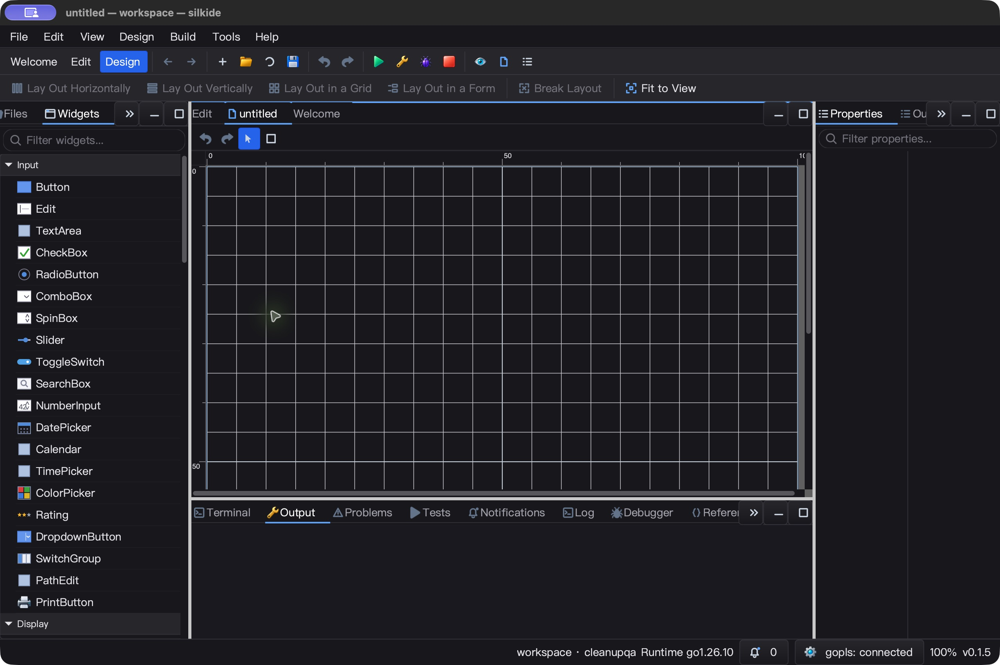

# 编辑器与设计器细节回归 — 2026-10-25

本轮接续 `WELCOME_UI_QA_20261025.md`，不把单元测试当成原生 UI 验证。

## 修复

- 最近文件：Quick Open、文件树、原生打开、源代码导航统一在成功加载后记录；已打开的脏缓冲区仍复用，不重载、不丢光标/撤销历史。恢复会话使用明确的无 MRU 副作用加载入口，避免启动时重排最近文件。
- 控件图标：所有控件面板图标在自己的方形槽内裁剪，并按 18 个逻辑像素等比缩放；隔离绘图状态。Rating 从越界的五个圆点改成三颗星，保留未选中状态的颜色区别。
- 本地化：布局工具栏的六个动作及说明、控件分类、属性过滤框与分类标题使用统一语言。保留已有插件分类身份和拖拽 factory 字符串。语言切换仍遵循现有“重启后生效”约定，不宣称全应用翻译已经完成。
- 命令面板去重：翻译后显露出两个“Fit to View”入口，移除旧的无上下文保护入口，复用设计工具栏的动作和可用性保护。

## 先失败后修复

- Quick Open 成功但 MRU 为 `[]`；旧版 session 恢复把 `[a,b]` 重排为 `[b,a]`。
- Rating 及多个边框类图标在 12/18/24/36 尺寸出现槽外像素。
- 第一轮完整回归检测到 Fit to View 重复注册；另一个旧属性测试仍硬编码中文显示值，已改为源语言键，并增加中英文分类显示断言。
- 所有失败输出保留在 `bin/qa-artifacts/designer-details-20261025/`，包括最初测试辅助代码误用 `IsModified` 的编译错误，不当作产品故障。

## 验收范围

- 自动测试覆盖 MRU 持久化读回、失败打开、脏文档复用、新旧 session 恢复、图标像素边界、绘图状态平衡、插件分类身份、筛选/拖拽 payload、动作翻译和命令去重。
- 原生验收与最终测试结果见下文；未验证的平台/行为不计为通过。

### macOS 已验证

- `go test -race -short -json -count=1 -p 2 ./gui ./ged ./prop ./cmd/silkide`：5,181 pass、42 skip、0 fail（含子测试）。
- `go vet -composites=false` 同四包与 RequireBundle 原生 IDE 构建均通过。独立设计器根包 `go test -race -short -count=1 .` 与构建也通过，未计入上述数量；根包本轮未做原生 UI 验收。
- 真实 Quick Open 输入 `beta` → `qa_beta.go` → Welcome 立即出现最近文件；正常退出后重启，恢复设计与四个编辑器没有把其他恢复文件插入 MRU，配置文件读回一致。
- 英文设计工具栏、分类及过滤提示可见；真实拖拽 Rating → 保存 `rating-qa.silkui`，读回单个 `gui.Rating`，bounds `[25 15 40 6]`、Value `3`。中文重启后设计控件完整恢复。
- 实际命令面板筛选 `Fit to View` 仅一条；原有六个工作区 fixture 内容未改。
- 编辑模式闲置 5.003 秒，主进程 CPU 增加 0.05 秒（约单核 1.00%，不含 gopls）。仅为短时采样，不代表全场景性能结论。
- 两次测试实例及其 bundled gopls 均正常退出。

### Windows 10 已验证

- 同四包原生 `-race -short -count=1`：5,059 pass、65 skip、0 fail（含子测试）。
- RequireBundle 构建、随包工具 manifest 校验通过；强制随包 gopls 的重命名、Unicode 补全/格式化、未保存内容导航三项集成测试通过、无跳过。
- immutable baseline 1,801 文件校验 + 346 overlay hash 与本地源文件一致；1,656 项代码/构建脚本输入检查没有未覆盖差异，不把该范围称为全部资产校验。
- 真实 Quick Open → Welcome MRU → 单击回到同一 `qa_beta.go`，两次复制读回均与 fixture 一致。保存后的最近文件配置包含该路径。
- Rating 拖拽 → 原生保存对话框 → 文件读回单个 `gui.Rating`，bounds `[40 40 40 6]`、Value `3`；原有六个文件 hash 不变。
- 英文分类、属性提示和布局动作正常；命令面板筛选只有一个 Fit to View。600×760 的窄窗口显示工具栏溢出入口，图标没有越界覆盖文字；狭窄侧栏的长文本截断仍需继续打磨。
- 设计模式闲置 5.010 秒，主进程 CPU 增加 0.109375 秒（约单核 2.18%，不含 gopls），`Responding=true`。没有将不同窗口/场景的短样本当作性能提升证据。
- 三个交互任务均 `Ready / LastTaskResult=0`；IDE 与 bundled gopls 正常退出，QA apps 路径下无残留进程。
- Windows 原始截图含窗口透明边框后方桌面，仅留在忽略的 QA 目录，不作为项目发布截图。

### 可重放证据

`bin/qa-artifacts/designer-details-20261025/`：

- `test-summary.json`、`mac-race.jsonl`、`gate-accepted/evidence/`：自动回归及 gopls 日志。
- `overlay-hashes.json`、`mac-tested-source-hashes.json`、`gate-accepted/tested-overlay-hashes.json`、`complete-source-input-check.json`：源文件与构建输入对应关系。
- `launch-native.py`、`prepare-overlay.py`、`build.ps1`、`ui-ide-*.ps1`：独立 QA HOME/APPDATA、构建与交互步骤；测试前需使用新目录/干净 fixture，不覆盖原始接受证据。
- `mac-fixture-readback.json`、`mac-*-preferences.txt`、`mac-final-exit.json`、`ui-accepted/`：持久化、截图、CPU、任务及进程终态。

### 本轮实际发现、下一轮继续

- 当时观察到 macOS 保存设计后 `Cmd+Shift+P` 不响应。后续隔离复现确认是原生文件 sheet 关闭后 key window 丢失，并非画布吞掉全局快捷键；修复与验证见 [快捷键 QA](SHORTCUT_ROUTING_QA_20261025.md)。
- 命令面板的设计动作可用性显示已在后续迭代与工具栏统一，见上述快捷键 QA。
- 部分具体属性标签（坐标、控件名称等）仍是中文；Calendar/TimePicker/PathEdit 等图标仍缺少辨识度。Rating 实际控件仍绘制圆点，本次仅修复面板图标。
- 本轮没有 Linux 原生桌面验收，也没有宣称全应用 UI/兼容性已全部完成。

