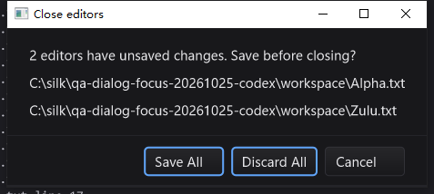

# Dialog focus and batch-close QA — 2026-10-25

## Scope and root cause

This increment changes SDK dialog activation and keyboard traversal. It does not
change batch-close disk transactions, install a new language server, or certify
Qt Creator parity.

A clean Windows replay of the original `6d968f1` binary reproduced the earlier
batch-close script's ambiguity: Save All was visually the default, but no button
initially had logical focus. One Tab selected **Save All**, and Enter really saved
all three modified files. Exact-byte readback confirmed that result. The old
`DISK_MISMATCH discard-alpha` assertion therefore did not establish a discard
transaction defect. The baseline binary SHA-256 was
`600b037362d36c7ce1ba41adb2ea0e38874b59aa854d939c1114b1a301c13154`.

The fix gives a label-only confirmation's default button initial focus. Input
dialogs prefer usable content, while explicit initial focus stays authoritative.
Dialog and MessageBox roots are no longer invisible Tab stops; disabled/hidden
subtrees are excluded. Default-action fallback rejects unusable, detached and
foreign buttons. Hidden construction still preserves default metadata, needed
by printer discovery, without permitting activation.

## Regression investigation

- The first full run caught a genuine regression in hidden PrintDialog default
  metadata. The implementation was corrected and a dedicated test added; the
  original printing test was retained.
- A subsequent full run caught `progress flooded queue 2`. A diagnostic-only Go
  overlay identified the two callbacks as `gitStatusService.drain-fm` and
  `async.Latest.Publish.func1`. This was a shared-queue assertion error, not two
  progress deliveries. The test now counts its own dispatches atomically while
  still using the real `gui.Post` queue. An unrelated sentinel callback ensures
  multiple producers are exercised. Worker/UI isolation, final progress and
  suppression after cancellation remain asserted. Twenty focused race runs pass.
- Earlier failed logs and their source overlays are retained, not overwritten
  or relabeled as successful runs.
- The first updated Windows workflow clicked the last pixels of Zulu's tab
  instead of the intended Beta tab. Its menu header and confirmation listed the
  actual targets (Alpha/Beta), and Discard correctly retained Zulu. This is a
  coordinate-fixture failure, not a failed discard operation. That run was
  preserved and normally closed; the replay uses the observed Beta tab center
  and a fresh workspace/configuration, with unchanged product binaries.

## macOS arm64 / Go 1.26.10

- Fresh `-race -short -count=1` run: 5,440 test/subtest passes, 47 skips, no failures
  across 13 requested package targets (12 with tests).
- Additional graph/prop/settings run: 238 passes, 1 skip. `go vet
  -composites=false` passes; the tab-navigation example builds (it has no test files).
- Three required **bundled** gopls integrations pass without skips: unsaved
  Unicode completion/formatting, rename, and definition/type/implementation/back
  navigation. The packaged tool manifest verification passes.
- Real native UI: first Tab selects Discard; Enter closes three editors with one
  dirty buffer without changing any disk file. Shift+Tab → Cancel retains the
  dirty buffer. Default Enter → Save All writes the exact `c` prefix; reopening,
  deleting the prefix and saving restores the original Unicode bytes. Cmd+Q
  exits normally, with zero QA-owned processes remaining.
- The native UI binary is byte-identical to the final gate build:
  `9ffb50bb29b9691e55e8f3c017193f1110ec7a75fc487e517795a6afc4228e96`.
- Initial-focus microbenchmark: three-button confirmation 133.3 ns/op, 0 B/op;
  1,000-field form 10,776 ns/op, 41,120 B/op, 8 allocs/op. This measures activation,
  not frame latency. No timer, animation or polling was added.

## Windows 10 native follow-up

- Native `-race -short -count=1` run: 5,324 test/subtest passes, 68 skips, no
  failures. The immutable 1,801-file baseline and 206-file source overlay were
  hash-checked before testing and after building. Three required bundled-gopls
  integrations pass with no skips; tool-manifest verification and IDE/SDK builds
  pass.
- A separate Session 1 modal probe requires `SILK_TEST_NATIVE_MODAL=1` and rejects
  skips. Thirteen test/subtest passes cover default Enter, Tab → Discard,
  Tab → Cancel, Space, Escape, Tab wrap, held-key rejection, MessageBox shortcut
  isolation and owner keyboard restoration.
- Tested Windows IDE SHA-256:
  `235aa3067aae31d73323c0e0145ff33d28ea4c750c98b65de2d2dc5e1ec2494c`.
- A fresh three-file desktop replay passes: Cancel preserves all dirty buffers;
  Close Right saves only Beta/Zulu; Close Others on inactive Beta discards
  Alpha/Zulu while retaining Beta's unsaved edit; reopen history, File-menu and
  Command-Palette Close All, ten menu open/Escape cycles, and subsequent typing
  all work. Twenty-four saved/readback artifacts were hash-verified locally.
  All original Unicode bytes are restored. Normal Alt+F4 exits with zero owned
  processes remaining.
- The final 10.22-second idle sample used 0.0625 CPU seconds (0.61% of one core);
  all 20 samples reported Alive/Responding. This is a bounded observation, not
  an input-latency, FPS or unbounded stability guarantee.
- A separate fresh 64-document session closes all editors in an observed
  0.528 seconds. All 64 disk hashes remain unchanged; reopening B00, typing,
  saving, undoing and restoring its exact Unicode bytes succeeds. Loaded/empty
  idle samples are 1.39% / 1.70% of one core over about ten seconds each. All
  responsiveness samples pass; normal exit leaves zero owned processes.

## Evidence and limits

Local artifacts: `bin/qa-artifacts/dialog-focus-20261025/` (ignored by Git).
`accepted-inputs.json` freezes 1,557 code/build inputs; final readback matches.
`accepted-gate.sh`, `accepted-*.log/jsonl`, `host-summary.json`,
`mac-results.json`, `queue-diagnostic.log`, and baseline `before-evidence/`
retain commands, failures, exact-byte results and provenance.
Windows build/UI/stress archives and their extracted evidence are under the
same directory. Native task exit codes are checked separately from launcher
output; source overlays and binary hashes bind these results to this increment.

Linux desktop, physical printer output, mixed-DPI/multi-monitor behavior and all
SDK control combinations are not re-certified by this increment. General
`-short` native-modal skips are not treated as desktop passes.
