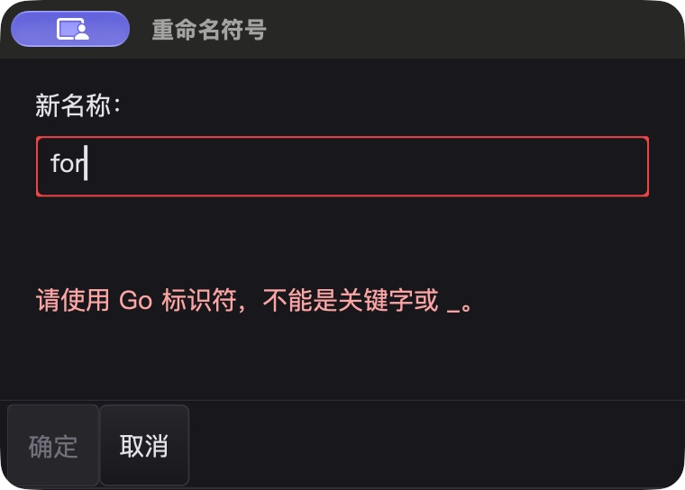

# 弹窗中文、图标继承与原生资源验收

上一阶段的真实 Windows 截图显示：重命名子窗口没有应用图标。切到中文界面复现发现，标题已翻译，但确认／取消按钮与校验原因仍是英文。此轮处理 SDK 的共同路径，不在单个 IDE 调用点硬编码图标。

## 修复

- `ButtonBox` 仅翻译 `@...` 标准按钮的显示名，保留提交 ID 和自定义字面值；SDK 增加中文标准按钮及重命名校验默认文案。通用确认／消息弹窗翻译内建按钮，IDE 补齐两个重命名错误分支的中文提示。
- `InputBox.SetIcon()` 原先写入独立字段，而 `Icon()` 读取嵌入 Form 的另一个字段；现在统一属性。创建原生 Form 时统一选择显式图标、所属窗口图标、已配置／缓存的应用图标，先设置身份再显示。
- `Form.SetIcon` 支持附加窗口后的更新及恢复继承；逻辑嵌入 Form 不修改父窗口。新增 `Window.Icon()` 查询逻辑来源。继承是快照，不是不断同步父图标的后台任务。
- Windows 生成独立小／大 HICON，替换与销毁时只释放自己持有的对象；空配置恢复 class/default icon。弹出菜单／内嵌窗口不自动生成标题栏图标。macOS 保留 bundle 图标边界，不调用不受支持的 GLFW `SetIcon`；Linux 图标交付函数仍有单测，但不是 Linux 桌面验收。

## 发现后继续修正，而非仅以单测判断

基线证据在 `bin/qa-artifacts/dialog-polish-20261026/baseline/`；原始单测证明图标 getter/setter 不一致、窗口缺少逻辑图标访问器、中文标准按钮与错误提示缺失。以完整旧生产源 overlay 重放也能复现，编译错误不作为红测证据。

R1 的 macOS 原生截图还发现长中文提示把句号挤到第二行。已缩短为“请使用 Go 标识符，不能是关键字或 _。”，重新构建并重跑最终版；不是缩小字体掩盖问题，也不宣称已实现通用中文行首禁则。

Windows 新增原生测试首轮超时：父 HWND 创建在锁定线程的外层测试，`t.Run` 却启动不同 goroutine，嵌套窗口创建停在 `AttachWindow`。保留完整超时栈和源版本，改为在同一锁定 goroutine 完成全部五类窗口用例，没有删掉嵌套、释放或资源断言。最后这次调整只涉及 Windows 测试文件；macOS 重建的生产二进制与最终 UI 实测版本哈希一致。

## 自动回归与原生闭环

最终源码冻结 1,786 个输入，相对上一阶段 14 个源码／测试文件变化，备份与阶段 diff 分离保留。

macOS 最终 7 包 `go test -race -short -count=1`：6,271 pass / 49 skip，其中本轮专项 10 个 pass 事件；专项三轮、pure-Go 路径、bundle 工具校验和构建通过。过滤既有 unkeyed-composite 告警后的 vet 通过，完整 vet 仍有 452 项基线告警，与改前逐项规范化比较，无新增／消失。Windows 最终同样 7 包 race 回归：6,061 pass / 71 skip，本轮专项 12 个 pass 事件；图标专项三轮均通过。Windows 专项过滤器对 `cmd/silkide` 没有匹配用例，IDE 的覆盖来自随后完整 7 包回归，不把“no tests to run”算作专项通过。

macOS 最终版中文界面已完成 16 项精确字节断言：预填、非法 Enter、禁用确认点击、空名称、输入撤销、两文件真实 gopls 重命名、逐文件保存／Undo／Redo／恢复，最后实际点击“取消”验证翻译没有改变动作语义。两个文件均恢复基线；并检查提示未遮挡按钮。

Windows 10 session 1 在干净 PATH、内置 gopls 条件下也完成同一组 16 项文件断言；实际点击禁用“确定”，第二次用 F2 打开，最后 Esc 取消。默认大小和放大后的窗口均截图检查：中文提示没有盖住按钮，输入框 Undo 显示 `newNam`，Redo 后跨文件落盘为 `newName`，最后恢复 `oldName`。两个平台都正常关闭测试 IDE，Windows 回收后确认没有该测试目录下的 IDE／工具进程。

原生图标验收不只看截图：两次实际重命名窗口的 `GW_OWNER` 都指向主窗；`WM_GETICON` 的小／大 HICON 均非零且各自独立，16×16、32×32 图片分别与 owner 的 SHA-256 一致。关掉第一个子窗后 owner 的句柄与图像保持有效，第二个子窗获得自己的图标。隐藏原生窗测试覆盖 Form、InputBox、MessageBox、Dialog、嵌套 owner、显式覆盖／恢复、销毁以及 popup 不自动分配图标；重复创建／销毁 50 个继承图标窗体，三轮 GDI 计数均为 7→7，未强制 GC。

| 最终验收构建 | SHA-256 |
| --- | --- |
| macOS arm64 | `a768d56a55dd368b9c6ccce820dedaa1329b9046841ef4842dda7686e33c8159` |
| Windows amd64 | `4b848501100423bd7f1a0e8b60f29a135a5ec17698b18f994221540485d64598` |

Windows 的 1,801 个不可变基线文件和 541 个覆盖文件均在构建与最终收集时回读验证，测试覆盖 manifest 与当前输入一致。源码／原始日志／失败轮次／截图／脚本及最终哈希清单位于 `bin/qa-artifacts/dialog-polish-20261026/`。




## 性能与限制

图标选择只在创建或显式更新时发生，无新增常驻任务／轮询。5 轮各 100,000 次基准中位数 4.967 ns/op，均为 0 B/op、0 allocs/op；仅测选择逻辑，不代表 PNG 解码、HICON 构造、整窗绘制或输入延迟。macOS 主进程 20.02 秒空闲样本消耗 0.07 CPU 秒，约单核 0.35%；Windows 主进程 20.02 秒样本消耗 0.28125 CPU 秒，约单核 1.41%，采样结束保持可响应。这些样本不代表 gopls、GPU、整机负载或帧率／交互延迟保证。

- 图标继承不是父窗口更新的实时订阅；普通自定义按钮文字仍由宿主负责翻译，既有打开界面不会自动整体重译。
- 没有认证 Linux 桌面、Windows 高 DPI／多显示器或全部 IME；macOS 原生图标由实际发布 bundle 负责，本轮不改变签名／打包策略。
- 本轮测试遵守 UI 线程约束，但没有增强生产环境对错误线程创建窗口的快速拒绝。检查发现旧 Windows 检查比较 `GetCurrentThread` 伪句柄，需下一轮重点强化，而非据此宣称线程误用安全。
- 中文工作台截图仍显示中间 dock 的“编辑器”标签被过早省略，已记录供下一轮排查。此轮不是所有 UI 细节已完成，也不改变此前重命名的多文件磁盘原子性等限制。

未 commit、push 或发布，保留原 HEAD。

## 重放核验

```sh
python3 bin/qa-artifacts/dialog-polish-20261026/verify-final.py
```

该核验回读冻结源、阶段备份、测试退出码与 JSON 事件、平台二进制身份、32 项文件字节断言、计划任务状态、图标句柄／像素证明以及截图／文档哈希；不是再次启动原生 UI。重新执行测试则使用同目录 `run-local.py`、`run-windows-build.py` 与四个 `dialog-polish-ide-*.ps1`；Windows 输入固定来自 `overlay.json`，不能拿新的工作区与旧 overlay 混用。
