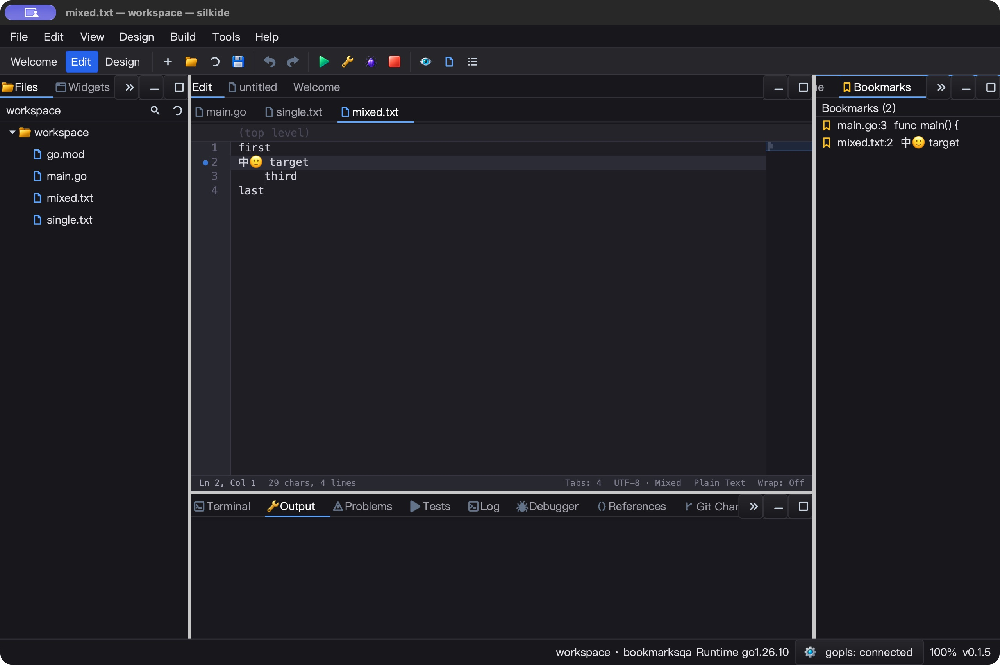
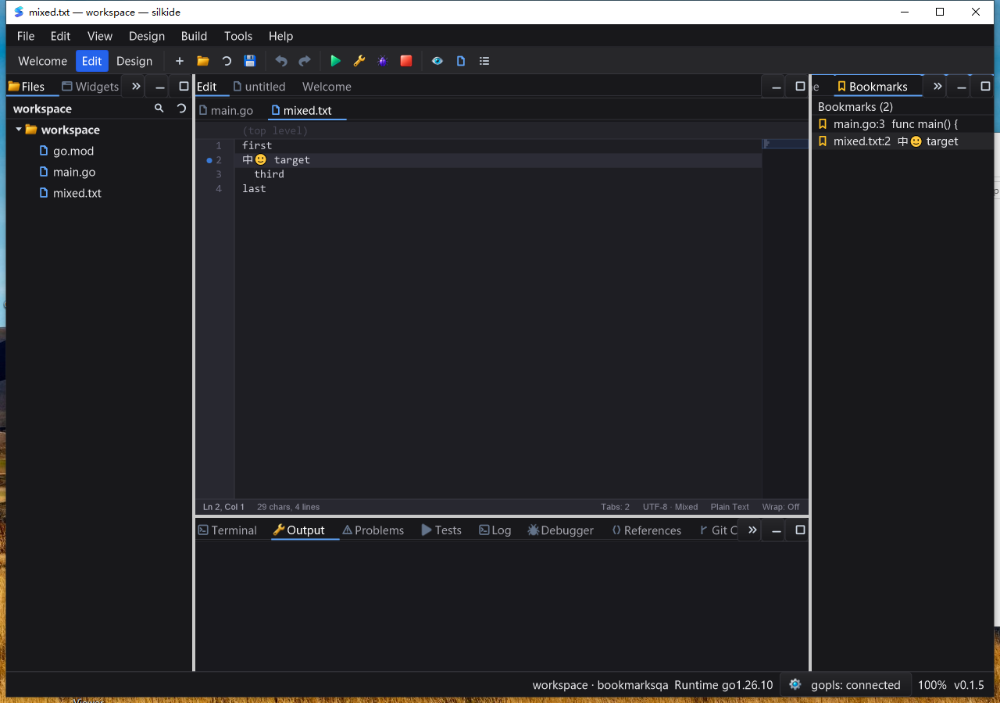
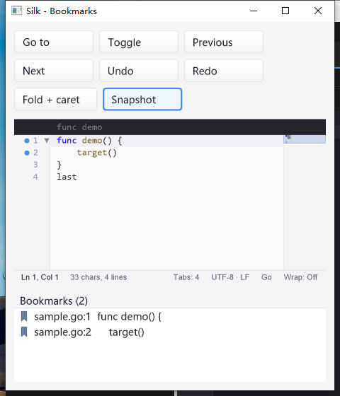

# Unified edit-aware bookmarks — 2026-10-25

## Changes

The old editor kept bookmarks at raw row numbers while the IDE panel had a
separate list. Baseline regressions reproduced marks not following insertion
and navigation retaining secondary carets or hidden folded targets.

The editor now owns live row anchors. Byte edits, line moves and line splices
map those anchors; text Undo/Redo restores deleted marks while the annotation
epoch remains unchanged. Explicitly removing a mark prevents later text Undo
from resurrecting it. Navigation reveals folds and retires selection/extra
carets. Annotation changes work in read-only buffers without changing text or
dirty state.

A workbench-owned coordinator synchronizes gutter, cross-file store, panel and
the existing asynchronous/coalesced preferences writer. Closed files retain
marks; reopened files reanchor from context. File/folder rename migrates marks.
Menu and palette commands capture document identity; shortcuts require editor
focus. Cmd/Ctrl+F2 toggles; Alt+F2 / Alt+Shift+F2 navigate across files; plain F2
remains Rename Symbol. Add Bookmark remains an idempotent palette alias.

The Bookmarks panel supports keyboard navigation and removal, uses theme
colors and existing scalable icons, sizes rows with the font and only draws
visible rows below a separately clipped header. The SDK exposes validated
batch/query/subscription APIs and `LineCount()`; see [SDK guide](docs/SDK_FEATURES.md).

## Automated acceptance

Go 1.26.10, native CGO, uncached `-count=1`; counts include subtests and overlapping
groups are not unique totals. Final source candidate only:

| Gate | Pass | Skip | Fail |
| --- | ---: | ---: | ---: |
| macOS arm64, 14-package `-race -short` | 4,891 | 45 | 0 |
| Windows 10 amd64, same native gate | 4,782 | 66 | 0 |
| macOS graph/prop/settings supplemental race gate | 238 | 1 | 0 |
| Required real bundled gopls, macOS | 3 | 0 | 0 |
| Required real bundled gopls, Windows | 3 | 0 | 0 |

Main packages: gui, ged, cmd/silkide, ide/bookmarks, settings, paint, purecairo
and editor bookmarks/goto/line-endings/readonly/clipboard/lines/indent examples.
Native IDE/SDK builds, bundle verification and macOS vet (`-composites=false`)
passed. The required gopls gate tests real completion/formatting, rename and
unsaved Unicode type/definition/implementation/back navigation, with no skips.

Focused tests cover precise byte mapping, newline merges, identical-body line
moves, EOF splice behavior, multi-caret edits, annotation epochs, full-buffer
reload, readonly navigation, observer retirement, persistence disk reload,
closed-file jumps, rename and stale menu/palette targets. Panel painter tests
cover light/dark themes, font sizes 12/24 and clipping with 5,000 rows.

The inline bookmark-map fast path in a 100,000-row fixture measured **1.986 ns/op,
0 B/op, 0 allocs/op** on the macOS host. This measures only no-op inline anchor
mapping, not full editing, persistence, worst-case large bookmark sets or frame
latency. There are no new idle timers or per-editor workers.

## macOS desktop verification

The SDK produced **13 exact JSON snapshots**: toggle; prefix insertion; Undo;
Redo; fold and add a second caret; Next (reveal and one caret); panel keyboard
removal; Undo without resurrection; add two marks; previous/next wrapping.
Text, marks, panel rows, caret, cursor count, dirty/undo/redo and folding fields
were checked. The final example uses `sample.go` so folding really executes;
an earlier plain-text sample attempt is archived and not accepted as fold QA.

The IDE passed native toggle, palette Show Bookmarks, prefix insertion/Save,
Undo/Save and cross-file navigation followed by a saved edit. Exact byte checks
preserved the mixed CRLF/LF Unicode fixture. Closing a marked file retained its
panel row; activating it reopened the file at the mark. After normal exit,
preferences contained the two expected marks. A fresh process restored both;
Clear File Bookmarks removed only the active file's mark. Final disk readback
confirmed the other mark remained and both source fixtures were unchanged.
Both SDK and IDE exited through the native application menu.

The macOS Edit menu's Bookmarks entry was inspected, but the capture API cropped
its separate submenu window. Complete submenu visual verification is not
claimed for macOS.

## Windows desktop verification

The SDK repeated the **13 exact snapshots**, identical field-for-field to the
validated macOS sequence. The 480-pixel window wrapped toolbar controls and
stacked the Bookmarks panel below the editor without overlap. The launching
task retained the process handle and recorded normal exit code 0.

The first trial typed `new` followed by Enter; Enter accepted the editor's
completion instead of inserting a newline. That trial was rejected, not counted
as a mapping pass. The accepted run used native clipboard paste of `new\n`,
matching the macOS input and exercising one insert/Undo transaction.

The Windows IDE passed **seven exact saved-byte checks** and **12 persisted
bookmark-state checks**: menu Toggle removes, Ctrl+F2 restores, prefix insertion
moves the anchor, Undo restores it, Alt+F2 jumps across files, closing a marked
file retains it, and activating its panel row reopens it at the correct line.
A fresh process restored both marks; palette Clear File Bookmarks removed only
the active file's mark and persisted that change without touching source text.
The full submenu was visually checked for icons, labels, shortcut hints and
checked state. All six desktop tasks returned LastTaskResult 0. Both IDE runs
and their owned gopls children exited normally; the relaunched IDE's retained
process handle recorded exit code 0. GUI launches used a clean system PATH,
without adding Go/gopls globally.

Both Windows apps responded in **5/5** idle samples over about five seconds.
SDK used 0.015625 CPU seconds (0.31% of one logical core); IDE used 0.15625 CPU
seconds (3.08%). This short observation is not a long-duration, input-latency or
system-wide CPU guarantee.

## Reproduction, evidence and limits

Run `go run ./examples/editor-bookmarks`. Toggle the second row, insert a line
before it, Undo/Redo, use Fold + caret then Next, remove through the panel and
Undo again. Snapshot prints the complete assertion state. In SilkIDE use
Edit → Bookmarks, the Command Palette and Show Bookmarks; close/reopen a marked
file, restart the application and verify persistence.

Raw evidence is in ignored `bin/qa-artifacts/editor-bookmarks-20261025/`, including
baseline failures, accepted JSON streams, source hashes, native screenshots,
snapshot/readback proofs and scripts. Host source freeze covers **1,621 inputs**.
Windows uses an immutable **1,801-file baseline plus 291-file overlay**, with
hashes verified before/after testing and native CGO builds.
Intermediate compile/palette failures were fixed before final gate reruns;
some test logs contain the existing prior-run/core.Close warning, not a claim
of empty stderr.

Full-buffer/provider replacements and closed-file reopens use bounded textual
context matching, not semantic identity; repeated identical text can be
ambiguous. Context over 1,024 bytes is not retained. Malformed or over-4-MiB
bookmark preferences are preserved rather than overwritten: live annotations
remain usable but are not persisted, with a warning. No recovery/reset UI was
added. Breakpoints are separate and were not rebased by this change.

Linux native GUI, all DPI/IME combinations and long-duration performance were
not revalidated. No full Qt Creator parity, new version tag or release-package
publication is claimed. SDK APIs and callbacks are UI-thread-only.
