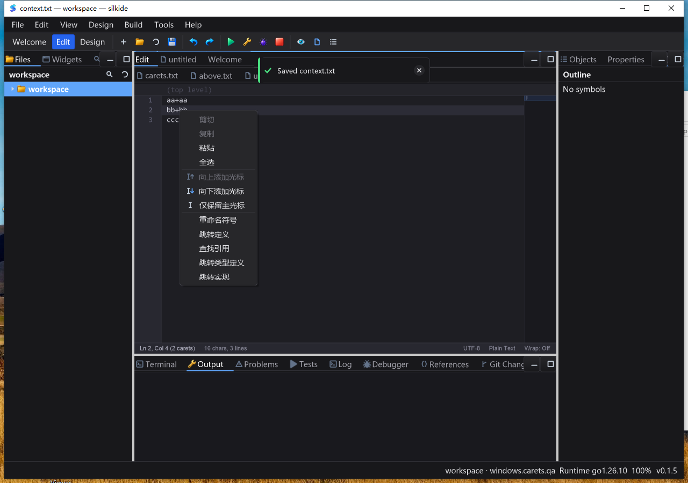

# 编辑器多光标命令与前缀定位优化（2026-10-24）

## 本轮变更

- Edit 菜单、命令面板、SDK 右键菜单增加向上/下添加光标及仅保留主光标；共用命令元数据，保持快捷键提示一致，边界按钮正确禁用。设计模式不会修改后台编辑器，旧菜单也不会误操作已切换的文档。
- SDK 新增 `CursorCount`、`CanAddCursorAbove/Below`、`AddCursorAbove/Below`、`KeepPrimaryCursor`。主光标保持不变，新光标所在折叠区域展开并滚入视野；成功操作关闭临时输入界面并返回编辑焦点，不改变文本、文档版本和撤销历史。详见 [编辑契约](gui/CODE_EDITOR_EDITS.md)。
- 状态栏显示光标数量；三个原生矢量图标遵循主题颜色及现有 DPI 变换。图标测试覆盖明暗主题和 16/20/24/32/48/64 像素尺寸。不是用模糊位图放大代替。
- 右键点击已有次光标时交换主次位置，避免同一位置被保留为重复光标。
- 光标坐标钳制、额外光标定位、视野滚动改为只转换所需前缀，不再为了定位行首而复制整条超长行。无折叠内容时避免额外折叠扫描。

## 单元、竞态与工具交付回归

- 先验证缺少 SDK API / 菜单入口时新增反例失败，再实现并回归。
- macOS arm64：7 包 `go test -race -short -count=1 -p 2`，**5,006 pass / 47 skip / 0 fail**（包含子测试）。Windows 10 22H2 / amd64 同组：**4,878 pass / 85 skip / 0 fail**。两端 7 包均通过：`internal/idetools`、`cmd/silktools`、`cmd/silkide`、`core`、`gui`、`ged`、`paint`。跳过项独立保留，不记为通过。
- macOS 新增命令/状态栏 pure-Go 渲染回归、7 包 `go vet -composites=false`、`make bundle-ide` 通过。
- macOS 实际 `.app` 内工具与 Windows 本轮应用旁工具分别执行真实 gopls 集成，均 **3 pass / 0 skip**，覆盖未保存 Unicode 补全/格式化、跨文件重命名及定义/类型/实现跳转。
- Windows 校验 1,801 文件不可变基线 + 53 个当前 overlay 输入，构建强制随包工具模式。当前 IDE SHA-256：`5820c01c542696b420bcb464eecf678b0f7c63148595fe02b62c4f22245f1c7a`；gopls：`5c409131c93b3d7136145492c5a39a08972fc483660beb4d2125a25447a79502`。

## 定位专项基准

同一 `BenchmarkEditorEnsureCaretVisiblePrefix`，光标在单行第 1 列，短行 80 字符与 4 MB 单行各测两次。Windows 旧版还单独验证了 43 个基线 overlay 输入和同一基准源码 SHA-256。

| 平台 / 场景 | 优化前 | 优化后 |
| --- | --- | --- |
| macOS / 80 字符 | 321–331 ns/op，516 B/op，4 allocs | 163 ns/op，160 B/op，2 allocs |
| macOS / 4 MB | 5.52–5.53 ms/op，约 16 MB/op，4 allocs | 161 ns/op，160 B/op，2 allocs |
| Windows / 80 字符 | 1.88–1.93 µs/op，516 B/op，4 allocs | 0.94–1.03 µs/op，160 B/op，2 allocs |
| Windows / 4 MB | 21.18–21.66 ms/op，约 16 MB/op，4 allocs | 0.92–1.92 µs/op，160 B/op，2 allocs |

**范围仅为光标视野定位，不等于整帧绘制、整次按键、行尾定位或大文件整体性能。** 绘制、命中测试等其他路径仍有整行测量/转换成本；不将上述基准冒充帧率或“彻底不卡顿”的证明。

## 原生 Windows UI

- Session 1 交互式桌面、新配置目录和项目、无全局 gopls 的继承 PATH，按哈希启动本轮最终二进制。随包 gopls 连接就绪。
- 编辑菜单点击 Add Cursor Below 后直接输入，确认两行同时修改；保存、撤销后保存、重做后保存均逐字读回。
- 命令面板 Keep Primary Cursor 后直接输入只修改原主光标；Add Cursor Above 保持第 3 行主光标并在第 2 行插入，撤销/重做准确。Esc 后只有主光标继续输入。
- 中文、emoji 混合行经菜单添加光标，在正确的 rune 列同时插入，保存/撤销/重做准确；截图核对两个光标位置与状态栏数量。
- SDK 右键添加光标，立即输入及保存/撤销/重做准确；右键点击第 2 行次光标后选择仅保留主光标，只有第 2 行继续修改，撤销准确。
- 上述共 **18 个保存/撤销/重做回读阶段**，记录在 `ui-evidence/save-stages.jsonl`。截图检查菜单禁用项、三个图标、状态栏及命令面板，无文字/按钮覆盖。SDK 右键菜单沿用现有中文文案；本轮没有把整个 SDK 菜单国际化。
- 4 MB 单行（4,194,305 个 ASCII 字符）打开后在行首定位，20 次左右导航再插入、保存逐字读回；撤销保存恢复原文。连同以上命令测试，共 **20 个回读阶段**；证据回收后独立计算每阶段预期 UTF-8 字节的 SHA-256，与 Windows 实际落盘哈希全部一致，排除仅文本相等但 BOM/编码变化的情况。
- 20 次导航 + 输入 + 保存脚本耗时 2.889 秒，包含 SendKeys 固定等待、文件读取和保存；打开脚本耗时 5.221 秒，也包含多段固定等待。它们不是按键延迟或 FPS 测量，不作流畅度认证。
- 空闲各测约 10 秒：短行 IDE CPU 0.234375 秒（约 2.30% 单核），gopls CPU 无增长；4 MB 单行 IDE CPU 0.140625 秒（约 1.39% 单核），gopls CPU 0.0625 秒。两组均 20/20 次 Responding=true，无窗口无响应，但这不是长期性能保证。
- 4 MB 场景一次内存采样 PrivateBytes 约 305 MiB、WorkingSet 约 267 MiB，明显高于此前短行样本约 75/43 MiB。当前仍有整行绘制、测量、缓存等成本，尚未做堆归因；不能称“超长行内存已优化完毕”，也不能仅由一次采样判定内存泄漏。
- 正常 Alt+F4 关闭，确认本轮应用目录下 IDE/gopls 进程全部回收，没有强杀或影响其他应用；清理本轮 7 个交互任务。

## 证据与限制

- Windows 最终证据包已核对 SHA-256：`477437de0ef63f0a2da284489993c57395b887c61208667d30968ad497a06ba7`。`summary.json` / `summarize.py` 汇总并复核两端 race、真实 gopls、20 个落盘字节哈希、53 个未变化源码输入及进程/任务回收。
- 原始证据：`bin/qa-artifacts/editor-carets-20261024/`，含 before 快照、失败反例、最终回归、原生脚本、输入文件、源码/二进制哈希与截图。
- 原生首轮脚本在新任务中重新激活主窗口后，误以为旧菜单仍然展开，点击落到文件树；文件未被修改，不能计作菜单测试通过。保留 `failed-menu-below.png` 和原始实际文件；修正为每次激活后重新打开菜单，以上 18 阶段全部通过，未为此修改产品代码。
- `targeted.log` 保留一次测试坐标设置错误：右键命中测试遗漏文本区 10 像素内边距。纠正 fixture 后 `targeted-final.log` 通过；没有为迎合错误坐标修改产品行为。
- 本轮 macOS 是构建、单测与真实 LSP 协议测试，未验证 macOS 桌面；Linux 桌面、Windows ARM64、真实 IME、混合 DPI、多选区编辑及所有菜单组合未覆盖。Windows 标准 Ctrl+Alt+Down 被桌面截获的问题未在本轮修复；新增菜单/命令面板入口不依赖该快捷键。
- 未 commit、Git push 或发布；保留既有工作区改动。
