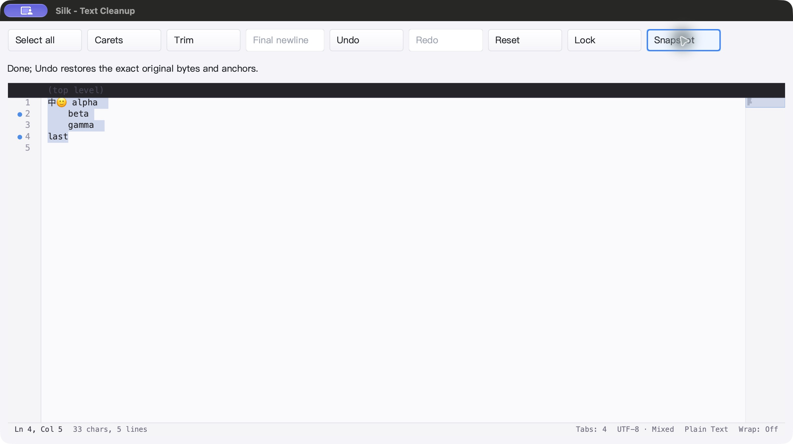
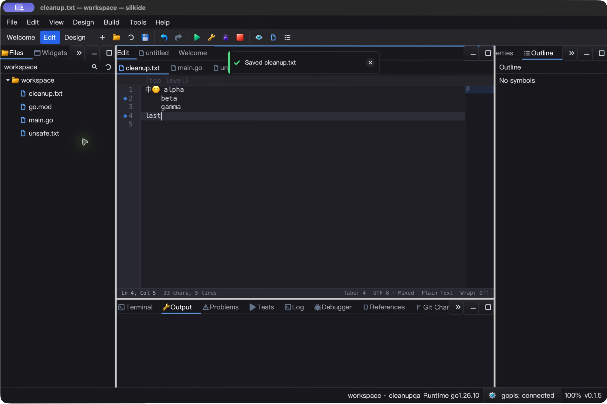
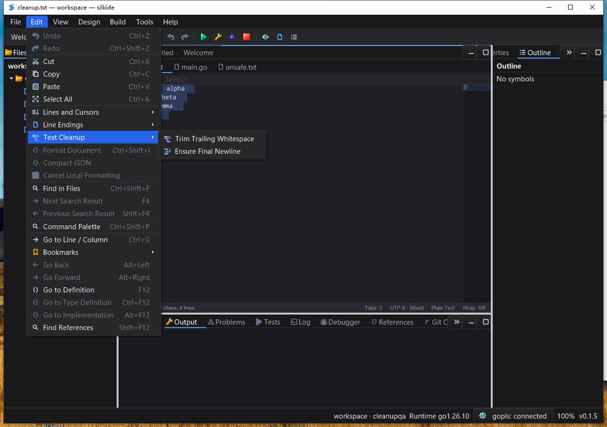
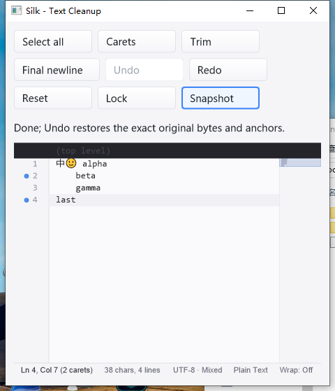

# 显式文本清理验收（2026-10-25）

本轮基于 `ef02f73`，修复行尾清理并加入文件末尾换行操作。不是自动保存格式化，
也不声称本轮覆盖整个设计器或所有平台。

## 修复与接口

- 原行尾清理漏掉 CRLF 前的空格／Tab，并丢失反向选区；先用回归测试确认失败，
  再改用现有字节编辑事务。只保存变化的空白尾部，不保存整篇文档的历史副本。
- 新增 `TrimTrailingWhitespaceChecked() error`、`HasFinalNewline() bool`、
  `EnsureFinalNewline() error`；保留原 `TrimTrailingWhitespace()` 签名。
- 保持 LF／CRLF、Unicode／无效 UTF-8、BOM／NUL、非 ASCII 空白、书签、反向选区
  和多光标；一次 Undo 撤销一整组，Redo 精确重放。无变化不增加 revision／历史。
- 独立 CR 可能被误解为分隔符时，拒绝整个事务；只读拒绝修改。
- Edit → Text Cleanup 与命令面板共用命令，捕获目标文档并检查焦点／只读／Design
  模式／过期目标。两个新矢量图标使用现有主题和设备缩放体系。
- `examples/editor-cleanup` 提供可折行工具栏、选区／多光标、撤销重做、只读与状态快照。
  没有新增空闲定时器、后台扫描器或保存钩子。

## macOS arm64

最终候选源码的 1,628 个构建输入 SHA-256 已冻结并回读核对。

- 15 个包 `go test -race -short -count=1 -p 2`：4,919 项通过、45 项跳过，0 失败
  （计数包含子测试；短模式／平台不适用的跳过不是通过）。
- `graph/prop/settings` 补充 race：238 项通过、1 项跳过。
- `go vet -composites=false`、SDK 示例与强制附带工具的 IDE 构建通过。
- 验证附带 gopls 清单；独立强制执行真实 gopls 补全／格式化、重命名、未保存 Unicode
  定义／类型／实现跳转 3 项，全部通过、无跳过。
- 原生 SDK 鼠标操作产生 18 份 JSON 快照，逐项核对文本、选区、revision、光标数量、
  书签、换行、dirty、Undo／Redo、只读；清理／追加／两次撤销／重做与只读拒绝通过。
- 实际 IDE 命令面板执行、保存及磁盘字节回读：混合 LF／CRLF 清理、追加偏好 CRLF、
  两次撤销恢复原始字节；歧义 CR 显示警告并保持原文件及其他文档不变。
- 两个应用均通过原生 Quit 退出，随后确认对应 PID 不存在；未把这一观察冒充捕获到退出码。

macOS 菜单的原生弹出子窗口截图会裁切子菜单，本轮不以该裁切图证明完整子菜单视觉。





## Windows 10 amd64

- Go 1.26.10、CGO 原生构建；验证 1,801 个基线文件与 298 个覆盖输入的哈希。
- 15 个包 `-race -short -count=1 -p 2`：4,810 项通过、66 项跳过，0 失败（含子测试）。
- 原生 SDK／IDE 构建、附带 gopls 清单校验及 3 项强制真实 gopls 集成测试通过。
- 干净 PATH 的交互桌面 SDK：18 份快照与 macOS 同样逐项通过；480×560 窄窗口
  工具栏自动折行、无控件覆盖；正常退出码 0。5 次健康采样均响应，5.09 秒 CPU
  增量 0.015625 秒（单核约 0.31%），只是该空闲片段，不是整机性能保证。
- IDE 原生菜单点击 Trim、命令面板 Ensure Final Newline、保存／两次 Undo／保存：
  四份磁盘字节回读通过。通过文件树打开歧义 CR 文档，断言活动标题后执行清理，
  确认警告、无 dirty 标记且保存字节未变；其他 Go 文档未改变。
- 完整子菜单截图检查两个独立图标、标签与布局；IDE 与其附带 gopls 均正常退出。
  SDK 与最终 IDE 交互计划任务 `LastTaskResult=0`。IDE 5 次采样均响应，5.11 秒 CPU
  增量 0.171875 秒（单核约 3.36%，包含保存提示消退），不据此推断长期帧率。





## 性能与范围

M2 Max、Go 1.26.10、GOMAXPROCS=2：10 万行无变更清理计划约 **178 µs/op、0 B/op、
0 allocs/op**；末尾换行状态查询约 **0.63 ns/op、0 B/op、0 allocs/op**。后者是
内联缓存查询微基准，不代表完整编辑或绘制耗时；发生实际修改仍需要更新正文与布局。
没有做跨版本整机性能对比，不宣称“零卡顿”或全平台帧率保证。

测试首次整合时发现纯转换测试调用 `SetFilePath` 启动异步 Git 探测，污染进程级分配
断言。改为测试内部直接设定文件类型，保留真实示例／IDE 的公开 API。既有剪贴板
零分配断言未放宽；隔离对照与组合重跑已保留。该修复只隔离测试，不修改生产 Git 行为。

原生自动化逐步核对活动文档标题与磁盘内容，避免保存提示覆盖页签时误点击
其他文档；被拒绝的初次脚本结果单独保留，不作为最终歧义 CR 验收。

没有本轮 Linux 原生 GUI、全量 IME／DPI／多显示器矩阵或长时间压力测试。
这些清理命令是显式文本操作，会删除 Markdown／原始字符串中有意义的尾空格，
不保证语义不变。不会自动压缩末尾空行，不改动原有换行类型。

## 重放与证据

```sh
go test -race -count=1 ./gui ./cmd/silkide ./paint ./examples/editor-cleanup
go run ./examples/editor-cleanup
```

示例操作：Snapshot → Select all → Trim → Final newline → Undo ×2 → Redo ×2；
Reset → Carets → Trim → Final newline → Undo ×2 → Lock → 尝试两项清理 → Lock。
每步 Snapshot，期望原有书签行不变；只读点击不改变文本、revision 或历史。

本地完整证据（不打包上传测试缓存／二进制）：
`bin/qa-artifacts/editor-cleanup-20261025/`，包括 `baseline.log`、`accepted-race.jsonl`、
`accepted-source-hashes.json`、`accepted-bundled-gopls.log`、`sdk.stdout`、
`validate-sdk.py`、`mac-ide-*.bin`、`rendered/` 与 `windows-accepted/`。
