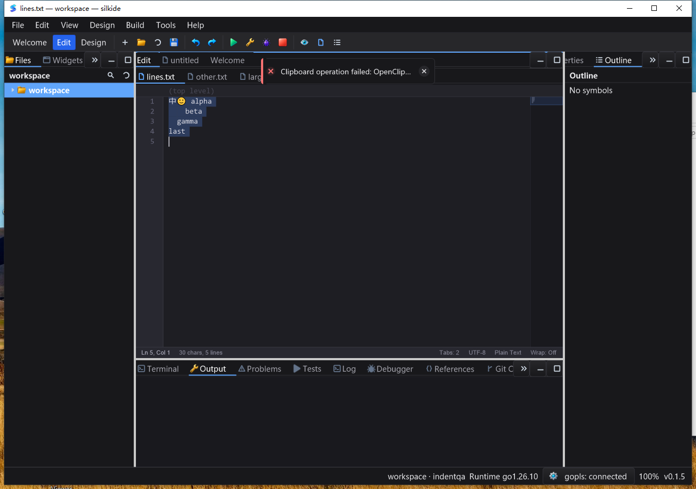

# Safe editor clipboard commands — 2026-10-25

## Changes

- Edit menu, Command Palette, keyboard and context menu share the SDK's
  `Copy() error`, `Cut() error`, `Paste()` and `SelectAll()` operations.
  Cut, Paste and Select All gain theme-aware vector icons; Copy reuses its icon.
- Copy/Cut validate NUL and the 16 MiB limit before native writes. Cut deletes
  source text only after the clipboard write succeeds. Failures preserve text,
  selection, revision, Undo and Redo. Empty-line Cut does not write the clipboard.
- Without a selection, Copy/Cut retain primary-line-only semantics and do not
  append LF. Select All clears secondary carets and cancels a pending paste.
- Availability queries do not allocate selected text or access native clipboard
  content. Opening a context menu no longer reads the Windows clipboard.
  `CanPaste` means permission to request a paste, not proof of clipboard content.
- Menu/palette commands bind the focused document before taking popup/modal
  focus, recheck its identity and restore focus before asynchronous paste.
  Search/property fields and hidden editor modes cannot mutate a background
  document through these commands. Other fields retain their own shortcuts.
- `examples/editor-clipboard` demonstrates SDK buttons, detachable history
  subscriptions, wrapping button layout and JSON state snapshots.

## Automated regression

Go 1.26.10; native builds and uncached tests (`-count=1`).

| Gate | Passed | Skipped | Failed |
| --- | ---: | ---: | ---: |
| macOS arm64, nine-package `-race -short` | 4,726 | 44 | 0 |
| Windows 10 amd64, same native race gate | 4,613 | 65 | 0 |
| macOS supplemental `graph`, `prop`, `settings` race gate | 238 | 1 | 0 |
| Required bundled gopls integration, macOS | 3 | 0 | 0 |
| Required bundled gopls integration, Windows | 3 | 0 | 0 |

The nine-package group is `gui`, `ged`, `cmd/silkide`, `settings`,
`examples/editor-lines`, `examples/editor-indent`, `examples/editor-clipboard`,
`paint`, `purecairo`. Groups overlap; do not sum them as unique tests.
macOS `go vet -composites=false`, both native IDE/SDK builds and both bundled-tool
verifiers passed. Required gopls tests cover unsaved Unicode completion and
formatting, rename, definition/type/implementation navigation and navigation back;
missing gopls cannot satisfy this separate gate by skipping.

Baseline regressions reproduced a destructive Cut on a rejected NUL payload and
four missing main-menu commands. New tests cover rejected/busy writes, preserved
Redo, Unicode/CRLF bytes, disabled/empty editors, oversized selections without
materialization, stale asynchronous paste, multi-caret Undo, focused text fields,
stale document bindings and palette focus capture. Queries on a 100,000-row
selection allocate zero bytes in the allocation test. Icon tests cover six sizes
in two themes; this is not exhaustive DPI/display validation.

## Native UI verification

Fixture: `中🙂 alpha\n    beta\n\tgamma\nlast\n`; second document `unchanged\n`;
large document: 100,000 rows, 1,700,000 bytes. Expected fixtures are separate from
saved outputs. macOS completed **16** exact saved-file byte comparisons; Windows
completed those **16 plus one native clipboard-busy check**:

1. Menu Copy current line, Paste, Undo.
2. Menu Select All, Cut, Paste, Undo and Redo.
3. Palette Select All, Cut and Paste; right-click Cut and Paste.
4. Multi-caret Paste and one-step Undo (Windows carets added through the menu).
5. Switch documents; palette Cut/Paste targets the new document only.
6. Menu copy/paste 1.7 MB and Undo, with byte-exact saved outputs.
7. Windows-only: a separate test process holds `OpenClipboard` while the IDE
   executes Cut. The error toast appears; all original bytes remain. The test
   releases the lock in `finally` and verifies the saved file.

Screenshots verify clipboard icons, search-field focus protection and disabled
commands in Welcome/Design. Each native SDK example passed **eight exact JSON
state comparisons**, including text, selection, availability, history flags,
caret counts/positions and no pending paste. The Windows example's buttons wrap
at 480 px width without covering the editor; its single-line explanatory label
is clipped at narrow widths, not wrapped. Both IDEs and SDK examples exited
normally, and the IDE-owned gopls processes exited too.

Windows idle sampling after the large-file workflow recorded **20/20 responsive
samples**, 0.140625 process CPU seconds over 10.162533 elapsed seconds (about 1.38%
of one core). This short sample is not a frame-time or long-duration guarantee.

## Open findings and coverage limits

Follow-up: [shortcut delivery investigation](EDITOR_SHORTCUT_HINTS_QA_20261025.md)
records the missing native key-down and a verified Shift-inclusive alternative.
The observations below remain the original clipboard iteration's results.

**Windows Ctrl+Alt+Down is not accepted as passing.** The IDE shortcut attempt
produced one caret rather than two. An independent SDK retry with a focused
editor also remained at one caret. Menu/SDK-button Add Caret followed by Paste
and Undo passed. The cause of the shortcut failure (input delivery versus app
routing) is not established, and it is not claimed fixed by this clipboard change.
The three extra SDK probe snapshots are retained separately from the eight
accepted clipboard snapshots.

Harness retries are retained: refocusing the Windows main window dismissed an
already-open menu, so the first Copy click missed; the corrected flow explicitly
reopened the menu. The inherited health helper accepts integer intervals, so
passing `0.5` caused division by zero after saved-file checks had completed; a
separate 20-sample/500 ms health and shutdown task passed. On macOS, file-search
and palette callbacks required waiting for results/state before Enter or Save.
No application source changes were made to conceal these harness failures.

This iteration does not add an independent CodeEditor ReadOnly property or route
all text-field clipboard commands through the IDE menu. macOS paste retains its
asynchronous target checks; other backends still use synchronous native reads.
Linux desktop, IME composition, all DPI/theme combinations and long-duration
stress were not revalidated. This is not complete Qt Creator parity.

## Evidence

Ignored artifacts: `bin/qa-artifacts/editor-clipboard-actions-20261025/`.
Windows root: `C:\silk\qa-editor-clipboard-actions-20261025-codex`.
The final source check matched **1,587 local build inputs** and the Windows
immutable **1,801-file baseline plus 248-file overlay**, including after UI tests.
Build logs, task results (including failed harness/probe attempts), binaries'
hashes, process identities, snapshots and byte-checked saved files are retained.
Windows GUI processes used an isolated data directory and clean system PATH.
