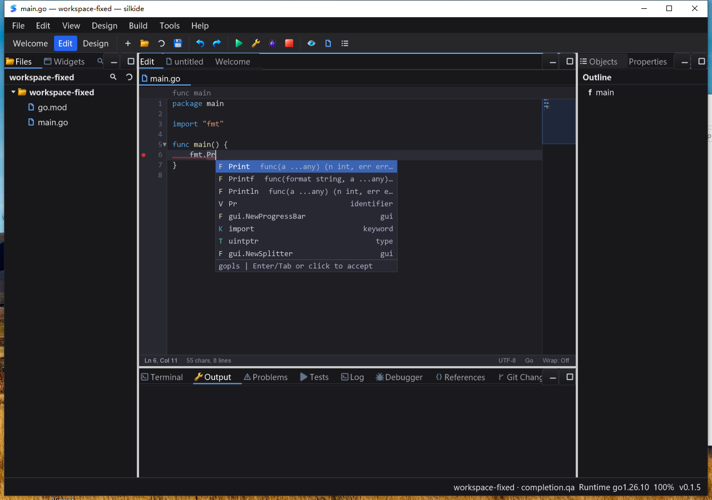

# 编辑器补全交互迭代验收（2026-10-23）

本轮承接 [gopls 随包交付修复](GOPLS_BUNDLE_QA_20261023.md)，范围是补全交互、失败反馈与热路径。未发布、未 commit/push；不代表编辑器全部功能或跨平台全部场景完成。

## 实际发现与修复

- Windows 基线已经从随包 `tools/gopls.exe` 得到真实 `Print/Printf/Println`；不是“所有补全都没有 gopls”。第一次 `go/packages.Load` 实测 **50.3095758 秒**，但 document worker 的补全请求 **2 秒**超时后静默丢弃错误，界面只剩本地候选。这一轮增加等待、超时重试、服务不可用反馈，没有声称消除冷索引耗时。
- 基线补全行没有指针命中处理：真机点击 `Println` 后保存仍为 `fmt.Pr`。现在点击/悬停、列表滚轮、PageUp/PageDown 共用绘制几何；列表内操作不移动正文光标或滚动正文，页脚不会点击穿透，外部点击/滚轮关闭列表。
- 补全布局使用正文的折叠行光标坐标；避开顶部栏、状态栏与小地图，根据剩余空间调整整行数。无空间绘制时不跨出控件绘制。
- SDK 增加 `CodeEditor.SetCompletionStatus` 与 `ExternalCompletion.Source`；gopls 结果带来源标记。反馈是静态文本、无轮询/动画计时器，不会把 Escape 关闭的列表重新打开。
- worker 错误走与结果相同的版本/关闭检查；UI 队列继续检查文档、会话、光标身份。错误消息不直接展示服务端任意载荷。补全请求在文件重命名期间退出，避免缺失 document 解引用。
- 修复本地候选接受时直接删前缀、未记录整笔替换的问题，改为一次可撤销/重做的原子编辑。负对照只还原原来的 `Accept` 方法后，新的撤销回归测试确实失败；当前实现通过。
- 可见行缓存已有排序，将光标行定位从线性扫描改成二分查找。10 万行补全布局/命中微基准从 **44.4–44.7 µs/op** 降到 **0.391–0.420 µs/op**，分配均为 325 B / 5 allocs；这是特定热路径，不是整个编辑器或每次按键的加速倍数。

## 自动测试

Go 1.26.10，显式包集合 `./gui ./cmd/silkide ./core ./internal/idetools ./cmd/silktools`；没有使用受 `local/` 限制的 `go test ./...`。计数包含子测试。

| 验证 | 结果 |
| --- | --- |
| macOS arm64，5 包 `-race -json -count=1` | **3,236 pass / 11 skip / 0 fail** |
| Windows amd64，5 包原生 `-race -json -count=1` | **3,111 pass / 46 skip / 0 fail** |
| 两个平台分别执行真实 bundled gopls 集成 | 各 **3 pass / 0 skip / 0 fail**，补齐上表中独立跳过的三个真实服务测试 |
| 最后补全聚焦回归 | **18 pass / 0 skip / 0 fail** |
| macOS `make bundle-ide` | 通过，更新 `bin/silkide` / `bin/SilkIDE.app`，再次校验随包工具 |
| 严格 `go vet` | 351 条未命名结构体字段告警；只还原本轮代码的 overlay 对照也是 351 条，归一化后 **无新增** |
| `go vet -composites=false`，同 5 包 | 通过；不将这个结果冒充严格 vet 全绿 |

新用例覆盖指针接受/页脚隔离、滚轮与翻页、选择随视口缩小保持可见、折叠光标定位、比例 1/1.25/1.5/2 的布局计算、状态长度/过期/关闭检查及失败投递。比例布局单测不是原生混合 DPI 验收。

Windows skip 包含 Git/Delve、平台/权限条件、需单独启用的原生 modal/IME 测试等。本轮没有将这些跳过项计为成功；协议集成与下面的 Session 1 桌面验证独立执行。

## Windows Session 1 桌面闭环

从不含 Go/gopls 的 Explorer 风格 PATH 启动，采用发布式非 race GUI，工作区和 APPDATA 独立隔离。读取实际子进程路径确认为 `apps-fixed\tools\gopls.exe`。

1. 显示真实 `Print/Printf/Println`、签名和 `gopls` 页脚；鼠标悬停选择 `Println`。
2. 指针接受 → Ctrl+S → 磁盘回读；撤销/保存回读为 `fmt.Pr`；重做/保存与接受后的内容完全一致。先规范化测试文件，避免保存格式化产生额外撤销步骤干扰断言。
3. **受控故障注入**：只暂停该 IDE 自己的、PID/父进程/路径均核对的 gopls 子进程。等待/超时页脚可见，IDE `Responding=true`；finally 恢复子进程。Escape 后恢复不会重开弹层；Ctrl+Space 重试再接受、保存成功。这是模拟服务停顿，不是新的冷启动性能数据。
4. `fmt.` 列表滚轮改变可见候选；PageDown/PageUp 改变选择而正文光标仍在第 6 行，保存内容不变。截图逐张复核，不只依赖脚本退出码。
5. 900×600 窗口中列表缩为 4 行和页脚，未盖住状态栏/输出区；恢复 1280×900。
6. 连续输入 20 行不同注释，保存回读全部存在；20 次响应采样均为 true。耗时 **1.785 秒**，包括脚本每行等待和保存，不是逐键延迟指标。
7. 静置 **10.172 秒**，IDE CPU 增量 **0.0625 秒**，约 **0.614% 单核 / 0.154% 四逻辑核整机占比**；20 次响应采样均为 true。短样本不证明长期资源稳定性或所有工程均无卡顿。
8. 点击原生关闭按钮正常退出，并确认所属 gopls 子进程已回收。

自动化边界：该会话普通 SendKeys 导航投递曾不可靠，复核后固定启动时记录的 Frame HWND；普通导航/编辑键通过 Win32 消息队列，组合快捷键仍用 SendKeys，点击/滚轮使用原生鼠标输入。这里证明真实窗口的路由与呈现，不等价于物理键盘/IME 完整认证。初轮 PowerShell 对未引用的 `-test.v` 参数分词失败，后续引用全部参数重跑了三个真实集成测试；初轮失败保留在证据中，不计为通过。



## 证据与复跑

```text
基线 HEAD: 1dd5c05432244057ecf67b0abbe6c91eb6a4ed0b（工作区原有变更保留）
本地: bin/qa-artifacts/editor-completion-20261023/
真机: C:\silk\qa-editor-completion-20261023-codex\
源快照: source-manifest.json，1782 个文件逐一 SHA-256 回读一致
最终 Windows IDE SHA-256:
8ffb8aa2cd5b1cf13f423dd753f92313366abffa1fc5e77188eb9a1e64b652d7
gopls SHA-256:
5c409131c93b3d7136145492c5a39a08972fc483660beb4d2125a25447a79502

windows-final/evidence/:
  windows-race.jsonl / windows-race.exit
  windows-real-lsp-retry.log / windows-real-lsp-retry.exit
  baseline-click-before.png / baseline-click-after.png
  accept-before.png / accept-hover.png / accept-after.png / redo.png
  accepted.go.txt / undo.go.txt / redo.go.txt
  provider-waiting.png / provider-timeout.png / dismissed-after-resume.png
  provider-recovered.png / list-wheel.png / list-pagedown.png / list-pageup.png
  popup-small-window.png / burst-saved.png / burst-saved.go.txt / health.json

macos-race.jsonl / macos-final-bundle-lsp.log
macos-vet.log / baseline-vet.log / macos-vet-no-composites.log
baseline-undo-negative.log（预期失败的负对照，不是当前代码的失败）
benchmark-baseline.log / benchmark-macos.log
```

构建后的新增差异只有 README、此报告和截图文档；本轮生产代码与真机源码校验清单一致。测试脚本、原始日志及失败尝试均保留在上述 QA 目录，没有修改 skill 原文件或其他测试工作区。

```sh
GOTOOLCHAIN=go1.26.10 go test -race -count=1 ./gui ./cmd/silkide ./core ./internal/idetools ./cmd/silktools
GOTOOLCHAIN=go1.26.10 go test ./gui -run '^$' -bench '^BenchmarkCompletionLargeFileHit$' -benchmem
GOTOOLCHAIN=go1.26.10 make bundle-ide
GOTOOLCHAIN=go1.26.10 bash scripts/test-bundled-gopls.sh bin/SilkIDE.app/Contents/MacOS
```

## 后续仍需处理

- 本地标识符候选收集仍同步遍历文件；上述二分优化不等于解决大文件输入的全部开销。下一步需要对候选索引、重算/取消与输入延迟单独采样和改进。
- 保存仍有同步 `gofmt` 子进程调用，需在保持保存/关闭一致性的前提下继续评估异步化。
- 极小 SDK 容器中的隐藏弹层键盘语义、所有补全种类图标、snippet、复杂 IME 与混合 DPI 仍需补齐。
- 本轮没有重跑 macOS GUI、Linux GUI、全部控件或所有菜单；不将 macOS 构建和协议测试当成这些桌面场景的通过。
