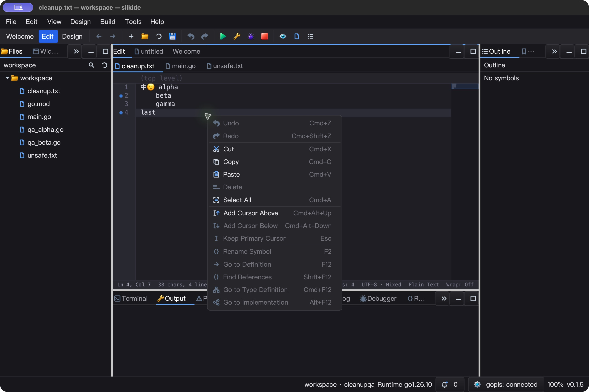
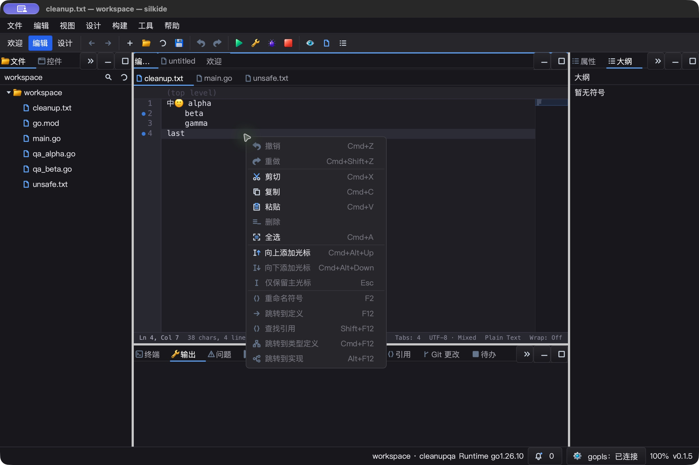
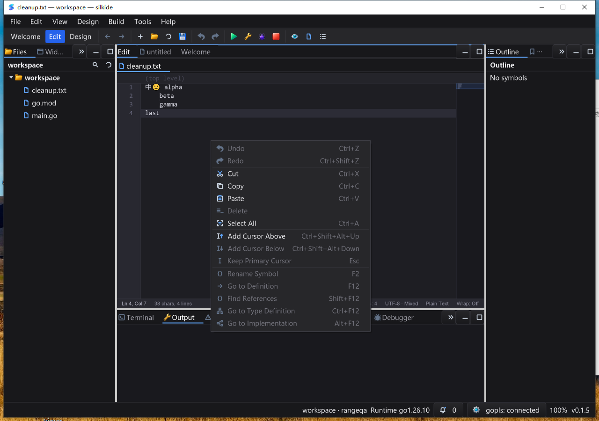

# 编辑器上下文菜单：功能、生命周期与性能验收

本轮聚焦 `CodeEditor` / 普通 `Edit` 和 SilkIDE 的菜单配合，不代表所有设计器控件或 Qt Creator 功能对齐已经完成。未发布、未提交、未推送。

## 本轮变更

- 代码编辑器默认菜单补充 **撤销、重做、仅删除选区**；15 个命令、3 个分隔行，每个命令都有已注册图标。
- 剪贴板、多光标、重命名和符号导航使用统一平台快捷键提示；IDE 重命名提示为实际注册的 `F2`，不误用 SDK 默认提示。
- 菜单使用当前语言，SDK 自带简体中文翻译及语言区域回退。宿主翻译仍能覆盖；重新打开时更新语言，不增加逐帧翻译。
- 右键按下定位或保留选区，抬起才打开菜单；拖离不打开。`Shift+F10` 在光标处打开；按键重复不重建弹窗。
- 一个编辑器复用一个自有 popup，关闭时清空菜单行，隐藏编辑器时关闭并作废旧命令。
- 菜单执行前和恢复焦点后校验文档 revision、路径、父级/窗口、光标、选区、多光标、只读状态及菜单版本。被替换的文档、宿主回调或编辑器不能被旧菜单误操作。
- `DeleteSelectedText()` 是单次可撤销编辑，恢复原始 UTF-8、混合行尾、选区方向和光标；没有选区时不删除当前行，不读取/写入剪贴板。只读/禁用时拒绝。
- 菜单只需要判断有无标识符，不再为此复制整个长行和整个单词。不调用 LSP、不读取剪贴板，不增加线程、计时器或轮询。

SDK 入口与覆盖约定见 [SDK 功能清单](docs/SDK_FEATURES.md#编辑器上下文菜单与可撤销选区删除)。

## 测试与来源

证据目录：`bin/qa-artifacts/editor-context-20261026/`。

- 冻结本轮 1,768 个源码输入；相对上一轮 17 个源码/测试文件变化。原始文件另存于 `before-source/`，不将此前工作区改动混作本轮新增。
- 修复前重放 `TestEditorContextStandardCommands` 会失败，准确报告缺少标准命令/图标和历史分组；当前版本通过。
- macOS：7 个包 `go test -race -short -json -count=1 -p1`，**6,143 个通过事件，48 个跳过，0 失败**；包含子测试，不是独立顶层测试数量。菜单/快捷键相关测试另跑 3 次。
- macOS 构建、内置工具验证和 `go vet -composites=false` 通过。
- 默认 `go vet` **并非全绿**：前后同为 452 条已有 composite literal 告警；归一化路径和行号后无新增/减少。
- Windows 10 真机：同 7 个包 `go test -race -short -json -count=1 -p1`，**5,943 个通过事件，70 个跳过，0 失败**；定向菜单/快捷键测试另跑 3 次，构建和内置工具校验通过。测试前后核对不可变基线 1,801 文件与 517 个 overlay 输入，未修改远端基线源码。

测试覆盖：所有命令/图标、快捷键元数据、本地化、只读/禁用、空选区、Unicode/非法 UTF-8 词存在性、20 次 popup 复用、失效命令、宿主 builder 覆盖、真实菜单 Action 的隐藏后单次分发及撤销历史。

## macOS 真实 UI

实际构建产物 `SilkEditorContextQA.app`，隔离配置与测试文档，通过 CUA 操作，不用内存注入代替真实输入。

- 英文环境：菜单全选 → 输入 → 保存 → 菜单撤销/重做；选区删除 → 保存空文件 → 撤销/重做；`Shift+F10` 打开与取消。
- 中文环境：独立启动，检查标签、图标、分隔线和快捷键；菜单全选、编辑、撤销、删除、恢复。
- **12 份文件回读断言**，额外连续 **3 轮删除/撤销**；最终恢复含中文、emoji、Tab、空格、CRLF/LF 的 43 字节基线。
- 两次早期坐标操作未产生预期结果，不计为通过；重新观察并打开菜单后通过，独立中文启动及连续重复也通过。尚未区分这两次无效果操作是输入投递还是应用状态因素，不能据此宣称零偶发问题。详情：`mac-automation-observations.json`。
- 两个测试实例都正常退出；空闲 5.009 秒采样累计 CPU 0.040 秒，约单核 **0.80%**。这不是长时间负载、输入延迟或 FPS 保证。





## Windows 10 真实 UI

- 在实际交互桌面 session 1 启动已验证的 `silkide-combo.exe`；PATH 不包含 Go/MSYS2，随包 gopls 已连接。
- 先截图确认本轮菜单坐标，再执行菜单全选、编辑保存、菜单撤销/重做、删除选区及删除撤销/重做；`Shift+F10` 菜单显示，Esc 取消不改文档。
- **16 份逐字节文件断言**，包含连续 3 轮删除/撤销；最终恢复同一 43 字节基线。原生截图显示撤销恢复了多行选区。
- 4 个交互任务均 `Ready / LastTaskResult=0`，输入前核对 PID、产物 hash、前台/点击窗口归属。关闭后本轮 IDE 与工具进程为 0。
- 空闲采样 5.017 秒：`Responding=true`，按该采样精度 CPU 增量为 0；不意味着所有场景零 CPU，也不是长期性能保证。
- 采集后再次校验源码、overlay、测试清单、脚本和二进制 hash，避免验证旧缓存或其他进程。



## 微基准（不是端到端弹窗耗时）

Apple M2 Max，旧实现 overlay 与当前实现各 5 次、每次 500ms；仅比较词存在性探测与菜单规格构建，**光标位于行首**，不包含文字绘制、图标加载或窗口显示。

| 输入行 | 旧中位数 | 新中位数 | 旧 bytes/op | 新 bytes/op |
| --- | ---: | ---: | ---: | ---: |
| 32 字节 | 789.6 ns | 694.1 ns | 1,344 | 1,632 |
| 1 MiB | 7.623 ms | 756.7 ns | 5,252,375 | 1,632 |

新增命令使短行菜单从 23 次分配升为 29 次；长行整行复制已去掉，但查询远处光标仍要遍历光标前缀，**不宣称所有光标位置 O(1)**。数据：`bench-comparison.json`、`before-bench.log`、`after-bench.log`。

## 范围和后续

- 本轮未验证 Linux 桌面、Windows 高 DPI、多显示器边缘、所有系统缩放组合，也不是发布包认证。
- 新增符号菜单的宿主路由/快捷键有自动测试；不代表每个 LSP 命令已在所有文档类型做端到端验证。
- 自定义菜单 builder 的回调由宿主自行校验；菜单本地化在创建时生效。
- UI 数据断言和短 CPU 采样不替代完整交互延迟测试。工作区还包含此前的设计器、布局、渲染等迭代，不在此重复认领。

## 复核入口

```sh
python3 bin/qa-artifacts/editor-context-20261026/verify-final.py
```

期望标记 `EDITOR_CONTEXT_SOURCE_TEST_NATIVE_VERIFIED`；这是对保留的源码、测试、文件回读、截图和产物清单的再次校验，不会重放原生输入。重新执行 UI 需使用隔离测试配置，按截图确认坐标，Windows 任务必须运行在交互桌面而非 SSH session 0。

```text
macOS silkide SHA-256:
eced0788a7484cf0ff10ab3a98fa4c275264d754a7b03350719096f24f2cffea
Windows silkide-combo.exe SHA-256:
87a678d59c0ba83c6b8dd43b29c90a12ea22b848dca7e5d64cdb98b9d57a0a45
```
