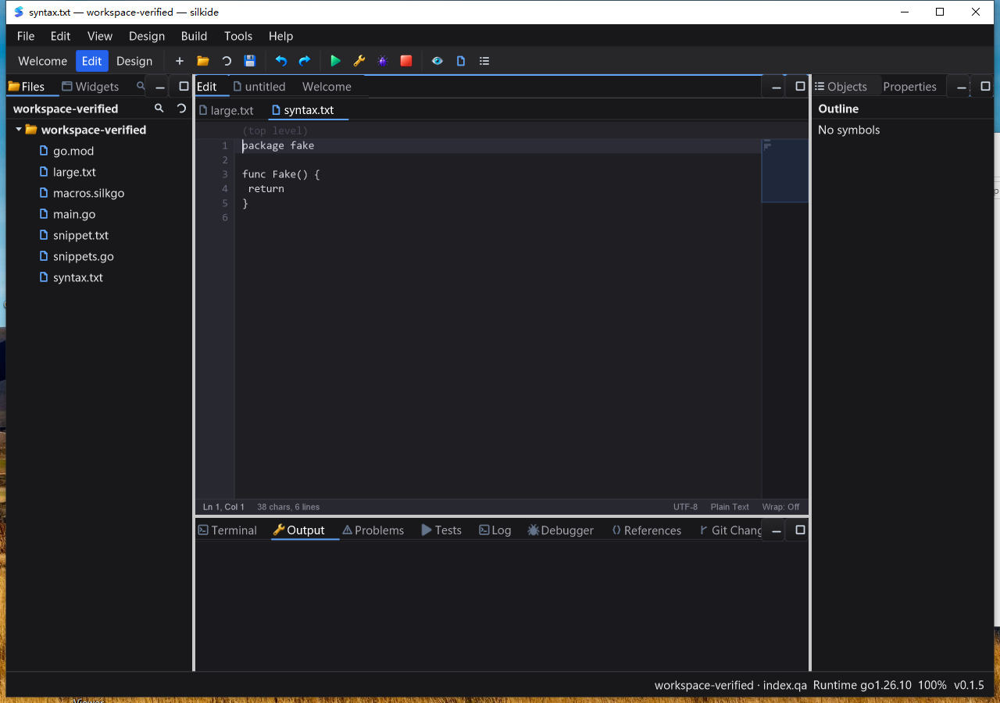

# 编辑器文件类型模式验收（2026-10-23）

承接 [后台补全索引 QA](EDITOR_INDEX_QA_20261023.md)。本轮修复非 Go 文件被当成 Go 的问题；不是新增完整的多语言 IDE，也不将词法补全等同于 gopls 语义服务。保留原有未提交修改，未 commit/push、未发布。

## 先更正一次截图判断

上轮将 `large.txt` 首次打开截图中的状态计数误读成空文档值。复查两份原始截图的 OCR，均为 **2200021 chars, 100003 lines**；本轮临时 Go overlay 记录第一次 `drawStatusBar` 调用，数据也相同，且没有先点击编辑区。新增首次绘制计数测试在修改生产代码之前就已通过。

因此这不是已经证实的计数刷新缺陷；没有为此添加刷新定时器、强制重绘或渲染层补丁。追踪只存在于独立 QA 副本／overlay，正式构建不包含它。上轮报告已同步更正。

## 真正复现与修复

- 负对照先复现：`notes.txt` 把 `func` 染成 Go 关键词、补出正文不存在的 `return`、状态栏显示 Go。随后加强 fixture，以合法 Go 形状的普通文本验证不再生成 Go 符号。
- SDK 新增 UI 线程 `CodeEditor.Language()`，根据文件名返回 `go`、`silkgo`、`plaintext`；扩展名不区分大小写。未命名 SDK 编辑器保留 Go 默认，其他已命名文件先按普通文本处理。
- 普通文本禁用内置 Go 高亮、符号解析、折叠、关键词种子、默认 Go 片段；仍保留全文件标识符补全。`FormatCode()` 只对 Go 生效，避免格式化普通文本或未展开的 SilkGo。
- 保留调用方显式安装的片段、高亮和符号；SilkGo 仍使用 Go 风格词法与宿主宏投影。没有把所有外部提供者一刀切禁用。
- 类型变化清除旧 token／符号／折叠／片段会话，取消旧索引、释放候选及旧文档引用。后台请求携带语言身份，UI 接收再次核对；相同文本版本也不能接收旧类型的异步结果。
- 改名导致的模式变化不改正文、dirty 状态或撤销记录。外部语言服务连接和文档协议仍由宿主管理，不能仅靠 `Language()` 代替 LSP 生命周期。
- **真实 UI 又抓出 Tab 路由缺口**：首次桌面用例中的 `iferr` 按 Tab 后正文未变，焦点跑到侧栏按钮；不是 gofmt 去掉尾部空白。窗口层优先执行焦点遍历，而 CodeEditor 没有实现既有 `IWantsTab`。新增窗口回调负对照也复现焦点转到 Button，再补齐接口，复用完整补全／查找／片段／缩进路径；Shift 状态显式传递，Ctrl／Alt／平台操作修饰的 Tab 留给宿主。增加 GLFW 窗口回调、Win32 HWND 消息（含 WM_CHAR／repeat 不重复插入）、片段前后跳转和选区反缩进测试。没有修改所有窗口的焦点遍历规则。
- **第二次桌面回归发现片段撤销损坏正文**：Go `iferr` 展开／保存通过，但 Undo 保存后变成 `iferrif err != nil ...`。新式片段的替换记录没有保存插入正文，旧式片段则记录了未补缩进的长度；Unicode／带缩进回归对照分别复现正文残留和尾部 `\t}` 残留。两条路径改为既有原子文本替换，保存完整新旧正文与光标；Undo／Redo／SetText／整段替换取消过期占位符会话。重做恢复文本和光标，不恢复旧占位符会话。

实现集中于 `gui/codeeditor_document_mode.go`、`gui/codeeditor.go`、`gui/codeeditor_symbols_cache.go`、`gui/code_completion_index*.go`、`gui/code_completion.go`、`gui/code_snippets.go`；测试位于 `gui/codeeditor_document_mode_test.go`。新增 SDK 使用说明见 [功能清单](docs/SDK_FEATURES.md)。

## 性能测量的边界

Apple M2 Max，Go 1.26.10，8000 个函数的相同内容，三次微基准；每次强制符号缓存失效。

| 文件模式 | `cachedSymbols` 时间 | 分配 |
| --- | --- | --- |
| Go | 6.48–6.70 ms/op | 约 9.99 MB / 96141 allocs |
| 普通文本 | 23.90–24.09 ns/op | 0 B / 0 allocs |

这是最终代码重新运行的微基准，衡量**不再对普通文本运行无关 Go 解析器**的语义隔离收益，不是 Go 解析器本身变快，也不是整次输入／布局／绘制快了同样倍数。全文件词法索引仍有实际后台开销。

## 自动测试

显式包集合：`./gui ./cmd/silkide ./core ./async ./internal/idetools ./cmd/silktools`，均禁用测试缓存。

- macOS arm64 六包 `-race -json -count=1`：最终 **3279 pass / 11 skip / 0 fail**，包含子测试。文件模式／Tab 修复阶段的 3272／3276 pass 仅为中间结果。
- Windows 10 amd64 六包原生 `-race -json -p 2 -count=1`：最终 **3154 pass / 46 skip / 0 fail**。`TestWindowsNativeTabReachesCodeEditor` 确实执行并通过，不是条件跳过。文件模式／Tab 修复阶段的 3147／3151 pass 不冒充最终结果。
- macOS 真实 `.app` 旁随包 gopls：未保存 Unicode 补全／格式化、重命名后的定义跳转、类型／实现及返回，**3 pass / 0 skip / 0 fail**。
- Windows 最终测试包强制使用自身 `tools\gopls.exe`，相同三个真实集成测试 **3 pass / 0 skip / 0 fail**。普通 race 的 Git／Delve／modal／IME 等条件跳过仍单独保留，不当作通过。
- `make bundle-ide` 通过，更新并校验 `bin/silkide`、`bin/SilkIDE.app` 及工具目录。
- 六包 `go vet -composites=false` 通过；未声称严格 vet 全绿，既有未命名结构体字段告警不在本轮修改范围。

初次新增用例误用了不存在的 `IsModified()`，编译失败后改为实际 `Modified()`；日志保留，不计作生产缺陷或最终通过。
Tab 用例曾误把仅含 `$0` 的 `iferr` 模板当成多占位片段，随后改用显式双占位模板验证前进／后退；默认 Go 模板仍独立验证展开。没有为迁就错误 fixture 改动片段语义。
Windows 最终构建脚本初次因替换 QA 目录名时误改了 DLL 来源路径，在编译前中止；修正脚本、保留失败日志后重跑。这不是编译失败或生产依赖缺失，不能把该次退出算作构建通过。

## 最终 Windows Session 1 桌面

使用新工作区 `workspace-verified`、独立 APPDATA／数据目录；最终 1796 个输入文件逐一 SHA-256 回读一致后构建。保留之前失败版本的归档、可执行文件与截图，不靠覆盖失败日志得出通过。

1. 打开约 2.2 MB、100000 个不同标识符的 `large.txt`，状态栏首次显示正确计数和 Plain Text。Ctrl+Space 出现文末 `RareRemoteValue`，只有本地相关候选，没有 Go 关键词／GUI 类型种子。
2. 指针接受 → 保存 → 整份文件回读，随后 Undo／Redo 分别严格匹配原文／接受后正文。更改前缀立即 Escape，迟到结果不重新弹出；Backspace 后候选可重新过滤，正文回读恢复原样。
3. Go 形状的 `syntax.txt` 仍为普通颜色，无 Go 符号／折叠；1280×900 和 900×600 截图中状态文字不覆盖。`macros.silkgo` 显示 SilkGo、Go 风格颜色及 MacroPreview 大纲。
4. `snippet.txt` 中原生 Tab 产生 `iferr\t\n`，不会展开 Go 模板。保存、Undo 保存、Redo 保存三次文件内容逐一匹配。
5. `snippets.go` 中原生 Tab 展开默认 `iferr`，保存为合法的缩进代码；Undo 保存完整恢复触发词，Redo 保存完整恢复展开正文。最终脚本得到 `NATIVE_GO_TAB_SNIPPET_SAVE_UNDO_REDO_OK`，不复用中间那次失败结果。
6. 大文件连续投递 12 个 ASCII 字符并保存，整份文件回读匹配，脚本耗时 **725 ms**（包含输入投递、保存和轮询，不是单键延迟）。测试／构建结束后静置 **10.223 秒**，IDE CPU 增量 **0.109375 秒**，约 **1.070% 单核**，相当于四逻辑核容量的 **0.267%**；20 次 Responding 检查全为 true。没有测整机总 CPU、帧率或长期稳定性。
7. 打开 `main.go`，看到 Print／Printf／Println 签名与 `gopls` 来源。指针接受 Println，保存、Undo 保存、Redo 保存均逐次回读匹配；实际服务器路径是本包 `apps-verified\tools\gopls.exe`，不是仅凭候选弹窗判断服务可用。
8. 点击原生关闭按钮，IDE PID 9984 与 gopls PID 4504 都正常退出，`clean-close.json` 两个退出字段为 true；没有强杀被测 IDE／服务器或其他用户应用。

逐张检查最终普通文本、窄窗口、片段、SilkGo 与 gopls 候选截图，不只信脚本返回值。普通键走固定 Frame HWND 消息队列，组合键走 SendKeys，指针走原生鼠标输入；不等于物理键盘／复杂 IME 认证。

QA 启动包装器一度使用 PowerShell `Start-Process -Wait` 等待整棵进程树，导致 IDE 正常运行而包装器等待其退出；它不是 IDE 无响应。修复包装器为只等待脚本进程退出，按精确命令行仅停止本轮包装器 PID，保留并确认 IDE Responding=true，随后用独立 Session 1 任务继续测试。原包装器失败结果保留，不算通过。



## 重放与证据

```sh
GOTOOLCHAIN=go1.26.10 go test -race -count=1 ./gui ./cmd/silkide ./core ./async ./internal/idetools ./cmd/silktools
GOTOOLCHAIN=go1.26.10 go test ./gui -run '^$' -bench '^BenchmarkDocumentSymbolDialect$' -benchmem -count=3
GOTOOLCHAIN=go1.26.10 make bundle-ide
GOTOOLCHAIN=go1.26.10 bash scripts/test-bundled-gopls.sh bin/SilkIDE.app/Contents/MacOS
```

本地原始证据：`bin/qa-artifacts/editor-status-20261023/`，包括修改前源码归档、负对照、增量 patch、双平台日志、SHA-256 清单、原生 UI 脚本与截图。Windows 独立目录：`C:\silk\qa-editor-status-20261023-codex`；源码上传后逐文件回读校验，不复用旧程序。

```text
基线 HEAD: 1dd5c05432244057ecf67b0abbe6c91eb6a4ed0b
最终源码: verified-source-manifest.json / verified-source.tar.gz
最终 Windows IDE SHA-256:
23687f65bd5ca1ff4a95927ea7abe053848c438486aa7fe0c199933249cbb112
随包 gopls SHA-256:
5c409131c93b3d7136145492c5a39a08972fc483660beb4d2125a25447a79502
最终 Windows 日志/截图: windows-verified/evidence-verified/
```

`verify-tested-source.py` 检查构建后只有文档变化；生产代码仍与真机清单一致。`summarize-evidence.py` 解析最终 JSONL 与进程／CPU 证据；最终 macOS 日志使用 `*-verified.*`，中间 `*-final.*`／`*-fixed.*` 不混为最终版本。

## 尚未覆盖

- 未添加 JSON／Markdown／go.mod 解析器、手动语言切换或多语言 LSP 管理器。
- Go 保存的同步格式化、高亮和大文件其他缓存成本尚未整体消除；没有宣称所有操作零卡顿。
- 片段展开复用完整文本历史快照，优先修复正文损坏；这不是局部增量历史压缩，大缓冲区的历史内存仍有优化空间。
- 本轮不代表 macOS 原生 GUI、Linux GUI、Win11、复杂 IME、物理键盘或混合 DPI 的验收。
- Go SDK 仍需安装；随包的是 gopls，不是完整 Go SDK、Git 或 Delve。
