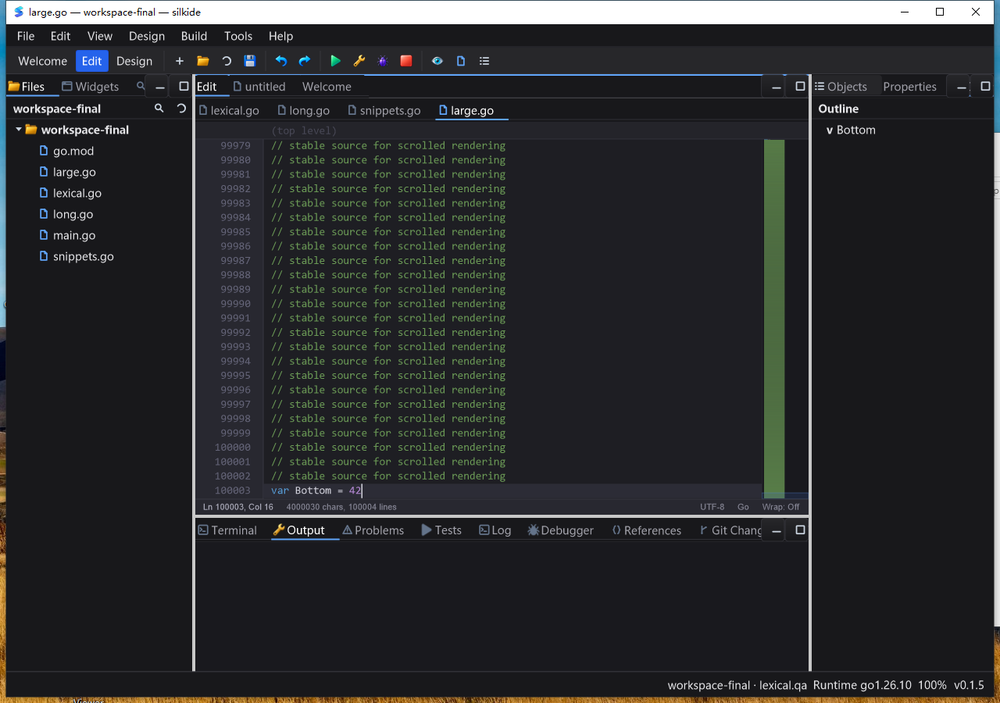

# 编辑器行号与 minimap 几何回归（2026-10-24）

本次继续解决 Windows 截图中可见的问题；不是整个 IDE/SDK 完成声明。保留工作区之前的全部未提交修改，未 commit/push/发布。

## 复现与修复

三项反例先在旧实现失败：

- 100,001 行、13/24 号字体：固定 50px 行号栏无法容纳六位数字和动作列。
- 水平滚动后正文的实际绘制裁剪仍从 x=0 开始，覆盖行号、断点等固定区域。
- 100k 行 minimap 的每行高度被强制至少 1px，只显示文档开头；底部视口生成 `y=100022, h=-99642` 的越界矩形。

正式改动：

1. 根据总行数和真实字体的数字宽度，在文本/字体变更时更新 gutter；数字与左侧动作列、右侧折叠/差异标记分区。绘制、鼠标命中、光标定位共用宽度。
2. 正文/选择背景/下划线/多光标在正文区域绘制；行号及标记单独绘制在固定裁剪区，水平滚动不再覆盖 gutter。
3. minimap 使用折叠后的可见行空间，按视口像素预算采样整个文档，包含首尾；小文档使用实际内容高度。显示与点击/拖拽使用同一几何模型，视口指示框始终在边界内。
4. 新增 minimap 视口拖动。点击或拖拽只滚动，不移动编辑光标、破坏选区或改动文件；释放鼠标、隐藏 minimap 时结束拖动。顶栏与状态栏不参与 minimap 命中，窄窗口让出正文空间。
5. 修正滚轮在折叠后仍用物理行数计算末端，以及跳行滚动上限遗漏顶/底栏高度的问题。
6. 缓存有界的 minimap 绘制片段，不缓存整份文档图像或字符串。文本、语义着色、语言模式、折叠、采样数、Tab 宽度变化时更新；仅滚动/光标闪烁复用。颜色在绘制时解析，主题切换不会沿用旧色。

## 性能证据

`BenchmarkEditorDrawScrolledGo`，macOS arm64，真实字体度量、空绘图后端、热缓存，不含 GPU、窗口合成或键盘延迟：

| 文档 | 修改前 | 正确几何但未缓存 minimap | 最终缓存版 |
| --- | --- | --- | --- |
| 1k 行 | 80.7–82.2 µs | 103.2–103.8 µs | 35.5–35.6 µs |
| 100k 行 | 87.7–89.1 µs | 119.9–120.3 µs | 40.2–40.3 µs |

100k 行最终热绘制 CPU 时间约下降 54%；分配由约 8.47KB/183 次变为 8.29KB/179 次。中间正确性改动曾增加开销，未把该阶段当作性能提升；随后缓存消除了每帧对分散源行重新哈希、读取词法状态和计算概览列宽的工作。缓存命中本身的零分配另有单测；整帧仍有分配。

## 回归范围

新增 `gui/codeeditor_geometry_test.go`：字体/位数、正文裁剪、尾部采样、空/极小/百万行坐标边界、点击拖动保留光标和选区、释放/隐藏、折叠/滚轮/跳行一致性、超长 token 工作预算，以及文本/语义/语言/Tab/折叠缓存失效。

最终平台单元测试与 Windows 原生 UI 结果见下方追加记录。不能用这些几何和热绘制测试证明大文件每次输入或同步 gofmt 已无阻塞。

## 证据

- 代码：`gui/codeeditor.go`、`gui/codeeditor_geometry.go`、`gui/codeeditor_geometry_test.go`。
- 本地：`bin/qa-artifacts/editor-geometry-20261023/`（任务开始于 10-23，测试跨午夜）。
- 远端：`C:\silk\qa-editor-geometry-20261023-codex`。
- `before-tests.log` 为三项旧实现反例，基准日志保留三个阶段，`increment.patch` 仅包含本轮增量。
- Windows 构建前核对 1,801 项冻结基础源码与 5 项 overlay 输入；其中两项为上一轮正式保存日志/测试增量。诊断环形探针不在本次正式构建内。

## 最终验证结果

- `go test -race -short -count=1 ./gui ./cmd/silkide`：macOS arm64 **2,540 pass / 10 skip / 0 fail**；Windows amd64 真机 **2,436 pass / 27 skip / 0 fail**。skip 保留在原始 JSON 日志中，包含 short 条件下的真实 LSP 集成及需要原生桌面的部分用例，不计入通过。
- 两包 `go vet -composites=false` 与 `git diff --check` 通过。构建完成后再次核对当前工作区代码：冻结基础已有文件仅 `cmd/silkide/main.go` 与 `gui/codeeditor.go` 不同；5 个 overlay 输入与最终工作区 SHA-256 全部一致。
- 最终 Windows 程序 SHA-256：`29ed8fcdd471e5d042f079c1419e87074c1ba4385b136af3f74cbce442830200`。

### Windows Session 1 实际 UI

使用独立 APPDATA/SILK_DATA_DIR 和工作区、真实随包 gopls、4,000,030 字节 / 100,004 行 fixture。没有修改系统 PATH。

1. 词法编辑、保存/撤销/重做和 Tab 片段保存流程通过。
2. 六位行号 `100000`–`100003` 完整显示；滚动长行并选中时，正文与选择背景仍在 gutter 右侧。已人工查看截图。
3. minimap 顶/中/底点击与上下拖拽后，正文分别显示开头、约 50,330 行和末尾，状态栏编辑光标仍在第 100003 行。截图像素检查在空白概览列 x=1018 观察到蓝色视口：顶部 y=179–186，中部 y=405–414，底部 y=630–638；拖拽上下与点击位置一致，均没有覆盖状态栏。
4. 从概览顶部直接键入并保存，全文回读确认后缀仍写在原来末行；再进行长行输入/保存和选区复制 → 概览点击/拖拽 → 再次复制，选区文本完全一致。最终磁盘为 4,000,131 字节，两次首次保存均成功。读取观察者明确允许读写/删除共享，没有引入上一轮发现的文件锁干扰。
5. 10.173 秒空闲采样：IDE CPU 时间 0.234375 秒，约 **2.30% 单核占用**，gopls CPU 增量 0；20/20 次 Responding=true。只是短时空闲观测，不代表 0 CPU、FPS、输入延迟或长期负载认证。
6. 正常关闭 IDE PID 4648、gopls PID 5208；再按精确测试程序路径枚举，测试程序及同路径派生进程剩余 0。

`final-evidence.tar.gz` 保存测试/桌面/关闭日志，`viewport-pixels.json` 保存视口像素边界，`summary.json` 汇总最终结果。未执行 Linux 桌面、物理键盘/真实 IME、全部控件组合或性能压力认证；每字符整文档工作及同步 gofmt 仍未在本次修复。
