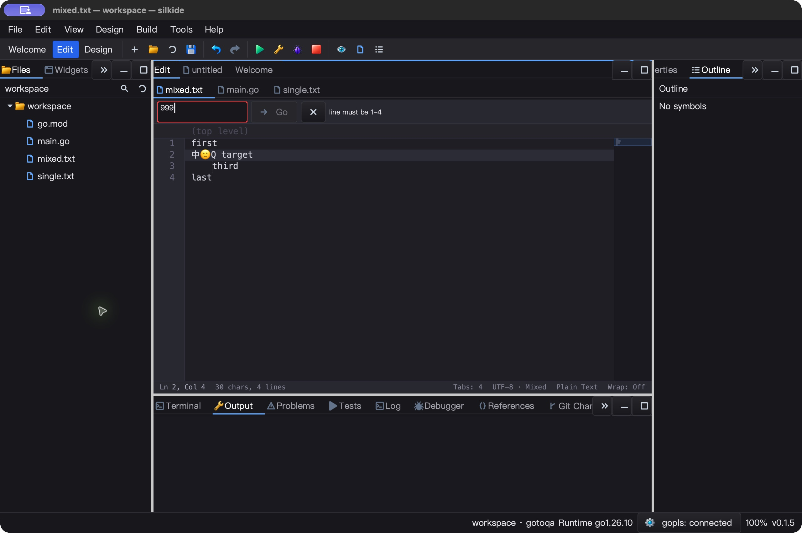
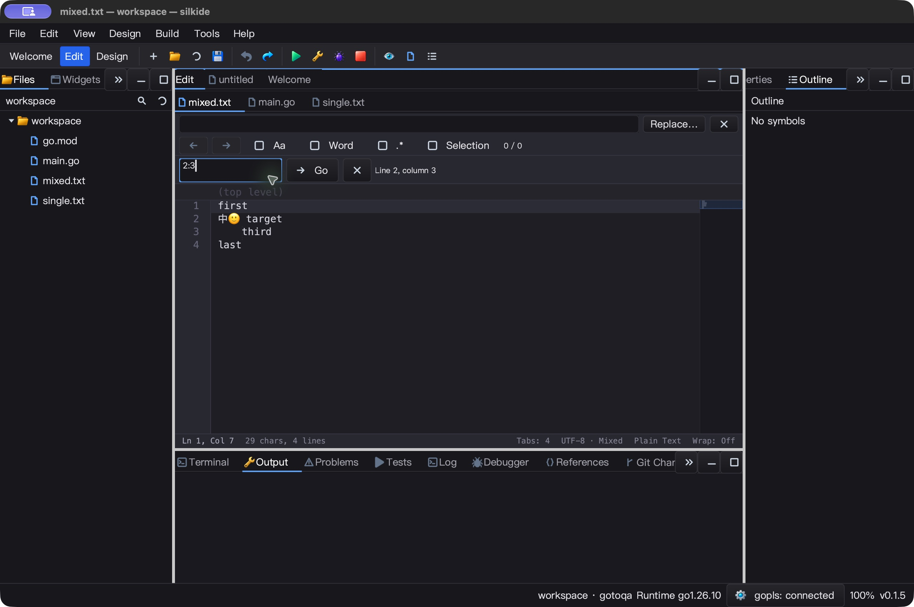
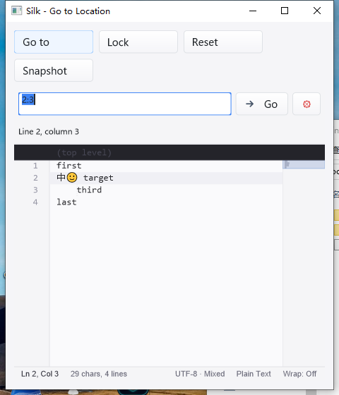

# Validated Go to Line / Column — 2026-10-25

## Fixes and scope

The original painted numeric-only pseudo-input discarded `:` from `2:3` and
silently clamped out-of-range line numbers to EOF. Both baseline regression
cases fail against the original implementation. The replacement is a real Edit
child of CodeEditor, not a separate window: native selection, clipboard, caret
editing, Enter, Escape, cached validation status, Go and Close buttons.

`ResolveGoToLocation` and `NavigateToLocation` accept one-based positive
`line[:column]`. Columns count Unicode code points, not graphemes, visual Tab
cells or LSP UTF-16 units. CRLF's CR is excluded; standalone CR remains content.
Invalid syntax, range and overflow are rejected before changing navigation
state. Read-only navigation reveals folds and clears stale selections/carets
without changing text or undo history. Input is bounded to 64 bytes in the API.

The bar stacks below Find, uses its measured height for drawing/hit testing,
and clamps child bounds in narrow/short panes. Closing/hiding the editor retires
input, pending paste and tooltips. Source Undo/format/rename shortcuts are
consumed while the query owns focus; the field itself does not implement Undo.
Menu/palette bindings capture document identity and reject stale targets.

Native inspection also exposed an existing generic Edit error-frame defect:
it painted opaque white under dark-theme text (1.27:1 contrast). The frame now
uses ViewBGColor or the read-only FormColor, retaining the red validation border.
A regression reproduces the old failure and checks both themes/read-only states
at >=4.5:1 text contrast. Go now explicitly shows both its icon and label.

## Automated acceptance

Go 1.26.10; uncached `-count=1`. Counts include subtests; overlapping groups are
not unique totals. Final candidate only:

| Gate | Pass | Skip | Fail |
| --- | ---: | ---: | ---: |
| macOS arm64, 12-package native `-race -short` | 4,849 | 45 | 0 |
| Windows 10 amd64, same native gate | 4,740 | 66 | 0 |
| macOS graph/prop/settings supplemental race gate | 238 | 1 | 0 |
| Required real bundled gopls, macOS | 3 | 0 | 0 |
| Required real bundled gopls, Windows | 3 | 0 | 0 |

Main packages: gui, ged, cmd/silkide, settings, paint, purecairo and the editor
GoTo/line-endings/readonly/clipboard/lines/indent examples. Native IDE/SDK builds,
bundle verification and macOS vet (`-composites=false`) passed. The gopls gate
requires real bundled completion/formatting, rename and navigation; no skips.

Focused tests cover Unicode coordinate units, CRLF, malformed UTF-8, invalid
range atomicity, field selection/paste, readonly folded targets, reload
revalidation, body focus, stale menu/palette targets, detach cleanup and Windows
WM_CHAR/WM_KEYDOWN dispatch. Layout checks cover widths 0, 64, 120, 200, 240,
400, 559, 560 and 800; the sample wraps at 920/480/220.

Valid `99999:3` lookup in a 100,000-row buffer measured **31.86 ns/op, 0 B/op,
0 allocs/op** on the host. This is a short-column lookup microbenchmark, not
worst-case long-line parsing, frame latency or overall IDE performance. There
are no new timers, workers or idle parsing loops.

## Native desktop checks

macOS final SDK: **12 exact JSON snapshots**, checking text, revision, dirty,
Undo/Redo, readonly, bar visibility, selection, caret and cursor count. Sequence:
invalid 999, Escape, paste 2:3, edit Q at the Unicode boundary, field Cmd+Z
isolation, accept 3:2, normal source Undo, readonly 4:5, host reload, unlock,
and field caret editing. The sample exited through the native application menu.

macOS final IDE: real Edit menu and Command Palette navigation each followed by
an edit, Save and exact byte comparison. Undo/Save restored the original mixed
CRLF/LF Unicode fixture. Invalid input stayed open, disabled Go, retained source
history and rendered legibly in dark mode. Find/GoTo stacking was visually
checked. Go document language service remained connected; IDE and its owned
gopls process exited normally.

Windows 10 final SDK repeated **12 exact snapshots** using native SendKeys,
including literal `2:3`, query Home/Delete editing, invalid Enter, Escape,
source-history isolation and readonly navigation. A 480-pixel window showed
wrapped toolbar buttons and the GoTo status on a separate row without overlap.
The launching task retained the process handle and recorded exit code 0.

Windows final IDE passed **five exact saved-byte checks**: menu Unicode-column
insertion, invalid query retaining source/history, Undo restoring mixed bytes,
palette column insertion, and Undo restoring again. Menu shortcut/icon, dark
validation and connected bundled gopls were visually checked. IDE and its owned
gopls exited normally; all four acceptance tasks returned LastTaskResult 0.
The GUI used a clean system PATH, without globally adding Go/gopls to PATH.

Both Windows apps were responsive in 5/5 samples over approximately five seconds.
Each used 0.09375 CPU seconds in that interval (about 1.85% of one logical core).
This is a short idle observation, not a long-duration or system-wide CPU guarantee.

## Reproduction and evidence

SDK: `go run ./examples/editor-goto`. Try `999` then Enter, Escape, `2:3`,
readonly `4:5`, and editing the query with selection/Home/Backspace. IDE:
Edit → Go to Line / Column, or Cmd/Ctrl+G; Command Palette uses the same name.

Raw evidence lives in ignored `bin/qa-artifacts/editor-goto-20261025/`: baseline
failures, source manifests, uncached JSON test streams, native logs, saved-byte
proofs, SDK snapshot validators and before/after screenshots. Host freeze:
**1,615 inputs**. Windows uses an immutable **1,801-file baseline plus 281-file
final overlay**, with hashes verified before/after testing. Initial candidate
results are archived separately and are not used as the final theme-fix gate.

The first macOS synthetic `typeText("3:2")` delivered `32`; explicit punctuation
injection also varied with the input environment. That trial was not counted as
a successful navigation. Final macOS column tests used native clipboard paste
with visible query verification. This does not certify every keyboard layout or
IME. Windows desktop uses native SendKeys after resetting key/IME state.
Intermediate compile errors are retained; final gates were rerun after fixes.
Some test startup logs retain the existing prior-run/core.Close warning; native
macOS logs contain OS input-manager notices and gopls tracing, not empty stderr.

Linux native GUI, all DPI/IME combinations and long-duration performance were
not revalidated. Extremely small panes keep controls in bounds but cannot make
all labels readable. No relative-location syntax, query Undo, new navigation
history integration, full Qt Creator parity, version tag or release-package
publication is claimed. SDK calls are UI-thread-only.
