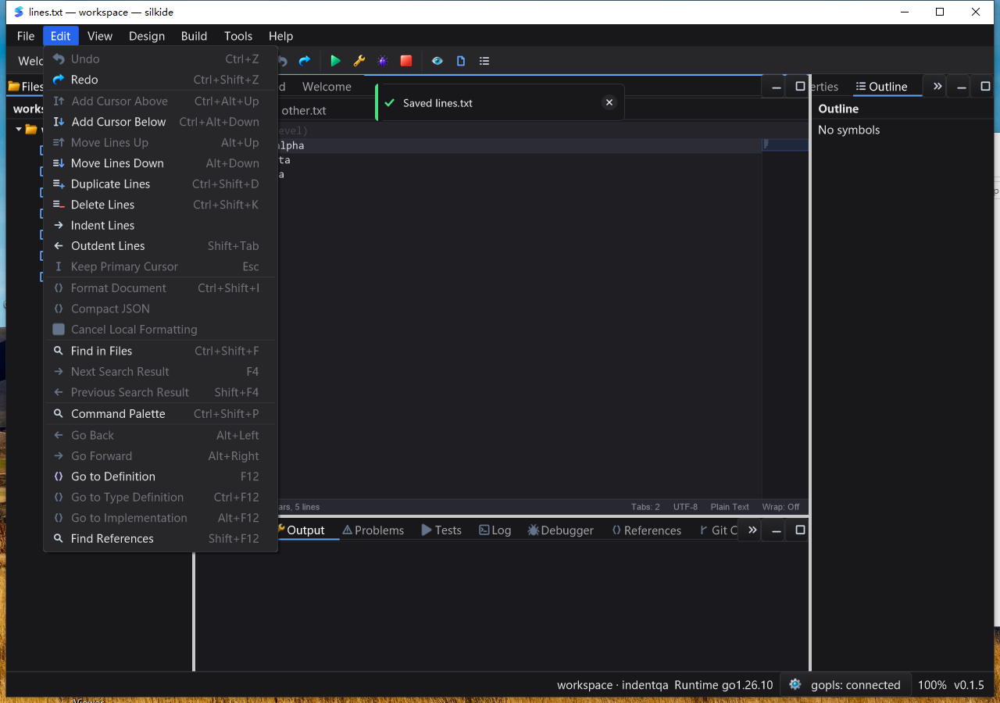

# History-aware editor actions — 2026-10-25

## Scope

This iteration synchronizes Undo/Redo availability across the visible document's
menu, toolbar and command palette. It is not a claim of complete Qt Creator
parity or of eliminating every editor/rendering performance issue.

- `CodeEditor.CanUndo` / `CanRedo` are constant-time, UI-thread-only queries,
  independent of the saved/modified flag.
- `SubscribeHistoryChanged` publishes availability transitions after completed
  edits, Undo/Redo and `SetText` resets. It supports multiple detachable listeners
  without replacing `SigChanged`; unchanged typing, save and caret movement do
  not publish availability events.
- Toolbar subscriptions follow tab/mode changes and detach on toolbar rebuild
  and shutdown. Unchanged availability does not touch action revisions or
  request a button repaint. No new timer was added.
- Menus capture document identity and refuse to undo a different editor after
  a tab switch. Unavailable palette commands remain discoverable with an explicit
  label, do not dismiss the palette and are rechecked before execution.
- Designer pending drafts remain eligible for commit-before-Undo. Pending edits
  disable Redo to avoid discarding its branch; failed commits preserve the draft.
  `GedScene.HasPendingEdits` is a query, not a commit operation.

## Automated regression

Go 1.26.10, real native builds; tests run with `-count=1`, not cached results.

| Gate | Passed | Skipped | Failed |
| --- | ---: | ---: | ---: |
| macOS arm64: eight-package `-race -short` | 4,714 | 44 | 0 |
| Windows 10 amd64: same eight-package native race gate | 4,601 | 65 | 0 |
| macOS supplemental `graph`, `prop`, `settings` race gate | 238 | 1 | 0 |
| Required bundled gopls integration, macOS | 3 | 0 | 0 |
| Required bundled gopls integration, Windows | 3 | 0 | 0 |

Package groups overlap: these numbers must not be summed as unique tests.
The eight-package gate covers `gui`, `ged`, `cmd/silkide`, `settings`,
`examples/editor-lines`, `examples/editor-indent`, `paint`, `purecairo`.
macOS `go vet -composites=false` and native IDE/SDK builds passed.
Both bundle verifiers passed. Required gopls tests cover unsaved Unicode
completion/formatting, rename, type/implementation navigation and back navigation.
Conditional skips in the short gate are not counted as coverage; the separate
required gopls gate does not permit a missing language server to pass as a skip.

The baseline was red for empty-history menu/toolbar state and stale-menu
cross-document Undo. New regression tests cover transitions, resets, edit kinds,
subscriber lifetime, tab/mode isolation, palette guards, pending drafts and idle
action revisions. An old test expected two design-change notifications from
Undo/Redo on an empty stack. It now explicitly checks **zero** notifications for
no-ops, then checks real push/Undo/Redo notifications. The first full gate failure
from that obsolete assertion is preserved separately from final acceptance.

## Native UI replay

The isolated IDE fixture contains `中🙂 alpha`, indented `beta`, tab-indented
`gamma`, and `last`, with LF line endings. A second document starts with
`unchanged\n`; the large fixture has 100,000 rows and 1,700,000 bytes.

Both macOS and Windows native IDEs completed 17 saved-file byte comparisons each:

1. Duplicate; menu Undo/Redo; toolbar Undo/Redo; shortcut Undo.
2. Delete to create a new history branch; Undo, Redo, restore.
3. Switch document, type `X`, toolbar Undo/Redo; close/reopen and check empty
   history; return to the original document and use palette Redo/Undo.
4. Duplicate in the large document and undo from the toolbar.

Screenshots also verified empty-stack disabled controls, the unavailable palette
entry remaining open after Enter, reopened-document history reset, and disabled
history in Welcome/empty Design modes. The SDK example completed eight exact
JSON comparisons on **each platform**, covering text, caret count/position,
line-operation availability and both history flags across single-/multi-caret
duplicate/delete/Undo/Redo. Windows IDE and SDK processes exited normally.

The original isolated macOS IDE exited normally via Cmd+Q. A post-exit computer-use
observation unexpectedly relaunched the QA bundle without fixture arguments;
only those owned relaunch processes were terminated. This automation artifact is
recorded separately and is not presented as another isolated UI test. The SDK
exited normally without a post-exit UI observation.

Windows harness retries are not hidden: the inherited `Get-AllWindows` helper
tried to assign PowerShell's read-only `$PID`; the probe was replaced with a
foreground-window title check. A subsequent script initially sent Escape before
focusing the still-open palette, leaving the original fixture unchanged. The
corrected replay focused its recorded modal handle first, then completed all 17
byte comparisons. Neither retry required an application source change.

## Performance and limitations

The 100,000-row availability microbenchmark on Apple M2 Max reported
`1.973 ns/op`, `0 B/op`, `0 allocs/op`. This measures only the availability helper
and unchanged notification path; compiler optimization applies. It is **not**
keystroke latency, frame time or an end-to-end renderer benchmark.

Designer pending-draft changes do not introduce a new draft-state event: menu
queries are immediate, while toolbar updates can use the existing workbench
heartbeat. The editor's history subscription is event-driven.

Linux native desktop, long-duration stress, IME composition, and all supported
themes/DPI combinations were not revalidated in this iteration. Palette disabled
items currently use an unavailable suffix rather than a special disabled-row
color. This iteration does not redesign that list renderer.

Windows idle sampling after the large-file workflow recorded 20/20 responsive
samples, 0.0625 process CPU seconds over 10.187 seconds elapsed (about 0.61% of one
CPU core). This short sample is not a long-duration leak or latency guarantee.

## Evidence location

Local ignored artifacts: `bin/qa-artifacts/editor-history-state-20261025/`.
Windows isolated root: `C:\silk\qa-editor-history-state-20261025-codex`.
Tests and builds used a frozen manifest of 1,580 local inputs. Windows uses the
immutable 1,801-file native baseline plus a hash-verified 239-file overlay.
Original fixtures and expected bytes are kept separately from UI-saved outputs.
The QA binaries, workspace, environment and process identities are recorded;
the Windows GUI launches with a clean system PATH and bundled language tools.
