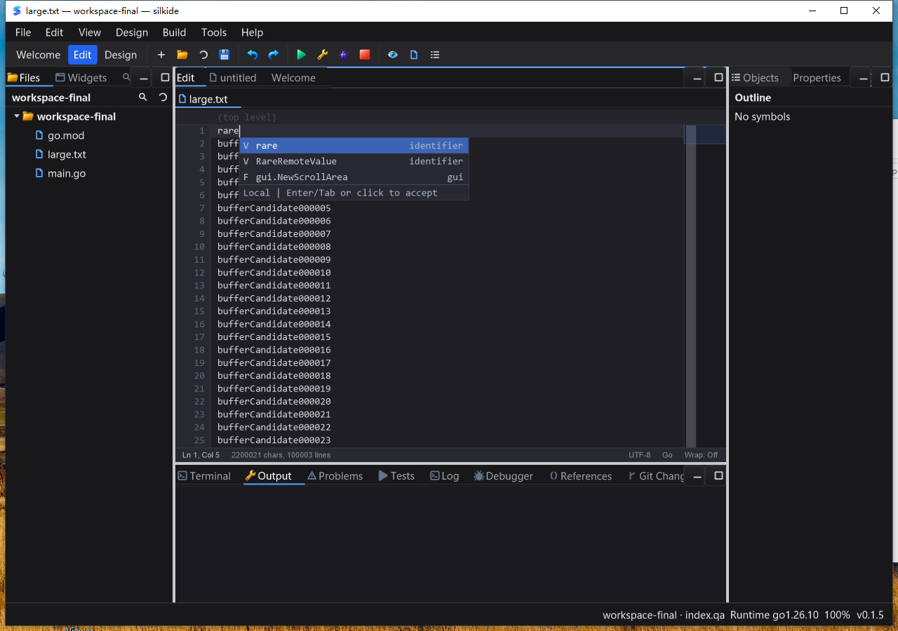

# 编辑器后台补全索引验收（2026-10-23）

承接 [补全交互验收](EDITOR_COMPLETION_QA_20261023.md)。本轮只处理本地候选的同步全文件扫描／排序、取消／关闭生命周期，以及不可见列表的键盘接受；不等于整个编辑器输入链路或全部控件已经无卡顿。未 commit/push、未发布。

## 实际修复

- 大于 32 KiB 的文本使用不可变快照后台索引，90 ms 静默期合并输入；每个编辑器至多一个活跃 worker 和一个最新请求，全局至多两份扫描／排序并行。任务完成后退出 goroutine，没有静置轮询或动画重绘。
- **扫描与排序都离开 UI 线程**；词法候选仍覆盖完整文档，不截断到光标附近。固定大小 top-50 堆与既有模糊匹配排序保持同样的顺序／去重语义；同版本文档切换前缀可复用索引。
- 后台只处理字符串和值快照，不访问编辑器可变行；每隔有限字符／候选检查取消。投递通过 `async.Latest` 合并，UI 再核对请求代数、文本版本、光标、前缀和打开意图。迟到的本地结果不能把用户已选的 gopls 候选跳走。
- Escape、失焦、文本替换、光标变化或页签关闭抑制过期结果；页签和主窗口关闭会释放索引与投递闭包。SDK 增加 `CancelCompletion()`、`CompletionIndexLoading()`，使用约定见 [SDK 清单](docs/SDK_FEATURES.md)。
- 窗口缩小到无空间绘制候选时，Enter/Tab 回到正常编辑语义，而不是接受不可见选择；在按键处理前重算几何，不依赖下一次 paint。Backspace 仍可在修改使旧索引失效后重新过滤。
- 全量测试首次发现宏编辑器用例未设置任何可绘制尺寸，却断言 Enter 接受候选。为 fixture 设置 800×500，保留生产代码拒绝不可见选择的行为；初次失败日志保留。
- 收尾复核还发现等待期的临时候选把 `var`／`string` 添加两次。新增负对照先复现两份，再在有界静态列表中去重，保留关键词／类型的原始 kind；修复后重建并重新执行双平台 race、真实随包 gopls 和 Windows 桌面流程。

## 微基准：不是整次按键延迟

Apple M2 Max、Go 1.26.10，每项三次；输入包含 10 万个不同标识符。

| 路径 | 修改前 | 修改后 |
| --- | --- | --- |
| `CompletionPopup.Show`，10 万行 | 47.14–48.37 ms/op；约 53.08 MB、200583 allocs/op | 8.31–9.28 µs/op；约 21.3 KB、27 allocs/op |
| 同入口，1000 行同步路径 | 422–426 µs/op；约 461 KB、2056 allocs/op | 347–349 µs/op；约 453 KB、49 allocs/op |
| 完整扫描及 top-K（新后台工作量，直接调用纯函数测量） | — | 35.55–38.43 ms/op；约 41.50 MB、573 allocs/op |

前两项复用编辑器已有文本快照，并重复请求同一前缀；**不包含一次完整编辑的文本缓存、高亮、布局、保存或屏幕呈现**。后台计算仍有 CPU／内存开销，不能将入口耗时变化宣称为整次输入加速几千倍。

## 自动测试

显式包集合：`./gui ./cmd/silkide ./core ./async ./internal/idetools ./cmd/silktools`。

- macOS arm64：`-race -json -count=1`，**3262 pass / 11 skip / 0 fail**，计数含子测试。
- Windows amd64：同六包原生 `-race -json -p 2 -count=1`，**3137 pass / 46 skip / 0 fail**。
- macOS `.app/Contents/MacOS` 旁真实随包 gopls：**3 pass / 0 skip / 0 fail**；未保存 Unicode 补全／格式化、重命名后定义、类型／实现及返回。
- Windows 也单独强制 bundled gopls 执行相同三个集成测试：**3 pass / 0 skip / 0 fail**。普通 race 中的条件 skip 不冒充通过；Git／Delve、原生 modal／IME 等未启用项目仍保留边界。
- `make bundle-ide` 通过；更新 `bin/silkide` 与 `bin/SilkIDE.app` 并校验工具完整性。
- 六包 `go vet -composites=false` 通过；这不是严格 vet 全绿，既有未命名结构体字段告警仍需另行清理。

新增回归覆盖词法扫描与旧实现等价、top-K 与完整排序等价、扫描／排序取消、1000 次更新合并、同版本缓存复用、关闭后清空状态／抑制排队投递、远端标识符不丢失、服务候选选择不跳动，以及 Escape／失焦／文本／光标／关闭后的过期抑制。

## Windows Session 1 真实桌面

测试目录 `C:\silk\qa-editor-index-20261023-codex`，1787 个源码文件逐一 SHA-256 回读一致后构建。独立工作区、APPDATA 和数据目录；没有覆盖上一轮测试目录，也没有全局安装 gopls 或改变持久化 PATH。

1. 打开约 2.2 MB 的 `large.txt`，包含 100000 个不同标识符；第一行 `rare`，末尾 `RareRemoteValue`。使用 `.txt` 隔离本地词法候选与 gopls，避免把语义服务结果误判为本地索引结果。
2. Ctrl+Space 出现末尾的 `RareRemoteValue` 与 `Local` 页脚。指针选择 → 保存 → 整份文件回读严格等于预期；Undo 后整份文件等于初始内容，Redo 后整份文件等于接受结果。
3. 修改前缀使缓存失效，立即 Escape；两秒后截图没有重新出现列表，保存回读正确。重新请求后 Backspace，远端候选再次出现，正文回读恢复初始内容。
4. 在同一大文件第一行连续投递 12 个 ASCII 字符，保存回读整份文件匹配。脚本总耗时 **842 ms**，包含输入投递、保存及轮询，**不是单键输入延迟**。
5. 构建／测试结束后静置 **10.195 秒**，IDE CPU 增量 **0.109375 秒**，约 **1.073% 单核 / 0.268% 四逻辑核整机占比**；20 次响应采样全部 true。短时间采样不证明长期资源稳定性或所有工程都无卡顿。
6. 再打开 `main.go`，看到带签名的 `Print/Printf/Println` 及 `gopls` 来源。指针接受 `Println`、保存、撤销／重做后的内容均逐次回读验证；实际子进程路径确认为该测试包的 `apps-fixed\tools\gopls.exe`。
7. 点击原生关闭按钮，IDE 与其 gopls 子进程正常退出并回收；未强杀其他进程。

逐张复核 `local-completion-ready.png`、`local-accepted.png`、`local-cancelled.png`、`local-backspace.png` 与 `gopls-completion.png`，不是只看脚本退出码。普通文字／导航键使用固定 Frame HWND 的 Win32 消息队列，组合快捷键使用 SendKeys，鼠标使用原生输入；不将此等同于物理键盘／IME 认证。首次收集证据直接调用 MSYS tar 缺 gzip 搜索路径，改为 MSYS bash 后成功；这不涉及被测程序。



## 证据与重放

```sh
GOTOOLCHAIN=go1.26.10 go test -race -count=1 ./gui ./cmd/silkide ./core ./async ./internal/idetools ./cmd/silktools
GOTOOLCHAIN=go1.26.10 go test ./gui -run '^$' -bench '^BenchmarkCompletion(RebuildLarge|FullIndex)$' -benchmem -count=3
GOTOOLCHAIN=go1.26.10 make bundle-ide
GOTOOLCHAIN=go1.26.10 bash scripts/test-bundled-gopls.sh bin/SilkIDE.app/Contents/MacOS
```

本地原始证据：`bin/qa-artifacts/editor-index-20261023/`，包含原文件备份、`increment.patch`、基准原始输出、race JSONL、构建／随包 gopls 日志及源码 SHA-256 清单（最终版本 `final-source-manifest.json`）。保留原有未提交更改；没有把整棵 dirty tree 当成本轮新增。

```text
基线 HEAD: 1dd5c05432244057ecf67b0abbe6c91eb6a4ed0b
Windows IDE SHA-256:
90c45704630733c3b9c0c00b890a4d2c0ecff8c18372f11aced9c775694296cf
随包 gopls SHA-256:
5c409131c93b3d7136145492c5a39a08972fc483660beb4d2125a25447a79502
最终回收证据: windows-verified/evidence-final/
  windows-race.jsonl / windows-race.exit
  windows-real-lsp.log / windows-real-lsp.exit
  accepted.txt / undo.txt / redo.txt / cancelled.txt / burst.txt
  health.json / clean-close.json / ui-process.json
```

构建后只更新 README、SDK 文档、本报告及截图；生产代码仍与真机源码哈希清单一致。

## 未覆盖范围

- 保存仍调用同步 `gofmt`；大文件每次编辑的文本／符号缓存和高亮开销尚未整体消除。
- 此轮不是 macOS 原生 GUI、Linux GUI、Win11、物理键盘／复杂 IME 或混合 DPI 的验收。
- gopls 首次工程索引延迟不由本地词法索引优化解决；Go SDK 仍须安装，随包的是语言服务器而非完整 Go SDK。
- 更正：此前将首次打开截图的计数误读为空文档值。后续对两份原始 `large-open.png` 做 OCR、记录首次绘制数据，均为 `2200021 chars, 100003 lines`，未操作光标时已正确；不存在据此可确认的计数刷新缺陷。真正复现的是普通文本仍标成 Go 并使用 Go 词法功能，见 [文件类型模式 QA](EDITOR_DOCUMENT_MODE_QA_20261023.md)。
