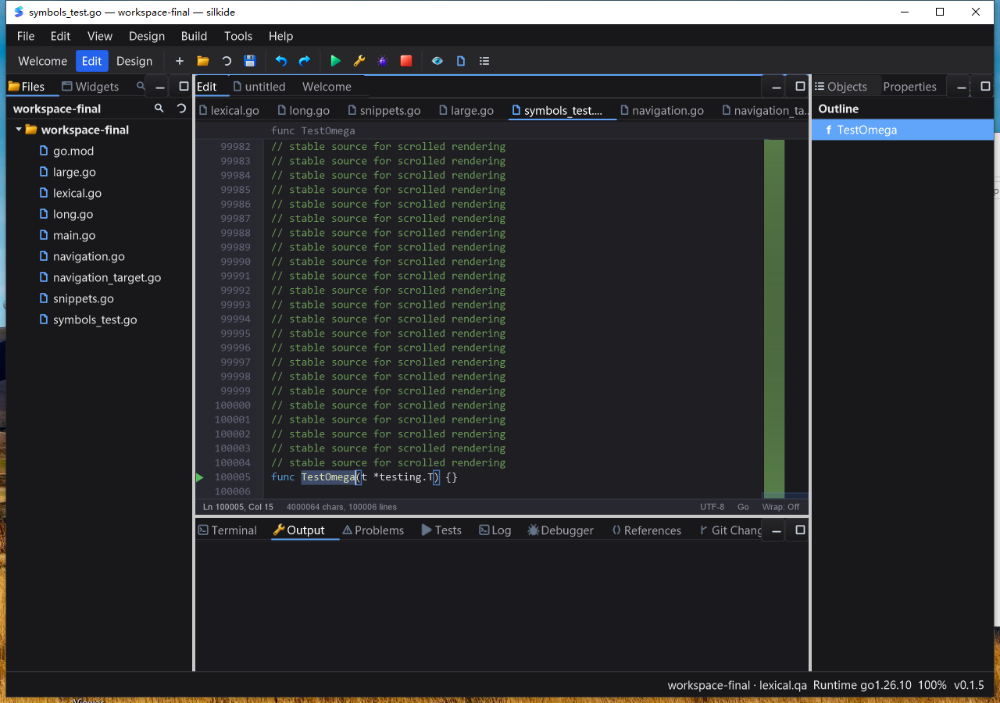

# 大文件输入与符号索引回归（2026-10-24）

本轮是编辑器性能增量，不是 IDE/SDK 全部完成声明。保留原工作区修改，未 commit/push/发布。

## 定位

10 万行、约 4 MB 的 Go 文档，在末尾输入空格、绘制、撤销、再绘制，循环保持文档大小不变。`pprof` 显示 `Draw → drawBreadcrumb → currentFunction → cachedSymbols → parseRecoverableGo` 占采样 CPU 约 69.5%；声明恢复解析扫描注释两次，导致每次编辑后再次全量解析。不是空闲帧缓存失效，也不能据此归因于 gopls。

原基准：57.40 ms/op、61.49 MB/op、400,593 allocs/op。一个 op 包含两次文本变更和两次空绘图后端绘制，**不是单键延迟、GPU 帧率或 IDE/LSP 端到端时间**。

## 修复

- 32 KiB 以上文档的绘制、大纲自动刷新改用后台符号索引；显式 `ParseSymbols` 导航 API 保留同步、精确修订语义。
- 90 ms 可取消合并；每编辑器最多一个 worker、一个最新请求，进程内最多两个解析同时运行。空闲 worker 退出，不添加永久计时器或轮询重绘。
- 后台只持有不可变文本和 provider 快照，建立符号、函数索引和测试行映射；主线程仅接收匹配 worker/文本修订/语言/provider 代次的结果。过期结果不能覆盖编辑、撤销、语言切换或关闭后的状态。
- GUI 投递使用 `async.Latest` 合并。关闭标签和退出时取消索引、释放回调；在途标准 Go parser 不能强制中断，实际退出前仍占并发槽，不借取消无限启动新 parser。
- 等待期间隐藏旧行号关联的测试按钮/函数提示，大纲显示“正在索引符号…”。后台完成通知符号修订；显式同步导航抢先完成时，也会唤醒等待的大纲，避免永久 loading。
- 直接使用编辑器已缓存的完整字符串，消除符号路径重复 Join。

SDK 契约：`gui/CODE_EDITOR_SYMBOLS.md`。新增回归覆盖最新请求合并、UI 投递合并、缓存零分配、编辑/撤销/provider/语言/关闭/同步抢先完成、运行中/已排队关闭及真实解析结果一致性。

## 本地测试与性能

- 最终 `go test -race -short -count=1 ./gui ./ged ./cmd/silkide`：3,920 pass / 41 skip / 0 fail；包含子测试计数。跳过项保留在 JSON，未冒充通过。
- `go vet -composites=false` 三包以及 `git diff --check` 通过。
- 重放修改前源文件（隔离 overlay，不改工作区）的无 profile 对照，3 次为 **55.93–57.29 ms/op**，与初始 profile 一致。
- 同一 100k 行输入/绘制/撤销循环，修改后 3 次：5.41–5.66 ms/op、约 9.85 MB/op、417–418 allocs/op。约 90% 主调用循环耗时下降，但部分解析工作转移至后台并在连续输入时合并，不代表完整后台工作成本为零。
- 仍有全字符串重建、字符计数、可见行缓存等逐次编辑开销；同步 gofmt/保存尚未改成异步，不能宣称所有大文件卡顿消除。

## 证据与复现

- 本地：`bin/qa-artifacts/editor-input-20261024/`；`before/` 保留本轮前源文件，CPU/内存 profile、前后 benchmark、race JSON 均独立保存。
- Windows：`C:\silk\qa-editor-input-20261024-codex`。冻结基础 1,801 文件 + 14 项 Go overlay，构建前逐项校验 SHA-256；程序使用 RequireBundle=1，工具/DLL 不依赖系统 PATH 修改。
- 基准：`go test ./gui -run '^$' -bench '^BenchmarkEditorInputDrawUndo/' -benchtime=2s -count=3`。

## Windows 同机前后性能对照

在相同 Xeon E5-2686 v4 / Windows 10 / Go 1.26.10 / GOMAXPROCS=2 下，GUI 正常关闭且检查无测试进程残留后，使用校验过的修改前源码 overlay 与最终源码分别运行同一个 100k 行基准，各重复两次：

| 输入＋绘制＋撤销＋绘制循环 | 修改前 | 修改后 |
| --- | --- | --- |
| 时间 | 351.99–352.50 ms/op | 32.82–35.10 ms/op |
| 分配 | 约 61.48 MB/op | 约 9.85 MB/op |
| 分配次数 | 400,590–400,591 | 417–418 |

同机主调用循环耗时下降约 **90%**。后台工作被延后、合并，不代表总 CPU 被消除；此数据仍不是单键实际呈现延迟。初始修改后测量 33.54–34.53 ms/op 与收尾对照一致。原始日志、SHA-256、测试统计和实际 UI 结果汇总在 `summary.json`；下载后的证据归档哈希与远端一致。

## Windows 真机最终回归

- Windows 10 amd64：`go test -race -short -count=1 ./gui ./ged ./cmd/silkide`，**3,808 pass / 62 skip / 0 fail**。与 macOS 数量差异包含平台条件及 short 跳过项，不能视作全部平台能力已覆盖。
- 程序 SHA-256：`1771e66cda6ac860d69513f527862cf1d32c6c0088cbe6a55acfd4004bd86d4a`。构建后核对 14 项 overlay 输入仍与当前工作区逐字节一致。
- 使用全新独立 APPDATA/SILK_DATA_DIR、真实 Session 1、随包 `apps-final\tools\gopls.exe`（IDE PID 3500，gopls PID 9904）。不是交叉编译、mock LSP 或仅健康检查。
- 原始字符串词法编辑、Tab 片段展开、保存/撤销/重做通过；minimap 顶/中/底和拖动保持编辑光标/选区、六位行号与长行裁剪通过。
- 约 4 MB、100,006 行测试文件：`TestAlpha → TestOmega` 粘贴替换，保存完整回读、撤销/重做完整回读；截图确认 breadcrumb、大纲及第 100005 行绿色测试按钮更新正确。
- 从第 1 行选中并复制 `package main` 建立独立基线，调用 **Show Outline → Home → Enter**，再从目标行复制 `TestOmega`，确认确实跨文档位置导航到第 100005 行，而不是停在原位置误判成功。
- gopls F12 从 `navigation.go` 跳到 `navigation_target.go`，Alt+Left 返回原文件；窗口标题与截图均验证。未关闭 gopls 换取性能。
- 6 轮真实 Win32 SendInput，每轮 20 个字符后立即格式化保存；6/6 首次完整回读匹配，响应状态均正常。整个输入＋格式化保存＋回读为 **1.14–1.91 秒**，尚不是瞬时操作；不是单键延迟/FPS 证据。
- 10.190 秒空闲采样，IDE CPU 0.046875 秒（约 **0.46% 单核**），gopls CPU 0.34375 秒（约 3.37% 单核），20/20 Responding=true，IDE working set 75,591,680 bytes。仅一次短时观测，不代表长时间或其他硬件表现。
- 正常关闭后 IDE/gopls 均退出；性能对照开始前额外按测试程序精确目录检查，无残留测试进程。

### QA 自身校正

首次脚本把宿主 `Ctrl+Shift+O` 误当独立 SDK 的符号弹窗，截图显示实际是 **Show Outline**。旧“弹窗已验证”的标签不采用；另跑 `ui-outline-verify.ps1`，以首页→末尾声明和剪贴板回读验证实际宿主导航。初次基准 overlay/PowerShell 生成脚本存在两项语法错误，均在生产构建之外；原失败日志保留，修正后通过语法校验再重跑，不将脚本返回 0 当验证结论。

未测 Linux 原生桌面、物理键盘/真实 IME、所有 DPI/显卡、长期内存压力。剩余重点：逐次编辑全量文本/可见行处理、LSP 变更同步的多余切分、同步 gofmt/保存生命周期。
