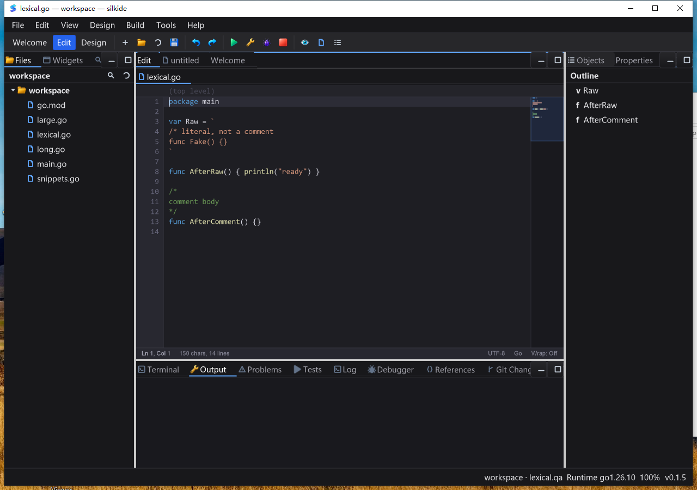

# 编辑器增量词法状态与大文件重绘验收（2026-10-23）

承接 [文件类型模式 QA](EDITOR_DOCUMENT_MODE_QA_20261023.md)。保留原有工作区修改；本轮没有 commit、push 或发布，不宣称已经达到 Qt Creator 的全部功能与性能。

## 已复现的根因

原 `CodeEditor.Draw` 每帧从第一行遍历到当前可视起点，通过 `lineEndsInBlockComment → tokenizeLine` 重新生成屏幕外的完整 token。滚到文件末尾后，即使内容没有变化，光标重绘也会重复扫描和分配；已有逐行 token 缓存并未覆盖这个前缀循环。

原跨行状态只有块注释 bool，另有三个正确性缺口：

- 反引号字符串跨行时丢失字符串状态，内部 `/*` 被误判为真实注释，连后面的正常函数也染成注释色。
- 超长行的单 token 降级没有检查闭合分隔符，`*/` 出现在长行末尾时污染后续代码。
- 绘制按可见行顺序传递状态，忽略折叠隐藏行里的分隔符。

新增完整 `Draw` 测试的四个子例先在原实现失败；Windows 旧版实际窗口也复现前两项颜色错误。基线二进制 SHA-256 为 `23687f65bd5ca1ff4a95927ea7abe053848c438486aa7fe0c199933249cbb112`，与上轮最终测试版一致，不拿源码推测替代桌面观察。

## 修复

- 用 normal／block-comment／raw-string 三态表达跨行上下文，状态扫描只处理字节分隔符，不生成 token。
- 文本发布时复用相同前缀／后缀，重新扫描变化区域，向后传播直到状态收敛；插入／删除行会移动对应记录并清除删除区的引用。
- 相同内容也重新绑定当前行字符串，避免全缓冲区替换后状态记录继续引用旧存储。
- 正文和 minimap 按源行索引读取相同状态；稳定绘制不再扫描不可见前缀。token 缓存键包含三态，修改前面的引号／注释后，未改字节的行也能正确重新着色。
- 超长行仍保留低成本的单 token 颜色降级，但单独扫描结束状态；不以牺牲后续所有行的正确性换速度。
- `SetText`、普通编辑、原子替换、Undo／Redo、文件类型切换维护同一索引；切到普通文本释放 Go 状态。
- 未增加线程、轮询、定时重绘或帧率心跳，也没有修改窗口调度和 gopls 协议。

主要实现：`gui/codeeditor_lexical_state.go`、`gui/codeeditor.go`、`gui/codeeditor_document_mode.go`。
测试：`gui/codeeditor_lexical_state_test.go`、`gui/codeeditor_lexical_draw_test.go`、`gui/codeeditor_draw_painter_test.go`；既有 tab 绘制测试适配新的私有函数签名。

## 性能：同一完整 Draw 基准

Apple M2 Max、Go 1.26.10，固定 1000×700 编辑器、相同 Go 内容、滚到文末、暖缓存；保留字体度量，Painter 为不做栅格化的测试实现，每组重复三次。

| 文件行数 | 修改前 | 修改后 | 每帧分配：前 → 后 |
| --- | --- | --- | --- |
| 约 1000 行 | 362–365 µs | 82–90 µs | 231.8 KB / 3072 次 → 8.5 KB / 183 次 |
| 约 100000 行 | 28.04–28.32 ms | 87.5–92.1 µs | 23.20 MB / 300078 次 → 8.5 KB / 183 次 |

这是完整编辑器绘制逻辑的 CPU／分配基准，不含真实屏幕栅格化、交换缓冲、事件投递或保存耗时，**不是整机 FPS 或单键延迟**。Go 解析、折叠、大文件编辑／保存等其他成本仍存在。

状态索引占 O(行数) 内存；每次文本发布的公共前后缀比较仍为 O(行数)，初始加载或改变跨全文分隔符可能重新扫描整份文本。没有将所有操作描述为 O(1)。

## 自动验证

显式包集合：`./gui ./cmd/silkide ./core ./async ./internal/idetools ./cmd/silktools`；不用包含受限 `local/` 的 `go test ./...`。

- macOS arm64 六包 `-race -json -count=1`：**3307 pass / 11 skip / 0 fail**，包含子测试。
- Windows 10 amd64 六包原生 `-race -json -p 2 -count=1`：**3182 pass / 46 skip / 0 fail**。条件跳过不计为通过，三个真实随包 gopls 集成另行强制执行并全部通过（0 skip）。
- 新增 28 个通过的测试项／子测试，覆盖三态、转义／Unicode／CRLF、长行、缓存状态键、随机 3000 行的扫描器／tokenizer 一致性、随机 2000 次插入／删除／替换、状态收敛、引用释放、Undo／Redo／类型切换、稳定绘制和零分配热查询。
- `make bundle-ide` 与六包 `go vet -composites=false` 通过；未声称严格 vet 全绿。
- macOS 随 `.app` 交付的 gopls：未保存 Unicode 补全／格式化、改名后定义跳转、类型／实现与返回，三个真实集成测试全部通过且未跳过。

Windows 第一次大文件保存断言失败：输入已经完整落盘，但 fixture 未预格式化，保存时 gofmt 在 package 行后补了空行，导致逐字比较失败。回读整份实际文件，确认它恰好等于预格式化 fixture 加上输入内容；保留失败截图／正文／日志，改用规范化 fixture 与独立工作区重新验证，不修改生产保存逻辑以迎合测试。

首次编译回归发现一个既有 tab 绘制测试仍调用旧私有函数签名；改为先载入正文再绘制源行，保留原有 tab／Unicode 断言，重跑后通过。初次失败日志保留，不计为通过。

## Windows 原生回归

使用同一最终二进制、独立测试目录 `C:\silk\qa-editor-lexical-20261023-codex`，1801 个构建输入逐一 SHA-256 回读校验，独立工作区／APPDATA／数据目录。GUI 从干净 PATH 启动，使用本包 `apps\tools\gopls.exe`。

已通过的原生 UI 检查：

1. 原始字符串中 `/*`／`func` 保持字符串色，关闭反引号后恢复正常 Go 颜色；超长注释结束后的函数也恢复正常颜色。逐张检查修改前后的截图。
2. 删除反引号制造临时不完整代码，观察状态传播；Undo 后颜色与正文恢复。合法的原始字符串内容编辑 → 保存 → Undo 保存 → Redo 保存，整份正文逐次回读一致。
3. Go `iferr` 原生 Tab 展开、缩进、保存及 Undo／Redo 回读通过，新工作区重放也通过。
4. 约 4 MB、100000 条注释行的 Go 文件能跳到文末，投递的 16 个字符完整显示在缓冲区；工具栏保存能将其正确写入磁盘。原生滚轮上下各 12 次后仍可正常绘制。
5. 构建／回归结束后，文末编辑器静置 **10.215 秒**，IDE CPU 增量 **0.203125 秒**，约 **1.989% 单核**／四逻辑核容量的 **0.497%**；20 次 Responding 均为 true。只统计 IDE 进程，不包含 gopls／整机，也不代表长期稳定性或实际 FPS。因快捷键输入断言未通过，不报告“快速输入耗时”作为成功性能数据。
6. `main.go` 真实补全弹层显示 Print／Printf／Println 签名与 gopls 来源，运行的服务器确认是本包 `apps\tools\gopls.exe`；指针接受 Println，Ctrl+S 保存、Undo 保存、Redo 保存逐次回读通过。小文件场景没有复现上述大文件连发后的保存失败，协议级三项实测也另外通过。
7. 点击原生关闭按钮，IDE PID 4956 与 gopls PID 7328 正常退出回收，没有强杀 IDE／服务器或其他应用。

**没有通过的项目，不隐藏为“全绿”**：规范化 fixture 重放后，`WM_CHAR` 连发后紧接 SendKeys Ctrl+S 的保存断言仍失败，缓冲区有输入、磁盘未更新；延迟后重复快捷键也未可靠恢复。独立探针验证当时前台 HWND 和保存按钮所在 HWND 均为目标 IDE，点击工具栏保存成功。另一次通过点击编辑区恢复焦点的控制路径能执行 Undo／保存，但下一次连发场景仍失败。因此不把问题单纯归结为首次 fixture 的 gofmt 差异，也不宣称“等一下就修好了”。尚需捕获 WM_KEYDOWN／repeat／修饰键状态与实际 Save 调用，区分自动化注入和程序快捷键分发。此次未为未经定位的原因盲改 Windows 消息循环；本轮不发布。



## 重放与证据

```sh
GOTOOLCHAIN=go1.26.10 go test -race -count=1 ./gui ./cmd/silkide ./core ./async ./internal/idetools ./cmd/silktools
GOTOOLCHAIN=go1.26.10 go test ./gui -run '^$' -bench '^BenchmarkEditorDrawScrolledGo$' -benchmem -count=3
GOTOOLCHAIN=go1.26.10 make bundle-ide
GOTOOLCHAIN=go1.26.10 bash scripts/test-bundled-gopls.sh bin/SilkIDE.app/Contents/MacOS
python3 bin/qa-artifacts/editor-lexical-20261023/verify-tested-source.py
```

最终 Windows IDE SHA-256：`e47fb8d12e1f385daa39b3d062a69745a5e7fa29a5ec6e54390a6055ad30cb20`。随包 gopls SHA-256：`5c409131c93b3d7136145492c5a39a08972fc483660beb4d2125a25447a79502`。

本地 `bin/qa-artifacts/editor-lexical-20261023/` 保留基线源码、负对照、最终源码清单／归档、增量 patch、双平台日志和原生截图／脚本。`verify-tested-source.py` 验证测试后生产／测试代码没有变化，只允许文档差异。最终归档为 `evidence-final.tar.gz`／`windows-final/`；构建和自动测试在 `evidence/`，干净工作区 UI 重放、未通过的快捷键场景、工具栏保存／CPU／滚轮及最终 gopls 闭环在 `evidence-replay/`。

`ui-batch.ps1` 和 `ui-replay-batch.ps1` 在大文件快捷键保存阶段失败，不能用最后单独成功的脚本把这两次失败抹掉。`ui-health-toolbar.ps1` 测量的是工具栏保存后的静置 CPU；不等同于 `ui-replay-health.ps1` 或 `ui-health-final.ps1` 的 Ctrl+S 连发验收。后续追踪应从最后这些失败脚本和同一二进制出发，记录 native key 的 repeat／modifier／目标窗口、编辑版本及保存入口调用顺序。

未验证 Linux 桌面、macOS 本轮原生交互、Windows 11、混合 DPI、复杂 IME 或长时间稳定性。本轮也没有实现真正的自动换行布局、替换全文历史快照，或解决全部已有 GDI／UI 延迟问题。实际大文件截图还暴露出六位行号左侧被固定 gutter 裁切、minimap 文末视口指示范围需要进一步校准；记录为后续迭代，不将本轮重绘优化当作这些视觉问题已经修复。
