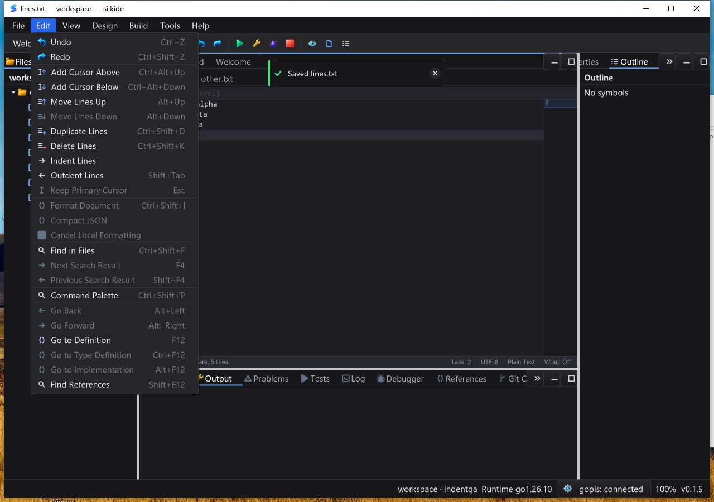

# Atomic line copy/delete and menu return-focus QA — 2026-10-25

## Changes

- `CodeEditor.DuplicateLines`, `DeleteLines`, `CanDuplicateLines` and
  `CanDeleteLines` share SDK, Edit-menu, Command Palette and Cmd/Ctrl+Shift+D/K
  behavior. Selection endpoints at the next row's column zero exclude that row;
  contiguous caret rows form one block. Duplicate rows are processed once.
- One Undo/Redo restores original bytes, all carets and selection direction.
  Empty-document deletion is a strict no-op. EOF copying follows the preceding
  separator style; EOF deletion removes its preceding separator. Literal CR and
  malformed UTF-8 bodies survive round trips. Cut-without-selection continues to
  remove only the primary line that was placed on the clipboard.
- Batch splices rebuild the line index once, not once per caret. History owns
  only changed line bodies, without retaining a whole-document backing string.
  Untouched folds are rebased; touched folds expand. Existing transient-state
  cancellation and frozen selection-search invalidation are retained.
- Distinct theme-aware plus/minus line icons cover 16/20/24/32/48/64 device pixels.
  `examples/editor-lines` exposes Duplicate/Delete and JSON state snapshots.
- Mouse-opened horizontal menu headers no longer steal the popup's return focus.
  Escape returns typing to previous content. Explicit keyboard-header focus,
  ordinary buttons and nested submenu behavior remain unchanged.

## Reproduction and regression gates

The original implementation failed three new tests: exclusive selection endpoint,
CRLF EOF duplication, and multi-caret grouping (`red.log`). Native macOS testing
then found Edit-menu Escape retaining header focus: empty-document duplicate did
nothing until the editor was clicked. `menu-red.log` reproduces the focus loss.
After the button fix, both platforms were rebuilt and the entire UI sequence was
replayed, including Escape → Duplicate without clicking the editor.

Tests cover forward/reverse selections, separated and adjacent carets, distinct
columns on one row, empty/EOF boundaries, previous history, one Changed emission,
fold rebasing, no stale transient UI, hidden/stale-document menu guards and
history retention. The small-body round-trip matrix includes 896 combinations.
Windows also verifies native HWND Ctrl+Shift+D/K dispatch. SDK example layout
checks cover normal, narrow, tiny and zero-sized parents.

Go toolchain: `go1.26.10`. Counts below include Go subtests, not just top-level
functions; skips are not passes.

| Gate | Result |
| --- | --- |
| macOS arm64, race/short/count=1, 8 affected packages | 4,698 pass; 44 skip |
| Windows 10 amd64, native cgo/race/short/count=1, same packages | 4,585 pass; 65 skip |
| macOS graph/prop/settings additional race gate | 238 pass; 1 skip |
| macOS `go vet -composites=false` | Pass |
| Native IDE and SDK builds, both platforms | Pass |
| Bundled-tool verification, both platforms | Pass |
| Required real bundled gopls tests, each platform | 3 pass; 0 skip |
| Actual IDE save/readback checks, each platform | 28/28 exact raw-byte checks |
| Actual SDK button snapshots, each platform | 8/8 text/caret/availability checks |

The eight packages are `gui`, `ged`, `cmd/silkide`, `settings`,
`examples/editor-lines`, `examples/editor-indent`, `paint`, and `purecairo`.
Real gopls tests exercise unsaved Unicode completion/formatting, renamed unsaved
URIs, and definition/type/implementation/back navigation. Their skips in the
short gate are supplemented by the separate required-bundle gate, not counted
as language-service success on their own.

## Native UI and performance evidence

Each IDE sequence covers single-line copy/delete, Undo/Redo, selection blocks,
menu and palette execution, three carets and their restoration, unterminated
CRLF, empty-document disabled Delete, menu cancellation focus, and a 100,000-row
1,700,000-byte file (copy/delete/save/Undo). macOS used Computer Use; Windows used
Session 1 interactive tasks with a clean GUI PATH and isolated app data. Both
IDEs and SDK examples exited normally; no processes under the QA app paths
remained. Windows task results were all zero.

Windows idle sampling after the large-file operations: 20 samples over 10.151 s,
zero NotResponding samples, 0.125 CPU seconds for the IDE process (approximately
1.23% of one core over that interval; excludes gopls). This is a short observation,
not a long-duration stress test or a frame-rate/keystroke-latency measurement.

`BenchmarkLineSpliceBatchIndex` on Apple M2 Max: 698,359 ns/op,
3,217,664 B/op, 4 allocs/op. Each operation applies and reverses 64 splices to a
100,000-entry line index. It measures only that helper, not complete text
publication, lexing, layout, repaint or disk save; those still have document-size
costs on the UI thread. No arbitrary-file-size zero-latency claim is made.

## Artifact identity and limitations

Local replay evidence: `bin/qa-artifacts/editor-line-copy-delete-20261025/`.
Windows evidence root: `C:\silk\qa-editor-line-copy-delete-20261025-codex`.
`accepted-source-hashes.json` freezes 1,576 build inputs; all were rechecked after
UI tests. Windows reverified its immutable 1,801-file baseline and 232 overlay
inputs. The pulled evidence archive's SHA-256 matches the Windows source.
Process identities match the tested binary hashes. Final IDE SHA-256:

- macOS: `e15d99fe17a4c26a625ce1d848b8d0ccf9083c99daf5a0c96dec96ba05549768`
- Windows: `12da6755248a47247fc39d009bc2ef13443fd5458c5c42a4cadbbebf196a65f8`

Key evidence: `accepted-race.jsonl`, `accepted-bundled-gopls.log`,
`accepted-benchmark.log`, `mac-save-stages.jsonl`, `sdk.stdout`,
`windows-final/evidence/`, `windows-final/ui-evidence/`,
`windows-final/sdk-ui-evidence/`, and `verify-evidence.py`. Failed first-attempt
artifacts are retained separately, not substituted for final-build results.

Linux native UI and all generated-project build/runtime tests were not rerun in
this iteration; short/platform/environment skips remain documented limitations.
The Windows machine's pre-existing Ctrl+Alt+Down delivery restriction remains:
multiple carets were created through Command Palette, then native copy/delete
shortcuts were exercised. Empty-document Undo/Redo menu availability is an
observed pre-existing polish gap, not fixed or claimed by this change.
