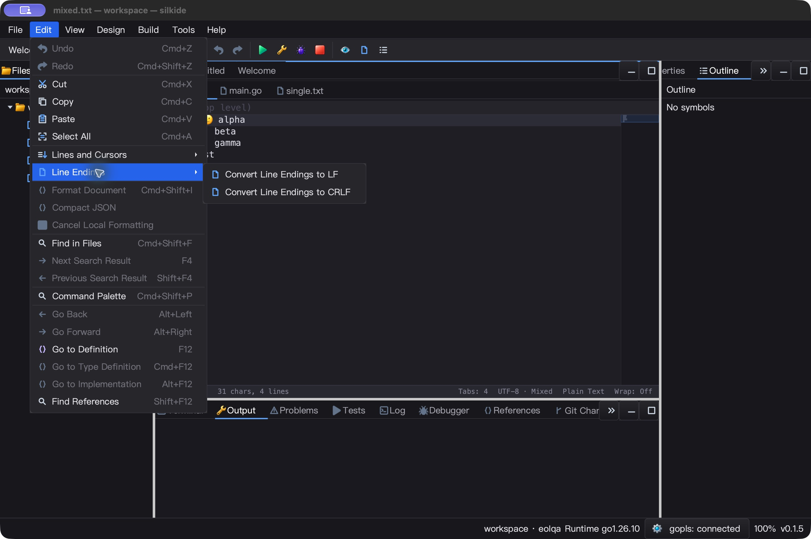
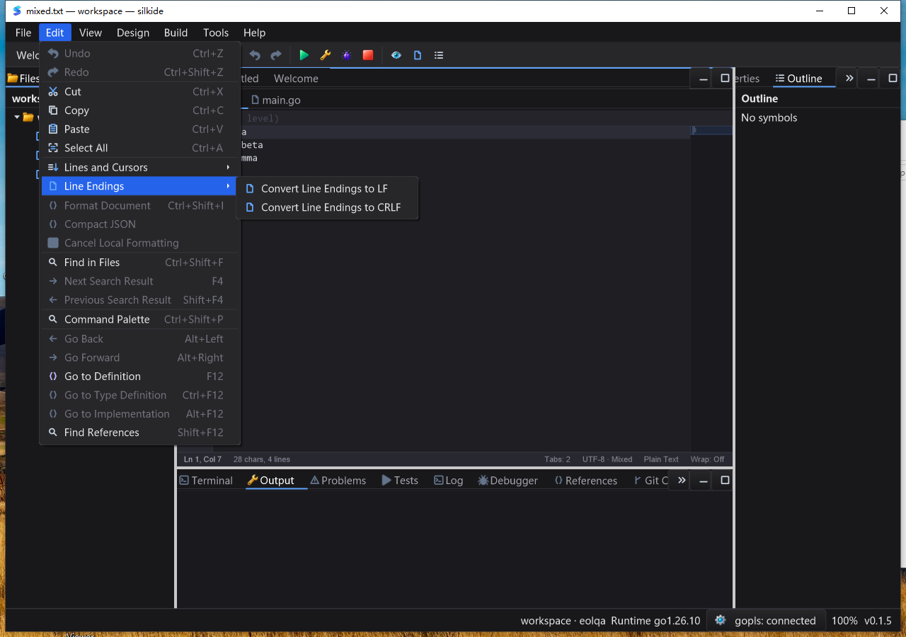
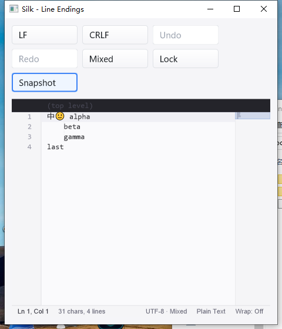

# Editor line endings and compact Edit menu — 2026-10-25

## Fix and scope

The original `TestEditorEnterPreservesCRLF` fails with `one\n\r\ntwo\r\n`:
Enter inserted LF into a CRLF document and could split after its CR byte. The
editor now detects the document preference on host load, uses it for Enter,
and treats CRLF atomically at Delete/Backspace boundaries, including multiple
carets that normalize to the same boundary.

`ConvertLineEndings` explicitly converts LF/CRLF as one undoable transaction.
It preserves non-separator bytes, EOF termination, selection direction, carets
and fold rows. History keeps one bit per separator (1,563 uint64 words for the
100,000-separator fixture), not full document snapshots. Read-only, unsupported
styles and ambiguous CRCRLF-to-LF input are rejected before mutation.

The status bar reuses its responsive encoding slot for `UTF-8 · LF/CRLF/Mixed`.
Cached metadata queries allocate nothing; a native 100,000-row benchmark measured
3.942 ns/op, 0 B/op, 0 allocs/op. This measures metadata availability only, not
conversion throughput or total UI frame time. Transition-only subscriptions add
no timer. Changing the preference of an empty/single-line document is undoable
but does not falsely dirty the document or emit a text-change event.

IDE menus/palette bind the focused editor identity and reject stale/read-only
commands. Go automatic save restores the selected CRLF style after gofmt. Native
UI inspection of the initial candidate found the enlarged root Edit menu extended
beyond the parent window capture; final **Lines and Cursors** and **Line Endings**
submenus keep command IDs, icons, shortcuts and enabled states while making the
root menu fit the tested window. This is not a claim about every monitor/DPI size.

## Automated gates

Go 1.26.10, native uncached `-count=1` tests; counts include subtests. Overlapping
groups must not be summed as unique coverage.

| Gate | Pass | Skip | Fail |
| --- | ---: | ---: | ---: |
| macOS arm64, 11-package `-race -short` | 4,836 | 45 | 0 |
| Windows 10 amd64, same native race gate | 4,726 | 66 | 0 |
| macOS supplemental graph/prop/settings race gate | 238 | 1 | 0 |
| Required real bundled gopls, macOS | 3 | 0 | 0 |
| Required real bundled gopls, Windows | 3 | 0 | 0 |

The main gate includes gui, ged, cmd/silkide, settings, paint, purecairo and
editor-line-endings/editor-readonly/editor-clipboard/editor-lines/editor-indent
examples. macOS vet uses `-composites=false`. Native IDE/SDK builds and bundled
tool verification passed. Mandatory gopls tests exercise real unsaved Unicode
completion/formatting, rename and definition/type/implementation/back navigation.

Focused coverage includes mixed/tied detection, final-newline preservation,
Unicode and malformed bytes, standalone CR, readonly/invalid conversion, exact
Undo/Redo selections/carets, CRLF Enter/Delete/Backspace, duplicate boundaries,
verbatim clipboard/host reload, preference-only metadata events, unsubscribing
during notification, menu/palette focus identity and actual saved Go file bytes.
Example layout tests cover widths 920, 480 and 220.

## macOS native UI

Final uninstrumented IDE, isolated workspace:

- Edit → Line Endings → LF; Save and exact byte readback.
- Undo/Save restores the original mixed CRLF/LF bytes; Redo/Save restores LF.
- Command Palette → CRLF; Save matches all-CRLF bytes.
- Native End/Enter inserts CRLF; Backspace joins the boundary without leaving CR.
- Go LF/CRLF conversion plus Save preserves the requested style after gofmt.
- Compact Edit root and both submenus visually inspected; gopls connected.

Save checks wait for modal command dispatch to complete; immediate same-call
reads initially observed the old disk content. Explicit Save after the modal
transition and exact byte readback passed, with the document clean afterward.

The SDK example passed **11 exact JSON snapshots**: initial mixed Unicode,
LF, Undo, Redo, CRLF, native Enter, Backspace, Undo, Redo, locked commands, and
unlocked host reload. Assertions include full text, counts/preference, readonly,
Undo/Redo availability, Modified, revision, caret and cursor count. Locked LF and
Undo buttons were actually clicked; typing-while-locked is covered by automated
regressions, not claimed as part of this native sequence. Both processes exited
normally (IDE 82003, SDK 82008).

## Windows native UI

The final IDE passed eight saved-byte assertions on the Windows 10 desktop:
menu LF, Undo to mixed, Redo to LF, palette CRLF, native Enter/Backspace boundary,
and Go LF/CRLF save after gofmt. The compact root menu and Line Endings submenu
were visually inspected. The isolated launch used a clean system PATH and its
bundled gopls; IDE and its owned gopls exited normally. Native WM_KEYDOWN Enter
and Backspace also passed in the Windows automated gate.

The Windows SDK repeated the same **11 exact JSON snapshots** as macOS, then
verified a 480-pixel window with wrapped buttons and no editor overlap. IDE and
SDK each passed 5/5 responsive samples over five seconds. The harness reports
cumulative process CPU, not interval CPU, so no idle CPU percentage is inferred.
The final SDK process exit code was explicitly captured as zero.

## Evidence and limits

Raw evidence: `bin/qa-artifacts/editor-line-endings-20261025/` (ignored).
Host input freeze: **1,606 build inputs**, unchanged after acceptance. Windows
uses `C:\silk\qa-editor-eol-20261025-codex` and an immutable **1,801-file baseline
plus 272-file final overlay**. Initial pre-grouping tests are preserved separately
and are not substituted for the final menu build.

Intermediate evidence retains the original expected failure, menu test compile
correction, and macOS SDK capture error `SCStreamErrorDomain -3811`. After the
IDE exited, binding the same SDK process by its app path succeeded; it was not
restarted and all 11 snapshots passed. This does not diagnose the capture error
as an application fault. Windows' first final-gate invocation was blocked by
PowerShell policy; process-scoped Bypass was used without changing system policy.
macOS benchmark/gopls and Windows bundled-gopls logs retain a prior-run/core.Close warning; they are not
represented as empty diagnostic logs.
The first Windows SDK sequence passed all snapshots and its process disappeared,
but the externally attached process observer failed the clean-exit assertion.
The complete sequence was repeated from a fresh process whose handle was retained
by the launching task; the strict assertion remained and `ExitCode: 0` was
captured. Original failed task evidence is retained, not relabeled as a pass.
The initial evidence archive could not read the still-open IDE stderr stream;
the final archive was collected after normal exits and contains all logs.
Final baseline/overlay hashes and successful acceptance task exit codes were
rechecked; host frozen inputs were rechecked too.

Standalone CR remains content; old-Mac CR-only line splitting is not supported.
CRCRLF → LF is intentionally rejected to avoid destructive ambiguity. Host
SetText, paste and explicit formatter output are not silently normalized. A
preference without an actual separator has no persistent file representation.
Every SDK API and observer here is UI-thread-only, not a concurrency primitive.
Linux GUI, IME, every CRLF word-selection/navigation shortcut, all DPI/theme
combinations and long-duration performance were not revalidated. No full Qt
Creator parity, new version tag or release-package publication is claimed.
