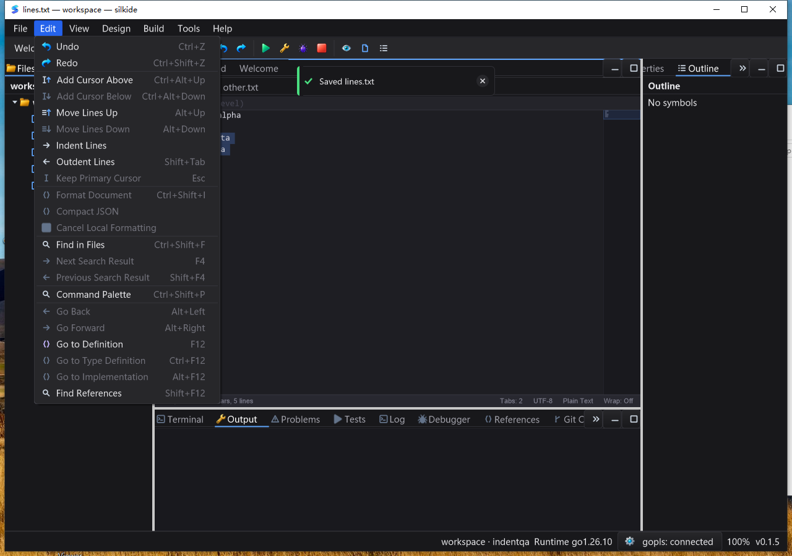

# Reversible line movement QA — 2026-10-25

## Behavior

- SDK: `MoveLinesUp`, `MoveLinesDown`, `CanMoveLinesUp`, `CanMoveLinesDown`.
  Edit menu, Command Palette and existing Alt+Up/Down shortcuts share that path.
- A selection moves its logical line block, excluding an endpoint at the next
  line's column zero. Without a selection, adjacent caret rows merge into groups;
  blocked boundary groups stay put while other groups may move.
- One Undo/Redo restores the whole transaction, including original bytes,
  selections (forward/reverse) and all caret positions. Earlier edits remain in
  history. History holds rotations and CRLF bits, not whole-document copies.
- Separator spelling stays at its original slot. Existing trailing-newline
  sentinel rows are excluded from movement. Interior empty rows remain movable;
  moving an empty body to an unterminated EOF can naturally leave an existing
  separator at EOF, without inserting a separator. Undo restores the original.
- Touched folds expand. Stale snippet/rename/navigation UI is dismissed; frozen
  selection-search scopes fail closed under the existing unrelated-edit rule.
- New line-stack/arrow icons are distinct from add-caret icons. Vector tests cover
  light/dark palettes at 16, 20, 24, 32, 48 and 64 device pixels.

## Reproduced defects and tests

Three tests fail on the pre-change implementation (`red.log`):

1. Moving a line adds no Undo record, so Undo affects an older unrelated edit.
2. A multi-line selection moves only the primary caret's row and loses selection.
3. Moving the last CRLF content line into the EOF sentinel corrupts line endings.

New tests cover those paths, reverse selection and EOF conversion, grouped and
separated carets, duplicate rows, no-op boundaries, malformed UTF-8, literal CR
at EOF, mixed separators, older history, single Changed publication, fold reveal,
transient state, stale-document/hidden-editor command guards and compact history.
An exhaustive small rotation/inverse matrix includes empty and malformed bodies;
CRLF bitsets are checked across 64/65/127/128/129-row boundaries. Example layout
checks include normal, narrow, tiny and zero-sized parents.

The first Windows desktop run exposed a separate routing defect: Alt+Down left
the saved file unchanged even though the initial package tests passed. Windows
delivers it as `WM_SYSKEYDOWN`, while the editor opted in only for Ctrl+Alt+arrow.
The fix opts bare Alt+vertical-arrow into line movement **without broadening the
Ctrl+Alt caret classifier**. Other Alt keys still fall through to native handling.
A new native HWND regression sends normal/repeated system-key messages, checks
both moves and Undo, then verifies Ctrl+Alt still adds a caret. Alt+F4, Alt+Space
and unrelated Alt keys remain unconsumed. First-attempt logs and artifacts are
retained separately from final acceptance evidence.

## Accepted builds

Go 1.26.10, native Cairo, race detector, `GOMAXPROCS=2`, fresh tests (`-count=1`):

```sh
go test -race -short -json -count=1 -p 2 \
  ./gui ./ged ./cmd/silkide ./settings ./examples/editor-lines \
  ./examples/editor-indent ./paint ./purecairo
```

| Platform | Pass events (tests/subtests) | Skips | Packages |
|---|---:|---:|---:|
| macOS arm64 | 4,684 | 44 | 8 |
| Windows 10 amd64 | 4,570 | 65 | 8 |

Short/platform/opt-in skips are not passes. macOS extra graph/prop/settings gate:
238 passes, 1 skip (settings overlaps). Host vet passes with `-composites=false`.
Both platforms build native IDE and SDK example binaries and verify tool bundles.
Three separately required real bundled-gopls tests pass on each platform with no
skips: unsaved Unicode completion/formatting, renamed unsaved definitions, and
unsaved type/implementation/back navigation. Those are general LSP regressions,
not a dedicated post-line-move symbol-navigation UI scenario.

## macOS native UI

An isolated workspace and preferences were used with the hash-recorded native
IDE. After the Windows-routing change, the native IDE and SDK were rebuilt and
the full UI sequence repeated. **Eleven saved stages** were checked byte-for-byte:

- Alt+Down, Undo and Redo on a single row.
- Shift+Down selection ending at column zero, Alt+Up block movement and Undo.
- Command Palette Move Lines Down, actual Edit-menu Move Lines Up.
- Ctrl/Cmd+Alt+Down adding two carets, Alt+Down on the three-row group and Undo.
- Moving Unicode content to the EOF of a CRLF file without a final newline,
  followed by Undo; disk CRLF bytes and EOF state were checked.

The Edit menu visibly disables downward movement at the selected block's bottom
boundary; new vector icons and key hints remain contained. The standalone SDK
example produced **six actual-widget JSON snapshots** verifying initial command
availability, Move Down, Undo, Redo, Move Up and grouped-caret movement. IDE and
SDK processes exited normally.

## Windows shortcut limitation

After the system-key fix, the first seven desktop save/readback stages passed.
The next stage failed because ordinary Ctrl+Alt+Down did not create extra
carets. The standalone SDK reproduced this: both attempts left `Cursors: 1`,
whereas its Add Caret button correctly created two carets. This is consistent
with the previously captured application-input limitation documented in
[byte-edit QA](EDITOR_BYTE_EDITS_QA_20261024.md#组合键的运行时归因修正);
that earlier diagnostic saw no Down message for this chord. This round does
not claim to identify or fix its OS/driver/injection cause. Windows line-block
acceptance uses the explicit Add Cursor Below Command Palette entries rather
than silently counting the blocked shortcut as a pass. The failed run is retained
in `attempt2-ui-evidence`, distinct from final native UI results.

The SDK example's six button snapshots all pass on Windows as well. Two
additional observations confirm Ctrl+Alt+Shift+Down creates a second caret and
bare Alt+Down moves that two-row group correctly. Thus the ten SDK observations
comprise eight successful checks and two recorded blocked-standard-chord probes;
they are not reported as ten passing shortcut checks. The SDK exits normally.

## Final Windows native UI

The same hash-verified, uninstrumented binary was restarted with reset fixtures
and isolated preferences. All **11 saved stages** passed: single-line down,
Undo/Redo, selected-block up/Undo, palette down/up, three-caret group down/Undo,
and Unicode CRLF movement to an unterminated EOF/Undo. Extra carets were created
through the Command Palette; line movement still used the real Alt+Down chord.
The collected files were independently compared as raw UTF-8 bytes and SHA-256,
not just as decoded strings. Screenshots show three carets, correct line order,
distinct menu icons and the disabled bottom-boundary Move Lines Down command.



The final idle sample was **20/20 Responding**, 0.21875 CPU seconds over
10.159 seconds (about **2.15% of one core**, IDE only). This small-file sample is
not a frame-rate, input-latency, long-session or whole-machine CPU guarantee.
Alt+F4 closed normally; the round's IDE, SDK and bundled-tool process paths had
zero residual processes. Eight round-owned scheduled tasks were removed after
their final successful results were recorded; failure evidence remains intact.

## Performance boundary

`BenchmarkEditorLineMoveRotationLargeBodies`: two 1 MiB LF-only bodies, one
rotation plus its inverse per iteration; Apple M2 Max: **20.13 ns/op, 0 B/op,
0 allocs/op**. This isolates pointer rotation, not the complete edit, text
publication, mixed-separator conversion, layout, redraw or key-to-paint latency.
Availability checks do not scan document bodies. Mutations still rebuild the
published text on the UI thread; no arbitrary-size/no-latency claim is made.

## Evidence and remaining scope

Artifacts: `bin/qa-artifacts/editor-line-move-20261025/` (ignored QA data).
`accepted-source-hashes.json` freezes **1,573 build/source inputs**; these matched
again after host UI testing. Windows uses a verified immutable 1,801-file baseline
plus **228 overlay inputs**; its tested-overlay hashes match the local manifest.
Race JSONL, bundle logs, binary identities, benchmark, saved text and SDK snapshots
are retained. The Windows baseline was also rehashed after tests. Final Windows
UI archive SHA-256:
`7104159faf4e822cec9ad57c466a31e7134e5e7bdf23a289df3868e584f5adfa`.
This is not a full-repository, Linux-native, IME, mixed-DPI or large-project
performance certification; the standard Windows Ctrl+Alt+Down limitation above
remains outside the passing line-movement scope.
