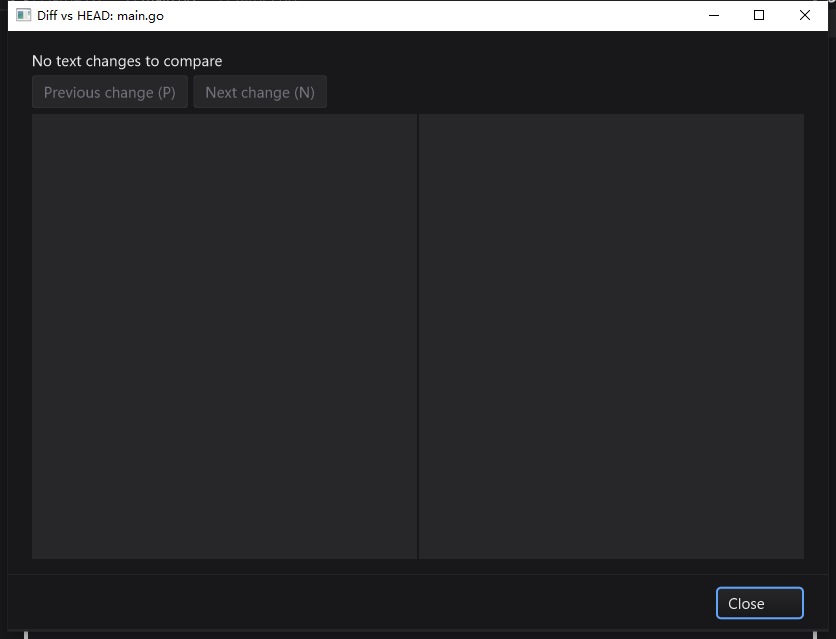

# 剪贴板响应与集成提交回归（2026-10-24）

本记录汇总本轮新增修复；此前工作区中的 gopls 交付、编辑器索引/导航/大文件编辑、异步 Diff、JSON Inspector 和下载监控控件仍以各自 QA 记录为功能证据。本轮扩大包级回归，不将此前的原生验收冒充为本次全部重测。Git 提交不等同于发布新版本或更新旧安装包。

## 真实卡顿与修复

- macOS 原生 100,000 行文件，在第 95,001 行粘贴一个字符，重现 **12.676 秒事件循环停顿**。watchdog 主线程栈落在 `glfwGetClipboardString → Clipboard.Data → CodeEditor.pasteClipboard`，而不是绘制或 Diff 运算。此前一轮还观察到 9.408 秒，但未定位的记录不再当作性能通过。
- 已知测试字符复制后，独立 `/usr/bin/pbpaste -Prefer txt` 返回精确内容，测得一次 17.121 ms。此单次数据用于方案归因，不代表所有剪贴板提供者的延迟。
- macOS 的 CodeEditor、Edit、TextArea、SearchBox 粘贴走有界后台 `pbpaste` 进程；绝对路径、无 shell、2 个执行槽、10 秒超时、16 MiB 输出上限。不会把主线程专用的 GLFW 调用搬到 goroutine。[GLFW 官方线程要求](https://www.glfw.org/docs/latest/group__input.html)
- 回调经 `gui.Post`；请求身份、文本/光标/选区、逻辑焦点、所属窗口及祖先可见性检查，隐藏/禁用/重挂父节点/逻辑焦点转移主动取消。连续相同锚点粘贴合并为一次插入与 Undo，最多 64 次；超限明确报错，不部分插入。晚到回调不能覆盖新请求。
- 新增 UI 线程 SDK API：`Clipboard.ReadTextAsync`、`Widget.PastePending`、`CancelPendingPaste`。macOS 编辑器右键菜单不再为判断 Paste 可用性而同步读取完整剪贴板。

## 一并发现的问题

1. **日志误过滤**：原正则在消息任意位置匹配 `debug`，将包含 `SILK_DEBUG=1` 的 watchdog 警告吞掉。现在只过滤行首的实际 debug/dbg/trace 级别，兼容日期、时间及微秒前缀。
2. **空 Diff**：Git 没有文本变化时显示中性状态 `No text changes to compare`，清空旧差异并禁用前后导航，不再冒充加载失败；不把二进制无文本 patch 解释为文件完全没变化。
3. **macOS 重复打包**：完整回归发现 `bin/tools/gopls` 可运行、`.app` 内相同 SHA 的 gopls 启动退出 137，包内三项真实 LSP 测试失败；静态 `codesign --verify` 仍返回 0。旧脚本原地覆盖可执行文件，且保留旧 `_CodeSignature` 与废弃工具。改为同目录下构建全新 `.app` 再替换，避免覆盖原 inode；复制失败保留旧包，发布阶段失败恢复旧包。不关闭其他在用实例，不移除系统安全策略，不声称完成 Developer ID 签名/公证。

## macOS 验证

- 29 包 race/short/count=1：**5,691 pass / 49 skip / 0 fail**（含子测试）；28 包有测试，`internal/processutil` 无测试文件。两个新 SDK example 另跑 race，3 pass / 0 skip。
- 同组 `go vet -composites=false` 通过；`purego` 的 cairo/purecairo/paint 回归、平台脚本通过。不是 strict-vet 全选项或 Linux 原生桌面验收。
- 普通 `bin` 与修复后最终 `.app/Contents/MacOS` 的随包真实 gopls 集成各 **3 pass / 0 skip**，包括未保存 Unicode 补全/格式化、重命名、定义/类型/实现与返回。
- 独立目录连续两次重打包后 gopls `version` 均可执行，并再通过三项真实集成。脚本回归使用硬链接证明旧可执行文件内容未被覆盖，验证旧签名/废弃工具不残留；注入复制和替换失败验证旧包保留/恢复。
- 独立 bundle ID `org.silkui.qa.paste20261024`、隔离 HOME/SILK_DATA_DIR 的真实 UI：粘贴 `MAC_NATIVE_123😀` 到 95,001 行，保存后 **1,400,018 字节逐字相等**；Undo 后保存 **1,400,000 字节完整恢复**。新的粘贴内容不同于旧系统剪贴板，排除读回旧值的假成功。右键菜单打开正常；本轮修复后诊断日志无 event-loop stall。
- CUA 粘贴工具调用一次耗时 2,118 ms，其中包含自动化自身的等待与剪贴板恢复，**不是应用纯输入延迟**。不据此声称毫秒级端到端延迟或固定 FPS。
- 正常 Cmd+Q 后，本轮 PID 42543 已退出；之前有另一生产路径实例，未擅自关闭。截图 `screenshots/silkide-paste-macos-20261024.png` 是开启诊断边框的实测，不是视觉效果图。

## 反例与测试修正

- 原日志正则的反例实际失败，修复后通过。
- 初版有界缓冲区内嵌 `bytes.Buffer`，意外暴露 `ReadFrom`，被 `io.Copy` 绕过 Write 上限；17 MiB 实际子进程输出测试抓到该问题。改为具名 buffer 字段后，大小限制、NUL、Unicode/CRLF、超时、取消和非零退出均通过。
- 扩大回归发现旧 Edit 快捷键测试立即断言同步结果。测试改为每控件隔离 reader，先断言“尚未插入/请求 pending”，显式交付后再断言替换和 pending 清除；保留 Copy/Cut/只读断言，不跳过、不访问真实剪贴板。初次失败日志留存。
- 最终包内 LSP 初次失败也留存，不将普通 bin 的成功代替 `.app` 成功。

## Windows 验证

- Windows 10 22H2 / amd64，31 包完整 race/short/count=1：**5,578 pass / 68 skip / 0 fail**（含子测试），31 包均通过。随包真实 gopls 集成 **3 pass / 0 skip**；两个示例单独 race 也是 **3 pass / 0 skip**。
- 无全局 gopls 的原生 Session 1 启动，实际子进程路径确认是本轮应用旁的 `apps\tools\gopls.exe`，不是 PATH 上其他工具。F12 从 `main.go` 跳到 `target.go`，Alt+Left 返回。
- 100,000 行文件第 95,001 行粘贴 `WIN_NATIVE_123😀`、Ctrl+S 后原始 UTF-8 文件逐字相等，Undo/保存完整恢复；空 HEAD 比较截图确认中性提示、禁用的前后导航和可用 Close，无错误状态或布局遮盖。
- 5 次打开/关闭空 Diff：GDI 始终 18；USER 从 27 到 29，最后三次均为 29。**此样本不足以证明无长期资源泄漏**，不将小幅增长解释为已解决。
- 10.337 秒样本内 IDE CPU 时间 0.171875 秒（约 1.66% 单核），gopls 0.078125 秒，20/20 Responding=true；不是 FPS 或输入延迟测量。正常 Alt+F4 后本轮目录下进程为 0，清除三个测试任务。
- 源基线 1,801 文件 + 最终 109 个 overlay 输入逐文件校验；最终输入重编译的 EXE 与实际 UI 测试产物 SHA 完全相同：`30dafd9cf1119aaafc54f5f1179b72e7a60142e50e4cea75520e253e27995492`。
- 初次 PowerShell `>` 捕获会把 Go 的 UTF-8 输出转为系统编码，损坏含中文/转义引号的 JSON。保留原日志，改用 `Start-Process -RedirectStandardOutput` 原生捕获，重新跑全组并逐行 JSON 解析；最终统计只取可完整解析的重跑记录，不修补原文后冒充通过。

新增 `make test-sdk-utilities`，并接入 `make test-ide`、CI 和 release gate，覆盖 async/httpx/jsonx/filetxn 及两个组装示例。脚本语法、workflow YAML 解析与 `git diff --check` 通过；这不是远端 GitHub Actions 已运行的声明。



## 可重放入口

```sh
make bundle-ide
make test-sdk-utilities
bash scripts/test-bundled-gopls.sh bin
bash scripts/test-bundled-gopls.sh bin/SilkIDE.app/Contents/MacOS
go test -race -count=1 ./gui ./core ./cmd/silkide
bash scripts/test-platform-scripts.sh
CGO_ENABLED=0 go test -count=1 -tags silk_pure_go ./cairo ./purecairo ./paint
```

完整包组与平台日志保存在证据目录的 `test-host.sh` / `race-native.ps1`；上列是便于复查的针对性入口，并非声称额外执行了一次未带 `-short` 的全包回归。

## 证据与边界

原始证据位于 `bin/qa-artifacts/editor-paste-20261024/`：原始/修复后 stderr、CPU profile、反例日志、29 包 race JSON、示例回归、保存/撤销文件、打包/LSP/脚本日志和平台源输入哈希。测试产物不入 Git。最终 Windows 证据包与远端核对 SHA-256：`99faeebf027c9256ec5f0ab42cd9c4491ec8ac74b05eea16afb1b18355897d04`；`summary.json` 汇总完整 JSON 解析和磁盘字节断言。

- macOS 已验证的 IDE SHA-256：`16f96563f7779d2660103170482ab60ce6839e7a1c219c8829a038fc76a87245`；真实 UI 与最终包可执行文件相同。
- macOS gopls SHA-256：`e4a710f35c02b5a80af11d0eed08bd8d01204d776b1e5a354768eb37abd3a072`。
- Windows/Linux 的原生剪贴板读取仍同步；旧 `Clipboard.Data/Formats`、复制/剪切写入也不在本次异步保证内。16 MiB 文本实际插入/排版仍在 UI 线程，未承诺超大粘贴全程无卡顿。
- macOS native application activation 与控件逻辑焦点不是一回事；本轮未实现全局应用失活取消策略，也未覆盖所有第三方剪贴板提供者、真实中文 IME、Windows ARM64 或 Linux 桌面。
- 并未进行新一轮 CVE 扫描、线上发布或版本打 tag。此前 QA 文档“未提交”是对应阶段的历史状态，实际本次提交/推送以 Git 回读为准。
