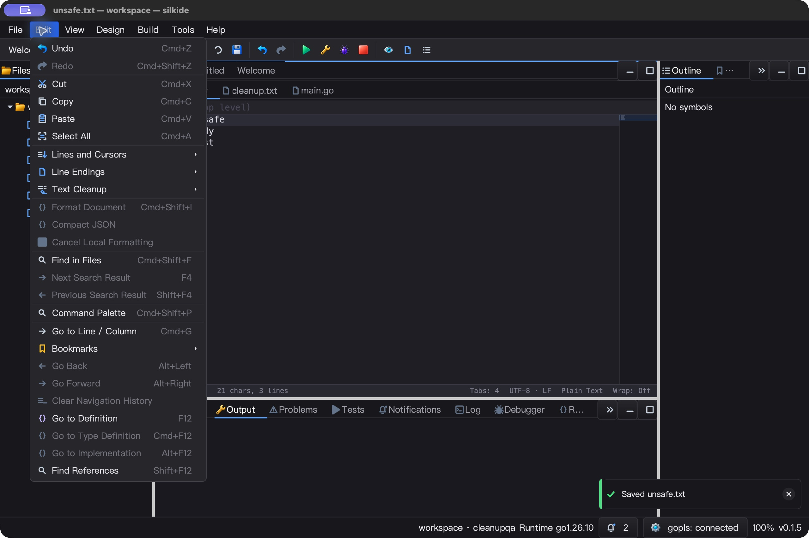
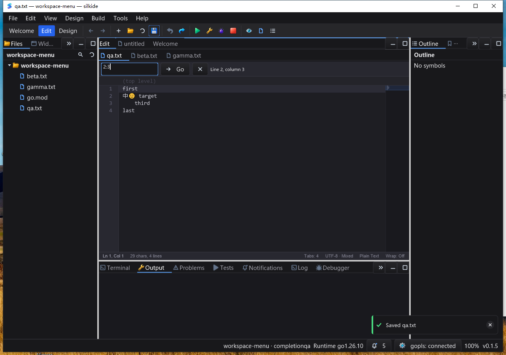

# 编辑器页签与工具栏焦点回归 — 2026-10-25

## 结果与根因

上一轮 OLE 修复解决的是拖拽期间的调度，本轮独立解决鼠标操作结束后的输入归属。
先在旧构建真实复现并保存文件证据：

- 拖拽 `unsafe.txt` 页签后，不点击正文直接输入 `D`，保存文件仍为原文。
- 点击正文输入并保存后，直接输入第二个字符 `E` 没有落入文档；编辑菜单的
  Select All、行列跳转、换行转换及清理项均不可用。

原因分别是页签条保留逻辑焦点，以及工具栏按钮在鼠标按下时取得焦点。
菜单按真实焦点筛选目标本身是必要保护，不能简单改成“总是使用活动文档”。

## 实现

- `TabBar.SetPointerFocusCallback`：可选的指针完成回调，SDK 默认不启用。
  点击同页、关闭或原生拖放结束后，IDE 检查当前模式、页面身份、窗口和可见性，
  将焦点交还文档。键盘／程序切页不调用该回调，不破坏标签栏方向键导航。
- 左键手势使用页签身份检查，防止等待期间移除页面后错误操作复用的数字索引。
  先清空按下状态再调用宿主；拖放正常结束或异常退出均释放临时预览表面。
  若其他控件已经取得焦点，不再抢回；隐藏／禁用祖先也不触发交接。
- `ToolBar.SetPreserveContentFocus(true)`：直属按钮的鼠标动作保留内容焦点。
  IDE 主工具栏、设计工具栏启用；普通 SDK 工具栏、键盘聚焦按钮、嵌入输入框不变。
  动作主动切换焦点不会被回滚，按钮重新挂到其他父节点也不会残留旧策略。
- 页签身份改变时立即同步窗口标题；场景与脏状态的原有低频同步继续作为兜底。
  比较实际 Frame 标题，而非可能覆盖事件更新的私有旧缓存。
- 保留显式设计草稿提交流程；单测验证鼠标保存不依赖属性输入失焦才能写入。
  不新增线程、定时器、空闲刷新或全局焦点历史。

## 自动测试

Go 1.26.10、GOMAXPROCS=2，最终冻结 **1719** 个源码／构建输入，本轮独立变化 **8** 个源码文件。

- macOS 十包 `-race -short -count=1`：**5630 pass / 47 skip / 0 fail**，统计包含子测试。
  根包 race、十包 vet、IDE RequireBundle／SDK 构建通过。
- 五项强制原生 cursor／GL 测试通过，保留 48 次真实 backbuffer resize 及精确像素断言。
- 新测试覆盖同页点击、关闭重入、拖放重排／取消／源页移除／显式焦点转移／panic 清理，
  以及工具栏默认兼容性、嵌入输入、按钮重新挂载、菜单目标和设计草稿保存。
- Windows 不可变基线 **1801** 个输入 + **452** 个 overlay 输入逐项哈希验证。
  原生 IDE／SDK 构建、附带工具清单验证、七包定向 race-short **三次**通过。
- Windows 完整 GUI race-short：**2723 pass / 21 skip / 0 fail**，包含子测试。
  `gui/win32` vet 的 **15** 项既有告警与上一轮源码独立重跑结果完全一致，新增 **0**；
  这不是零告警的 vet 通过，也不是全仓所有平台测试。

## macOS 真实 UI

使用新构建与隔离 HOME／workspace，所有保存结果按原始字节核对：

1. 拖拽第三页到首位，**不补点正文**，输入 `D` 后用工具栏保存，文件准确增加 `D`。
2. **不重新聚焦**继续输入 `E` 并保存，文件准确增加为 `DE`。
3. 打开实际 Edit 菜单，Select All／Go to Line 等可用；点击全选，输入单字符 `Q`，
   文件准确为 `Q`；一次 Undo 恢复 `DE` 加原始混合换行正文。
4. 单击其他页签、点击关闭当前页签后，均可直接输入并保存到正确的剩余文档。
5. 行列导航输入框取得焦点后，工具栏保存不夺回正文；菜单文本操作保持禁用。
   精确输入 `2:3`、保存、Enter 后输入 `N`，落在第二行第三列，Undo 完整恢复。
6. Ctrl+Tab 后直接输入、保存及 Undo 字节恢复通过；三个文档均恢复原始内容，正常退出。

默认 SDK 示例保持 opt-in 以外的行为：方向键切页、Ctrl+Tab 往返、窄栏与完整标题菜单、
中文页输入、拖放重排、关闭指定页、其他文档保留及 Undo。**10 份 JSON 快照逐字段匹配**。
额外一次全新进程再次验证原始内容 → 输入 `S` → Undo，三份快照均准确。



## Windows 10 真实 UI

交互桌面 session 1，1600×1200，干净 PATH，最终测试二进制哈希与构建记录一致：

- SDK 默认示例 **9 份**快照精确核验：滚轮、键盘切页、溢出菜单、中文输入、重排、关闭及 Undo。
- IDE 原生 OLE 拖放后**直接输入** `G`，工具栏保存为 `Ggamma\n`；保存后再直接输入 `H`，
  得到 `GHgamma\n`。撤销后恢复原文，没有使用正文补点掩盖焦点问题。
- Ctrl+Tab 往返和混合换行／Unicode 字节保存恢复；Dock 菜单与边框拖动到 **1100×780** 通过。
- 独立新进程实点 Edit → Select All，单字符替换后 Undo 精确还原；实点 Go to Line，
  输入 `2` → 工具栏 Save → 继续输入 `:3`，字段保持 `2:3`。Enter 后 `N` 落在中文和 emoji
  后方的正确列，保存与 Undo 字节均核对。
- 五个交互任务均 **Ready / LastTaskResult=0** 且有成功 marker；三个 Windows GUI 进程正常退出。
  UI 后重新核验全部基线／overlay／构建产物哈希，没有用旧源码或旧可执行文件替代。



短时静置采样：macOS SDK 约 5 秒增加 CPU **0.03 秒**；Windows SDK **0.015625 秒**，
IDE **0.078125 秒**，Windows 均 Responding。这不是长期性能保证，不包含 gopls CPU。

## 未解决项与测试边界

- 首次 macOS SDK 激活会话观察到未计划的 `i`，随后键盘动作没有可见效果；鼠标和快照正常。
  正常退出后，同一二进制两次独立启动均通过。原失败截图／快照保留，**归因未定**，
  不称其已修复，也没有以此修改生产输入逻辑。后续需追踪激活／原生 responder 边界。
- macOS 自动化 `typeText(':3')` 的冒号未落入导航框，改用精确 paste 验证真实输入与提交；
  不能据此声称所有键盘布局／IME 已覆盖。Windows 同序列键入完整 `2:3` 通过。
- `MENU` 的选择替换和后续 `ENU` 输入形成两个撤销组；保留首次单步期望不匹配记录，
  再以单字符 `Q` 独立验证一次 Undo，不把输入分组误报为焦点缺陷。
- 设计草稿不失焦保存本轮有单元测试，未重新穷举所有原生属性控件和保存对话框。
- Linux 原生 UI、Windows 高 DPI、多显示器、所有主题和菜单组合未在本轮验收。
  本轮没有重新运行全部 bundled-gopls 集成；工具清单验证和 connected 状态不是 LSP 全面验收。
- Windows 既有 vet 告警、定时器 ID 复用边界仍留待独立审计。

## 证据与重放

`bin/qa-artifacts/editor-pointer-focus-20261025/` 保存旧构建失败复现、源码差异、SHA-256
清单、原始测试日志、原生截图、每一步文件、SDK 快照与 Windows 任务／退出回读。
`mac-sdk-input-investigation/` 保留首次异常，不覆盖成通过；`mac-sdk-relaunch/` 是独立复测。

最终核验：

```sh
python3 bin/qa-artifacts/editor-pointer-focus-20261025/verify-final.py
```

`EDITOR_POINTER_SOURCE_TEST_NATIVE_FILES_VERIFIED` 同时要求当前源码／二进制哈希、原始
测试事件、精确字节、任务成功及进程关闭成立。持续迭代目标仍进行中；本轮未 commit／push／发布。
