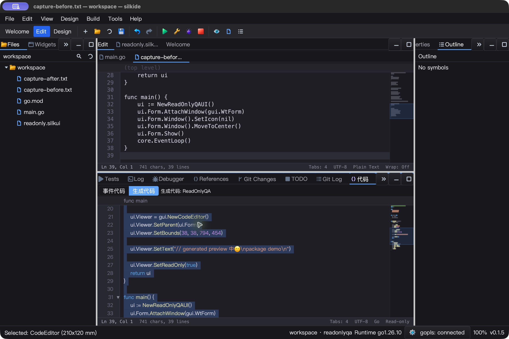
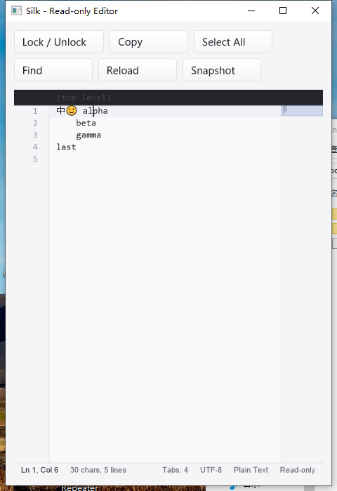
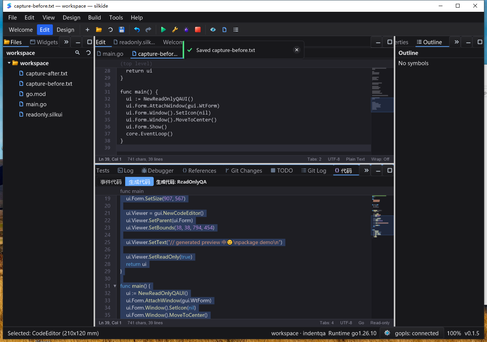

# Read-only editor and generated-source safety — 2026-10-25

## Result and regression evidence

Generated-code previews previously filtered keyboard input but still inherited
mutating SDK methods. Against the original source, eight regression cases failed:
move, duplicate, delete, indent, comment, join, replace-all and replace-selection.
The fix is a real SDK permission boundary, not a longer key allowlist.

Native macOS testing then exposed a second issue: application shortcuts run
before ordinary editor input, so Undo inside the preview could undo the unrelated
source document above it. The generated view now uses the existing focused
`IShortcutOverride` boundary for Undo/Redo, formatting, rename and code actions.
Other host commands and reader commands retain normal routing. Final acceptance
uses a rebuilt, uninstrumented binary, not the first candidate that exposed this.

## API, designer and UI

- `CodeEditor.SetReadOnly` / `IsReadOnly` block document mutations, native text
  input, completion acceptance, rename, replacement and paste. Copy, selection,
  Find, navigation, folding and scrolling remain available.
- Locking preserves text, revision, dirty state and stored history. Unlocking
  restores Undo/Redo. Availability notifications are event-driven; no polling or
  render-loop timer was added. Unchanged state calls return immediately.
- Pending editor-owned paste, formatting, completion and replacement work is
  retired on lock, including lock/unlock ABA. Cut rechecks edit permission after
  a native clipboard write returns. Error-returning edit APIs report
  `gui.ErrEditorReadOnly`; void edit commands do nothing.
- Context menus and Find replacement buttons show correct disabled states.
  The editor status shows **Read-only**; plain Tab can leave a locked document.
- Designer **只读** is serialized, restored, applied in preview and emitted as
  `SetReadOnly(true)`. The generated viewer uses this SDK mode and restores its
  safe reader context menu. `examples/editor-readonly` demonstrates the contract
  with wrapping buttons and exact JSON snapshots.

`SetText` remains an explicit **host/model reload exception**: it can replace a
locked buffer and reset history. Read-only is not a filesystem ACL, concurrency
lock or permission check for host-owned cross-file transactions. All editor APIs
are UI-thread-only. External providers must still validate their own requests.
The IDE does not gain a general filesystem/document-lock toggle in this round.

## Automated regression

Go 1.26.10, native uncached `-count=1` tests. Counts include subtests; groups
can overlap and should not be summed as distinct test cases.

| Gate | Passed | Skipped | Failed |
| --- | ---: | ---: | ---: |
| macOS arm64, ten-package `-race -short` | 4,806 | 45 | 0 |
| Windows 10 amd64, same native race gate | 4,695 | 66 | 0 |
| macOS supplemental graph/prop/settings race gate | 238 | 1 | 0 |
| Required real bundled gopls, macOS | 3 | 0 | 0 |
| Required real bundled gopls, Windows | 3 | 0 | 0 |

The ten-package gate covers `gui`, `ged`, `cmd/silkide`, `settings`,
`examples/editor-lines`, `examples/editor-indent`, `examples/editor-clipboard`,
`examples/editor-readonly`, `paint`, `purecairo`. The 52 SDK mutation subtests
cover both a caret and selection. Additional tests cover native Windows messages,
history transitions, stale async results, safe readers, menus/stale commands,
100,000-line zero-allocation availability queries, and generated-view shortcuts.

macOS vet (`-composites=false`), native IDE/SDK builds, bundled-tool verification
and a non-short generated-form compilation passed. The designer round-trip test
saves/loads three times and constructs the actual preview. Bundled-gopls tests
require real bundled binaries and do not accept a skip: unsaved Unicode completion
and formatting, rename, definition/type/implementation, and navigation back.

## Native UI acceptance

Both SDK examples passed **10 exact JSON snapshots**, covering:

1. Initial Unicode text, readonly state and empty history.
2. Rejected typing, deletion, Enter, line movement/duplication, join, Cut/Paste/Undo.
3. Select All and Copy preserve content; Cut/Paste remain blocked.
4. Find locates `beta`; Replace and Replace All remain disabled.
5. Unlock and insert `X`; lock and attempt Undo without changing text.
6. Unlock Undo; lock and attempt Redo without changing text.
7. Unlock Redo; lock and host Reload, resetting history.

Assertions compare full text, selection, readonly/clipboard/history availability,
dirty state, revision, primary caret and cursor count. Wide and approximately
480-pixel windows were visually inspected; buttons wrap without covering the
editor. Windows sampled 20/20 responsive states over 10.2186945 seconds with
0.078125 process CPU seconds (~0.76% of one core). This is a short idle observation,
not a frame-rate benchmark, improvement percentage or long-duration guarantee.

macOS IDE: actual designer property and generated `SetReadOnly(true)` were visible.
Generated source was copied through the UI to ordinary files before and after
blocked editing/global shortcuts: both were exactly **746 bytes**, SHA-256
`201ab32a6474d4938f2866771c4d725bf01351582ba33b443b0a5617eeef256e`.
The editable comparison document retained its content and clean state; normal
Copy/Paste/Save remained usable. IDE and SDK exited normally; the IDE's owned
gopls exited too.

Windows IDE: the same designer/property/preview flow passed on the native
Windows 10 desktop. Copy before/after blocked document edits and global shortcuts
preserved the generated source and the ordinary comparison document. The preview
retained Read-only status, its context menu disabled Cut/Paste, and the IDE used
its bundled connected gopls on a clean PATH. The final process and its owned gopls exited normally. Both saved copies matched
the same 746-byte SHA-256 recorded above. A further 20/20 IDE samples were
responsive, using 0.1875 CPU seconds over 10.1864837 elapsed seconds.

## Evidence and limitations

Raw ignored evidence: `bin/qa-artifacts/editor-readonly-20261025/`.
Windows root: `C:\silk\qa-editor-readonly-20261025-codex`.
Local input freeze: **1,598 files**. Windows uses an immutable **1,801-file baseline
plus 263-file overlay**, with pre/post verification. Process identities, native
binary hashes, task logs, source manifests, screenshots, raw JSON and saved files
are retained. GUI launches use isolated data directories; Windows uses a clean
system PATH. Final binaries contain no observability patches.

Preserved intermediate evidence includes the eight expected original failures,
test-harness compile corrections, and the first native candidate's misrouted Undo.
An initial remote build invocation was blocked by PowerShell execution policy;
rerunning with process-scoped Bypass started the build without changing system
policy. The upload helper's cleanup exit status was not trusted: remote symbols
and every overlay hash were checked. A macOS UI query after Quit accidentally
relaunched a QA instance; only that instance was terminated before launching and
normally exiting the final isolated instance. The final Windows mandatory gopls
probe retained a non-fatal prior-run/core.Close marker warning in its stderr;
all three mandatory cases passed and the probe exited zero. It is not described
as a completely empty diagnostic log. Both IDE logs also contain normal gopls
startup output and a missing external `property/ged.cml` warning with built-in
`default` fallback; the readonly property and generated output were verified
under that fallback. This optional-file warning is not fixed in this round.
A final harness assertion incorrectly assumed IDE stderr was empty; it was
corrected to retain and inspect these diagnostics, not delete or silence them.
SDK stderr was empty; neither IDE log contained panic or race reports.

Linux desktop behavior, IME composition, all DPI/theme combinations, filesystem
readonly permissions and long-duration stress were not revalidated. Application
menus still act on their documented workbench document context; this change does
not redefine every IDE command's focus routing. No complete Qt Creator parity,
release package or new version tag is claimed.
