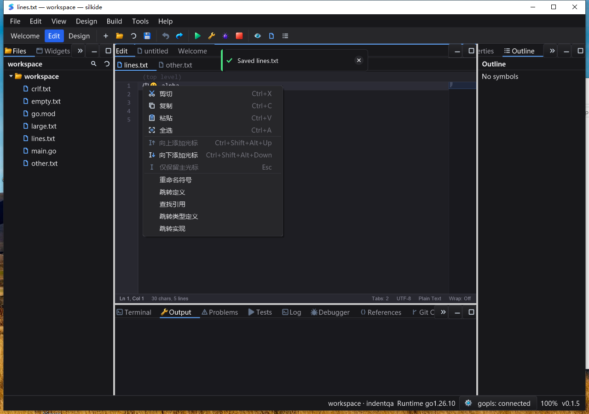

# Platform editor shortcut hints — 2026-10-25

## Result and cause boundary

The previous clipboard iteration recorded a real Windows Ctrl+Alt+arrow failure.
This follow-up traces native delivery rather than pretending that passing
`SendMessage` tests proves desktop hotkey delivery:

- On the test desktop, Ctrl+Alt+Down and Ctrl+Alt+Up delivered modifier messages
  and the arrow key-up, but **no arrow WM_KEYDOWN or WM_SYSKEYDOWN** reached the
  focused CodeEditor. Caret count stayed at one.
- Ctrl+Shift+Alt+Down delivered `WM_KEYDOWN` with Ctrl, Shift and Alt set; the
  editor added the second caret. Bare Alt+Down delivered `WM_SYSKEYDOWN` and
  continued to move the line.
- This places the failure before the editor's key-down handler. The exact
  OS, driver or desktop component consuming the original chord is **not identified**.

The Shift-inclusive chord was already accepted by editor dispatch. This change
makes it the **preferred Windows hint**, not a new event-routing fix. The old
chord remains accepted when delivered. No global keyboard hook, fabricated
key-down on key-up, timer or render-loop change was added.

## SDK and UI changes

- `gui.CodeEditorShortcuts()` returns an independent `CodeEditorShortcutHints`
  value for clipboard, multi-caret, line movement, duplication/deletion and
  indentation help. Windows carets use Ctrl+Shift+Alt+Up/Down; macOS uses
  Cmd+Alt+Up/Down; Linux hints retain Ctrl+Alt+Up/Down.
- IDE Edit-menu and Command Palette command specifications share SDK metadata.
  Seven editor context-menu entries now show a separate shortcut column while
  retaining icons and disabled-state behavior.
- This is presentation metadata, **not user-remappable keybindings**. Hosts
  overriding keys must supply their own hints. Tab/Esc remain context-sensitive
  (completion, snippets, find UI); the IDE does not label Indent as an
  unconditional Tab command.

## Automated regression

Go 1.26.10, uncached `-count=1` native builds/tests:

| Gate | Passed | Skipped | Failed |
| --- | ---: | ---: | ---: |
| macOS arm64, nine-package `-race -short` | 4,732 | 44 | 0 |
| Windows 10 amd64, same native race gate | 4,620 | 65 | 0 |
| macOS supplemental `graph`, `prop`, `settings` race gate | 238 | 1 | 0 |
| Required bundled gopls integration, macOS | 3 | 0 | 0 |
| Required bundled gopls integration, Windows | 3 | 0 | 0 |

The nine-package group is `gui`, `ged`, `cmd/silkide`, `settings`,
`examples/editor-lines`, `examples/editor-indent`, `examples/editor-clipboard`,
`paint`, `purecairo`. Counts include subtests, and groups overlap; do not sum them
as unique cases. The new Windows normal/system/repeat/key-up test passed natively.
Platform tables, returned-value isolation, context-menu hints/icons and IDE
menu/palette consistency have regression coverage.

macOS `go vet -composites=false`, both native IDE/SDK builds and both bundled-tool
verifiers passed. Required real bundled-gopls tests cover unsaved Unicode
completion/formatting, rename, definition/type/implementation and navigation back.
They run in a separate mandatory gate: missing gopls cannot pass by skipping.

## Native UI acceptance

Both platforms ran the normal, uninstrumented native IDE and independent SDK
example. Fixed fixtures include Unicode, spaces, tabs and trailing LF:
`中🙂 alpha\n    beta\n\tgamma\nlast\n`, plus a 100,000-row / 1,700,000-byte file.

Each IDE passed **14 saved-file raw-byte comparisons**:

1. Add three downward carets, insert X, Undo, Redo and restore.
2. Add three upward carets, insert Y and Undo.
3. Bare Alt+Down moves one line; Undo restores exact bytes.
4. Right-click Add Cursor Below, insert Z and Undo.
5. Command Palette Add Cursor Below, insert P and Undo.
6. Add two carets in the large file, insert L and Undo.

Each SDK example passed **four exact JSON snapshots**: initial state, three
carets, insertion at all three carets, and one-step Undo. Comparisons cover
text, selection, availability, Undo/Redo, pending-paste state, cursor count and
primary position, not just screenshots. IDE/SDK context menus, Edit menu and
palette were visually checked in the tested dark IDE and light SDK configurations.
Both IDEs and SDK examples exited normally; IDE-owned gopls processes exited too.

Windows sampling after the large-file workflow recorded **20/20 responsive
samples**, 0.3125 process CPU seconds over 10.2199643 elapsed seconds (about
3.06% of one core). This is a short responsiveness observation, not a
frame-time benchmark, performance improvement claim or long-duration guarantee.

## Coverage limits and evidence

Controlled Windows native-message tests cover both normal/system key-down,
old and Shift-inclusive chords, up/down, repeats and no action from orphan
key-up. They do not guarantee that the OS forwards every chord; the native GUI
replay above is the separate delivery check. Linux desktop delivery, IME
composition, all DPI/theme combinations and long-duration stress were not
revalidated. This iteration does not establish complete Qt Creator parity.

Tracing used a separately derived `window_windows.go` through a QA-only overlay
and separate executable. Production `gui/window_windows.go` was not patched;
the accepted normal build overlay has no trace source. Raw native logs and
four diagnostic snapshots remain separate from accepted GUI results.

Ignored evidence: `bin/qa-artifacts/windows-key-chords-20261025/`.
Windows root: `C:\silk\qa-key-chords-20261025-codex`.
The final checks matched **1,590 local build inputs**, and the Windows immutable
**1,801-file baseline plus 251-file overlay**, including after UI tests. Native
binary hashes, task results, process identities, exact saved outputs, screenshots,
source manifests and logs are retained. Windows GUI launches used an isolated
data directory and clean system PATH.

Harness-only retries included an early screenshot fetch before bootstrap completed
and a final validator using the wrong IDE stderr filename. Both were corrected;
final validation passed against the retrieved raw artifacts without changing
application source or suppressing application failures.
