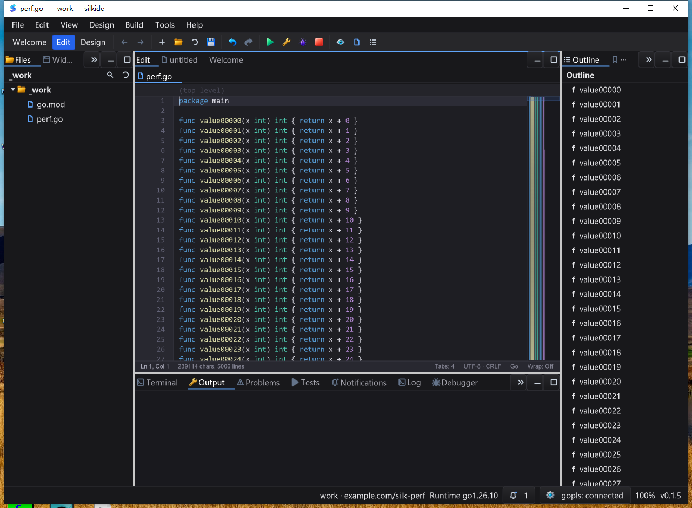

# Incremental symbol projection and outline snapshots — 2026-11-15

## Evidence and scope

Baseline: `cd5da6671ca296b2eb5050abf1f5601d5ca77358`. The preceding minimap
change improved painting but did not solve typing CPU or cumulative allocation.
Reuse the same Windows 10 Session 1, 5,000-function CRLF fixture, English input
layout, bundled gopls, non-race release flags and 161-character native replay
inside an EOF line comment (5,000 generated functions plus `main`).
Independently save/read the file and close the exact PID-owned window normally.

Artifacts and replay scripts: `bin/qa-artifacts/editor-analysis-20261115/`.
The heap experiment adds only the recorded `observability.patch` to a separate
source copy: after CPU capture finishes and memory counters are logged, force
one GC and write the sampled cumulative-allocation profile. This diagnostic
overlay is **not product source** and is identical for baseline/candidate.
Never compare its startup/GC behavior to an uninstrumented release as if they
were the same experiment.

The baseline allocation profile attributes approximately 53% to background
symbol parsing and 16% to rebuilding outline/flattened rows. The standalone
5,000-symbol outline-refresh benchmark allocated about 8.2 MB / 5,038 objects
per identical refresh. These are sampled allocation/logic measurements, not
displayed frame rate or input-to-photon latency.

## Implemented contract

- Share the tolerant AST parser, physical-source coordinates and lexical body
  boundaries. Do not replace them with a regex or a parser for a narrow subset
  of Go. Preallocate declaration/result arrays without changing recovery.
- Record proven safe line-comment payloads after a valid outline parse. Exclude
  function/receiver signatures, scanner directives, newline changes, invalid
  encoding, NUL/BOM and every edit whose equivalence cannot be established.
  Such edits continue through the complete AST fallback.
- Publish immutable projection metadata; private worker rebasing cannot mutate
  a delivered snapshot. Proven comment edits keep exact symbols ready on the
  UI thread, avoiding a background parse and transient indexing frame.
- Add `SymbolsSnapshotSince`: editor-local nonzero content identities, owned
  changed data, no copies for equal data, explicit pending/empty states. Keep
  old synchronous and snapshot APIs compatible.
- Retain owned outline rows/expansion when data is identical. Pending rows may
  remain allocated but are neither drawn nor actionable by mouse or keyboard.
  Rebinding editors and retiring semantic providers invalidate view identity.
- Keep one private parser/projection per worker, at most two active parsers
  process-wide. Close and large-to-small replacement retire the old source
  without joining a non-preemptible parser on the UI thread. No idle polling.

## First diagnostic native comparison

Both runs save the identical file SHA-256:
`ec798c639c8abfc910c01d8578e5bdb8ea54020d3d1a1345fcd13e548e8d526b`.
Both native processes exit 0. Memory counters are captured before diagnostic GC.

| Measurement | Baseline probe | Candidate probe |
|---|---:|---:|
| Native typing interval, s | 30.33 | 28.51 |
| IDE CPU during typing, s | 18.61 | 10.88 |
| IDE CPU, % of one core | 61.35 | 38.15 |
| Direct-child gopls CPU during typing, s | 23.05 | 22.16 |
| Cumulative Go allocation in 45 s, MiB | 1,919 | 465 |
| Paint count | 434 | 515 |
| Total CPU-side paint wall time, s | 8.37 | 7.73 |

This isolates a main-process analysis/allocation improvement. The language
server remains a separate substantial CPU consumer; no blanket gopls speedup,
universal editing latency, memory-leak fix or Qt Creator parity is claimed.

## Final uninstrumented release comparison

The final production source contains no allocation-profile overlay. Build with
`-s -w -H windowsgui` and `internal/idetools.RequireBundle=1`; use the identical
DLL/tool bundle, native Session 1 replay, source readback and 45-second built-in
CPU capture. Raw data: `_symbols-release-base-typing/` and
`_symbols-release-final-typing/`, with corresponding release verdict JSON files.

| Measurement | Baseline release | Final release |
|---|---:|---:|
| Native typing interval, s | 28.84 | 28.80 |
| IDE CPU during typing, s | 19.42 | 12.42 |
| IDE CPU, % of one core | 67.35 | 43.13 |
| Direct-child gopls CPU during typing, s | 23.69 | 24.84 |
| Cumulative Go allocation in 45 s, MiB | 1,941 | 483 |
| Paint count | 441 | 467 |
| Total CPU-side paint wall time, s | 8.14 | 8.73 |
| Normal close, s | 0.33 | 0.35 |

Both processes are responsive, save the identical SHA-256 above and exit 0.
Final binary SHA-256:
`51acb4d5e93b45915e0a12fe9828df1674e20b20fd89a1942a0129c8cb65708b`.
IDE CPU is about 36% lower and cumulative allocation about 75% lower in this
replay. Paint wall time and gopls CPU do **not** improve. Windows pprof native
wait samples are not substituted for OS CPU, and SendWait acknowledgement is
not presented as key-to-photon latency. A single matched replay is not a
statistical guarantee for all projects, typing patterns or hardware.



## General-code control: function-body string input

Do not extrapolate the EOF-comment fast path to ordinary code. Paste a complete
`func editTarget() { _ = "" }`, move inside the empty string with three native
Left keys, then type the same 161 characters. The source remains syntactically
complete throughout. This path still requires full background symbol parsing.
Run baseline/candidate, then repeat candidate/baseline with fresh capture and
APPDATA directories; binaries, DLLs, bundled tools and other conditions match.

| Order | Baseline IDE CPU, s | Final IDE CPU, s | Baseline allocation, MiB | Final allocation, MiB |
|---|---:|---:|---:|---:|
| Baseline → final | 17.00 | 17.61 | 2,057 | 1,414 |
| Final → baseline | 18.23 | 17.41 | 2,044 | 1,379 |

Typing intervals are 28.64–28.95 seconds. Allocation is cumulative over the
45-second capture, not retained heap. It decreases 31–33%; **no reliable CPU
improvement is demonstrated** (two-run means 17.62 vs 17.51 seconds). The first
pair is slightly higher, the reverse pair lower. gopls CPU is 24.05/24.08 and
22.95/24.11 seconds respectively: no demonstrated server improvement either.

All four processes are responsive, save identical SHA-256
`b1d3552d19b33588d258ffbcf9ad71bc0a6a2ab073388d624442a72f8795c204`
and exit 0. An independent standard-Go AST reader verifies the saved main
package, 5,002 functions, exactly one target assignment and the decoded
161-byte string value. Artifacts: `_symbols-body2-*-typing/`, `body3/` and
`body-native-repeated-summary.json`.

The first attempted control rejected a correct saved file because its literal
one-line assertion did not account for Save formatting the function onto
multiple lines. Preserve that failed harness result; it is not performance
evidence. Inspect the actual saved AST, fix only the whitespace-sensitive
assertion, then repeat from fresh fixtures/directories. No product patch was
made to disguise that assertion failure.

## Verification gates

- Exact AST differential tests: comment/header/receiver/directive boundaries,
  synthetic package offsets, physical `//line` coordinates, malformed input,
  invalid UTF-8, every truncation of a complex signature and repeated rebasing.
- Fuzz both private worker and immutable UI projections against the complete
  parser, rather than accepting a matching hash or a successful tool call.
- Snapshot ownership/empty/pending/content identity; no stale draw/jump;
  editor/provider switching, retained expansion and worker retirement races.
- Reconcile the final uninstrumented source with the platform runners and
  publication tree. Full ordinary/race and release-native results are reported
  only after their runner processes are terminal and exits/readbacks verified.

Final production source archive SHA-256:
`1cea3fb2f260a7ec05ff15a253577768946979b8b968620a87187ff20f672fbe`.

Final-tree full ordinary/race results (each listed run exits 0):

| Platform / mode | Named passes | Named skips | Failures |
|---|---:|---:|---:|
| macOS ordinary | 8,748 | 28 | 0 |
| macOS race | 8,748 | 28 | 0 |
| Linux ordinary | 8,687 | 36 | 0 |
| Linux race | 8,687 | 36 | 0 |
| Windows ordinary | 8,538 | 41 | 0 |
| Windows race | 8,538 | 41 | 0 |

Counts include named subtests/fuzz seeds, not independent user workflows.
Skips are not passes. All three platforms also pass the three strict real bundled
gopls probes for unsaved Unicode completion/formatting, rename, and
type/implementation/back navigation: nine passes, no skips. The Linux bundle
is verified arm64. Windows verifies the same 2,665-file archive before and
after ordinary/race tests; the terminal runner exit is 0.
Changed-area pure-Go rendering/race regression and no-CGO point/HMI consumer
tests exit 0. Final-source AST differential fuzzing executes 181,886 inputs in
61 seconds without a mismatch; an earlier no-matching-fuzz invocation is
retained as an invocation mistake, not counted as fuzz evidence.

The publication index reconciles 1,974 Go/native/module/embedded build inputs
with the frozen source, with no mismatch. README, changelog, QA prose and the
new native screenshot are the only later noncompiled additions/edits.

Focused source replay (with the project's native Cairo/toolchain prerequisites):

```sh
go test -count=1 ./gui ./ged -run 'TestGoSymbolIndex|TestSymbolSnapshot|TestSymbolContent|TestOutline'
go test -race -count=1 ./gui ./ged -run 'TestGoSymbolIndex|TestSymbolSnapshot|TestSymbolIndex|TestOutline'
go test ./gui -run '^$' -fuzz '^FuzzGoSymbolIndexEditsMatchFullParser$' -fuzztime=60s -parallel=2
go test ./ged -run '^$' -bench '^BenchmarkOutlineIdenticalSnapshotRefresh$' -benchmem
go test -count=1 -p 2 -timeout=20m ./...
go test -race -count=1 -p 2 -timeout=20m ./...
# STAGING_DIRECTORY/tools must contain a verified, matching-platform bundle:
bash scripts/test-bundled-gopls.sh STAGING_DIRECTORY
```

Native performance is not reproduced by those logic tests. Its retained local
scripts generate 5,000 one-line functions in a CRLF Go file, position the caret
at EOF, paste `\r\n// SILK PERF `, send `alpha beta gamma delta ` seven times
through native input at 125 ms intervals, save/read back, then close the owned
window. Keep APPDATA/tool bundle, file bytes, release flags and profile duration
constant, and measure the IDE and gopls processes separately. Local raw QA
artifacts are ignored build outputs, not files shipped in the Git commit.

## Remaining work

Ordinary code/structural edits still use the full tolerant parser; this is not
a complete incremental Go compiler. Local completion-index scans and full-text
JSON synchronization remain material allocations in the candidate profile.
The function-body/string control still takes the full-parser path; a comment
fast path must not be presented as a general code-editing CPU fix.
Further LSP/transport and keyboard/IME work must preserve unsaved-text ordering,
UTF-16 coordinates, stale-response guards and explicit-command flush behavior.
