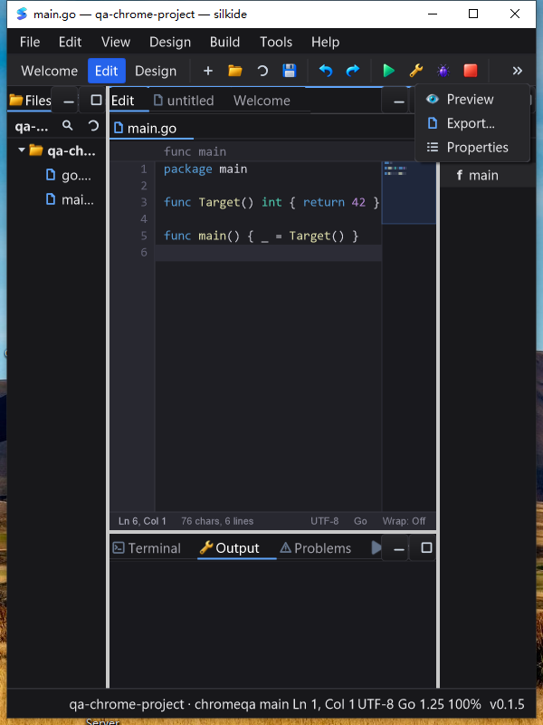
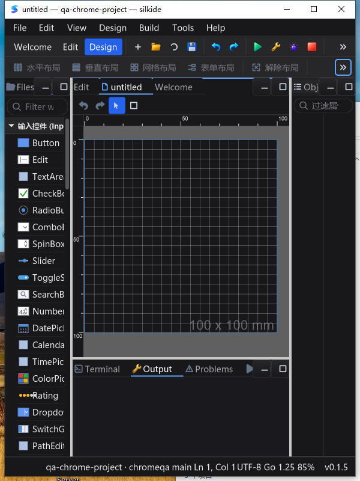

# SilkIDE 编辑器 / SDK / 紧凑工具栏：Windows 原生回归

日期：2026-10-21（UTC）。基线：`3a76b1c` 之后的工作区版本。
这是源码迭代验收，不是发行包发布，也不代表已实现 Qt Creator 全部功能。

## 本次提交范围

- 编辑器 / LSP：UTF-16 跳转、异步符号与文件搜索、失效结果清理、提示生命周期、语言服务重启和有界传输取消。
- 文件树 / Git：后台扫描、键盘导航、编辑器感知的文件及目录改名、冲突保护、异步 Git 标记与子进程回收。
- 宏 / SDK：宏高亮、定义 / 引用 / 补全、大纲和诊断、源码位置映射、安全生成，以及结构化错误信息。
- 持久化：设置保存合并、后台写入、退出时等待真实保存、Windows 原子替换，以及 TDoc 截断 / gzip / I/O 错误处理。
- 桌面布局：显式启用的紧凑菜单 / 工具栏、字体感知的按钮尺寸、可缩放溢出图标、菜单右缘定位、避免编辑器状态栏字段重叠。
- Windows 测试：隔离原生计时器的线程消息队列，保留精确计时器身份断言，并增加真实消息洪峰与反向对照。

各 SDK 的兼容性和限制见 `core/LSP_REQUESTS.md`、`core/TDOC_IO.md`、
`ged/FILE_EXPLORER_RENAME.md`、`gui/CODE_EDITOR_GIT.md`、
`gui/CODE_EDITOR_SYMBOLS.md`、`settings/PERSISTENCE.md`。

## 测试来源与环境

- 真机：Windows 10 `10.0.19045.0`，交互桌面 Session 1，1600×1200。
- Go：`go1.26.5 windows/amd64`；UCRT64 / Cairo 原生构建，不是交叉编译替代验收。
- 独立源码目录：`C:\silk\qa-20261021-stage17`，1685 个冻结输入文件。
- 源码清单 SHA-256：`2e6ac03e346091c73b1326f0b9635a08d5229fbc5a0626a0f0f2eef058bf7fbf`。
- 二进制：`qa-bin/silkide-stage17.exe`。
- 二进制 SHA-256：`37de4387884544fe1f17dcac8127fc18b75340d57742c02f63b8844bbb4d103b`。
- 递归检查并部署 19 个 UCRT64 DLL；每组 UI 回放先验证同一二进制哈希。
- 每组场景使用隔离项目和设置目录；一般 UI 场景的 PATH 不加入 Go / UCRT64，gopls 由独立 GOPATH 提供。改名场景显式加入测试 Git；阻塞 Git 场景使用受控测试程序。
- 构建前、构建后、UI 回归后，远端 1685 个输入哈希均匹配。最后一次远端回读为 `2026-10-21T17:53:57Z`。随后仅增加验收文档 / 截图，不改变已测产品代码。

## 原生构建与 race 门禁

在交互任务中设置 `SILK_TEST_NATIVE_MODAL=1`，执行：

```sh
go test -race -count=20 -v ./gui \
  -run 'TestWindowsMessageFairness|TestCompact|TestToolbarOverflowAnchors|TestEditorStatus'
go test -race -p 1 -count=1 \
  ./diagnostic ./settings ./macro ./internal/fileops ./core \
  ./paint ./gui ./ged ./cmd/silkgen ./cmd/silkide
go vet -composites=false \
  ./diagnostic ./settings ./macro ./internal/fileops ./core \
  ./paint ./gui ./ged ./cmd/silkgen ./cmd/silkide
go build -ldflags '-H windowsgui' -o qa-bin/silkide-stage17.exe ./cmd/silkide
```

专项重复 20 轮通过，10 个包的 race 全部通过，vet 和原生构建通过。
任务 `silk_stage17_gate` 为 Ready / LastTaskResult=0，终止标记 `STAGE17_GATE_PASSED`。

### 计时器旧失败的归因

原用例单独运行 20 轮通过，但完整 GUI 包运行失败：取到的是另一个 HWND 的
`WM_TIMER`，而非本用例创建的 NULL-HWND 计时器。Go 测试之间复用了带有其他窗口计时器的 OS 线程消息队列。

修正只涉及 `gui/message_fairness_windows_test.go`：使用有超时的独立测试进程。
没有把断言放宽成“任意计时器”，也没有修改生产消息泵。新用例先投递 64 条 wake，
证明未过滤的 `GetMessage` 先取 wake，再证明生产公平选择器能越过剩余 63 条 wake
取到精确的计时器，且下一条 wake 的顺序不变。专项 20 轮与完整 GUI race 均通过。

## 真实桌面回放

以下不是调用 SDK 后推断 UI 正常，而是原生键鼠操作，并以保存回读、光标处插入后回读、
实际进程 / 文件状态和截图确认。导航探针完成后撤销并恢复基线。

| 场景 | 已验证结果 |
| --- | --- |
| 工具栏 | 鼠标点击保存、撤销、重做，逐步检查文件字节，最终恢复原文件 |
| 窄窗口 | 600×800 下主工具栏溢出菜单完整显示 Preview / Export / Properties，编辑器底部字段不重叠 |
| 设计器菜单 | 同一前台会话中打开布局溢出菜单并点击“适应视口”；600×800 下画布从裁切变为完整 100×100 mm，状态显示 85%；窗口退出码 0 |
| Unicode / LSP | emoji / 中文前缀后的 F12、工作区符号跳转位置与输入焦点正确 |
| Quick Open | 空结果、路径搜索、520 个文件中选择超出初始 500 条展示范围的文件、取消后继续输入 |
| LSP 重启 | 终止本测试 IDE 的真实 gopls 子进程，执行 Restart LSP，验证旧进程回收、未保存文本保留和新服务跳转 |
| 文件树 | Reveal → Enter、过滤后 End / Enter、F5 刷新新文件、隐藏文件开关、取消改名 |
| 宏 | 定义跳转、补全与撤销；通过命令面板展开宏，磁盘生成文件包含 `var Answer = 42` |
| 文件 / 目录改名 | 未保存缓冲区与撤销保留；目录内多个编辑器路径迁移；冲突不覆盖目标，模态框内保存快捷键不泄漏 |
| Git 阻塞 | 受控 Git 子进程保持阻塞时，真实编辑器仍可输入、保存、撤销；超时及关闭 IDE 均回收其直接子进程 |
| 大纲 | 注释边界、泛型接收者子节点、键盘展开、选择清理、切换文档与未保存修订导航 |
| 设置 | 独占文件锁导致保存失败时仍能输入 / 保存 / 撤销；原设置不损坏；解锁后显式重试、退出最终保存、重启恢复活动编辑器及焦点 |

Finder 回放子进程结果为 0，其余六组在 `silk_stage17_replays_resume` 中全部结果为 0。
退出时检查了测试持有的 gopls / Git 子进程；没有以测试环境的其他进程替代被测对象。
截图同时确认宏大纲、词法着色、`SILK-MAC008` 未知宏诊断、`SILK-FS004` 改名冲突说明和泛型大纲层级。





### 自动化失败与重跑

- 首次启动脚本误用了 PowerShell 只读变量 `$HOME`，更名后重新启动；不计为产品失败或 UI 通过。
- 首次文件树回放未获得前台焦点，截图显示键盘落在其他窗口，文件从未打开。
  增加前台 PID 校验；仅在确认标题栏归属被测 IDE 时点击获取焦点，否则停止输入。
  在全新隔离项目中重跑，文件树全部断言通过；后续六组都使用该校验。
- PowerShell 附着的 `Process.ExitCode` 可以为空。原脚本把空值误判为非零；
  重跑保留原生进程句柄，以 `GetExitCodeProcess` 确认退出码 0，并检查 gopls 回收。
- 首次分段菜单探针重新聚焦主窗口，导致菜单提前关闭、点击落在下面的标签页。
  该次不算 Fit 通过；最终同一脚本内打开菜单并选择，比较前后截图确认画布确实适配。
- 失败日志与截图均保留，没有覆盖为成功；未把窗口出现、脚本结束或菜单消失直接当成业务动作成功。

## 有界性能采样

同一 Windows 原生二进制，1280×1000 设计器窗口、鼠标离开窗口：

| 指标 | 观测 |
| --- | --- |
| 静置采样 | 20 次 / 20.220765 秒 |
| IDE 进程 CPU 时间 | 0.25 秒，约 **1.24% 单核占用** |
| 无响应采样 | 0 / 20 |
| 20 轮 680×740 ↔ 1280×1000 缩放 | 持续响应 |
| GDI 资源 | 83 → 83 |
| USER 资源 | 41 → 41 |

这里只测 IDE 进程，不包括 gopls 的 CPU；不是长期泄漏证明，不是大型项目性能基准，
没有测量 FPS，也没有据此宣称 1–25 FPS 策略或性能提升倍数已经验收。

## macOS 与剩余边界

- [Stage16 macOS 原生回归记录](docs/test-reports/macos-editor-chrome-2026-10-21.md)：
  10 包 race、vet、真实窗口保存 / 撤销 / 重做、F12、宏大纲与布局菜单验证通过。
  与本次 Windows 冻结输入相比，唯一代码差异是 Windows 专用计时器测试，不是产品代码。
- Linux 原生桌面、Windows 多 DPI / 多屏、长时间压力、大型工作区，以及全部菜单、甘特图、打印机和组态控件没有在本轮完整验收。
- 极窄窗口的侧栏文字截断、Dock 标签可见性、全局状态栏空间分配与混合语言文案仍需后续打磨。
- 另记录两个后续项：Fit 后再次放大窗口，画布变大但全局缩放标签仍保持 85%，需要核对实际视图比例与标签同步；`.txt` 恢复场景仍显示 Go 默认补全，本次只验收文本 / 焦点恢复，不代表非 Go 语言识别已完善。
- Git UI 阻塞探针不是远程仓库 / 网络 Git 操作验收。模态错误路径、文件读写保护等结论只适用于记录的场景。

## 证据位置

本地完整日志 / 截图 / 脚本：`bin/qa-artifacts/editor-sdk-20261021/stage17/`（不提交构建产物）。

- `source-manifest.json`、`final-source-verification.log`
- `windows-gate-run.log`、`chrome-evidence/qa-stage17-focused.log`、`chrome-evidence/qa-stage17-race.log`
- `windows-baseline-fullgui.log`、`windows-baseline-isolated.log`
- `windows-chrome-actions.log`、`chrome-evidence/qa-stage17-performance.json`
- `windows-replays.log`（保留首次前台焦点失败）、`windows-replays-resume.log`
- `windows-chrome-exit-retry.log`、`windows-fit-replay.log`
- `final-ui-evidence.zip`、`final-task-results.log`
