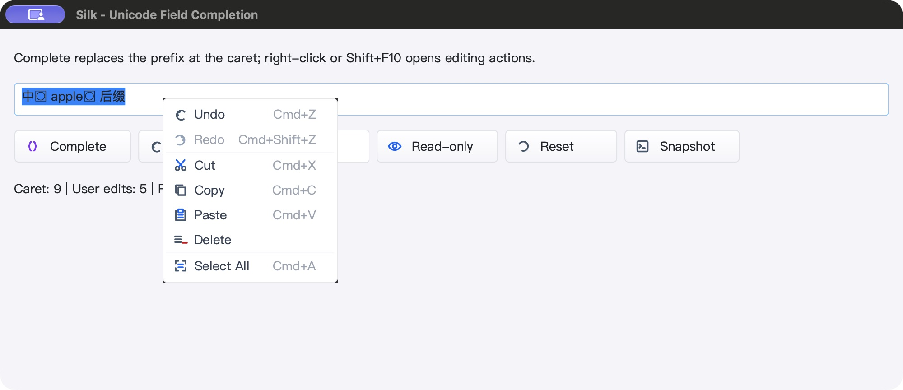
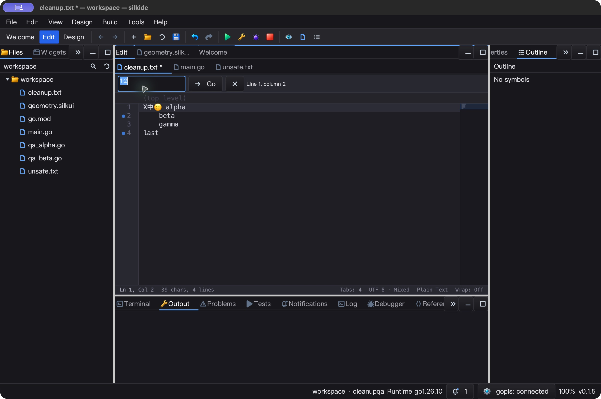
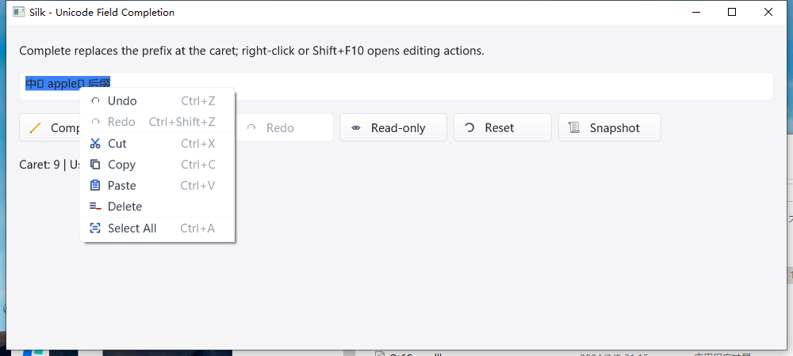
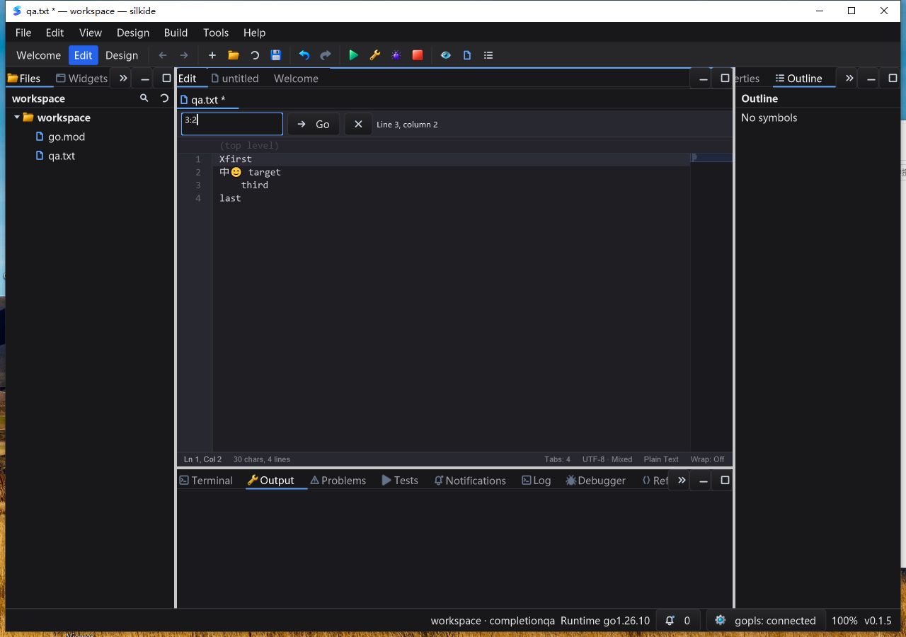

# Unicode 补全、查询框历史与选区反馈 QA — 2026-10-25

开发中记录，非发布／全平台全量通过声明。接续 [字段菜单 QA](EDIT_MENU_QA_20261025.md)。

## 复现与修复

修改前用新增回归复现：

- `CompletionPrefix` 把 rune 光标当 byte 下标，`A中🙂` 会截成无效 UTF-8。
  `AcceptCompletion` 同时绕过只读／禁用／长度／校验器，直接 SetText 丢弃历史。
- “转到行”的派生 `HandleShortcut` 吞掉 Undo/Redo，但没有执行字段自身历史。
- 字段在所属右键菜单取得焦点后停止绘制选区，用户看不到即将剪切／删除的目标。

修改后：

- 保留 `SetCompletionPrefixStart` 的 byte 接口，内部转换到 rune 区间，用活动光标
  而不是选区锚点。非法边界对齐，不复制光标后的正文。
- 补全先经过输入约束，再走普通编辑事务；保留后缀、原选区和之前的历史，
  取消过期粘贴，发出一次 changed／edited 通知对。历史同步保存补全起点。
- 导航条查询／按钮优先转发字段历史，空历史不向背后正文穿透。
- 所属菜单可见期间保持选区色，但不伪造字段键盘焦点或失焦光标。
- 新增 `examples/edit-completion`，提供补全、历史、只读、重置、状态快照和响应式
  按钮布局。原生检查发现图标按钮默认隐藏文字，已显式启用标签并加入测试。

## 自动验证

证据目录：`bin/qa-artifacts/edit-completion-20261025/`。

- `before-fix.log` 保留上述失败；`integration-tests.log` 还保留测试夹具自身的问题：
  `SetSelection` 会排序，不能用它构造反向选区；重新挂载可见假菜单触发了非主线程
  Cocoa 窗口创建。分别改用反向选区夹具、隐藏后换父控件，不修改生产线程保护。
- 最终 `mac-gates.exit=0`、`MAC_BUILD_RACE_GOPLS_OK`；七包
  `-race -short -count=1 -p 2`：**5,342 pass / 42 skip / 0 fail**（含子测试）。
  根包 race-short、vet、IDE／两个 SDK 示例构建通过。
- RequireBundle 产物的真实 gopls：Unicode 未保存补全／格式化、重命名、
  类型／实现／返回导航 **3 pass / 0 skip**。
- 1,685 源码输入构建前后哈希相同。IDE SHA-256：
  `f954e5bd45ccb26acea7e58ff73d448e42be584bd37ba72d9087879e30b9e2ae`；
  SDK：`22c755e00498c891cb890d4184c2378c4d759421ce1f67c2277f8d72800d2bd8`。
- 修改前源码 overlay 对照：10 万字符后缀、短前缀查询原来每次分配约 **106,496 B**；
  现在只为结果分配 **5 B**。新基准 27.21–27.41 ns/op，1 alloc/op；旧基准约
  415 μs/op。仅为局部查询基准，不等于整帧速度或跨机器性能承诺。

## macOS 原生 UI 与内容读回

关闭调试日志，隔离 HOME／数据／工作区，使用以上二进制：

- SDK 真鼠标 Complete：`中🙂 ap 后缀` → `中🙂 apple🍎 后缀`，rune 光标 5→9，
  用户编辑计数只增加 1。按钮 Undo/Redo 与 Cmd+Z/Cmd+Shift+Z 共用同一历史。
- 全选右键时蓝色选区保持可见；鼠标 Delete 后 Shift+F10→Home→Enter 恢复原文本
  和选区。只读后补全、Undo、键入 Q 都不修改内容。6 个 stdout JSON 快照已断言。
- IDE 在 cleanup.txt 首部输入 X，打开 Cmd+G 查询栏；一次完整粘贴 `3:2`，
  Undo（含空历史重复 Undo）回到 `1:2`，正文 X 不变；Redo→Enter 跳到第 3 行第 2 列。
- 保存后磁盘确认为原始字节前加 X；正文重新获得焦点后 Undo→Save 恢复全部原始
  混合行尾及空白。7 个 fixture SHA-256 一致，不只依赖截图／通知。
- SDK／IDE 分别静置 5 秒，累计 CPU 各增加 0.04 秒（约单核 **0.8%**）；只是
  短采样。Cmd+Q 后精确 PID 23638／25086 均确认退出。

## Windows 与边界

- 本轮网络恢复并确认测试机身份；新目录使用 1,801 文件基线与 392 文件 overlay。
  远端回传 `tested-overlay-hashes.json` 与本地一致。
- RequireBundle IDE／补全 SDK 真机构建、附带工具包校验通过；
  `WINDOWS_COMPLETION_TARGETED_BUILD_OK`，`go test -race -short -count=3 -p 1`
  定向测试通过。命中的包为 gui、cmd/silkide 和两个示例；prop 显示
  `[no tests to run]`，不算该包有实际定向用例通过。
- Windows IDE SHA-256：`72804510d8336232c574b5e3b12b123d15d7d977e1d815359b48ef1f638d4402`；
  SDK：`e5c1f330783317bfe450dc1c61bf022b2959355152493376cd51f551adef7f2a`。
- Windows 交互式任务 `silk_completion_interactions`：最终 **Ready / LastTaskResult=0**，
  marker 为 `WINDOWS_COMPLETION_SDK_IDE_UI_OK_AND_CLOSED`，不是只看 SSH 退出码。
  SDK 原生补全、按钮／键盘 Undo/Redo、右键选区高亮、菜单删除、Shift+F10 撤销、
  只读保护通过；7 个 JSON 快照确认文本、rune 光标、选区和编辑次数。
- IDE 原生查询框重复 Undo 后正文 X 不变，Redo 可见 `3:2`，Enter 后状态栏确认
  第 3 行第 2 列。保存内容是 X 加原文，正文 Undo→Save 后 SHA-256 恢复基线。
  本轮 Windows 只验证该文本 fixture，不套用 macOS 的 7 文件数量。
- SDK 空闲 5.018 秒 CPU 增加 0.015625 秒（约单核 **0.31%**）；IDE 5.014 秒
  增加 0.109375 秒（约 **2.18%**），两者 `Responding=true`。仅为 GUI 进程短采样，
  不包括 gopls 子进程，不等于整机／长期帧率承诺。精确 PID 3836／1976 正常关闭，
  远端复查均不存在。
- 上阶段 Windows 全量 race／强制 native-modal 失败没有被这次定向绿灯覆盖。
  Linux 原生 UI 未验证；没有进行发布或 commit/push。
- SDK `Edit` 仍存在 emoji 字形回退的视觉缺口：快照证明码点完整，但截图有占位字形；
  IDE CodeEditor 则能绘制 emoji。不能把 Unicode 数据正确等同于字形渲染完整。
  菜单圆角边缘也需后续像素级检查。新示例使用显式 Complete 按钮，不自动弹出候选。

## 后续字形修复

本报告上述截图与 Windows 结果保留为当时的证据；后续 `TextBlock` 已改为保留字体归属
与浮点光标几何。macOS 新截图确认彩色 emoji 不再为占位符，详见
[后续字形与布局 QA](TEXTBLOCK_FALLBACK_QA_20261025.md)。该后续版本 Windows 测试机
SSH 不通，不能沿用本报告的 Windows 通过结论。菜单圆角黑边仍是待处理项。
