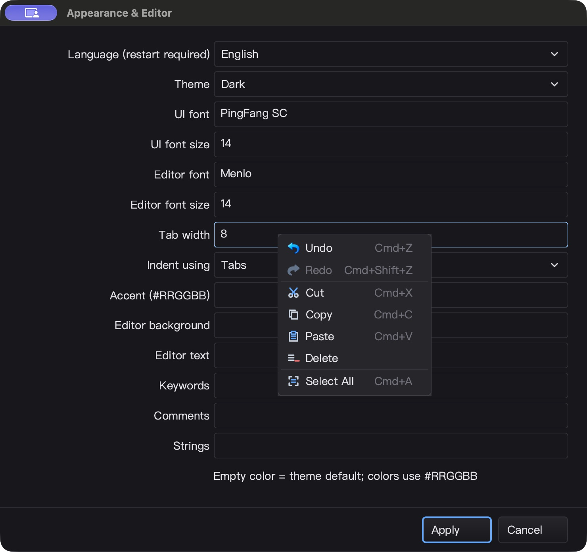
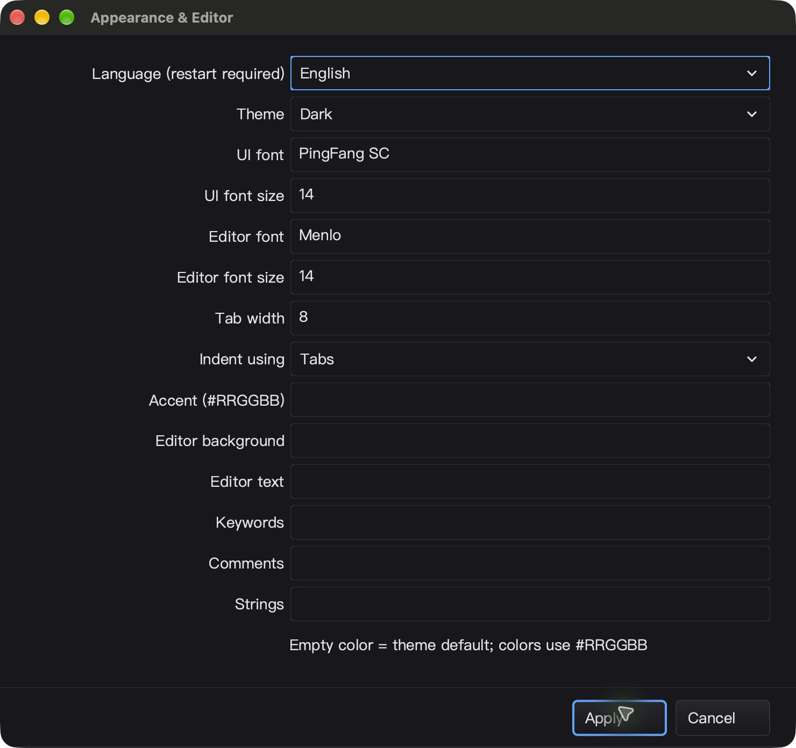

# 字段菜单、局部历史与设置间距 QA — 2026-10-25

开发中阶段记录，非发布／全平台通过声明。接续
[模态 popup 鼠标焦点 QA](POPUP_MOUSE_QA_20261025.md)。

后续的 Unicode 补全、导航条 Undo 和菜单选区高亮修复见
[补全联动 QA](EDIT_COMPLETION_QA_20261025.md)；本文保留本阶段当时的验证边界。

## 本轮修改

- `gui/edit_context.go`：右键／Shift+F10 菜单、矢量图标、平台快捷键提示、
  只读／禁用／空选区可用性。每个 Edit 懒创建并复用所属菜单，关闭清理动作闭包；
  动作执行前复核 revision、选区、owner 和可见／启用祖先。
- 自定义菜单注册优先，派生 `IContextMenuProvider` 可覆盖默认菜单；重复 F10
  不反复打开。Windows 系统键路径也有处理。
- `gui/edit_history.go`：仅保存变化片段，最多 256 条、1 MiB UTF-8 载荷；
  Unicode Undo 恢复原选区／光标，Redo 恢复结果光标。查询 O(1)，无新增轮询。
  程序化 SetText／约束改变重置历史；输入／重放取消迟到的异步粘贴。
- `gui/edit.go`：剪切只在系统写入成功且内容／选区仍相同后删除，不先 Clear
  剪贴板。失败保留原文本和历史；修正 Backspace／Delete 的历史选区记录。
- `cmd/silkide/appearance.go`：FormLayout 统一 6 点标签间隙／行距，窗口高度计入
  14 段额外间距，避免末行提示和按钮被挤出。没有修改 SDK 布局接口。

## macOS 自动验证

证据目录：`bin/qa-artifacts/edit-menu-20261025/`（忽略的 QA 产物）。

- `mac-gates.exit=0`，`mac-gates.log` 含 `MAC_BUILD_RACE_GOPLS_OK`。
- `mac-race.jsonl`：gui、ged、prop、cmd/silkide、examples/combobox 五包，
  `-race -short -count=1 -p 2`，**5,328 pass / 42 skip / 0 fail**，含子测试。
  根包 race-short、vet、IDE／SDK 构建均通过。
- RequireBundle IDE 附带 gopls；强制真实 gopls 的 Unicode 未保存补全／格式化、
  重命名、类型／实现／返回导航 **3 pass / 0 skip**。
- 专项覆盖：历史边界、只读／禁用、过期菜单、Unicode 删除／选择、剪贴板写入
  失败／重入、迟到粘贴、菜单释放、自定义构建器、键盘及图标存在性、布局边距。
- 修正旧测试中“剪贴板写入失败仍清空剪贴板并删除文本”的错误期望；成功剪切
  使用注入 writer 验证，未把失败测试改为跳过。
- `attempt-1/` 保留早期新增测试编译失败；修复不存在的测试构造器后重新完整运行。
  首次失败不计入最终通过，也没有覆盖删除。
- 1,682 个源码输入构建前后 SHA-256 相同。IDE：
  `92eb02c89e0e97ea4fe6530481c54c523ee51cc7578a29b3f1cea82bb839041c`；
  SDK 示例：`07e8a8301cf7a60bddc99d10b7c8510aca2846545e5866aed7969bd3bf947ebf`。

## macOS 原生 UI 闭环

隔离 HOME／数据／工作区，关闭调试日志，启动上述冻结产物；不是测试替身。

1. Appearance → Tab width：全选输入 8，Cmd+Z 可见 4，Cmd+Shift+Z 可见 8。
2. 右键菜单图标及启用状态可见；鼠标点击 Delete 后字段清空，菜单关闭，
   **Appearance 仍保持原生前台焦点**。
3. Shift+F10 → Home → Enter 撤销，字段恢复 8；Apply 后主窗口自动取得焦点。
4. 重新打开设置，可见 8；隔离配置读回 `tabSize=8`。间距和底部按钮完整可见。
5. 命令面板只读详情全选右键：Undo／Redo／Cut／Paste 禁用，Copy 启用。
   Esc 后 Cmd+Z 和键入 Q 不修改只读文字或背后文档。
6. 7 个工作区 fixture SHA-256 未变。Cmd+Q 后确认本轮 PID 1397 已退出。

`mac-ui-readback.json`：静置 5 秒 CPU 累计增加 0.05 秒，约单核 **1%**。
这只是短采样，不能代替帧率／长期性能验收。缓存与千项搜索基准均为 0 alloc；
字段历史可用性也有零分配测试，微小计时可能被编译器优化，不作速度承诺。

## Windows 与剩余边界

- 已准备冻结源码 overlay（388 个增量输入，基线 1,801 文件），脚本先验证
  基线／增量 SHA-256，再构建 RequireBundle IDE 和 SDK，计划重复三次定向 race。
- 本轮传输／SSH 两次终止于 `Connection timed out during banner exchange`；
  首次连接复查成功但目标目录尚不存在，之后状态查询也超时。
  技能记录的备用地址单独连接同样超时，没有在未确认机器身份时继续部署。
  **本轮 Windows 构建、定向测试及新菜单原生 UI 均未获得通过证据。**
- 同时发现 QA 打包格式问题：初始 `.tar` 未压缩，而 `winpush.sh` 使用 `tar xzf`。
  已生成 `windows-input.tar.gz` 并记录修正；恢复网络后应使用 gzip 包，不能仅凭
  传输脚本退出码判断成功，仍须远端源码哈希、构建 marker 和 UI 断言闭环。
- 上阶段 Windows 原生 ComboBox／设置读回的通过记录不能替代本轮新代码验收；
  全量 race 的 Git／调试器耗时失败及强制 modal 前台前置条件失败仍保留，见前篇。
- Linux 未进行原生 UI 验证；本轮没有新增密码回显模式。
- 菜单打开时字段选区仍保留，但失焦后的高亮呈现待改进。派生导航条的快捷键
  override 尚未接入局部 Undo，不能声称所有派生输入快捷键统一完成。
- 旧的直接补全／validator fixup 路径清除历史，并不支持作为普通编辑被撤销；
  Unicode 补全偏移整合留待单独回归。
- macOS 未直接改动用户系统剪贴板；本轮真实 UI 验证的是菜单 Delete／Undo／Redo，
  写入成功／失败与重入保护由注入剪贴板 writer 的测试覆盖。

本轮未 commit、push 或发布；保留既有工作树修改及历史 QA 失败证据。
