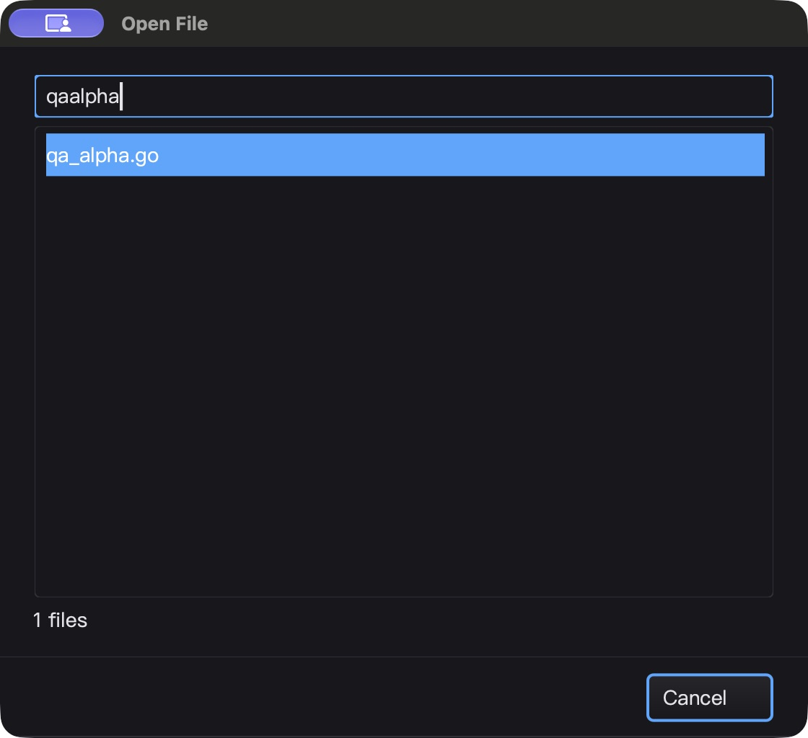
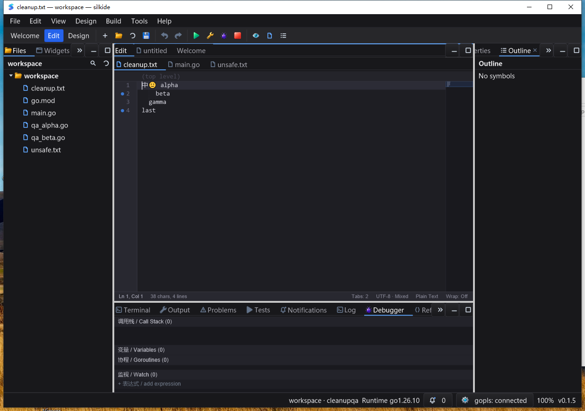

# 搜索结果键盘导航验收（2026-10-25）

基于 `b65f33f`。本轮补齐输入框与结果列表的组合交互，不涉及重新设计原生窗口
调度，也不声称完成全项目或 Qt Creator 功能对齐。

## 缺陷与修复

- 基线原生界面：命令面板输入 `Show` 后按 Down，仍停在第一项。
  两项新增回归在修复前失败：输入框方向键不移动结果、回车固定接受第零项。
- SDK 新增 `Edit.SetNavigationList` / `NavigationList`：单行输入框中的无修饰键
  Up／Down／PageUp／PageDown 使用现有列表导航和滚动逻辑，焦点和查询保持不变。
  Home／End、Tab、Enter、带修饰键及多行编辑保留原有语义。
- 命令面板、快速打开文件、工作区符号搜索统一使用该 API；命令面板回车接受
  当前高亮结果，仍在模态窗口退出后执行命令，保留不可用命令检查。
- 仅允许同控件树、同原生窗口中的可见可用目标；忽略分离、隐藏、禁用及跨窗口
  列表。可见原生对话框不会错误继承隐藏逻辑宿主的不可见状态。
  文件／符号搜索关闭时解除关联，已有异步过期结果保护不变。
- UI 线程 API，无新增轮询、定时器或后台任务，不替换宿主筛选、选区或提交回调。
  单测覆盖 Unicode、反向选区、重复键、分页滚动、空列表和重入回调清空／解绑。

## macOS arm64

- 15 包 `go test -race -short -count=1 -p 2`：4,947 项通过、45 项跳过、0 失败
  （含子测试，跳过不算通过）；`graph/prop/settings` 另有 238 通过、1 跳过。
- `go vet -composites=false`、要求内置工具的 IDE 构建、gopls 清单校验通过。
  3 项强制真实内置 gopls 测试通过且无跳过：未保存 Unicode 补全／格式化、
  重命名、定义／类型／实现导航。
- 原生 UI：命令面板 `Show` → Down → Enter，实际打开第二项 Debugger；
  Quick Open `qa` → Down → Enter，打开 `qa_beta.go`；真实 gopls 符号搜索
  `Qa` → Down → Enter，从 QaBeta 移到 QaAlpha 并打开 `qa_alpha.go`。
- 选中过第二项后继续输入 `alpha`，查询变为 `qaalpha`，结果缩为一项，输入未落入
  源编辑器；Escape 正常关闭。5 个测试源文件的原始 Unicode／换行字节不变。
- 空闲 5.05 秒 CPU 增量 0.05 秒，约单核 0.99%；只代表此片段，不是帧率保证。
  原生 Quit 后核对 IDE PID 与内置 gopls 均退出，不冒充已捕获退出码。



## Windows 10 amd64

- Go 1.26.10 / CGO 原生构建；校验 1,801 个冻结基线文件与 314 个覆盖输入。
  测后远端覆盖输入逐项回读，SHA-256 与当前本地源码相符。
- 15 包 `-race -short -count=1 -p 2`：4,838 项通过、66 项跳过、0 失败（含子测试）；
  IDE 原生构建、内置 gopls 清单校验和上述 3 项强制真实 gopls 测试均通过。
- 干净 PATH 交互桌面：`Show` → Down → Enter 打开 Debugger 而非第一项 Log；
  快速打开选第二项打开 `qa_beta.go`；工作区符号选择 QaAlpha 后打开 `qa_alpha.go`。
  截图确认高亮与实际面板／文件，标题断言通过。
- 三类搜索都在导航后从查询框全选复制，精确读回原查询；继续输入细化为
  `qaalpha` 后只剩一个结果，取消正常返回。5 份测试源文件逐字节未变。
- 检查活动语言服务实际路径为测试程序旁的 `apps/tools/gopls.exe`，不依赖系统 PATH。
  5 次健康采样全部响应，5.06 秒 CPU 增量 0.09375 秒（约单核 1.85%）。
  Alt+F4 正常退出，IDE 与其内置 gopls 均结束。
- 三个交互计划任务 LastTaskResult 均为 0，并回读各阶段显式成功标记；不将
  helper 的退出状态或“没有找到默认日志路径”单独视为 UI 测试成功。



## 性能与限制

M2 Max / Go 1.26.10 / GOMAXPROCS=2：500 行列表中一组 Down + Up 约
309 ns/op、0 B/op、0 allocs/op。这是导航微基准，不含原生按键投递、查询及整帧绘制，
不能代替端到端延迟或长期负载测试。

此前快速重开命令面板的输入时序现象，本轮两次基线尝试未稳定复现，因此未修改
底层焦点恢复，也不将该现象声明为已修复。没有 Linux 原生 GUI、完整 IME／DPI／
多屏矩阵或长期压力验收。普通 Edit 不绑定列表时行为保持不变；SDK 仍仅限 UI 线程。

## 重放与证据

```sh
go test -race -count=1 ./gui ./cmd/silkide \
  -run 'Test(EditNavigation|PaletteInput|FileFinder|SymbolFinder)'
go test -run '^$' -bench '^BenchmarkEditResultNavigation$' -benchmem ./gui
```

UI 重放：在一个 Go workspace 创建 `qa_alpha.go` / `qa_beta.go`，分别定义
`QaAlpha` / `QaBeta`；打开命令面板输入 `Show` 后选第二项回车；快速打开与工作区
符号搜索同样选择第二项，核对实际打开的文件。结果顺序以当次界面为准。
选中后继续输入以缩小查询，取消，再比对源文件字节及进程退出状态。

完整证据位于 `bin/qa-artifacts/finder-input-20261025/`，包含失败基线、race JSONL、
冻结构建输入哈希、gopls 日志、基准、原生截图及退出记录。缓存和二进制不提交。
