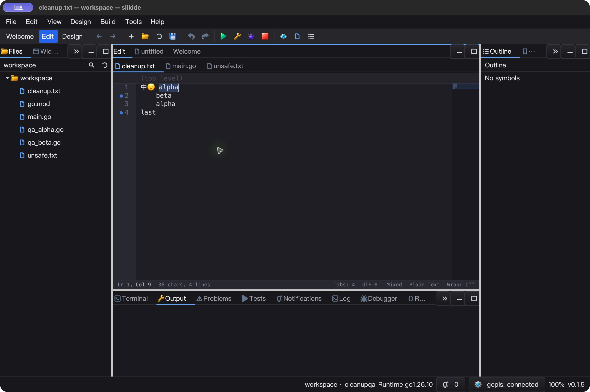
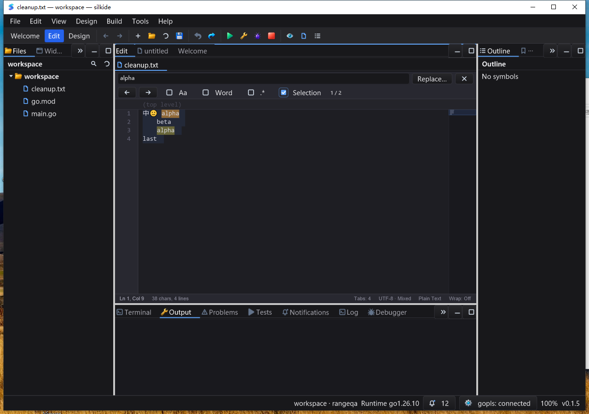

# 查找结果选区与异步导航验收

本轮完善编辑器查找到实际编辑的链路，不代表所有控件／Qt Creator 功能已经对齐。未提交、未推送、未发布。

## 实现与行为变化

- 匹配结果成为真实选区，光标在末端；关闭 Find 后直接输入替换选区。Unicode、非法 UTF-8 字节、混合行尾、多行正则和零宽匹配均有定向测试。
- Enter／Shift+Enter、F3／Shift+F3、前后按钮共用导航。手动移动文档光标后，按实际位置二分定位，不使用旧结果索引；搜索选项改变后也核对索引对应的真实范围。
- 异步等待期间累计前后步数，新查询清除旧导航。交付时比较请求对应的光标、选区、附加光标、焦点、文档版本、父级和窗口；状态改变时可接受有效计数／高亮，但不应用旧导航。
- 单个匹配导航清除附加光标，查找本身不改文档／撤销栈。零宽匹配可继续前后移动，没有伪造选区。
- 原始冻结搜索范围与自动选中的匹配分离，启用 Selection 不缩成单次命中。零命中只清除查找自身持有的旧选区，保留用户另选内容。
- SDK 的 `SetFindQuery` 定位也遵循真实选区语义；宿主不能再假定它只移动到匹配开头。默认查询起点策略未改。没有新增公共 API、计时器、轮询或工作线程。

## 自动测试与来源

证据：`bin/qa-artifacts/find-navigation-20261026/`。冻结 1,772 个源码输入，相对上一阶段变化 6 个源码／测试文件。

- 修改前源码 overlay 重放新测试，复现没有真实选区、延迟结果覆盖新光标／选区／编辑，以及排队导航只保留最后一步。旧实现失败、当前实现通过。
- 定向 Find／regex／scope／异步生命周期测试以 race 模式连续三次通过。
- macOS 七包非缓存 race/short 回归：**6,184 个通过事件，48 个跳过，0 失败**（包含子测试）。pure-Go 定向 race、构建及内置工具校验通过。
- Windows 10 七包非缓存 race/short 回归：**5,973 个通过事件，70 个跳过，0 失败**。定向查找 race 连续三次、原生构建、内置工具校验通过。七包为 `paint`、`graph`、`decl`、`ged`、`gui`、`prop`、`cmd/silkide`；不是全仓库无条件全绿声明。
- 新增查找导航测试在两平台各产生 **20 个通过事件**。异步场景用受控 worker 交付验证，不能替代所有系统负载下的原生时序测试。
- `go vet -composites=false` 通过；默认 vet 前后仍各 **452 条已有告警**，归一化后无新增。默认 vet 并非全绿。
- 旧的“文档点击后输入”测试曾只改光标、未清除选区；现在补齐点击的清除选区前提，而不是让输入绕过真实选区。

## 原生 UI

macOS 使用同一 SHA-256 的原生构建，正常模式完成 **18 项精确文件回读断言**：首个／下一个／上一个匹配，前后按钮，查询框键盘菜单，原始 Selection 范围，零命中保留插入位置，以及保存／撤销恢复。基线包含中文、emoji、制表符和混合行尾。不是仅凭截图或按钮点击判断通过。

初始实例曾在输入测试前出现一个意外未保存字符，之后鼠标有效、键盘操作未见效果。菜单撤销／保存恢复了基线，正常关闭后，用同一产物重启并重连自动化，调试模式与再次重启后的正常模式均完成测试。**初始现象原因未确定，不算已修复**；中途另有自动化提示用户改变窗口状态，重新读取状态后继续，也不足以证明初始问题的成因。三个实例均确认关闭，无遗留本轮进程，文件恢复基线。

Windows 10 在交互桌面 session 1（1600×1200，应用窗口 1280×900）完成对应的 **18 项精确文件回读断言**。先检查当前查找栏截图，确认按钮与 Selection 坐标，再操作；不是在 SSH session 0 注入。4 个交互任务均为 `Ready / 0`，标记与执行脚本哈希一致。正常关闭后确认本轮 IDE／工具进程为 0，文件恢复基线。

Windows 在干净 PATH 下使用已校验的内置工具；验收前后核对 1,801 个不可变基线文件和 522 个 overlay 输入。绝对 `GOFLAGS=-overlay=...` 传递给子 Go 进程。此处的 QA 组装不等于安装包／签名／发布认证。

macOS：Escape 关闭 Find 后仍保留可编辑匹配选区。



Windows：启用原始 Selection 范围后，两个命中仍可导航，未缩成单次命中。



## 性能与范围

- 二分查找替代按位置扫描导航结果；常规连续导航不重新扫描文档。
- 导航快照只在 UI 事件边界创建，没有附加光标时不复制光标数组；有附加光标时复制其位置。快照不在 worker 中读写控件。
- Apple M2 Max 微基准，各 5 次、每次 500 ms：常规连续匹配导航中位数 **214.1 → 264.6 ns/op**，真实选区／归属核对增加约 50.5 ns，分配维持 **160 B、2 次**。不能声称全部导航都变快。
- 独立 benchmark overlay 使用同一份合成的 100,000 条已排序命中，反复按位置定位尾部，中位数 **46,135 → 225.4 ns/op**，约 205 倍；分配同为 **160 B、2 次**。这个集合是合成输入，不代表默认查找上限，也不包含扫描、worker、绘制或系统输入耗时。
- macOS 正常实例约 5.005 秒空闲采样，进程累计 CPU 0.04 秒，约 **0.80% 单核**。仅限该窗口与短时空闲状态，不代表复杂文档压力下的帧率。
- Windows 约 5.006 秒空闲采样，进程累计 CPU 0.015625 秒，约 **0.31% 单核**，`Responding=true`。采样受平台计时分辨率影响，不与 macOS 数据直接作性能排名。
- 尚不承诺所有布局、显示器缩放、Linux 桌面、所有输入法和第三方宿主组合。短 CPU 采样或微基准不代表整帧耗时或输入延迟保证。
- 当前状态快照用于拒绝不匹配的交付，不是记录所有“离开后又回到同一状态”的交互历史。

## 回读与复核

本阶段源码文件：`gui/codeeditor.go`、`gui/codeeditor_find.go`、`gui/codeeditor_find_bar_test.go`、`gui/codeeditor_find_navigation.go`、`gui/codeeditor_find_navigation_test.go`、`gui/codeeditor_find_scope.go`。工作树此前已有大量修改；`phase-source.diff` 仅描述本阶段六文件差异，不替代全部工作树 diff。

```sh
python3 bin/qa-artifacts/find-navigation-20261026/verify-final.py
```

该脚本回读冻结源码、旧实现失败证据、测试事件、平台产物、18+18 项文件断言、任务状态、CPU 采样、关闭状态和截图。`artifact-hashes.json` 保存文档、脚本和证据哈希；生成型验证报告排除在自身哈希输入之外，可再次运行。

原生产物 SHA-256：

```text
macOS   029e865fc3412628682eda4934bc50d317a9216879d5dc0169b8bcca2d97baa9
Windows 3baed059ebf792a3d5b74a0d0397eba6f1c2fbc38479e91780ebda71c851e4ef
```

本轮保持 HEAD `98eda478092cb8b2509bdccb2e02954d2a8420e4`，未 commit、push 或发布。Linux 桌面、Windows 高 DPI、多显示器和长时压力测试未覆盖；macOS 初始键盘异常保留待查。
