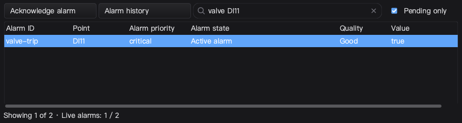
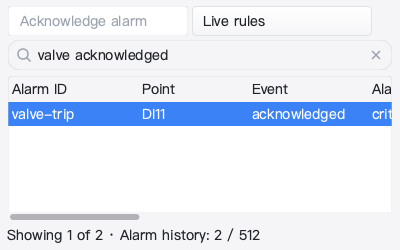
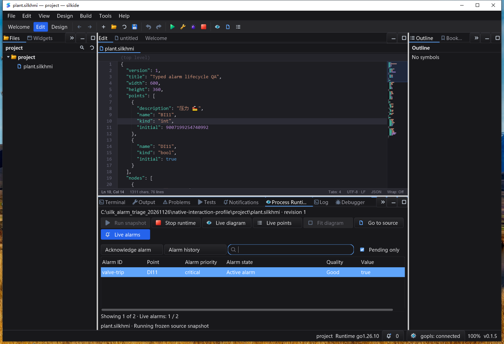
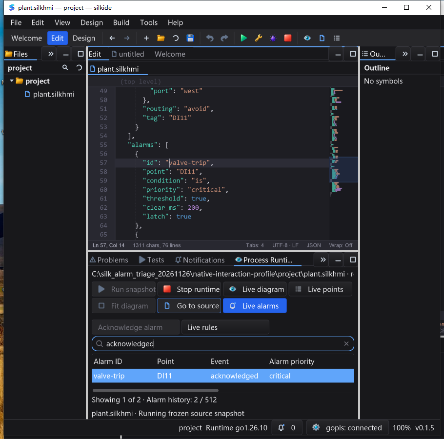

# HMI alarm triage verification

Source candidate: `1504fbb` plus the alarm triage changes. The portable
archive contains 2,905 files and has SHA-256
`8fe124ca2418a3c3dd2361c9356caa2d561228444f6e7f2e003d55871b0ae6d1`.
Evidence: `bin/qa-artifacts/alarm-triage.vvqkh5/`.

## Safety and interaction coverage

- A case-insensitive multi-word query matches the rule ID, point or priority
  in either view, and event type in history. Oversized queries do not silently
  revert to the unfiltered list.
- Keep selection only when the same live occurrence or history sequence is
  still visible. If the selected row is filtered out, acknowledging is
  disabled; clearing the query does not select a different row.
- **Pending only** excludes normal and already acknowledged live rules.
  Acknowledging the selected pending rule removes that row without selecting
  the next one. The history view remains read-only and does not inherit the
  pending filter. Stopping or rebinding clears the filters.
- Layout bounds cover both modes across widths 240, 400, 659, 660 and 900.
  This is a widget geometry test, not a native interaction verdict.

## Rendered widget checks

An isolated test fixture used the production widget tree and Cairo renderer,
with keyboard events routed to the search box and Pending only control.
In both light and dark modes, the wide panel kept the filters on one row.
In the compact panel, search wrapped onto its own row; the pending control
stayed hidden in history, and the matching event remained navigable but
could not be acknowledged. These are widget renders, not desktop screenshots.

A separate in-process GLFW dispatch fixture exercised the actual widget
hit tests using a synthetic window. Pointer clicks enabled Pending only,
focused search, cleared it, selected the displayed row, acknowledged it and
opened history. Committed keyboard characters reached the focused search
box, and the detached monitor rejected further input. The sequence passed
25 race-enabled repetitions without changing the frozen source.

## Windows 10 native interaction

The independently built IDE used the same verified archive and a fresh
profile in the interactive Windows session. The frame hashes were verified
locally after the run. In the 1460 × 1000 window, searching `pressure`
cleared the previous `valve-trip` selection and disabled acknowledgment.
Checking **Pending only** showed 0 of 2. Clicking the clear icon restored
only `valve-trip`; explicitly selecting and acknowledging it returned the
pending count to 0 of 2 without another selection.

In the 910 × 900 window, search wrapped below the two buttons. **Pending
only** was absent in history. Searching `acknowledged` found one of the two
events; **Go to source** located `valve-trip` at line 57, column 14. Stop
cleared the filters and displayed **Stopped; no acquisition**. The app
exited normally, persisted that caret position, and left the fixture bytes
unchanged. SQLite's integrity check passed, and both point value tables
were empty.

## Platform gates

- macOS arm64: full and race suites each passed 9,736 named tests with
  29 skips and zero failures. All source hashes matched before and after.
  Four strict bundled-gopls integration tests passed. The focused alarm race
  suite also passed 25 repetitions.
- The native macOS test executable reached the Cocoa event loop. CUA did
  not return a window handle, including on a separate direct bundle launch.
  No native interaction pass is claimed.
- Windows 10 amd64: the five focused alarm race tests each passed 25 times
  (125 passes, no skips). The uncached full and race suites each exited
  zero with 9,533 named passes and 43 skips. Four strict bundled-gopls
  tests passed. The terminal matrix verified all 2,905 source hashes and
  found no extra Go files.
- The first native fixture stopped at its 40-minute wait for the Windows
  matrix and never opened a window. The independent native interaction
  runner above passed; no UI result is inferred from the first fixture.
- Linux arm64/Xvfb: the full and race suites each passed 9,678 named tests with
  34 skips and zero failures. All four strict bundled-gopls checks passed.
  The runner exited zero and the 2,905 source hashes matched before and after.
  Dependency preparation ran outside the tested source.
