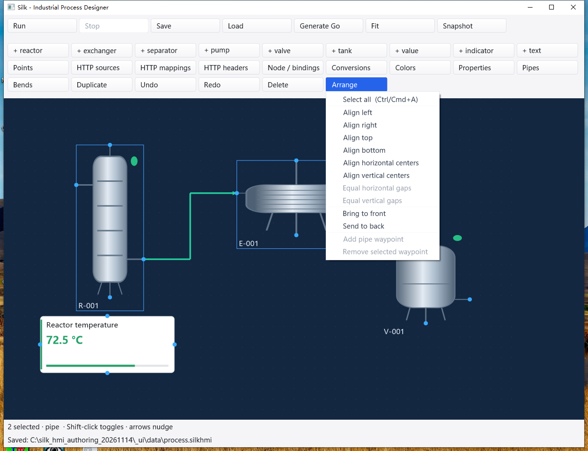
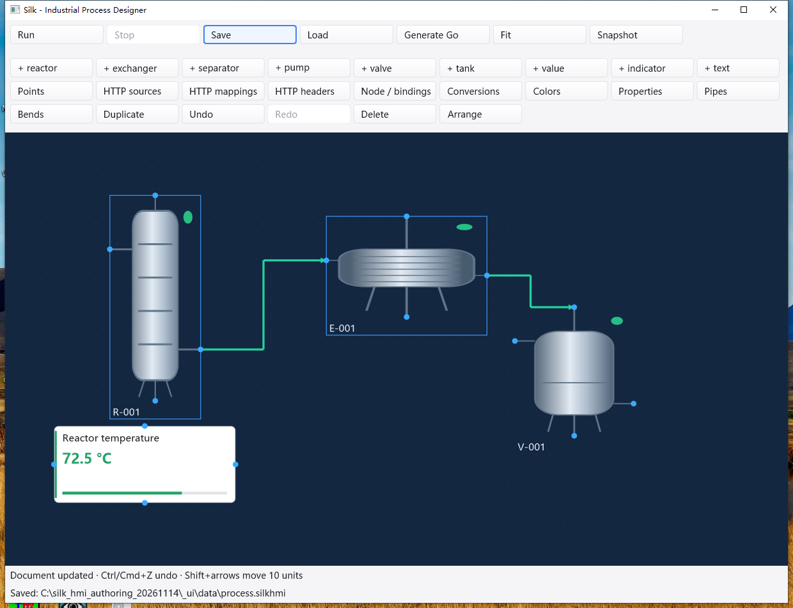

# Industrial 2D group-authoring verification — 2026-11-14

This is an unreleased development iteration after `6b9381b`. It does not declare
the continuing SilkIDE product goal complete or claim Qt Creator/SCADA parity.

## Source identity and reproduction

The immutable test candidate contains 1,931 Go files. Its archive SHA-256 is
`6fc0067da31e27c446fb6491b596d1df14dedcbd63c10d380f4b241321994b74`.
All candidate Go files were compared with the working tree after testing; no
runtime/test Go-source drift was found. README, screenshots and this report were
updated after the code snapshot. QA artifacts are intentionally outside tracked
source at `bin/qa-artifacts/hmi-authoring-20261114/`.

```sh
go test -json -count=1 -p 2 -timeout=20m ./...
go test -race -json -count=1 -p 2 -timeout=20m ./...
CGO_ENABLED=0 go test -count=1 ./hmi ./point
go test ./gui -run '^$' -bench 'BenchmarkProcess(MultiDrag|DiagramDrag)' -benchmem
```

Linux runs use Xvfb, software rendering and the normal native library closure;
Windows runs use the actual Windows 10 machine and its UCRT64 Cairo closure.
The candidate is copied to fresh test roots; generated main programs and data
stay under separate/underscore-prefixed QA directories, not source packages.
Source-audit tests see the candidate's Go files in its isolated Git index.

## Automated results

Counts include named subtests. Skips are retained, not reclassified as passes.

| Platform | Ordinary full suite | Race full suite |
|---|---|---|
| macOS arm64 | 8,635 pass / 28 skip, exit 0 | 8,635 pass / 28 skip, exit 0 |
| Debian 12 arm64, Xvfb | 8,574 pass / 36 skip, exit 0 | 8,574 pass / 36 skip, exit 0 |
| Windows 10 amd64 | 8,415 pass / 51 skip, exit 0 | 8,415 pass / 51 skip, exit 0 |

Windows changed-package race regression (`hmi`, `hmiapp`, `gui`, `ged`) separately
passed: 4,977 named tests / 25 skips, four packages, exit 0. The no-CGO `hmi` and
`point` SDK regression also passed. These results do not by themselves prove
physical desktop behavior or a frame-rate target.

New regression coverage checks atomic group clamping/internal waypoint movement,
deep copy and maximum exact integers, edit budgets and rejected edits, alignment,
distribution, layering, subgraph copies, resize/capture cancellation, marquee,
keyboard history, read-only action state, authored-vs-live properties, exact
string/body whitespace and strict advanced-pipeline JSON. Existing designer
factory/save/load/preview and actual generated-Go compile tests remain included.

## Windows native desktop

The tested race-enabled executable SHA-256 is
`d214ce54525cdf8f0eff9a047ebd8fcf70d946315d9f2f97be952b7baab61159`.
The interactive task verified Session 1 and an HWND owned by that exact process,
not an SSH Session-0 or console window. Native input exercised:

- Shift multi-selection, group dragging, one-step Undo/Redo and corner resizing.
- The actual owned Arrange popup, keyboard navigation and alignment.
- Pipe segment picking, waypoint insertion/dragging/undo and toolbar deletion.
- Ctrl+D subgraph duplication, Ctrl+Z, directional marquee and Shift+Arrow nudge.
- Save-file readback after edits, explicit Run/Stop, responsive idle and normal
  Alt+F4 exit (held process handle, native exit code 0); no race report.

Independent local readback of the pulled final `.silkhmi` file proves reactor
`(150,90,130,320)` and exchanger `(460,120,230,170)`, four nodes/two pipes, no
remaining feed waypoint. Thus the nudge persisted, resize/duplication were
undone, and deleting the waypoint did not delete its pipe.

Two harness failures were preserved rather than hidden: the first C# helper
referenced a type from a separate dynamic assembly; after correction, a
PowerShell `@($null).Count` assertion incorrectly treated an omitted empty JSON
array as one item. The persisted file already proved deletion correct. The
assertion was fixed and testing resumed from that exact live process/state.

A second isolated run opened the actual saved file and exported Go through the
native **Generate Go** button. Windows built that exact output with `-race`,
launched the generated application on the interactive desktop, verified editor
mode/four nodes/two pipes, and saved/read back the moved coordinates. The
generated application exited normally (0), with no race or heartbeat warning.
Generated source SHA-256:
`c15462a9c4394f8bf8996e075ee2732832f9d2f597ac519aef178d5a906af1b8`.
Generated executable SHA-256:
`e17740e2d41d7d29d822724309ba2a874fd8136e18bda01beed34951174e18b3`.





## Performance observations and remaining verification

The local **logic-only** preview benchmark measured two-node group movement at
91.04 ns/op and single-node movement at 61.93 ns/op, both 0 B/op / 0 allocs/op.
This excludes drawing, presentation, event delivery and commit-time validation;
it is not rendered FPS or whole-application latency evidence.

The Windows functional run's idle sample recorded 0 process-CPU seconds over
13.706 wall seconds (counter-resolution-limited). Its log also contained one
5.293-second heartbeat warning/recovery while the separate full Go build/test
was running. This warning is not silently classified as a performance pass;
the subsequent isolated debug-enabled repetition did **not** reproduce it.
That same binary reopened the authored file, completed four drag/undo and fresh
Snapshot acknowledgments, saved/reloaded and exported actual Go, remained
responding throughout 15.413 seconds of idle, and exited normally with no race
or watchdog warning. Idle used 0.109375 process-CPU seconds (about 0.71% of one
core in this sample). The Snapshot round trips were 1.05–1.30 seconds **including
the automation helper's deliberate input delays**, not a rendering/input-latency
benchmark. The original warning's cause remains unproven; a compiler-contention
reproduction with stacks is still an open investigation, not a claimed fix.

macOS candidate build and full/race suites passed, but native automation could
not observe the candidate: ScreenCaptureKit returned `-3811` before any authoring
action. Reattaching the same process and resetting the automation connection did
not restore capture. The owned QA process was subsequently retired with SIGTERM
(launcher exit 143), **not** counted as a normal UI close or native UI PASS.
Linux Xvfb coverage is not physical-desktop/hardware-GPU verification.

## Product work remains active

The next requirements include normal IDE `.silkhmi` source/visual coordination,
obstacle-aware routes/caches, reusable device subgraphs and point-prefix mapping,
typed live-point tools/operator writes, full alarm lifecycles and further
editor/LSP/DPI/rendering polish. See [the active plan](PRODUCT_ITERATION_PLAN.md).
Current condition colors are not alarms, and this is not a safety interlock or
certified industrial control system.
