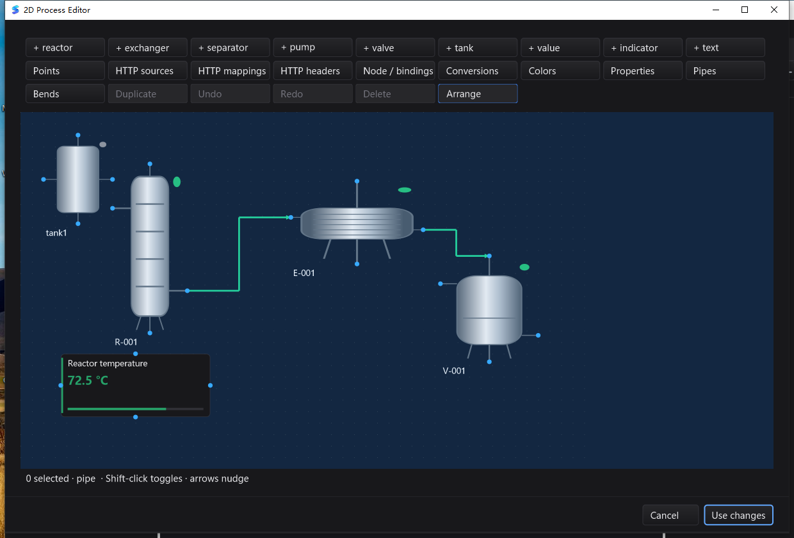
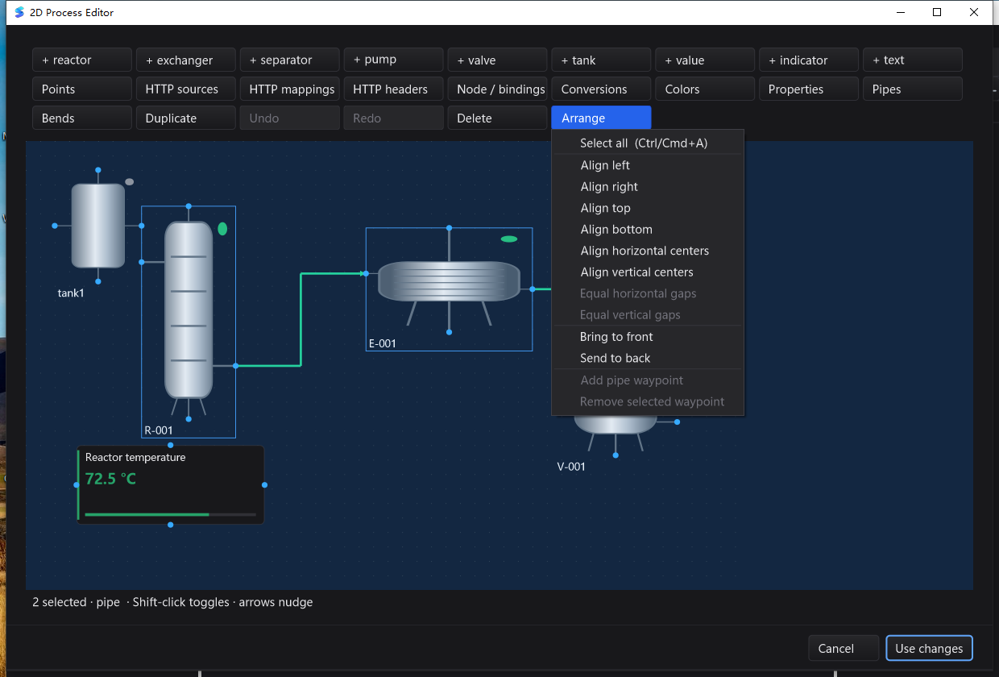

# IDE process-document coordination — 2026-11-14

This unreleased increment follows `bd3019d`. It adds source/visual coordination,
not full Qt Creator parity or an industrial safety/control certification. The
continuing product plan remains active.

## Implemented workflow

- `.silkhmi` is JSON source, including case-insensitive extension detection.
- Tools and the command palette expose **Edit 2D Process...** only for the
  eligible current document. The menu has an existing vector preview icon.
- A bounded background decode captures source identity/revision. Late results
  cannot open over another/changed/closed/read-only document; stale commits are
  rejected, including conflicting file operations.
- An owned, resize-fitted modal stages the document. Nested point/binding tables
  stay owned and inert. Use changes submits one normal buffer replacement;
  Cancel/no changes do not dirty or save the source. Normal Undo/Redo, Save/Save
  All, dirty-close handling and recovery remain the host authority.
- LF/CRLF is retained where the document byte budget permits. No parallel shadow
  file, acquisition worker, SQL store or HTTP request is started by the modal.

## A visual defect that automated interaction tests missed

The first candidate (`162fadc6…`) passed functional native editing and host
history, but its debug-enabled screenshot showed red placeholder crosses and a
pale fill behind the toolbar/footer. `ProcessEditor` inherited the bare
`Widget.Draw` debug placeholder. That candidate was **retired**, not counted as
final visual acceptance.

The final candidate paints its own theme-aware surface. Added raster tests cover
ordinary/modal composites, light/dark colors and out-of-bounds pixels. Focused
race tests also passed with `SILK_DEBUG=1` and the optional pure-Go renderer.
The final native source/visual flow was rerun against the rebuilt executable.

## Final source and automated regression

Frozen candidate: 1,935 Go files; archive SHA-256
`1ea0a6165dd65b5532fd86db6155fef8bc765d3dd0e664b2f92a0df7c6e7e538`.
Go files are compared with the working/staged tree before publication; docs and
screenshots are finalized afterward. Local raw evidence is under
`bin/qa-artifacts/hmi-ide-final-20261114/`; earlier failed/retired evidence remains
separate at `bin/qa-artifacts/hmi-ide-20261114/`.

```sh
go test -json -count=1 -p 2 -timeout=20m ./...
go test -race -json -count=1 -p 2 -timeout=20m ./...
go test -tags silk_pure_go -race -count=1 ./gui ./cmd/silkide \
  -run 'TestProcessEditorComposite|TestProcessDocumentModal|TestProcessAsset'
```

Named subtests are included; skipped tests are not passes.

| Platform | Full ordinary suite | Full race suite |
|---|---|---|
| macOS arm64 | 8,640 pass / 28 skip, exit 0 | 8,640 pass / 28 skip, exit 0 |
| Debian 12 arm64, Xvfb/software rendering | 8,579 pass / 36 skip, exit 0 | 8,579 pass / 36 skip, exit 0 |
| Windows 10 amd64 | 8,420 pass / 51 skip, exit 0 | 8,420 pass / 51 skip, exit 0 |

Strict **real bundled gopls** probes separately passed on all three platforms:
three cases each, no skips. They verify unsaved Unicode completion/formatting,
renamed unsaved definitions, and type/definition/back/implementation navigation.
They use the staged bundle resolver with required-tool gates, not a developer
PATH substitute. Default-suite optional-tool skips remain visible in their logs.

## Windows native verification

The final race-enabled IDE executable SHA-256 is
`75ed137f1abe0240b41a1c55c2563a2dea4a88749201d7f1ebe5eb41136692c6`.
Session 1 and each target HWND's owner PID were checked. The same exact process
was continued after harness admission failures instead of blindly restarting it.

The initial chooser attempts exposed test-harness weaknesses: a pending IME
composition did not accept the native Open dialog, a PowerShell JSON-array cast
was wrong, and a fixed one-second dialog/foreground assumption was too short.
These failed attempts are preserved. The corrected flow confirms actual native
chooser completion and source readiness, waits for foreground transitions and
then operates only the owned target. No foreground-lock/system setting or
product focus-forcing workaround was added.

The final native flow proved:

1. Open the real saved `.silkhmi` source; use the actual palette to open the
   structured editor. Resize, select two devices and nudge them together.
2. Add a tank, undo/redo inside the visual editor, use its owned Arrange popup.
3. Open the nested point table. The IDE is disabled while the visual modal is
   open; the visual modal is disabled only while its child is open. Closing the
   child returns focus/input to the visual modal, not to the still-disabled IDE.
4. Use changes returns to the enabled source editor. The disk is unchanged both
   before Use changes and afterward until an ordinary Save.
5. Save/read back five nodes/two pipes, reactor X=160 and exchanger X=470. One
   host Undo + Save restores the original bytes; Redo + Save restores edited
   bytes. Reopen, make a draft edit, cancel; disk remains unchanged.
6. Close normally through the native window, exit 0. No DATA RACE or heartbeat
   warning was emitted during this final flow, which overlapped full Go tests.

File readback identities:

- Original SHA-256: `2c5138963d183a3f01984dd72bd82b1771acd177cb304241b9e3b763ab80d73d`.
- Edited/redo SHA-256: `7e7990b10e1e0fb0011e8580e4fd53ea3612d56e9b48a578b37cca579ed093bd`.

This is UI/state/history evidence, not an FPS claim or proof that the older rare
compiler-contention heartbeat delay has a diagnosed root cause.

A separate run with debug disabled restored the saved IDE session, reopened the
same visual editor from the palette, selected devices/opened Arrange, cancelled
without changing the file, and exited normally (0). Its source and executable
hashes match the identities above; it emitted no race/heartbeat/debug log. README
screenshots use this clean native run, not the rejected debug-placeholder image.

One initial screenshot during concurrent full tests showed only part of the
equipment, while subsequent interaction showed the full model. A fresh quiet
run captured the initial, +1-second and +4-second frames without input: those
three captures had identical client-area pixels and all five devices/values were
present (298 changed pixels were confined to the screenshot's outermost bottom
border row); Fit retained the same fixture pixel counts. The cause of the earlier partial
capture is **not proven** (capture/presentation timing versus application
painting). It remains a targeted first-frame-under-load investigation, not a
claimed rendering fix. The README overview uses the verified stable capture.





## Remaining boundaries

Native macOS observation remains blocked by the ScreenCaptureKit `-3811` failure
recorded in [authoring QA](HMI_AUTHORING_QA_20261114.md). No old native pass is
reused for this new modal. Linux Xvfb is not physical-desktop/hardware-GPU QA.
This commit is not a new signed/notarized multi-platform binary release.

Node-to-source-caret selection, IDE-integrated live runtime panels, reusable
device subgraphs/point-prefix tools, obstacle-aware routing and alarm lifecycles
remain open in [the product plan](PRODUCT_ITERATION_PLAN.md).
