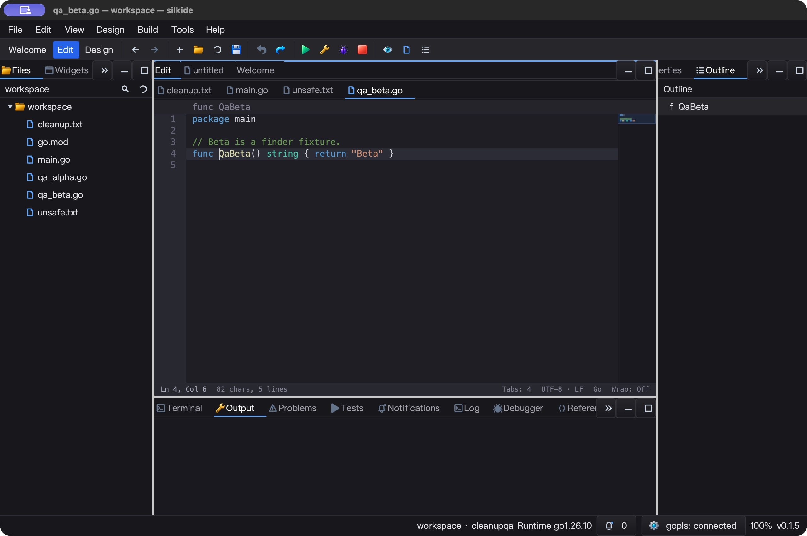
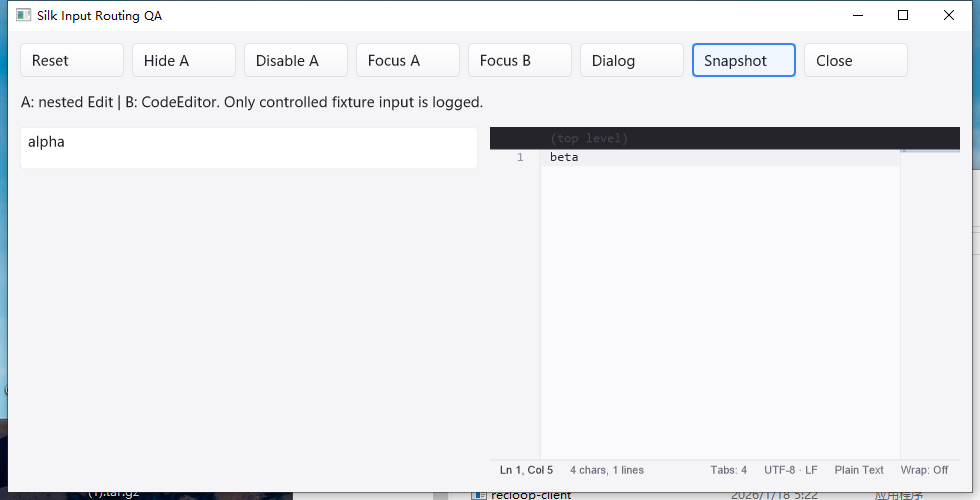

# 原生输入作用域回归（2026-10-25）

基于 `98eda47`，本轮修复输入派发边界，不改剪贴板实现、IME 提交协议或渲染节拍。

## 根因与修复

- GLFW `onKey` 有窗口范围检查，`onChar` 却直接选择全局 `focusWidget`。
  通过真实注册回调入口的失败基线，复现无关 Form、隐藏控件／祖先、禁用祖先、
  已脱离窗口控件收到 `x`，以及无焦点时根编辑器意外收到 `x`。
- 原输入路径借用的 `IsAllAncentorsVisible` 不检查控件自身，且遇到无原生窗口的
  中间父控件便提前停止。本轮不贸然改变这个通用方法及所有调用者，而是新增输入
  专用 `focusedInputTarget`：逐层检查可见／启用状态，直到实际原生窗口边界。
- Win32 UTF-16／Unicode／IME 与 GLFW 字符回调共用文本目标选择，不再将字符
  回退给没有焦点的窗口根编辑器。键盘按键保留窗口级处理回退。
- 保留非激活弹窗 owner 链路由；独立 Form 不继承另一个原生窗口的控件状态。
  GLFW 还拒绝负数、代理项和超过 `U+10FFFF` 的无效标量，原实现会插入替换字符。
- 不增加后台任务、计时器、轮询或每事件切片。24 层控件祖先查找分配回归为零。

## 自动回归

### macOS arm64 / Go 1.26.10

- `./gui ./ged ./cmd/silkide` 的 `-race -short -count=1 -p 2`：
  4,678 通过、42 跳过、0 失败，含子测试；3 包均通过。
- `go vet -composites=false` 和要求内置 gopls 的 IDE 构建通过。
- 覆盖：完整祖先链、隐藏／禁用根对象、无焦点、脱离树、独立 Form、嵌套弹窗、
  popup owner 改变、窗口拆卸、Unicode／控制字符、零分配。
- 第一轮完整回归揭示一个测试夹具问题：`NewPopupMenu` 默认隐藏，但原 Tab 用例
  没有模拟打开状态。现补上逻辑可见状态，不通过放宽生产输入规则来迁就测试；
  定向和完整回归重跑通过。Windows 原生输入夹具也明确区分隐藏 HWND 与逻辑可见性。

### Windows 10 amd64 / Go 1.26.10 / CGO

- 16 包完整 `-race -short -count=1 -p 2`：4,919 通过、66 跳过、0 失败，含子测试。
  原生构建、工具清单与 3 项强制内置 gopls 集成测试通过，gopls 无跳过。
- 在完整回归后额外增加 Win32 `SendMessage(WM_CHAR/WM_UNICHAR)` 的隐藏／禁用
  各级祖先回归；同时修正 macOS 的隐藏 popup 夹具。生产输入与首轮完全相同，
  两个差异文件均为测试。最终覆盖集在独立目录重新校验并原生构建，定向回归
  58 通过、17 跳过、0 失败；新增 `WM_CHAR/WM_UNICHAR` 用例明确通过。
  内置 gopls 的 3 项集成回归再次通过。
- 最终 327 项覆盖输入与远端回读一致；本地完整构建输入共 1,646 项，无未覆盖差异。

## macOS 原生 UI 与运行时证据

- 独立 SDK 探针中，三层容器里的 Edit 输入 `alpha` 后，隐藏或禁用顶层容器，
  再故意将逻辑焦点留在该 Edit 并输入 `leak`。日志快照均保持 `alpha`，另一侧
  CodeEditor 不变；切到有效 CodeEditor 输入 `beta`，正常收到文本。
- Unicode／标点粘贴可写入 Edit；模态 InputBox 返回测试文本，后台 A/B 缓冲区
  均保持为空。日志只记录这些受控 fixture，不记录其它应用或用户输入。
- 实际 SilkIDE Quick Open 接收 `qa_beta.go:4:6` 并定位 Ln 4 / Col 6，82 字符。
  输入 `z` 后显示 `zQaBeta`、83 字符及 dirty，Escape / Undo 恢复原文、位置及干净
  状态。再次打开查询、输入 `alpha` 后取消，没有污染后台文档。
- 五份测试文件与基线逐字节一致。IDE 原生 Quit 后主进程及所属内置 gopls 均退出。
- 空闲采样 5.01 秒，CPU 增量 0.10 秒，约单核 2.00%；仅是短片段，不代表长时无卡顿。

## Windows 原生 UI

- 原生 SDK 探针复现相同的隐藏／禁用祖先路径：A 保持 `alpha`，有效 B 可输入
  `beta`；模态框返回精确的 `dialog_qa:4:6`，后台缓冲区保持为空。
- IDE 实测 Quick Open、菜单、工具栏、Welcome／Design 返回编辑器、dirty 文本、
  Undo／Save、禁用命令及 Alt+Left/Right；五次目标字符复制均读回 `Q`。
  五份 fixture 逐字节恢复。四个 IDE 任务、两个探针任务均有成功标记及退出码 0。
- 5/5 响应检查正常；空闲 5.08 秒 CPU 增量 0.015625 秒，约单核 0.31%。IDE、
  内置 gopls 及探针经正常关闭退出。
- 第一遍 UI 脚本误把空历史的 Clear 当成可执行命令，命令面板按设计留在原地。
  修正夹具为先产生一次实际跳转，再清空后重跑。第二遍观察到其它应用抢占前台，
  尚未证明其与本次代码有关；最终脚本在每个快捷键阶段验证进程归属并聚焦被测
  窗口后通过。没有把这一回归推广为 Windows 前台切换时序已完全解决。

## 自动化标点丢失的对照实验

同一个 `typeText('qa_beta.go:4:6')` 请求：

- Silk Edit 实际字符回调序列为 `qabeta.go46`，没有下划线和冒号；
- 新建的纯 Cocoa `NSTextField` 对照程序（不依赖 Silk、GLFW、Go 或异步剪贴板）
  也收到 `qabeta.go46`，原生 `NSApplication.sendEvent` 的 keyDown 记录同样没有
  下划线和冒号，AX 与截图一致。

这证明**该标点丢失现象不是 Silk 编辑缓冲区特有问题**，不能用自动插入标点的
方式修改 SDK。尚未定位自动化投递／系统输入源之间的具体环节；也不将此结果
推广为之前所有错字、时序或 IME 异常都已解释。纯 Cocoa 最小对照没有 Edit 菜单，
所以不拿它的 Cmd+A／Cmd+V 行为作剪贴板对照结论。

## 验证边界与重放

- 未覆盖 Linux 原生 GUI、完整 IME 候选会话、多屏／高 DPI 或长期压力矩阵。
- 通用 `CheckAllAncestors` 的其它调用者仍待后续审计；Welcome 的本地化／快捷键提示
  已进入随后一批修复，见 [Welcome UI QA](WELCOME_UI_QA_20261025.md)。
- 两个临时 SDK／Cocoa 探针不提供完整的应用退出菜单，测试后按已记录 PID 和路径
  定向 SIGTERM 清理；没有将其当成 SilkIDE 的正常退出证据。

```sh
GOMAXPROCS=2 GOTOOLCHAIN=go1.26.10 go test -race -count=1 ./gui \
  -run '^Test(GLFWCharacterRouting|InputScope|WindowsTextInput|WindowTabNavigation)'
GOMAXPROCS=2 GOTOOLCHAIN=go1.26.10 go test -race -short -count=1 -p 2 ./gui ./ged ./cmd/silkide
```

本地探针源码、JSONL、Cocoa 对照、截图、失败基线及完整回归：
`bin/qa-artifacts/input-routing-20261025/`。
最终 Windows 覆盖集、输入校验和后续验收：
`bin/qa-artifacts/input-routing-final-20261025/`。




