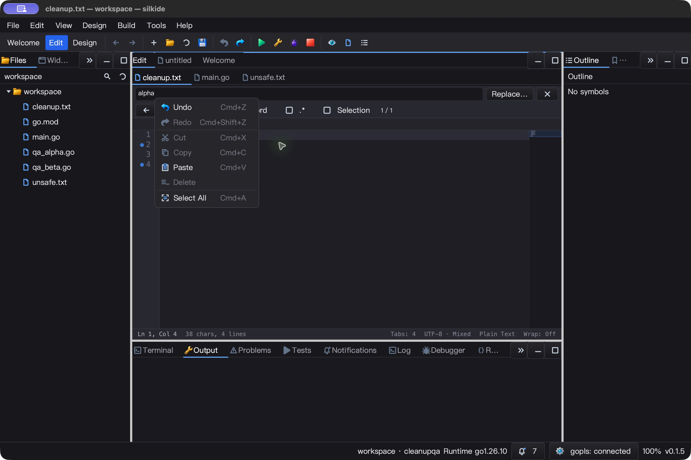
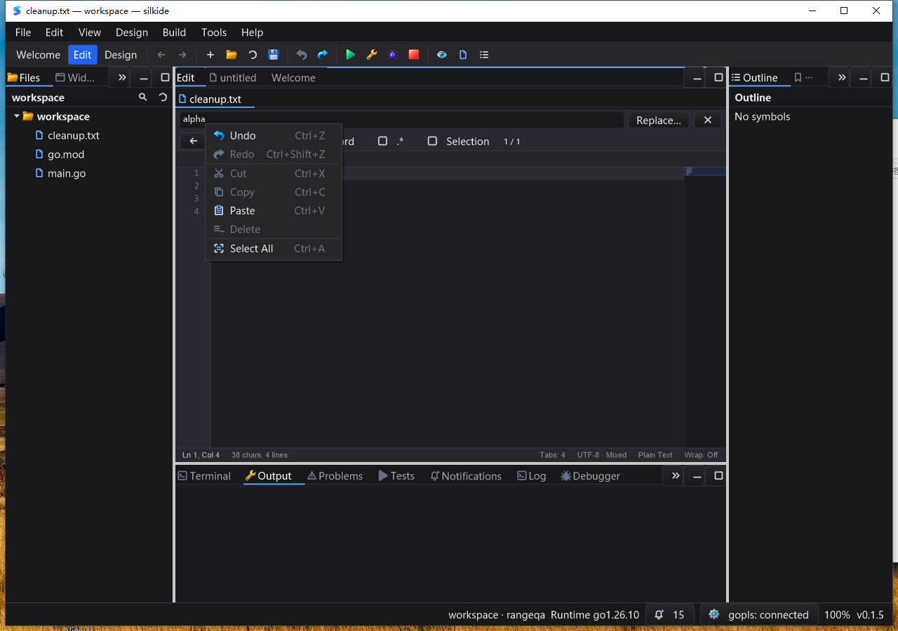

# 弹窗输入路由与光标菜单锚点验收

本轮在编辑器菜单迭代之上修复底层事件归属及输入框菜单定位，不代表全项目 UI 或 Qt Creator 功能对齐完成。未提交、未推送、未发布。

## 修复内容

- GLFW 的原生窗口与跨窗口捕获事件共用一个分发路径。按下时选择子控件，抬起仍交给原接收者，不重新命中另一菜单行。
- 每次按钮事件使用当前坐标更新 hover；不要求先有 MOVE。修复静止点击不触发，以及拖出后旧 hover 导致误触发。
- 显式叶控件 capture 保持事件归属；跨窗口事件也检查接收窗口是否启用。hover 回调后重新核对控件归属和可见性。
- `CodeEditor` / `Edit` 的 `Shift+F10` 菜单锚点使用可见的 `InputMethodCursorRect()`，不是未限制的 gutter 坐标或输入框左下角。普通 Edit 增加实际焦点校验。
- 保留菜单按键重复保护；不新增公共 API、定时器、轮询或后台线程。Windows 原生鼠标分发未改变，共享的键盘锚点逻辑有变化。

## 对照复现和自动测试

证据目录：`bin/qa-artifacts/input-routing-20261026/`。本轮冻结 1,770 个源码输入，相对上一阶段变化 7 个源码／测试文件。

- 正确 fixture 下，将 `window_glfw.go` 回退到本轮修改前，复现：静止菜单点击 down/up 到达但 action 未执行；跨窗口抬起错误交给另一行，原按钮未收到 up；显式叶控件捕获被改派。
- 回退编辑器锚点实现，20×10、1×1、0×0 的视口仍给出 `(60,39.1328125)`，定向测试失败。当前实现通过。
- 早期零尺寸 mock popup 的试验失败不作修复证据；以修正 fixture 后的 `replay-red-capture-tests.log` 和 `replay-red-anchor-tests.log` 为准。
- macOS 七个包 `go test -race -short -json -count=1 -p 1`：**6,164 个通过事件，48 个跳过，0 失败**（含子测试）。定向 capture／锚点测试跑 3 次，pure-Go 定向 race 测试也通过。
- macOS 构建、内置工具校验、`go vet -composites=false` 通过。默认 vet 前后仍各有 **452 条已有告警**，归一化后无新增，不能称默认 vet 全绿。

## macOS 真实 UI

已构建产物 `SilkInputRoutingQA.app`，隔离配置及 43 字节文档，包含中文、emoji、Tab、尾空格和混合 CRLF/LF。

- 原生菜单连续三次选区删除 → 保存空文件 → 菜单撤销 → 保存原始字节，全部通过。
- 菜单拖动后未执行命令，Esc 关闭、保存后字节不变。自动化观察曾切换到 popup 自身窗口；未记录逐条原生拖动坐标，不能据此单独证明准确的跨行输入路径。跨行归属由定向回归测试覆盖。
- 编辑器 Shift+F10 锚点位于第四行光标；查找字段输入 alpha 后 Shift+F10，菜单位于字段光标下方。菜单 End/Enter 执行全选，输入 beta，查找定位后显式选中四字符，替换、保存、撤销恢复。
- 初次查找测试误以为查找会选中匹配文本，实际只定位光标；该次断言失败与原始结果保留。回读运行态并核对 `moveFind` 的清空选区行为后，从基线重放并显式选择，得到预期字节。没有把初次失败计为通过。
- 共 **9 份成功文件断言**，最终基线不变，程序正常退出，本轮 IDE／工具进程无残留。
- 空闲 5.004 秒累计 CPU 0.040 秒，约单核 **0.80%**；仅为短采样，不是 FPS 或输入延迟保证。



上一阶段两次无效果原生点击，在未改动的旧产物上开启日志后没有再次复现，连续六轮删除／撤销通过。**本轮确定性的 capture 缺陷尚未证明就是那两次现象的根因**，仍保留这一限制。

## Windows 10 真机

- Windows 10 交互桌面 session 1、1280×900 窗口；从不含 Go/MSYS2 的 PATH 启动，随包 gopls 已连接。
- 七个包 race/short 非缓存回归：**5,953 个通过事件、70 个跳过、0 失败**（含子测试）。菜单／键盘锚点定向 race 测试另跑三次，IDE 构建及内置工具校验通过。
- 本轮确认菜单截图后执行全选、编辑保存、撤销／重做、删除及删除撤销／重做；再连续三轮删除／恢复。编辑器 Shift+F10 和查找字段 Shift+F10 均检查实际显示。
- 查找字段菜单 End/Enter 全选 alpha → 输入 beta → 返回编辑器 → 显式选择四字符 → 输入 FIND-MENU → 保存 → 撤销。共 **19 份文件逐字节断言**，最终恢复同一 43 字节基线。
- 四个交互任务均 `Ready / LastTaskResult=0`；输入前核对 PID、产物 hash、前台／点击窗口归属。最终正常关闭，本轮 IDE 和工具进程为 0。
- 空闲 5.006 秒：`Responding=true`，CPU 增量 0.03125 秒，约单核 **0.62%**。不推导长期负载、输入延迟或 FPS。
- 测试前后、采集时核对不可变基线 **1,801** 文件与 **520** overlay 输入；已测试清单、实际源文件、二进制和任务脚本 hash 对应。



## 事件分发微基准

Apple M2 Max，同一普通按钮按下／抬起路径，旧实现 overlay 和新实现各五次，每次 500ms。两版本每次循环均断言发生一次 click。

| 项目 | 修改前中位数 | 修改后中位数 |
| --- | ---: | ---: |
| 一次按下／抬起 | 280.3 ns | 379.6 ns |
| 分配 | 16 B / 2 allocs | 16 B / 2 allocs |

为消除旧 hover 和抬起改派，新路径增加实时命中及归属检查，本样本额外 **99.3 ns/手势（约 35.4%）**，没有增加分配。它是正确性取舍，不宣传为分发提速，也不能外推复杂控件树、整帧渲染或端到端延迟。

## 边界和复核

- 未测试 Linux 桌面、Windows 高 DPI、多显示器及所有弹窗／控件组合；Windows 回归不能代替 GLFW 运行时覆盖。
- 模拟捕获测试证明明确条件下的分发行为；原生文件回读证明已执行菜单／输入链路，两者不互相替代。
- 本轮没有重新认证全部 LSP 操作、发布包安装或所有 SDK 功能。
- 本阶段不能使用上一阶段 verifier 检查当前源码：其源码快照已经更新。

```sh
python3 bin/qa-artifacts/input-routing-20261026/verify-final.py
# 期望标记：INPUT_ROUTING_SOURCE_TEST_NATIVE_VERIFIED
```

脚本校验源码、对照失败、测试日志、字节回读、产物和进程状态；不自动重放原生输入。重新执行 UI 必须使用隔离配置，先确认当前截图坐标；Windows 必须使用交互桌面。

```text
macOS silkide SHA-256:
d807382071c86b285168adf42a331da90a60b3d23d2946d78129e88f96a57ec9
Windows silkide-combo.exe SHA-256:
d3fd4c0c16c77d70e8a36a29eac4810a67e4ea725457ddb2fa15bae7548a8d3c
```
