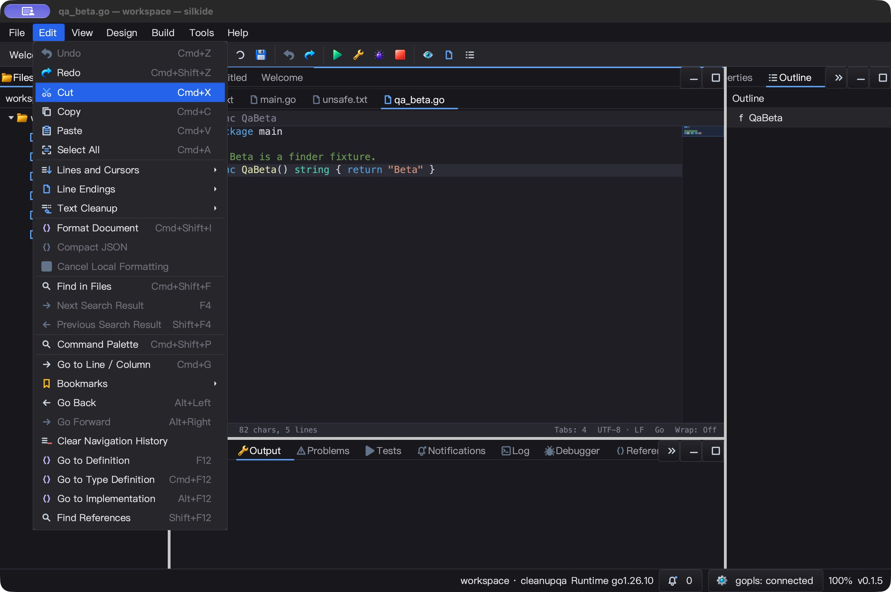
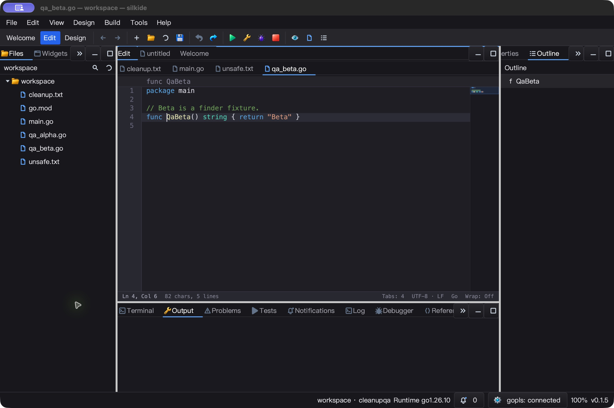
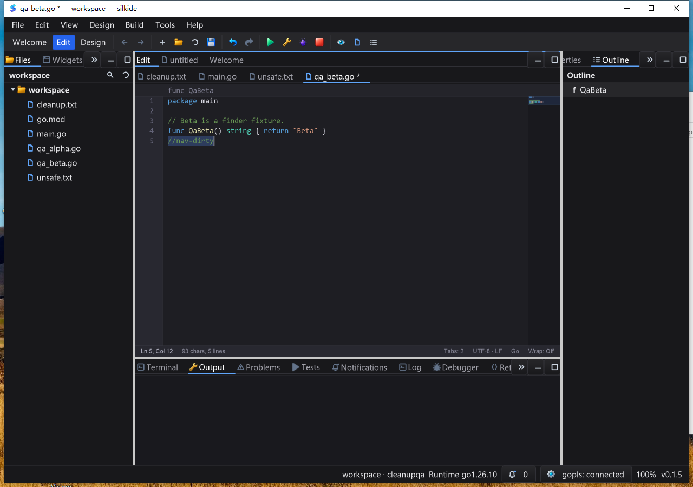

# 导航工具栏与历史通知验收（2026-10-25）

基于 `cd0ca98`，本轮补齐工作区导航入口及 SDK 变更通知，不重写渲染或 LSP。

## 实现与失败基线

- 原工具栏没有 Go Back / Go Forward；新增回归在旧实现中以
  `missing history button Go Back` 失败。现在使用独立于 Undo / Redo 的双箭头，
  显示 Alt+Left / Alt+Right 提示，空历史及边界同步禁用按钮和 Action。
- 菜单、工具栏、快捷键、命令面板共用工作台历史。命令面板原先额外要求 Edit 模式，
  现在可从 Welcome / Design 返回历史代码页；不可用命令显示 Unavailable 且不执行。
- Edit 菜单及命令面板新增 Clear Navigation History，只清位置，不改变文档、光标、
  dirty 或编辑 Undo。清空后可继续记录新的跳转。
- `gui.NavigationStack` 新增 `Len`、`Clear`、`SubscribeChanged`。完整跳转／路径改名
  只通知一次；失败／边界导航、完全相同 Push、空 Clear 静默。监听器可在通知中退订
  或新增，新增从下一次通知开始；宿主必须在 UI 线程调用，不允许回调同步修改历史。
- 位置上限仍为 256；到上限后复用缓冲区，分支丢弃的前进路径清零。监听器名单只在
  订阅／退订时复制，导航不分配通知切片；没有新增后台线程、定时器或轮询。
- 工具栏重建／退出时退订并清除提示；状态未改变时不刷新按钮 Action。
- 首轮原生 UI 发现新菜单的 `edit-clear` 实际解析为红色缺图占位符。增加图标名称
  验收断言后复现失败，再改为项目已有的 `line-delete` 矢量图标。最终候选在独立
  路径、BundleID 和冻结源码覆盖集上重新构建／测试，不用旧产物代表图标修正已测。

## 自动测试与性能

### macOS arm64

- Go 1.26.10，16 包 `-race -short -count=1 -p 2`：5,024 通过、45 跳过、0 失败
  （包含子测试）。`graph/prop/settings` 另有 238 通过、1 跳过。跳过不计为通过。
- `go vet -composites=false`、要求内置工具的 IDE 构建、内置 gopls 清单校验通过。
  3 项强制内置 gopls 集成测试通过且无跳过，覆盖 Unicode 未保存文本补全／格式化、
  重命名、定义／类型／实现导航。
- 新增测试覆盖原子通知、空操作、失败目标、滚动位置、路径改名、订阅中退订／新增、
  容量／丢弃路径、Clear、工具栏模式切换／销毁、菜单／命令面板可用性和缺失图标。
- M2 Max，单监听器、256 条满历史 Push：约 143.4 ns/op，0 B/op、0 allocs/op。
  这是 SDK 微基准，不包含磁盘打开、LSP、排版或整帧绘制。
- 最终 IDE 空闲 5.02 秒，CPU 增量 0.05 秒，约单核 1.00%；仅证明该短时静默片段。

### Windows 10 amd64

- Go 1.26.10 / CGO 原生 16 包 `-race -short -count=1 -p 2`：4,915 通过、66 跳过、
  0 失败，含子测试。原生构建、内置工具清单校验及 3 项强制内置 gopls 集成测试通过，
  gopls 用例无跳过。
- 1,801 份冻结基线文件和 322 个覆盖输入验证；测后远端覆盖清单回读，与当前本地
  逐项 SHA-256 相符。本地完整构建输入检查共 1,644 项，未发现未覆盖或变化输入。
- 5 次响应检查均正常；5.06 秒空闲 CPU 增量 0.109375 秒，约单核 2.16%。
  未把短时采样当成长时间无卡顿证明。

## macOS 原生 UI

- 最终构建实点后退／前进，窗口从 qa_beta.go 切到 cleanup.txt 再返回；截图确认
  目标保持 Ln 4, Col 6，按钮在历史边界正确变灰。
- 从 Welcome 的命令面板执行 Go Back 返回编辑页；Alt+Right 返回 qa_beta.go。
- 实点 Edit 菜单 Clear，最终图标不再是红色缺图占位符；菜单文本与提示未覆盖。
  清空前后文档保持 82 字符、Ln 4, Col 6，两个禁用按钮点击不移动文档。
- 5 份测试文件逐字节保持原样；真实 gopls 子进程来自该 app 的 tools 目录。
  原生 Quit 后 IDE 和所属 gopls 进程均结束。
- 首轮候选还验证了清空时保留未保存的 `//nav-dirty` 和 Undo；最终候选的该场景
  由单测及 Windows 原生回归重新验证，不冒充最终 macOS 的完整 dirty 复测。





## Windows 原生 UI

- 干净 PATH、交互桌面启动后，实际点击后退／前进按钮返回 cleanup.txt／qa_beta.go。
  前进后的 Shift+Right / Copy 精确读回 `Q`，证明不只是标题切换。
- 从 Welcome 执行 Go Back、从 Design 执行 Go Forward 均重新显示目标编辑页，
  目标字符读回通过。清空后创建新历史，Alt+Left / Alt+Right 仍可导航。
- 未保存的 `//nav-dirty` 中执行 Clear，dirty 标记仍保留；点击两枚禁用按钮不跳转，
  复制整行逐字确认内容未变。Undo / Save 恢复，五份 fixture 逐字节与基线相同。
- 空历史的命令面板显示 `Go Back (Unavailable)`；Enter 不执行、不关闭，输入框
  复制回读仍为 `Go Back`。Edit 菜单的图标及快捷键可见，截图未见项目文字覆盖。
- 验证真实 gopls 子进程来自当前程序旁的 tools 目录。Alt+F4 后 IDE 与所属 gopls
  均退出；bootstrap/UI/menu/verify 四个计划任务 LastTaskResult=0，阶段成功标记回读。
- 首次 Windows UI 脚本误用了不存在的 `Click` helper，在点击前明确失败；改成技能
  的 `Click-At`，经“定位 cleanup.txt → Clear”重置历史后重跑完整脚本并通过。
  未把 helper 的 shell 返回码或上一轮日志当作 UI 成功。



## 已观察到的边界与后续项

- macOS 自动化输入出现间歇性未投递／错字符，一次目标行多出空格。已截图、Undo
  恢复并回读文件未变；尚未区分输入工具、焦点／剪贴板时序与应用输入层原因。
  因而不宣称 macOS 连续输入或 IME 已完整通过。旧候选中也有 typeText 丢失冒号／
  下划线、AX 标题先于截图状态滞后的现象；动作发出不直接计为验收成功。
- Welcome 页仍有英文环境混用中文及 macOS 显示 Ctrl 快捷键的问题，已截图留待后续。
- 历史按钮表示有相邻记录，不探测磁盘存在性；不可打开目标由 Navigate/visit 跳过。
  历史没有持久化，Clear 不删除书签、最近文件或编辑 Undo。
- 本轮不包含 Linux 原生 GUI、完整 IME／多屏／高 DPI 矩阵或长时间压力验收。

## 重放与证据

```sh
GOMAXPROCS=2 GOTOOLCHAIN=go1.26.10 go test -race -count=1 -p 2 ./gui ./cmd/silkide \
  -run 'Test(Navigation|WorkbenchNavigation|FileFinder|History|CodeEditorShortcut)'
go test ./gui -run '^$' -bench '^BenchmarkNavigationHistoryObservedPush$' -benchmem
```

最终产物、输入清单、测试 JSONL、原生截图和退出证据：
`bin/qa-artifacts/navigation-actions-final-20261025/`。
按钮缺失／缺图基线及首轮候选证据单独保留在
`bin/qa-artifacts/navigation-actions-20261025/`。二进制、远端覆盖文件和缓存不纳入源码。

## 提交前复核

- 再次运行本文的导航／Quick Open／历史／快捷键提示定向回归，
  `./gui` 和 `./cmd/silkide` 均在 `-race -count=1` 下通过。
- 重新计算当前 1,644 项构建输入的 SHA-256，与已测基线及覆盖集无差异；
  Windows 回读的 322 项覆盖清单与本地完全一致。上述原生 UI 证据仍对应本次源码。
- 本次没有改写原生键盘／剪贴板路径；输入异常、Welcome 提示和未测平台仍按上文
  保留为后续项。复核输出位于 `bin/qa-artifacts/navigation-commit-20261025/`。
