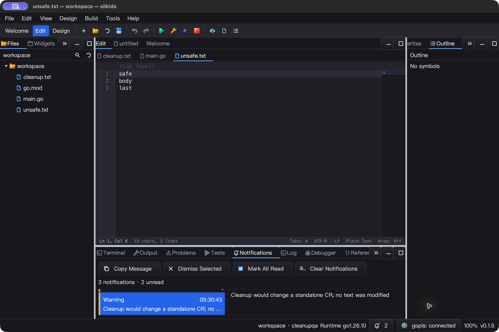
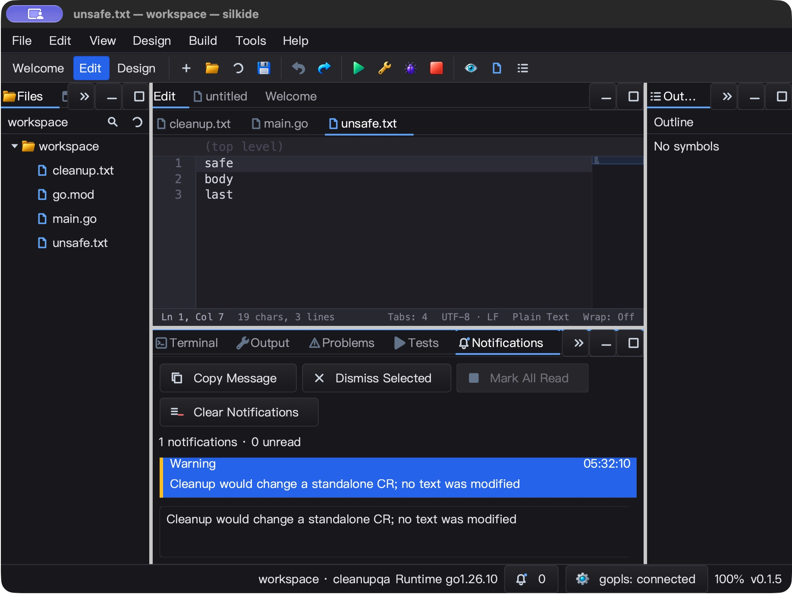
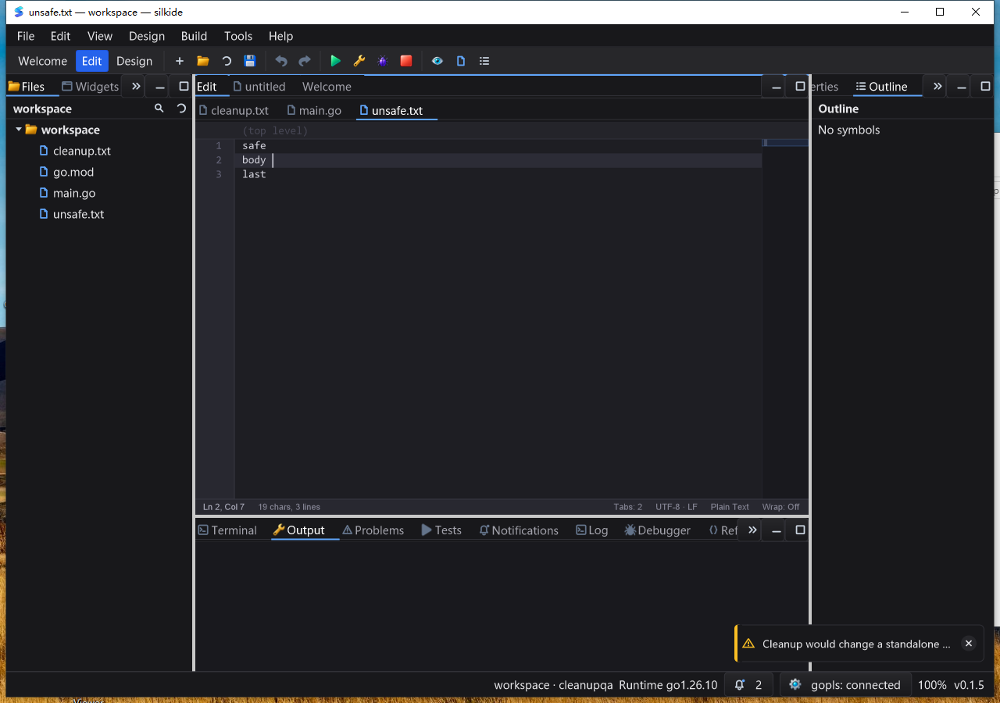
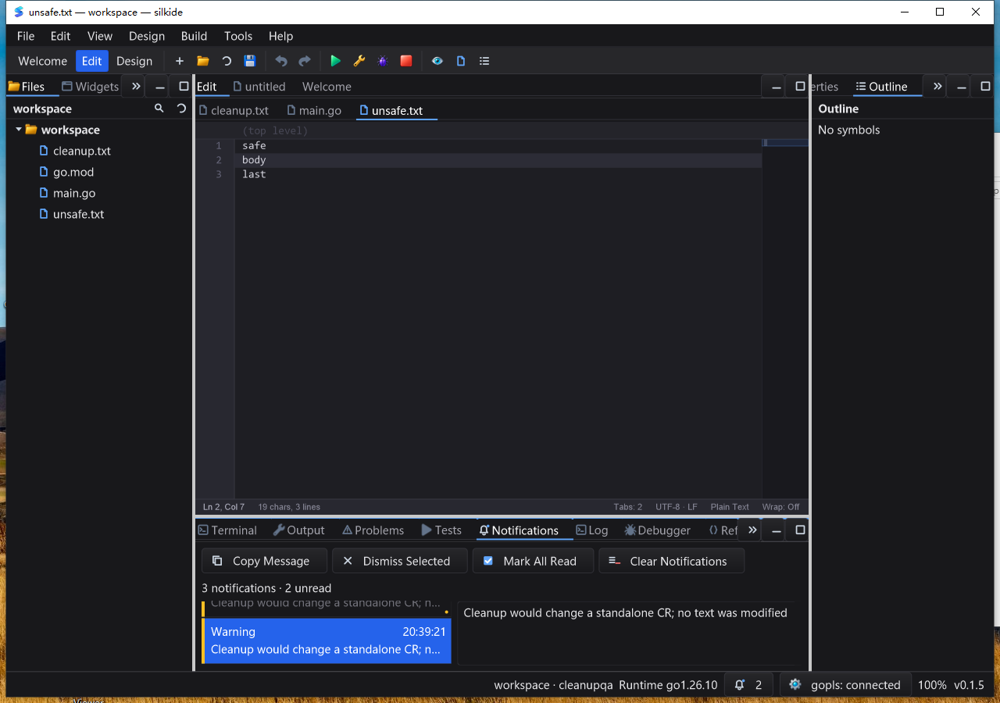

# 通知与遮挡修复验收（2026-10-25）

基于 `ca64a03`。本轮处理保存提示覆盖文档页签、长消息无法回看，以及 SDK
通知面板的状态／输入／绘制边界，不声称全项目或 Qt Creator 功能对齐。

## 根因与改动

- 上轮 Windows 原生截图证明顶部保存提示盖住文档标签，点击命中提示而非目标
  文件。IDE 改用宿主内容区右下角，且只允许下半区显示；空间不足隐藏，不挤到页签。
  保留 SDK 原 ShowToast 顶部位置，新增 Options、Activate 与幂等 Dismiss 句柄。
- IDE 每次只显示一个横幅，完整历史由 NotificationPanel + 只读详情框组合。
  View 菜单／命令面板／状态栏铃铛入口，复制／移除／全部已读／清空，未读数同步。
- 历史只保留本次会话最新 200 条；单条正文最多 64 KiB，额外附带明确截断标记。
  SDK 默认无容量限制，可显式 SetLimit；每个宿主最多 8 条活跃 toast，淘汰时释放
  定时器、回调及正文。没有新增空闲轮询、扫描器或刷新心跳。
- 基线回归确认 Items 暴露底层切片、面板外点击也会触发首行；修复为快照和完整
  x/y 命中检测。补齐键盘、选区、已读、容量、重入回调安全、主题及缩放绘制。
- 显示仅处理可见行，消息／标题／时间先限制预览长度再测量，不对整条巨型消息塑形。
  完整消息由详情框显示。按钮使用已有主题矢量图标，新增铃铛矢量图标。

## macOS arm64

- 15 包 `go test -race -short -count=1 -p 2`：4,932 项通过、45 项跳过、0 失败
  （含子测试，跳过不计通过）；`graph/prop/settings` 另有 238 通过、1 跳过。
- `go vet -composites=false`、强制附带工具的 IDE 构建和附带 gopls 清单校验通过。
  3 项真实 gopls 集成：未保存 Unicode 补全／格式化、重命名、定义／类型／实现跳转
  全部通过，无跳过。
- 原生桌面：保存后趁横幅仍在直接点击 unsafe.txt 页签，活动标题确实改变；
  歧义 CR 清理显示右下角警告，点击正文打开完整详情；Home／End 改变选中与已读数。
- 点击 Copy Message，通过原生剪贴板粘贴到测试编辑器并保存，磁盘读回完整警告
  `Cleanup would change a standalone CR; no text was modified`，无省略号或截断。
  Undo／保存恢复原始 Unicode／混合换行字节；其他两份源文件保持不变。
- 全部已读、移除、清空、菜单及命令面板入口通过；空列表按钮禁用、未读归零。
  缩窄窗口后工具栏换行，上下分栏无覆盖；底部 dock 太小时需拖高分割线查看正文。
- 5.06 秒空闲采样 CPU 增量 0.04 秒（单核约 0.79%），仅代表这段采样，不是帧率保证。
  原生 Quit 后核对测试 PID 与附带 gopls 均退出，未把 PID 消失冒充捕获到退出码。





## Windows 10 amd64

- Go 1.26.10、CGO 原生测试；回读校验 1,801 个基线文件及 307 个覆盖输入，
  测后哈希与本地候选一致；本地 1,621 个 Go/C/模块构建输入另有冻结清单。
- 15 包 `-race -short -count=1 -p 2`：4,823 项通过、66 项跳过、0 失败（含子测试）。
  IDE 原生构建、附带 gopls 清单校验及上述 3 项强制真实 gopls 测试全部通过。
- 干净 PATH 的交互桌面：保存时直接点击 unsafe.txt 页签成功，标题断言通过；
  CR 警告未改文档，横幅右下角、页签可点击；正文点击显示完整详情。
- Home 选择第一条并复制得到 `Saved cleanup.txt`，End 返回最新警告并精确复制。
  只读详情中尝试输入后全选复制，内容仍完全相同；不是仅检查按钮存在。
- 已读、移除、清空逐步截图分别确认 3/0、2/0、0/0 条／未读，按钮状态同步；
  最小化底部 dock 后通过状态栏铃铛恢复。960×760 窄窗口按钮换行不覆盖。
- 保存提示存在时继续输入 `x`，标题出现 dirty；Undo／保存恢复原始 Unicode 与混合
  换行字节；另两份源文件逐字节未变。没有让反馈抢走源编辑器输入焦点。
- 5 次健康采样均响应，5.07 秒 CPU 增量 0.140625 秒（单核约 2.77%）；仅为当前
  空闲片段，不是长期性能结论。Alt+F4 正常退出，IDE 与附带 gopls 均消失。
  四个交互计划任务 LastTaskResult=0，且各阶段显式成功标记均回读确认。





## 性能、兼容与限制

M2 Max / Go 1.26.10 / GOMAXPROCS=2：巨型消息的有界预览约 1.28 µs/op、1,016 B/op；
SDK 有界追加约 444 ns/op、320 B/op。这是微基准，不包含 IDE 完整通知刷新及绘制，
没有跨版本整机性能对比。SDK API 仍是 UI 线程 API，不因 race 测试通过就变成线程安全。

底部横幅仍覆盖少量内容并消费正文点击；并非全区域鼠标穿透。关闭 × 不执行正文动作。
清空不删除磁盘文件，历史不持久化。默认 SDK 列表容量仍为无限，宿主需设置合适上限。
本轮无 Linux 原生 GUI、全量 IME／DPI／多显示器矩阵、屏幕阅读器或长期压力验收。

一次 macOS 连续两次命令面板自动化未等待第二面板出现，文本落进源编辑器；该截图
保存在 attempts，已 Undo 恢复，并改为先确认面板窗口再输入后通过，未计为有效测试。
第一次 Windows 构建被脚本执行策略拒绝，随后使用测试台标准脚本启动方式重跑。

## 重放与证据

```sh
go test -race -count=1 ./gui ./cmd/silkide ./paint
go test -run '^$' -bench '^BenchmarkNotification' -benchmem ./gui
```

UI：打开两份文件 → 保存第一份并立即切换页签 → 触发长警告 → 点击正文 →
Home／End → 复制到临时编辑器／保存核对 → Undo 恢复 → 已读／移除／清空。
另测 View 菜单、命令面板与状态栏铃铛；缩窄窗口、拖高底部 dock 检查布局。

完整本地证据：`bin/qa-artifacts/notifications-20261025/`，包括失败基线、最终
race JSONL、gopls 日志、基准、原生截图、剪贴板落盘结果、CPU 增量与退出记录。
测试缓存和二进制不提交；仅提交代码、文档及代表性截图。
