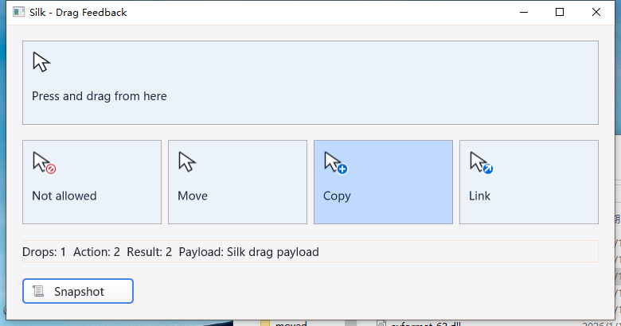

# Windows OLE 拖拽调度回归 — 2026-10-25

## 结果与根因

修复上一轮真实桌面已确认的缺陷：拖拽操作和光标正确，但目标高亮直到松手才绘制，
UI 看门狗报告约 5 秒没有心跳。本轮未屏蔽看门狗，也未强制高频全窗口刷新。

旧实现只在 Silk 自己的消息循环处理 `HWND=0` 的定时器和线程唤醒。
`DoDragDrop` 接管循环后这些路径不再执行。Windows 文档说明了
[线程消息在原生模态循环中丢失的限制](https://learn.microsoft.com/en-us/windows/win32/api/winuser/nf-winuser-postthreadmessagew)，
以及 [`DispatchMessage` 调用 TIMERPROC 的机制](https://learn.microsoft.com/en-us/windows/win32/api/winuser/nf-winuser-settimer)。

现在使用 message-only HWND 接收 `Post` 唤醒，定时器使用稳定的原生回调入口。
保留原有有界任务队列、渲染截止时间、脏区域合并和绘制防重入。
嵌套循环不递归执行同一定时器回调；关闭唤醒窗口与工作线程发送互斥，旧闭包不再访问已销毁句柄。

## 实机验证

**Windows 10 22H2，交互桌面 session 1：**

- Ignore / Move / Copy / Link、载荷、计数、Escape 取消及松手结果精确回读。
- 拖拽尚未结束时，从原生截图读取接受目标 RGB **192,218,255**；拒绝目标保持 **236,242,250**。
  上一轮三个接受目标都错误地保持默认底色，本轮均通过。
- 静止按住约 5 秒：Timer **+20**、worker Post **+25**，四个目标的绘制计数均 **不增加**。
  其他动作保持期间也同时验证回调推进和稳定绘制计数。
- 普通模式关闭探针和 debug，独立干净启动，再做三次 5 秒拖拽：CPU 时间分别为
  **0.125 / 0.203125 / 0.046875 秒**，折合单核约 **2.49% / 4.05% / 0.94%**。
  这是短时 CPU 样本，不是长期压力测试或全 IDE 性能保证。
- SDK 日志无 UI 卡死、恢复异常、越线程修改或 race 报告；三个测试 GUI 进程正常关闭。
- IDE：Unicode/混合换行文件编辑、工具栏保存、Undo 字节恢复、Ctrl+Tab 往返、页签拖放、
  Dock 选择、原生边框缩放至 1100×780；保存与还原文件均回读核对。

**macOS：**

- 同一示例 Move/Copy/Link 和 6 秒按住回归；保持期间 23 条采样，Timer/Post 持续推进、绘制计数稳定。
- IDE 实际输入 `U`、工具栏保存、Undo 后恢复原始 Unicode/混合换行字节；菜单打开/退出及页签往返。
- SDK/IDE 截图、二进制 SHA-256 和正常退出均留存。

## 自动回归与证据

- macOS 十包 `-race -short -count=1`：**5,616 pass / 47 skip / 0 fail**（含子测试事件）；
  根包 race、十包 vet、IDE/SDK 构建及五项强制原生 cursor/GL 测试通过。
- Windows 七包相关测试 `-race -short -count=3` 通过；完整 GUI race-short：**2,714 pass / 21 skip / 0 fail**（含子测试事件）。
  `gui/win32` 完整 vet 发现 **15 项原生边界/不可达代码告警**，与上一轮源码独立对照后确认 **15 项完全一致，新增 0 项**；
  不把有告警的 vet 描述成通过。
- 新增原生分发测试不调用 Silk 自定义泵：仅 `DispatchMessage` 驱动定时器、嵌套循环、
  worker 队列及关闭竞态；验证真实 OS 线程归属与停止后的消息忽略。
- 修正旧测试中“工作线程不能 PostMessage 到 HWND”的错误假设。
  Windows 初始化断言改为检查实际 HWND/线程/进程，不再读取会绕过 `go -overlay` 的旧源文件。

证据目录：`bin/qa-artifacts/ole-ui-pump-20261025/`。
保存不可变远端基线、覆盖层清单、构建与测试日志、截图、JSON 快照、文件字节、任务退出状态和最终哈希核验。
上一轮失败证据保留在 `bin/qa-artifacts/cursor-feedback-20261025/`，没有覆盖成通过。

## 限制与后续

- 未声称所有 Windows 原生菜单、文件对话框及所有 DPI/显示器组合都完成实机验收；本轮重点是 OLE。
- Linux 未做真实桌面回归。耗时 UI 回调仍会阻塞；必须把重任务放到后台。
- 原生线程定时器 ID 复用问题仍是既有边界，本轮只防止已停止且未复用 ID 的回调。
- Windows 完整 vet 的原生指针边界与一处不可达代码需后续逐项审查；现有 race/native 回归
  不能替代对所有未执行 ABI 路径的审计。
- 页签拖放后的立即输入焦点/标题同步，以及工具栏操作后编辑菜单目标识别，留作下一轮独立修复；
  本轮 IDE 拖放保存验证显式点击编辑区，不将其冒充自动焦点修复。
- 持续迭代目标仍在进行，本轮不执行 commit / push / release。
