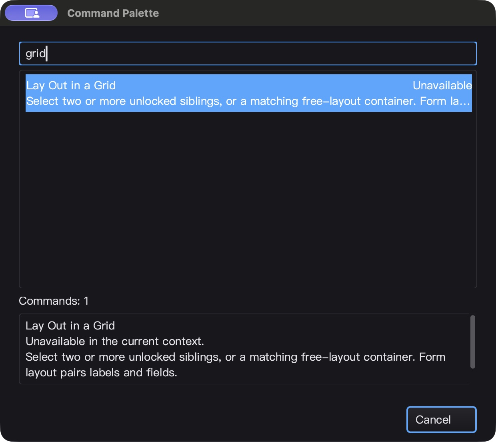
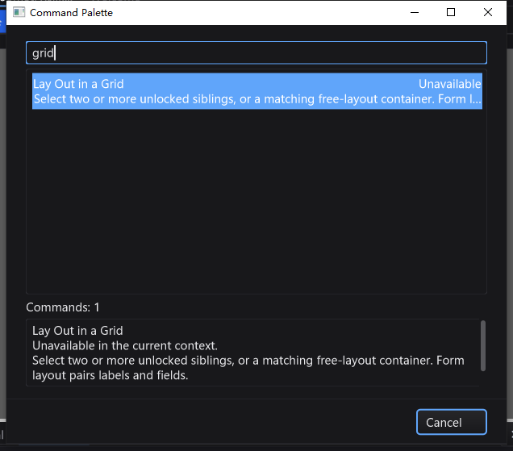

# 命令面板完整说明与双行列表 QA — 2026-10-25

开发中改动，接续命令面板长说明被截断的问题；不是发布声明。

## 改动与边界

- 原先把命令名、提示／快捷键、不可用状态串成一个 `ListItem.Text`，长提示只能被裁掉，没有完整说明入口。
- SDK 新增可选 `ListItemPresentation`、`SetItemPresenter`、`InvalidateItemPresentation`。主标题、右侧状态、第二行说明分别测量和 Unicode 省略；不改变 `ListItem` 数据结构或默认单行模式。
- 为字形 bearing 和抗锯齿覆盖保留像素余量，避免右侧状态末尾字母被裁。第一次直接减去小数 bearing 的实现曾使原生字体边缘越过 padding，像素测试发现后改为整数原点与槽内余量；不是宣称修复全部字体后端。
- 所有列表行（包括旧单行）在 padding／可见滚动视口内绘制；鼠标命中使用相同边界，修复边距点击不可见行、带 padding 复选框列命中偏移。
- 仅测量可见行，缓存最多 128 项。行数据、宽度、字体、主题变化失效；外部状态显式失效。`Muted` 是视觉状态，**不是禁用执行权限**。
- 命令面板增加结果计数与四行高的只读、多行、可滚动和可复制说明区。缩窄后仍能访问完整文本；列表选择、筛选、提交事件更新内容，不增加轮询／timer／goroutine。
- 不可用命令 Enter 不关闭；执行仍在模态退出后再次检查。只读说明中的 Enter 不执行命令，输入不改说明；Escape 关闭。搜索框仍可用 Up/Down/PageUp/PageDown 导航。

## 自动回归

- 缺少完整说明、padding 错误命中均保留修复前失败日志。新增测试覆盖中英／emoji 长文本、暗亮主题、13/24 字号、零／窄／正常宽度、缓存可见性和失效、128 行上限、只读与不可用提交、空查询和紧凑布局。
- 像素测试在 1、1.25、1.5、2 倍变换下，比较有内容与空列表的 padding，要求文字不越界；这不是 Windows 混合 DPI 原生桌面验收。
- macOS 四包 `go test -race -short -json -count=1 ./gui ./ged ./prop ./cmd/silkide`：**5,269 pass / 42 skip / 0 fail**（含子测试）；根包 race-short、`go vet -composites=false` 及 RequireBundle 构建通过。另编译真实工具测试程序至 app bundle，**3 项强制 bundled gopls 集成测试全部通过，无 skip**（未保存 Unicode 补全／格式化、重命名定义、类型／实现／后退导航）。
- `BenchmarkListPresentationWarmCache`：Apple M2 Max，三次 **14.09–14.30 ns/op，0 B/op，0 allocs/op**。只测已有行的缓存查询，不代表初次塑形、绘制 FPS 或总体不卡顿。

## macOS 原生 UI

独立 HOME／数据目录；最终二进制 SHA-256：
`dc16649bf53197accc15b18d0767f426d36b0188dc062b6db432bf17a94ba40c`。

1. 无选区搜索 `grid`：名称、独立 `Unavailable` 和省略说明清晰；下面完整显示名称／不可用原因／长说明。Enter 保持面板。
2. Tab→列表→只读说明；Cmd+A 后输入 `mustnotreplace` 不改内容，完整选区可见。本平台没有额外读取系统剪贴板，不把选区截图当作复制验证。
3. 原生拖拽窗口由 1240×1104 缩到 780×868 截图像素（Retina）；状态仍可读，说明可滚动，取消按钮与各区域不重叠。
4. 搜索 `nomatchingcommandzzzz`：计数为 0、旧说明清空，Enter 不执行。改为 `layout` 后 Down，第二条 Grid 高亮且完整说明同步。
5. 关闭面板，画布多选既有两个 Button；`grid` 可用，Enter→保存，回读 **1 GridLayout / 2 Button**。`break`→Enter→保存，回读 **0 GridLayout / 2 Button**。
6. 六个原代码／文本 fixture SHA 不变。主进程闲置 5.014 秒 CPU +0.04 秒，约单核 **0.80%**，不含 gopls，不是全场景性能认证。
7. 正常 Cmd+Q；IDE PID 26931 与 bundled gopls PID 26943 均退出。

## Windows 10 原生验收

- Windows 10 22H2 四包原生 `-race -short -json -count=1 -p 2`：**5,138 pass / 65 skip / 0 fail**。RequireBundle 构建、工具 manifest 校验和 **3 项强制 bundled gopls 集成测试**通过，无集成 skip。
- 最终二进制 SHA-256：`29f2fc613d155d131e65bbb652a5f19868370459ea0eacfdf0322826905b2fca`。
- 交互桌面计划任务，而非 SSH 会话 0；bootstrap／details／commands 三项任务均 `Ready / LastTaskResult=0`，且成功 marker、保存文件和剪贴板断言均已读回。
- 默认和 **360×380** 窄窗口中，Tab 到说明→Ctrl+A/C，复制内容与完整预期文本逐字比较；包括名称、不可用原因和整段说明。输入／Enter 不改说明、不执行命令；测试后恢复原剪贴板。
- 无匹配查询清空旧详情且 Enter 不执行；恢复 `layout` 后 Down 的说明与预期 Grid 全文一致。Escape 正常返回主窗。
- 真实选中两个既有 Button，`grid`→Enter→保存，回读 1 GridLayout / 2 Button；`break`→保存，回读 0 GridLayout / 2 Button。切换 Edit 后 Grid 不可用，Enter 不关闭面板，隐藏设计文件不变。
- 六个原代码／文本 fixture hash 不变。主进程闲置 **5.014 秒 / CPU +0.09375 秒，约单核 1.87%，Responding=true**；不含 gopls，不作为长时间性能或 FPS 认证。
- 正常退出 IDE PID 3804 和其 gopls PID 3116；追加检查确认首次候选与最终候选目录均无残留进程。
- 当前 macOS **1,669 个构建输入** hash 一致；Windows immutable baseline **1,801 项 + overlay 370 项**在测试前后逐项匹配，远端与本地 overlay manifest 一致。

## 证据与剩余范围

- `bin/qa-artifacts/palette-details-20261025/` 保留修复前失败／首次候选；最终源码 hashes、测试 JSONL、截图和保存产物在 **`final/`**，不混用首次候选结论。
- 本轮原生 UI 为英文暗色；中英和暗亮主题的其余组合来自自动测试。Linux 原生桌面、Windows 混合 DPI、多显示器、全部 IME／字体组合未验收。
- 全部命令是否应具备独立 icon、更多 Qt Creator 功能、其它对话框细节仍需后续逐项迭代，不宣称全平台全面对齐。
- 未发布、commit 或 push。
