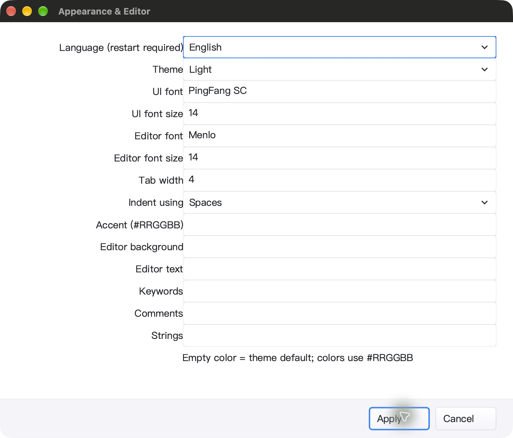
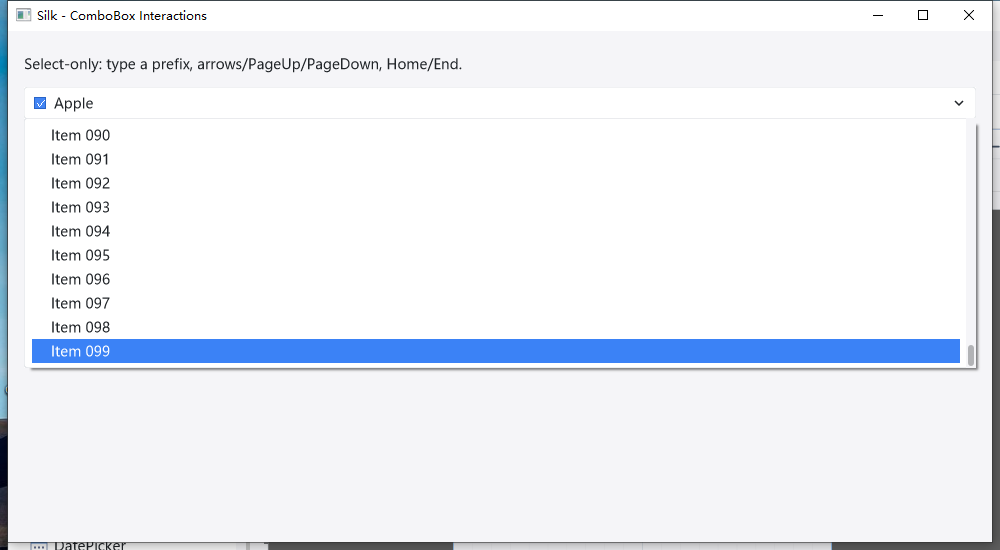
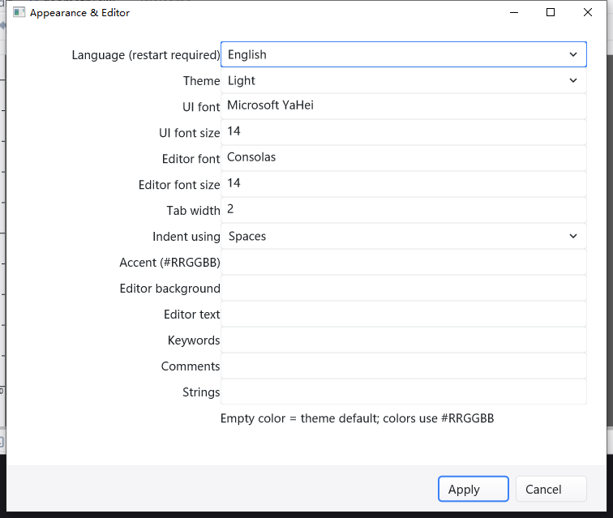

# 模态窗口内下拉框鼠标焦点 QA — 2026-10-25

开发中记录，非发布／全平台通过声明。接续 [视口 QA](POPUP_VIEWPORT_QA_20261025.md)。

## 已证明的根因

原先“点击下拉项后设置窗口关闭”的描述不准确：原生 mouse down/up 确实到达
popup，坐标正确，没有 `Close`／`EndModal`；设置窗口仍存活，但落到了主窗口后面。

popup 隐藏时把原生焦点归还操作排入 `pendingNativeDestruction`。此队列只在外层
主循环处理，正在运行的 `ShowModal` 不会处理它（也不能随意在嵌套回调中销毁仍被
引用的原生窗口）。Cocoa 先选择主 Frame 为 key window，导致当前模态窗口失焦。

## 修改

- `gui/window_focus_return_glfw.go`：只针对 popup，在 native hide **之前**归还
  存活、启用、可见、未最小化的直接 owner 的原生焦点。
- 保留 generation 校验；popup 已失焦、应用已退到后台、owner 已销毁／分离、
  已出现新的窗口意图时不抢焦点。激活失败保留原有回退；成功不再留下旧的外层回调。
- `gui/window_glfw.go`：接入隐藏流程；真实 modal 的销毁仍通过原有安全队列处理。
- 新增当前／嵌套模态、其他应用／窗口、新 generation、隐藏／禁用／最小化／销毁
  owner、退出、非 popup、激活失败回归。不新增 timer、轮询或后台 goroutine。

## macOS 验证

以下产物位于 `bin/qa-artifacts/popup-mouse-20261025/`（忽略的 QA 目录）：

- `before-mouse-events.log`、`after-mouse-events.log`、`after-mouse-apply-events.log`：
  同一交互路径的修改前后原生事件，修复后 owner 在 popup hide 前取得焦点。
- `focus-tests.log`：焦点／ComboBox 定向测试通过。
- `mac-test-summary.json`、`mac-race.jsonl`：五包 race-short、`-count=1`，
  **5,315 pass / 42 skip / 0 fail**（含子测试）；根包 race-short、vet、IDE／SDK 构建通过。
- `mac-bundled-gopls.log`：RequireBundle 产物内附带 gopls，强制 Unicode 未保存补全／
  格式化、重命名、类型／实现／返回导航 **3 项通过，0 skip**。
- `mac-native-verification.json`：关闭调试日志、隔离 HOME／设置后，原生鼠标选择
  Light、Spaces 均保持 Appearance 为前台；F4→Home→Esc 取消预览不改 Spaces；
  Tab 到下一个字段；点击 Apply→重新打开可见 Light／Spaces，配置文件读回一致。
  7 个工作区 fixture SHA-256 未改变。Esc 返回主窗口、Cmd+Q 后 PID 确认退出。
- 静置 5 秒累计 CPU 时间从 7.70 增至 7.74 秒，约单核 **0.8%**；只是短采样，
  不等于 FPS 或长时间流畅保证。
- label warm cache **10.65–10.69 ns/op**；千项 Unicode 搜索 **6.176–6.306 μs/op**；
  均 **0 allocs/op**，不是整帧性能测量。
- 1,678 个代码输入构建／测试前后哈希一致。IDE SHA-256：
  `d5d4b8d051f051cbc8b33d2d715ada811967d73239b59767e837833417d23d7b`。

## Windows：分开记录通过与失败

Windows 使用上一阶段冻结的 382 文件 overlay；上述 3 个 macOS 文件受 `!windows`
构建约束，不影响 Windows 二进制，但两次源码清单不同，不声称整树同版本全绿。

- 独立诊断构建成功，附带工具包验证成功；marker 为 `WINDOWS_DIAGNOSTIC_BUILD_ONLY`，
  **不是完整测试门禁通过**。
- IDE 原生 UI：Light→Home 预览→Esc→Tab→Spaces→Apply→配置读回→重新打开→取消通过。
  Apply 和 Cancel 后都断言主窗口自动回到前台，没有通过 `Focus-Win` 修补检查结果。
  `WINDOWS_COMBO_IDE_UI_OK`；6 个内容 fixture 哈希未变；最终 SDK 脚本补验 geometry
  SHA-256，7 个 fixture 均未改变。
- `idle.json`：5.023 秒累计 CPU 增加 0.0625 秒，约单核 **1.24%**，`Responding=true`。
- Windows IDE SHA-256：
  `eaf8adb739da92a43e68ec2d9ba4ee8f47f57a9a2714114ec7162e0868bae307`。
- **完整自动化未通过**：首次 GUI Git flood 超过有界等待；IDE 包达到 10 分钟超时。
  GUI 串行第二次又出现 Git diff deadline、flood 在 deadline 前无输出。没有放宽单项断言，
  也没有用局部通过覆盖这些失败。
- **原生模态用例未通过**：修复前对照在孤立窗口顺序中通过，未复现旧问题；
  修复后 9 次中 4 pass／5 fail。多次在 owner／independent／inner **取得前台的前置条件**
  就失败，继而出现归还焦点断言失败。不能据此宣布“不抢其他窗口焦点”已通过；
  需要真实输入驱动的前置条件及进一步产品／测试环境归因。

### Windows SDK 原生 UI 已完成

- 初次脚本未通过 `INPUT_OWNER_MISMATCH`，未注入控件输入、未记录 snapshot。
  窗口存在且有正确几何，但不在前台。观察截图后，通过 SDK 自身任务栏入口完成
  **初始**激活，然后才开始输入；每次点击／按键前均校验窗口所属 PID。
- 100 项：End→Esc 保留 Apple／0 changes／0 submits；End→Enter 得到 Item 099／
  1 change／1 submit；两次 `a` 循环到 Apricot（3 changes，仍 1 submit）。
- popup 中 End→Tab 取消预览并进入真实 editor；自由输入 `free-text`；Down 选择 Rust。
- 鼠标选择 Apple，快照为 Index 0、Changes 4、Submits 2、Popup false、Editable Rust。
  之后 PageUp／PageDown／End／Esc、向下滚轮／Esc 均不意外提交。
- End 后 **Item 099 在截图中完整可见**；普通 popup 原生矩形 `(24,118)-(976,368)`，
  仅 **952×250**，不再按全部 100 行创建 2,410 px 高窗口。底边测试向上展开于
  `(24,838)-(976,1088)`，位于 `(0,0)-(1600,1160)` 工作区内，末项仍可见。
- SDK 静置 5.021 秒 CPU 增加 0.0625 秒，约单核 **1.24%**，`Responding=true`。
- 最后 marker `WINDOWS_COMBO_SDK_UI_OK_AND_QA_CLOSED`，计划任务 `LastTaskResult=0`、
  `State=Ready`；SDK／IDE 均按精确 PID／路径正常 CloseMainWindow，并等待退出。
- SDK SHA-256：`1f43b50d29135f45c980c8ea63703b6aa4a900bbb156a7e22af4752c8b3fbf1e`。
- 过程中保留了测试脚本错误：技能的窗口枚举覆盖 PowerShell 只读 `$PID`，负滚轮
  将负数直接转换为 UInt32；没有归咎为产品缺陷，也没有降低断言。后者仅在 QA 脚本
  通过保留有符号 delta 的位模式修正。跨任务弹窗可能因任务启动失焦而关闭，因此
  重新确认已提交基线、重新打开预览后才续测，不拿旧截图状态直接点击。

证据集中在 `bin/qa-artifacts/popup-workarea-20261025/windows-success/ui-evidence/`：
`sdk-stdout.log`、`sdk-mouse-readback.json`、`sdk-popup-bounds.json`、`sdk-idle.json`、
`settings-readback.png`、`sdk-end-visible.png`、`sdk-edge-above.png`、`sdk-final.png`。
任务退出结果另见 `windows-sdk-finish3-readback.log`。这些分项通过不覆盖上面的门禁失败。

## 剩余限制

- macOS 独立 SDK 窗口 CUA ScreenCaptureKit `-3811`，没有原生 UI 通过结论。
  QA-only Go overlay 探针确认窗口 visible、非零几何、已进入事件循环并有逻辑焦点；
  这不是可见界面验收。探针与正式 QA 源码分开，精确路径核验后停止探针进程。
- Appearance 字段标签和输入框缺少水平留白；单行 Edit 右键未出现编辑菜单，
  作为后续 UI 完整性改进项，而非本轮已修复项。
- Linux 原生桌面、物理中文 IME／AltGr、多显示器混合 DPI 未验证。
