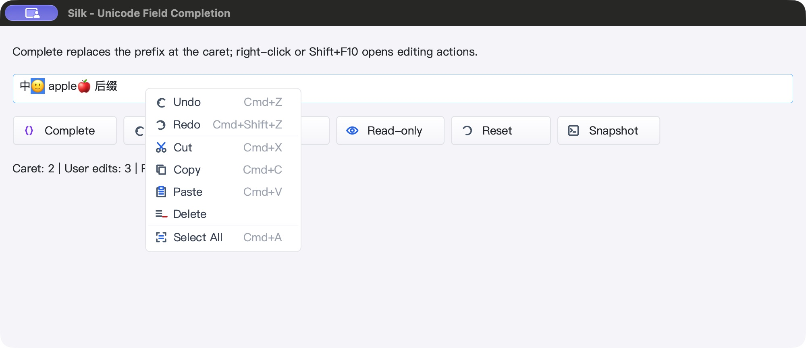
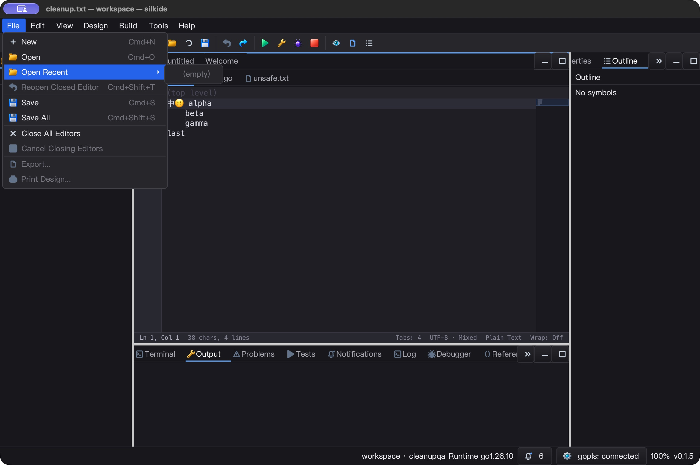
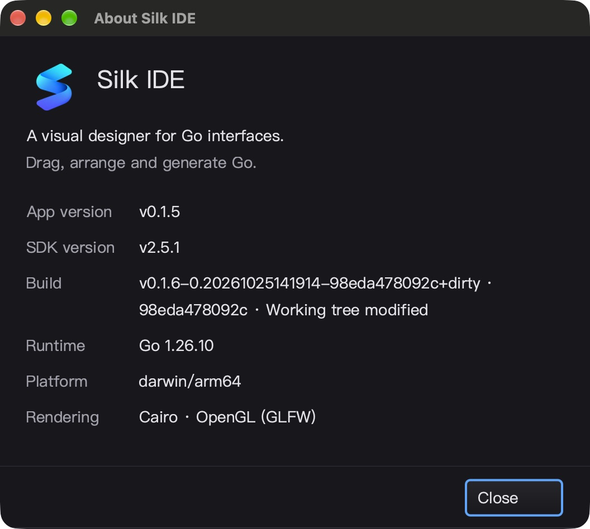

# 原生菜单表面与 About 焦点 QA — 2026-10-25

## 本轮结论

修复原生弹出菜单圆角的黑／灰色边角、被裁掉半宽的边框，以及关闭 About 后
正文无法直接输入的问题。改动在 SDK 共享菜单绘制／GLFW 呈现和设计器 About 层，
没有新增轮询、计时器或 goroutine；没有 commit、push 或发布。

### 渲染根因与处理

- Cairo 的圆角像素含 alpha，但原生 GLFW popup 没有请求透明 framebuffer，
  最后又在不透明灰色背景上混合，形成可见方角。仅修改圆角半径不能修复。
- 现在只为 `WtPopup` 请求透明 framebuffer；创建每个普通窗口时显式恢复 false，
  并查询实际能力，防止全局 window hint 泄漏到编辑器和对话框。
- 支持透明的 popup 使用透明清屏，保留 Cairo 预乘 RGBA；普通窗口保持原呈现。
  GPU 图表使用独立的 RGB／alpha 混合因子，避免把源 alpha 再乘一次。
- 不支持透明的原生目标完整填充不透明矩形，而不是猜背景色。当前 Windows
  BeginPaint/GDI 属于此路径，**菜单是完整方角，不声称支持每像素透明圆角**。
- 一像素边框向内半像素对齐；不画超出原生窗口边界的假阴影。

### About 焦点根因与处理

IDE 的 About 宿主可能是隐藏的 designer canvas，而当前编辑器在同一主窗口的
兄弟面板。旧代码在进入 `ShowModal` 前先 `SetFocus`，让底层记录不到原编辑器。

现在由既有模态流程先记录 owner 焦点、再激活默认 Close 按钮；额外的恢复兜底
只在焦点仍属于 About 且旧目标仍有效时执行，不覆盖回调主动选择的新焦点。
两个新增回归先在旧实现失败，再在修复后通过。

## 自动测试与构建

最终源码在 `bin/qa-artifacts/popup-surface-20261025/final/` 冻结／验收，
Go 1.26.10，`GOMAXPROCS=2`：

- paint、gui、ged、prop、cmd/silkide 与三个示例的 race-short：
  **5585 pass / 45 skip / 0 fail**，包含子测试；不是全仓库所有长时间集成测试。
- 根包 race-short、上述八包 `go vet -composites=false`、RequireBundle IDE 与 SDK 构建通过。
- 强制使用附带 gopls：**3 pass / 0 skip**，覆盖未保存 Unicode 补全、重命名后定义定位、
  类型／实现／返回导航。
- `SILK_TEST_NATIVE_RENDER=1 SILK_TEST_NATIVE_POPUP_ALPHA=1` 强制原生 GL race 测试：
  **3 pass / 0 skip**。主 OS 线程创建真实 popup 与随后创建的普通窗口：
  - 240×160 framebuffer，PBO 与直接上传、局部重绘，每个 RGBA 通道对照 Cairo，容差 1；
  - 92 个边缘像素保留分数 alpha；普通窗口实际透明能力为 false；
  - 半透明图表叠加回读为 `[120, 60, 30, 128]`，不是错误的 alpha 64；
  - 既有传输探针仍为全帧 76800 bytes、局部更新 2688 bytes。
- 深／浅主题，1／1.5／2 倍缩放：不透明路径每个像素均完全覆盖，透明路径圆角和边框正确。
  旧实现的不透明角像素测试六个子例均失败，证据保留。
- Windows amd64 的 `gui` 与 `ged` **silk_pure_go 测试二进制交叉编译通过**；
  不能替代 Windows 原生 Cairo、GDI 或实机 UI 测试。
- 最终 1680 个源码输入在原生 UI 完成后 SHA-256 回读一致。

可复跑命令（依赖现有 Cairo／GLFW 环境及工具包）：

```sh
GOTOOLCHAIN=go1.26.10 GOMAXPROCS=2 SILK_TEST_FONT_FALLBACK=1 \
  go test -race -short -count=1 -p 2 \
  ./paint ./gui ./ged ./prop ./cmd/silkide \
  ./examples/combobox ./examples/edit-completion ./examples/editor-goto

SILK_TEST_NATIVE_RENDER=1 SILK_TEST_NATIVE_POPUP_ALPHA=1 \
GOTOOLCHAIN=go1.26.10 GOMAXPROCS=2 go test -race ./gui -count=1 -v \
  -run '^Test(GLFWNative(RenderTransfers|PopupSurfaceAlpha)|PopupFramebufferHintDoesNotLeakToForms)$'
```

## macOS 真实 UI 闭环

### SDK

- Complete：`中🙂 ap 后缀` → `中🙂 apple🍎 后缀`。
- 选中一个 emoji，右键菜单 Delete 仅删除 🙂；Undo 恢复准确文本及 `[1,2)` 选区。
- Reset → Read-only 后，Complete、Undo 和输入均不修改文本；五个 JSON 快照读回。
- 原生截图中，菜单四角在固定空白区域与打开前底图逐像素一致；边框对照像素不同，
  确认不是漏截菜单。首次在彩色 emoji／选区上比较的左上角不相等，未算通过；
  改为稳定空白区域后四角通过。完整边缘正确性另由原生 GL 读回验证。
- SDK 最终构建与这次实机测试的二进制逐字节相同，不把不同构建的截图混作证据。

### IDE 最终构建

- Help → About，分别点击 Close、按 Enter、按 Escape；**不再点击编辑器**，
  直接输入 Y／Z／E 并保存，文件逐字节等于对应字符加原始混合换行文本。
- 每次 Undo → Save 都恢复原始字节，三条关闭路径通过。
- File → Open Recent 子菜单可打开；Left 只返回父菜单，Escape 关闭整条链，
  与既有 `Menu.OnKeyDown` 契约一致；本轮没有更改此键盘语义。
- 菜单关闭后输入 X，通过 File → Save 保存并读回；Undo 后精确恢复基线。
- About 版本／平台／渲染信息和 Close 布局截图检查通过，附带 gopls 显示 connected。
- 所有精确 QA PID 均正常退出并用 ps 确认，不重新调用 UI 接口启动已关闭应用。







## 性能与平台边界

- popup 表面绘制约 **24.9–25.1 µs/op，0 B/op、0 allocs/op**（400×300）。
- 光标导航约 53.5–53.8 ns/op，0 分配。输入框保留字形重绘约 27.9–28.0 µs/op，
  872 B/op、14 allocs/op，**并非所有 UI 重绘零分配**。
- 菜单打开静置采样：SDK 5.004 秒增加 CPU 0.04 秒（约单核 0.80%），
  IDE 5.018 秒增加 0.05 秒（约单核 1.00%）。仅 GUI 进程短采样，
  不含 gopls，不代表整机长期占用或 Windows 性能保证。
- Windows 两个测试地址均 SSH banner 超时，scp 连接关闭，本轮远端构建／交互任务
  未启动。已更新未来 targeted 脚本以覆盖 ged/About，但**尚未执行**。
- Linux 原生合成器未测试；不支持透明 framebuffer 时走完整不透明回退。
- 没有宣称所有 UI 细节完成，也不覆盖完整复杂文本 shaping 或 Windows DPI 问题。

## 证据索引

`bin/qa-artifacts/popup-surface-20261025/`：

- `before-opaque.log`、`before-about-focus.log`、`after-about-focus.log`
- `sdk-flat-underlay.png`、`sdk-flat-corner-menu.png`、`sdk-flat-corner-readback.json`
- `sdk-active-corner-readback.json`：保留首次不稳定比较的失败结果
- `mac-sdk-ui-readback.json`、`about-focus-before-readback.json`
- `windows-connectivity.log`、`windows-alternate-connectivity.log`、`windows-attempt.log`
- `windows-purego-compile.exit` = 0（gui）

最终结果在其 `final/` 子目录：

- `mac-gates.exit` = 0；marker `MAC_BUILD_RACE_GOPLS_NATIVE_ALPHA_OK`
- `mac-race.jsonl`、`mac-test-summary.json`、`native-gl-race.log`、`mac-bundled-gopls.log`
- `ide-about-focus-readback.json`、三个 `ide-about-*-saved.txt`、`ide-menu-readback.json`
- `ide-keyboard-submenu.png`、`ide-submenu-left-return.png`、`ide-keyboard-submenu-escape.png`
- `mac-benchmark.log`、`ide-menu-idle.json`、`final-artifact-readback.json`
- `windows-ged-purego-compile.exit` = 0
- SDK SHA-256：`392b8fbfe276ea9dfe181d7e2d8d21e334f6b7e415066b5197a9447220a2be04`
- IDE SHA-256：`9a0736a2681b9dda6f4a0fbcb41de43d97d428a27849e9bcde5a1cfa181aedea`

父目录的初次 gates 为 5583 pass；About 修复后已在 `final/` 完整重跑至 5585 pass。
