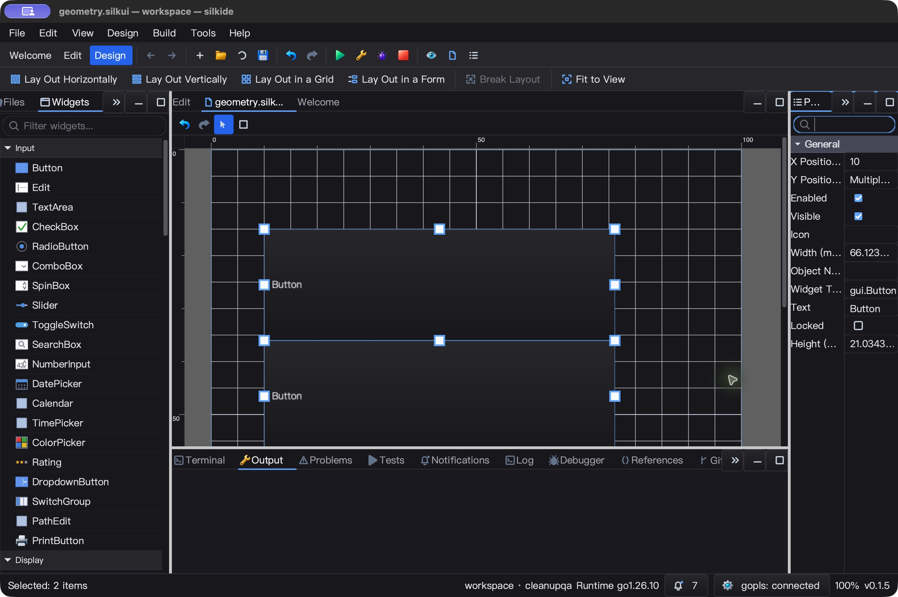

# 属性面板与紧凑输入框 QA — 2026-10-25

本轮接续设计器细节与原生文件面板修复，重点是精度安全、混合值可读性及窄侧栏。
不宣称已达到 Qt Creator 的完整功能覆盖；这是开发中改动，未发布。

## 改动

- 新增 `prop.FloatEdit`：float32/float64 默认使用专用编辑器；非聚焦时显示 7/10 位有效数字，编辑缓冲、tooltip 和模型保留完整精度。显式配置控件类型仍优先。
- 有效值实时走既有属性命令；不完整输入、尾随垃圾、NaN/Inf、溢出不写模型。Enter/失焦回退到真实值；Up/Down 步进 1，多选同一命令可撤销到各自原值。
- 混合值提示从背景色改为主题文字色，中英文随 locale；文本、整数、浮点、颜色、布尔控件提供完整提示。
- 常用历史中文属性 ID 只转换显示名，显式配置标签保持原样；序列化、绑定与插件身份不变。筛选可匹配可见标签。
- 属性标签、混合提示、紧凑数字和颜色文本采用字体测量省略及矩形裁剪，避免覆盖输入列／下拉箭头。公开 `gui.ElideText` 供 SDK 复用。
- 不增加 goroutine、timer、后台轮询或持续绘制；紧凑数字格式在属性变化时更新，不在每帧重算。

## UI 实测额外发现的底层缺陷

最初看似聚焦刷新不及时。独立 Go overlay 追踪确认：焦点和 Draw 已到达正确控件，完整编辑文本仍在，但 CPU 绘制缓冲中的文字消失。原因不是数值舍入或 GPU 帧率：

`Edit.ScrollToCaret` 用 `floor(viewportHeight / rowHeight)` 计算可见行数；当属性行略矮于字体加 padding 时得到 0，把唯一一行滚到视口外，下一次光标动作又滚回来。

- 修复：单行输入框禁止垂直滚动；过矮多行框至少按一行计算。
- 新测试修复前失败：viewport `19.09991455078125`，row `19.59991455078125`，首次点击后 `scrollY=1`；更矮布局及多行同样失败。
- 修复后重复点击、选择、箭头、残留滚动恢复及过矮多行光标测试通过。
- 正式 macOS 二进制重新启动后，鼠标点击即显示完整数字和光标，不需要下一次按键触发。
- 追踪文件仅保留在忽略的 QA 目录；正式源码和验收二进制不含 `FLOATTRACE` / `EDITTRACE` / `BUFFERTRACE`。

## 自动回归

- macOS：`GOMAXPROCS=2 go test -race -short -json -count=1 -p 2 ./gui ./ged ./prop ./cmd/silkide`：**5,244 pass / 42 skip / 0 fail**（含子测试）。
- 同四包 `go vet -composites=false`、RequireBundle 构建及根包 `go test -race -short -count=1 .` 通过。
- 精度测试覆盖次正规数、最大有限值、负零的无操作保持、float32/命名类型、混合选择与各项 Undo、只读保护和显式控件映射。
- 轻/暗主题 × 英/中文、多个窄宽度的像素边界与提示颜色断言通过。公开 elision API 覆盖 Unicode、nil、零/负/NaN/无限宽度。
- `-short` 跳过的生成代码运行、专用 fixture、原生 GL 及未启用的真实 gopls 等测试不计为通过；macOS 本轮没有重跑所有长集成测试。

## macOS 原生 UI

正式构建 SHA-256：`131686882fe7e9aa7d533f0f30478469bc1a35e97d438275df933c1e13ee2ea1`。

独立 HOME/数据目录，两个 Button 使用上一轮 Windows 真实拖拽／解除布局后保存的 geometry fixture，不从源码臆造最终结果。

1. 多选：Y 为可读的 `Multiple values`，Width 静态显示 `65.0875`；点击进入完整精度编辑。
2. 只聚焦／失焦再保存：两个 Width 均仍为 `65.08749999999999`。
3. Up→保存：均为 `66.08749999999999`；一次 Undo→保存：均回到原始精度，X/Y/Height 保持不变。
4. 输入 `66.12345678901234`→保存：两个值完整读回；追加 `x` 后失焦→保存，非法尾缀不写模型。
5. `Width` 筛选按英文可见标签找到对应行；清空后恢复。缩窄整个 Properties dock，标签、混合值和紧凑数值出现省略号而不串列。
6. 只读 Widget Type 全选后输入 `blocked` 不生效，保存仍是两个 `gui.Button`。
7. 六个原有代码／文本 fixture 字节不变；正常 Quit 后 IDE、其 bundled gopls 及所有本轮临时追踪实例均已退出。

上一轮一次自动化在 Undo 后未重新聚焦就尝试输入，文件断言失败；重新点击后重放成功。后续定位更正：普通属性 Undo 的 `RefreshValues` 保留控件，真正丢焦点的原因是 IDE 无条件 `canvas.SetFocus()`；随后画布全选才触发属性重绑。现已单独修复并验证无需重新点击的连续输入，见 [输入框与焦点 QA](EDIT_FOCUS_QA_20261025.md)。逐字输入不宣称整段只有一条 Undo。

Design 窄侧栏闲置 5.013 秒，主进程 CPU +0.04 秒，约单核 **0.80%**（不含 gopls）。这是短时存活／闲置观察，不是全场景无卡顿或相对版本提速的证明。

## Windows 10 原生验收

最终构建 SHA-256：`88665905c0b27b80fe969ba8551fad101f73373c8f26c8d41cbc7ed17427a53f`。

- 同四包原生 `-race -short -count=1`：**5,113 pass / 65 skip / 0 fail**（含子测试）；RequireBundle 构建和工具 manifest 验证通过。
- 强制 bundled gopls 的未保存重命名、Unicode 补全／格式化、导航三项真实集成测试全部通过，无跳过。
- 1,801 个不可变基线文件 + 362 个 overlay 输入 hash 校验通过；远端 tested-overlay 与本地相同，覆盖本地 1,661 个当前代码／构建输入。不声称涵盖全部资源资产。
- 独立干净环境启动；双选、多值提示、静态紧凑值、单击完整编辑、Ctrl+A/C 复制精确原值均验证。
- 聚焦无操作、Up、Undo、高精度粘贴、非法尾缀回退及只读类型保护，六份保存产物逐项回读：两个 Button 保留，Width 符合预期，X/Y/Height 不变。
- 英文 Width 过滤正确；缩窄 Properties dock 后标签／多值／数字使用省略号，无跨列覆盖。原始截图逐张检查，含桌面边框，仅保留在忽略的 QA 目录。
- 六个原有 fixture hash 不变。五个交互任务均 `Ready / LastTaskResult=0`；正常 Quit 后 IDE PID 8808 与所属 gopls PID 5748 消失，QA apps 下无进程残留。进程对象未返回可靠的 ExitCode，不将其写作 0。
- Design 窄侧栏闲置 5.008 秒，主进程 CPU +0.109375 秒，约单核 **2.18%**，`Responding=true`；不含 gopls，不作为跨场景性能／帧率或提速证明。

修复通用 caret 前的 Windows 构建和 UI 证据留在独立目录；上述结果来自包含最终修复的重新构建，不复用旧版本验收。

## 证据与剩余边界

- 原始记录：`bin/qa-artifacts/property-polish-20261025/`；最终版本测试、输入 hashes、保存回读、CPU/退出结果在其 `final/`，独立诊断在 `trace/`。
- 早期测试编写曾使用不存在的几何字段／Painter API，以及追踪构建漏加 `os` import；已修正，原始失败日志保留，不混入正式通过数量。
- 本轮原生 UI 是英文暗色主题；中文与亮色覆盖来自自动化绘图测试，不冒充对应真机截图。Linux 原生桌面未验收。
- 本报告当时未覆盖横向光标跟随和 Undo 后属性焦点保持；后续修复与独立验收见 [输入框与焦点 QA](EDIT_FOCUS_QA_20261025.md)。
- 命令面板长说明、窗口 DPI 与此前 QA 中未关闭的其它缺口仍在，不宣称全部 UI 已完成。
- 没有发布、commit 或 push。
