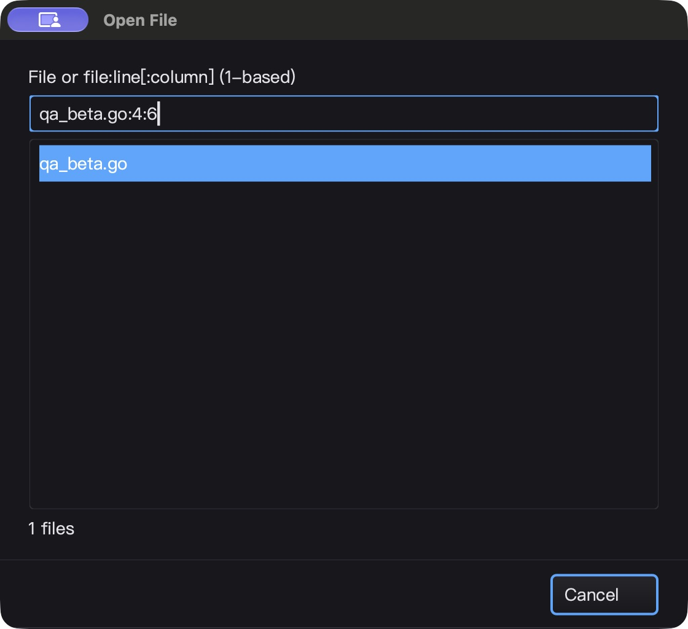
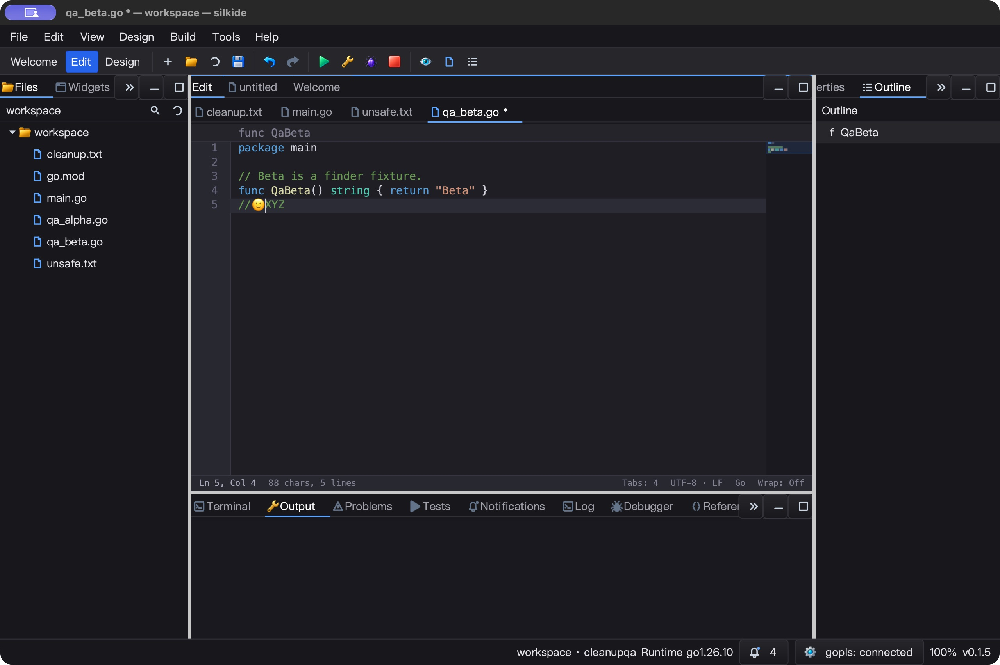
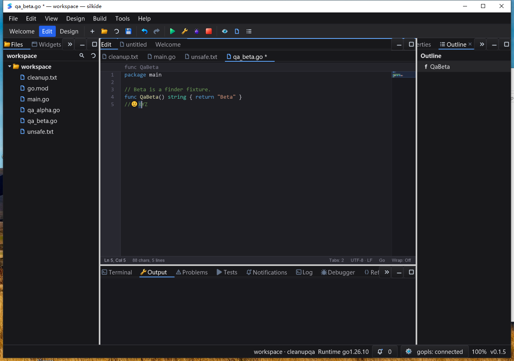

# 快速打开行列定位验收（2026-10-25）

基于 `30012dc`。本轮连接“文件检索 → 指定行列 → 导航历史”，复用现有编辑器
位置检查和异步文件索引，不重写 LSP 或原生渲染调度。

## 基线与实现

- 修复前原生窗口输入 `qa_beta.go:4:6` 显示 No files found。新增回归
  `TestFileFinderLocationSuffixFindsFile` 在旧实现中失败：0 个结果。
- SDK 新增无 GUI 依赖的 `locator.ParseFileQuery`、`FileQuery` 和
  `ErrFileQuerySyntax`。支持 `file:line[:column]`、盘符／UNC、引号路径和字面冒号。
  输入最多 4096 字节，位置部分最多 64 字节；零、负数、溢出、不完整引号等报错。
- 快速打开只将文件部分送入模糊匹配；绝对路径仅匹配已索引文件，不能绕过索引
  打开任意输入路径。对话框新增常驻语法提示、冒号文件名 tooltip 和中英文错误提示。
- 非法输入清空可执行结果；查询进行中仍不能接受旧行。Enter／列表提交使用同一
  选中行及位置快照，在模态窗口退出后打开文件。
- 位置按目标**实时未保存文本**检查，列号以 Unicode code point 为单位。
  只读文档可导航；成功加入工作台 Back／Forward 历史，失败不新增记录。
  范围错误可以打开／激活目标文件以显示警告，但保持其光标和文本不变。
- 保留现有有界索引、75ms 去抖及过期结果检查，没有新增扫描线程、定时器或轮询。
  关闭查找器会解绑结果列表并清理输入／状态 tooltip。

## 自动化与性能

### macOS arm64

- 16 包 `go test -race -short -count=1 -p 2`：5,017 项通过、45 跳过、0 失败，
  含子测试；`graph/prop/settings` 另有 238 通过、1 跳过。跳过不算通过。
- `go vet -composites=false`、要求内置工具的 IDE 构建及 gopls 清单校验通过。
  3 项强制真实内置 gopls 回归通过，无跳过：未保存 Unicode 补全／格式化、
  重命名、定义／类型／实现导航。
- SDK parser fuzz：349,355 次执行，无失败；整数溢出、Windows 路径、字面冒号、
  不完整输入及 Unicode 由确定性用例覆盖。不是安全性或全输入空间证明。
- M2 Max / GOMAXPROCS=2：解析一个典型 Windows 文件行列串约 41 ns/op，
  0 B/op、0 allocs/op。此微基准不包含索引排序、磁盘读取或 UI 绘制。

### Windows 10 amd64

- Go 1.26.10 / CGO 原生测试，16 包 `-race -short -count=1 -p 2`：4,908 通过、
  66 跳过、0 失败，含子测试；IDE 原生构建、内置 gopls 清单校验通过。
- 3 项强制真实内置 gopls 回归均通过，无跳过。
- 1,801 个冻结基线文件与 317 个覆盖输入验证；测后远端输入清单回读，逐项
  SHA-256 与当前本地源码相符。未把缓存通过或上传成功当作新代码已测。

## 原生 UI

### macOS

- `qa_beta.go:4:6` 找到文件并将光标放在 `QaBeta` 前；状态栏显示 Ln 4, Col 6。
  Go Back 命令返回原来的 cleanup.txt。
- `cleanup.txt:1:2` 后 Shift+Right 选中完整 `🙂`。复制、粘贴到测试文件并保存，
  磁盘字节确认是该字符而不是 UTF-16 半个代理项或 UTF-8 字节碎片；Undo／保存恢复。
- `qa_beta.go:0` 显示明确错误，Enter 不关闭或执行；`:999` 显示行范围警告，
  已打开目标仍处于原来的 Ln 4, Col 6，未静默钳位到文件末尾。
- 在第五行插入但不保存 `//🙂XYZ`，再次快速定位 `qa_beta.go:5:4`，光标准确位于
  `X` 前，dirty 星号保留。磁盘旧文件没有该列，证明导航使用实时缓冲区。
- 撤销临时修改后，5 个源文件逐字节恢复。5.06 秒空闲 CPU 增量 0.04 秒
  （约单核 0.79%）；仅代表此短片段。原生 Quit 后 IDE 及其内置 gopls 均退出。





### Windows

- 干净 PATH 交互桌面启动；`qa_beta.go:4:6` 跳到目标，Shift+Right／Copy 精确
  读回 `Q`。Go Back／Go Forward 命令分别回到 cleanup.txt／qa_beta.go，标题断言通过。
- `cleanup.txt:1:2` 选中并复制完整 `🙂`；`:0` 后 Enter 仍留在搜索框，查询复制
  读回相同文本。常驻提示、错误提示、列表和取消按钮无覆盖。
- 未保存的 `//🙂XYZ` 中定位 `:5:4`，复制读回 `X`，dirty 状态仍在；Undo／保存恢复。
  重新定位 `:4:6` 后输入 `:999`，警告出现，再复制仍得到 `Q`，未移动到其他位置。
- 输入带真实 `C:\...` 盘符的已索引绝对路径 `qa_alpha.go:4:6`，标题正确且复制得到 `Q`。
- 五份源文件逐字节未变；实际 gopls 子进程来自程序旁的 tools 目录。
  5 次健康采样全响应，5.04 秒 CPU 增量 0.078125 秒（约单核 1.55%）。
  Alt+F4 后 IDE 及其内置 gopls 均结束；三个交互计划任务 LastTaskResult=0，
  各阶段显式成功标记已回读。



## 限制与测试过程

- 没有 Linux 原生 GUI、完整 IME／DPI／多屏或长时间压力验收。普通文件打开仍保留
  既有 I/O 路径；新增 parser 零分配不等于整个 Quick Open 零分配或恒定帧率。
- 未带数字的冒号可以是普通文件搜索；以数字结尾的冒号文件名用双引号消歧。
  Windows 单字母盘符 `C:`／`C:123` 优先解释为路径；解析器本身不做路径授权。
- 首轮批量投递 macOS Alt+Left／Alt+Right 未获得明确标题切换。提交前在独立
  BundleID 的同一已验收二进制上，逐次投递并断言新窗口状态：后退返回 cleanup.txt，
  前进返回 qa_beta.go；截图确认 Ln 4, Col 6。未修改键盘分发，也不把先前不确定
  的观测宣称为底层缺陷；本次明确结果与截图保存在 `commit-check/`。
- 初次基线 app 复用了旧 BundleID，CUA 出现绑定歧义／截图错误；隔离标识与路径后
  重跑基线。两个准备阶段实例被终止，未计为正常退出验收。
- 一次自动化在异步粘贴完成前按 Save，磁盘仍是旧内容；等待 UI dirty 状态再保存、
  读回后才计入字符验证。未把动作发出当作落盘成功。

## 提交前复核

- 重新运行 `GOMAXPROCS=2 GOTOOLCHAIN=go1.26.10 go test -race -short -count=1 -p 2 ./locator ./cmd/silkide`，两个包均通过。
- 本地及 Windows 已验收的 317 个覆盖输入重新逐项核对 SHA-256，均与提交前源码一致。
  本次复用已有 Windows 完整验收记录，没有把它表述为再次运行远端测试。
- macOS 快捷键复核使用的二进制与原验收产物 SHA-256 一致：
  `db9f8451e6b79939abb4157f2b2fdcc277d6f554935d193e519c3ac02aec1202`。
  原生 Quit 后测试 IDE 进程已结束；`git diff --check` 通过。

## 重放

```sh
go test -race -count=1 ./locator ./cmd/silkide \
  -run 'Test(ParseFileQuery|FileFinder|FileSearch|RankFiles|WorkbenchNavigation)'
go test ./locator -run '^$' -fuzz '^FuzzParseFileQuery$' -fuzztime=5s
go test ./locator -run '^$' -bench '^BenchmarkParseFileQuery$' -benchmem
```

在含 `qa_alpha.go` / `qa_beta.go` 的 workspace 中用 Ctrl/Cmd+P 输入文件行列；
检查光标旁字符、Go Back／Go Forward、非法与越界输入、未保存目标及绝对路径。
完整失败基线、冻结输入哈希、测试 JSONL、构建、真实 gopls、截图和退出证据位于
`bin/qa-artifacts/quick-open-location-20261025/`；二进制和缓存不纳入源码改动。
