<p align="center">
  
</p>

# Silk — Cross-Platform Go UI Framework & Visual Designer

A Go-native GUI framework with a **visual form designer** and **integrated Go IDE**. Drag widgets onto a canvas, arrange nested layouts, generate Go code, then build and run from the same workbench. The project is working toward a Qt Creator-style workflow; it does not claim full feature parity.

The SilkIDE mark is a cyan-to-blue folded silk **S**. Transparent PNGs and
Windows/macOS application icons live in [assets/branding](assets/branding/README.md).

**Release:** [SilkIDE v0.1.5 / SDK 2.5.1](https://github.com/uk0/silk/releases/tag/v0.1.5)
provides Windows amd64, Linux amd64 and macOS arm64 / amd64 archives with SHA-256 checksums.
The four-platform release gates and actual Windows package desktop checks passed;
see [release notes](RELEASE_NOTES_v0.1.5.md) and [package QA](RACE_RENDER_QA_20261020.md).
Windows system/per-monitor DPI scaling remains incomplete and may still blur the
whole window. macOS packages require external Cairo and are not Developer ID
signed/notarized standalone apps.

---

## Industrial 3D scene SDK (development)

- New dependency-free `scene3d` package: immutable shared meshes, hierarchy snapshots,
  bounded OBJ/glTF/GLB static-scene import, depth/picking, box/cylinder primitives and cached CPU rendering.
  The optional [OpenGL backend](scene3d/glrender/README.md) adds real offscreen GPU rendering,
  shared mesh buffers and explicit CPU fallback diagnostics. Its private 58-entry GL binding
  is context-owned; independent contexts can render concurrently on their owning OS threads.
  `CloseCurrent` reports incorrect context/thread ownership instead of deleting another
  context's resources. The Windows scene example no longer links the large go-gl binding.
- `gui.SceneView` is embedded in the normal widget tree with clipping and HiDPI rendering,
  orbit/zoom/pick interaction, cancellable background loading and coalesced tag bindings.
- Designer palette, vector icon, saved camera/source properties, preview, generated events
  and `decl.SceneView` use the existing registration/code-generation paths.
- glTF preserves hierarchy, transforms and shared meshes with stable primitive IDs. Explicit
  `FitScene()` reframes tag-driven assemblies; external buffers stay inside the selected model directory.
- Portable `.silkscene` documents preserve shared geometry, node hierarchy and inert tag bindings.
  Compiled bindings cover position/relative rotation/scale, visibility and alarm color, with bounded
  UI delivery and authored-baseline export/reconfiguration. **Tools → Edit 3D Scene...** and the
  command palette open the node/binding inspector; edits use normal buffer Undo/Redo and Save.
  See [scene document workflow and QA](SCENE_DOCUMENT_QA_20261028.md).
- Reusable device `Template`s add atomic batch placement, shared mesh storage and per-device tag
  mapping. The pure-Go [plant assembler](examples/scene3dplant/README.md) builds multi-device
  `.silkscene` files for the existing scene editor; node edits preserve the observation camera.
  See [template SDK, native screenshots and regression evidence](SCENE_TEMPLATE_QA_20261028.md).
- `scene3d.EditSession` adds atomic node/group/box/cylinder creation, subtree copy/delete,
  keep-world reparenting and bounded Undo/Redo. The scene editor exposes these through owned
  **Node actions** menus and forms; **Use changes** creates one host-editor transaction,
  while Cancel leaves the document untouched. See [authoring SDK](scene3d/README.md).
- Conservative CPU/GPU frustum culling avoids offscreen vertex work and first-time uploads.
  Optional per-context GPU instancing batches consecutive shared meshes without changing
  draw order or picking IDs; capability checks retain the ordinary-draw/CPU fallback paths.
  The [final regression matrix](SCENE_RELEASE_QA_20261028.md) distinguishes actual hardware,
  software GL, native desktop flows, skipped fixtures and unsupported capabilities.
- Reusable `scene3d.Culler` adds spatial Morton-ordered BVH queries with stable original draw/
  pick order, conservative numerical handling, incremental bound refits and bounded linear fallback.
  CPU and GPU renderers share the culling API; unchanged GPU snapshots reuse matrix/budget
  validation. `CullingStats` and `ValidatedInstances` expose work rather than guessed FPS.
  See the [BVH regression and measured limits](SCENE_BVH_QA_20261029.md).
- **Move node** adds embedded world-X/Y/Z handles to the scene editor. A drag previews without
  modifying the authored document, then commits one undo step on release. Shift snaps to one
  world unit; Escape, lost capture/focus, resize and scene replacement cancel the gesture.
  The SDK exposes camera projection/rays, an immutable axis solver and revision-guarded
  translation edits that preserve parent rotation/scale/shear. See [interaction SDK](scene3d/README.md)
  and [translation QA](SCENE_GIZMO_QA_20261029.md). World-axis rotation and scale now share the
  same one-gesture/one-undo contract, with vector handles, angle/ratio snapping and cached overlays.
- **Node actions → Device library** adds an embedded searchable pump/tank/conveyor shelf,
  bounded background model import, ground-plane drag placement and per-device point prefixes.
  The SDK's `EditSession.InstantiateTemplate(s)` merges geometry, inert bindings and diagnostics
  as one atomic undo step. Shelf metadata is session-local; placed resources persist in the document.
  See [device library and placement contracts](scene3d/README.md#transactional-device-library-placement).
- Immutable `scene3d.RayIndex` adds shared-mesh triangle and instance BVHs, nearest surface
  queries, world/local positions, normals and original triangle IDs. Background builds,
  snapshot refits, cancellation and storage budgets are explicit; queries need no framebuffer.
  `SceneView.SurfaceAt` rejects stale indexes and respects logical coordinates/camera clipping.
  The scene example's **Inspect center** demonstrates worker preparation without idle polling.
  The device editor now supports ground, upright-surface and normal-aligned placement,
  with cancellable preparation, bottom-center anchors, inert bindings and one-step undo.
  Missing/stale surfaces never fall back to ground; this is not a persistent attachment constraint.
  This does not replace raster picking.
  See [surface-query SDK](scene3d/README.md#geometric-surface-queries).
- The CPU reference and initial **OpenGL readback backend** do not provide PBR/textures or a complete
  industrial editor. Windows native CPU-fallback interaction is verified; Windows hardware GPU
  and Linux physical-desktop UI verification remain open. Linux Xvfb/Mesa llvmpipe is
  software-GL validation, not hardware GPU performance evidence.
  See [SDK guide](scene3d/README.md), [runnable example](examples/scene3d/README.md),
  [CPU verification](SCENE3D_QA_20261028.md), [GPU/native verification](SCENE3D_GPU_QA_20261028.md),
  [GL dispatch and full regression](GL_DISPATCH_QA_20261028.md),
  [glTF import and three-platform regression](GLTF_QA_20261028.md), and [full roadmap](SCENE3D_ROADMAP.md).

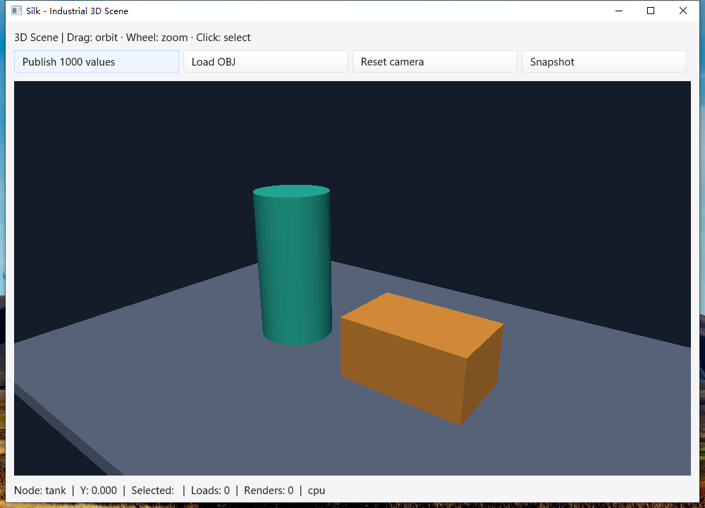

Windows native screenshot: this test machine lacks the required OpenGL driver; the image
shows the verified CPU fallback, **not** a Windows GPU performance claim.

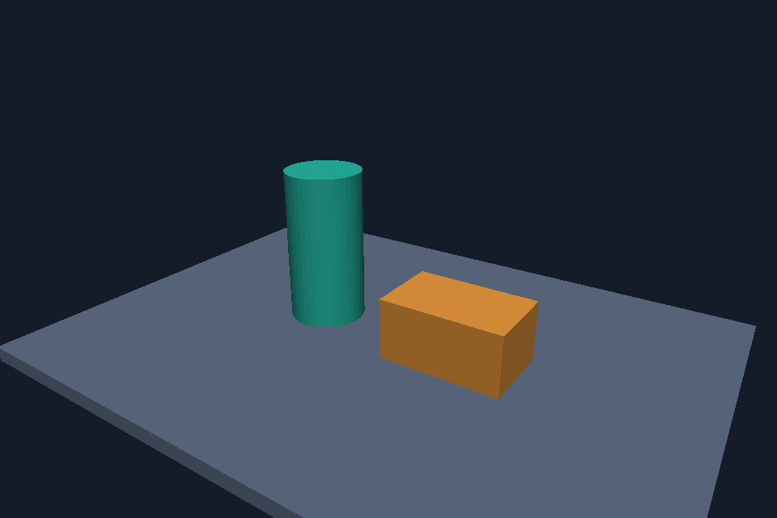

## Editor and language-service fixes (development)

### Typed UI dispatch and cancellable SDK updates

- `Invoke` / `InvokeValue` marshal short worker calls to the UI and return results;
  UI-thread calls execute inline. Cancellation retires work not yet started.
- `PostContext` drops stale queued updates; `NewLatestUI` coalesces progress with
  one pending delivery instead of flooding the event queue.
- `TryAttachWindow` reports attachment errors and rejects wrong-thread calls
  before widget mutation. Win32 creation now checks actual thread identity.
- Caption elision tolerates floating-point layout round trips rather than
  truncating a fully fitting label. Run `go run ./examples/ui-dispatch`; see
  [SDK dispatch QA](SDK_DISPATCH_QA_20261026.md) for verified scope and limitations.

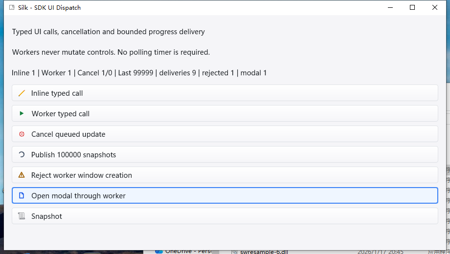

### Consistent dialog language and window identity

- Standard `@ok` / `@cancel` / save-family buttons now translate their captions
  without changing command payloads. SDK rename validation includes concise
  Chinese defaults; host-provided custom captions remain untouched.
- Forms, input boxes and message dialogs share icon selection before their first
  display: explicit icon, owner-window icon, then configured application icon.
  `Form.SetIcon` updates live forms; `Window.Icon()` exposes the logical source.
- Windows owns separate native icon handles per window and releases them on
  replacement/close. Popups avoid this title/taskbar-icon work; macOS keeps its
  bundle-icon boundary. See [dialog polish QA](DIALOG_POLISH_QA_20261026.md).

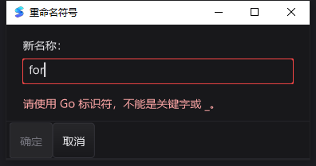

### Validated rename dialogs and consistent commands

- Rename starts with the current identifier selected. Invalid drafts show a
  wrapping explanation and disable OK; Enter cannot bypass validation. Cancel
  remains available and existing free-form input dialogs keep their behavior.
- SDK keyboard/context-menu rename routes through the same host action. The
  single-buffer fallback gains text Undo/Redo; SilkIDE keeps semantic gopls
  rename and flushes all open buffers before submitting it.
- Modal and delayed results reject changed/replaced/read-only target editors.
  `WordAtCursor()` avoids converting an entire long line just to prefill a name.
  See [rename dialog QA](RENAME_DIALOG_QA_20261026.md) for the tested scope and
  remaining workspace transaction limitations.

### Useful completions without redundant popups

- Exact literal matches no longer consume Enter/Tab; case corrections and
  semantic provider edits remain available. Empty lists retain request intent,
  while Escape, navigation and focus loss retire pending completions.
- Local acceptance preserves untouched bytes and records a small atomic splice
  instead of full-document undo copies. Candidate substrings are detached from
  old source allocations before entering history.
- SDK hosts can query `CompletionActive()` separately from `CompletionVisible()`;
  SilkIDE uses this for LSP refresh and suppresses proven no-op server edits.
  See [completion intent QA](COMPLETION_INTENT_QA_20261026.md).

### Find results you can edit directly

- Find navigation selects the actual match, including multiline regular-expression
  results. Escape returns to the document without discarding that selection.
- Next/Previous resume from a manually moved caret; queued navigation accumulates
  while searching, and delayed results cannot replace a newer interaction state.
- Search-in-selection keeps the original frozen range rather than shrinking to
  the currently selected match. See [find navigation QA](FIND_NAVIGATION_QA_20261026.md).

### Reliable popup gestures and caret-anchored menus

- GLFW popup and owner-window button events now share capture routing: a release
  stays with the pressed control, and a fresh hit-test prevents stale hover from
  activating the wrong row or losing a stationary click.
- Shift+F10 in both editors and text fields uses the visible caret rectangle,
  clamped to the control, and rejects unfocused field shortcuts.
- This adds no timer or background polling. See
  [input routing QA](INPUT_ROUTING_QA_20261026.md) for native tests, overhead and
  remaining limits; the Windows mouse dispatcher itself is unchanged.

### Complete, reusable editor context menus

- Code editors now offer Undo/Redo and selection-only Delete alongside clipboard,
  multi-caret and symbol actions. Command icons and platform shortcut hints are
  consistent; the IDE advertises its actual F2 rename binding.
- Context menus follow the active language, open on right-button release or
  Shift+F10, reuse an owned popup and discard rows when dismissed. Captured
  commands cannot retarget a replaced document, caret or editor owner.
- Opening a menu no longer copies a whole long line just to detect a word.
  SDK hosts can use `BuildContextMenu`, `CanDeleteSelectedText` and
  `DeleteSelectedText`, or supply their own registered menu builder.
  See [editor context QA](EDITOR_CONTEXT_QA_20261026.md) for tested scope.

### Composed-character rendering and editor geometry

- On macOS with the Cairo Quartz font backend, ZWJ emoji, flags, skin-tone
  modifiers and combining marks now use native composed glyphs instead of
  separate boxes. Drawing and measurement retain the actual fallback font.
- Editor clicks, caret anchors, syntax colors and text-field wrapping share
  cluster boundaries. Original UTF-8, line endings and Undo/Redo remain intact;
  this does not yet change keyboard navigation/deletion to grapheme semantics.
- Ordinary ASCII/CJK keep the existing rendering path. Bounded UI-thread caches
  add no polling or worker; Windows/Linux retain their previous text backend.
  See [composed text QA](COMPLEX_TEXT_QA_20261026.md) for scope and limitations.

### Native Unicode character chooser on macOS

- Focus an editable field and press **Control+Command+Space** to request the
  system Emoji & Symbols panel. Character commits use normal text-input and
  Undo/Redo handling; Silk does not emulate them with clipboard replacement.
- Explicit application shortcuts and an active IME composition retain priority.
  Hidden, disabled, detached and foreign-window targets are rejected.
- SDK: `gui.CharacterPaletteAvailable()` / `gui.ShowCharacterPalette(target)`.
  The API is UI-thread-only; Windows/Linux report unsupported, not a fake panel.
  See [native input QA](NATIVE_INPUT_QA_20261026.md) for actual test scope.

### Editable integer controls and designer round trips

- `SpinBox` now supports direct signed-integer entry, selection, clipboard and
  field-local undo. Enter or focus loss commits once; incomplete drafts restore
  the previous value. The suffix stays outside the editable number.
- Arrow, wheel and page steps saturate instead of wrapping at machine-integer
  limits. Disabled/read-only controls reject changes; dark/light theme arrows
  use contrasting colors and suffix ink remains inside its actual clip.
- The designer saves and generates step, page-step override, suffix and read-only
  settings without leaking the internal editor as a separate widget. Printing
  copies and Gantt progress editors reuse the same control.
- See `examples/spinbox-edit` and [integer control QA](SPINBOX_EDIT_QA_20261025.md)
  for verification scope and remaining platform limitations.

### Exact integer ranges across load, preview and SDK builds

- Integer range properties now load as a complete range before the initial
  value, matching the existing floating-point range handling. Negative values
  and ranges outside factory defaults survive reload and preview.
- Declarative `min`/`max` and `value`/`Value` support integer controls without a
  float conversion; machine-integer endpoints remain exact. Fractions,
  overflow and malformed persisted data are ignored, not rounded or executed.
- Property-order, repeated serialization and both generated constructors are
  covered by [integer-range regression QA](INTEGER_RANGE_QA_20261025.md).

### Property edits with coherent designer undo

- Integer, floating-point and text property rows keep updating the canvas while
  typing, but one continuous edit produces one designer Undo/Redo record.
- Enter, real focus loss, refresh and field retirement end the edit session;
  save points and history branches remain separate. Mixed selections restore
  every object's original value rather than only the first selected value.
- No-op visits do not dirty the scene. Read-only, disabled, hidden and stale
  property controls cannot write through delayed edit callbacks. Held arrow
  repeats are grouped until key release; no timer or background worker is added.
- See [property-edit session QA](PROPERTY_EDIT_SESSION_QA_20261025.md) for exact
  native save/readback assertions and platform coverage.

### Live designer geometry and coherent canvas history

- The selection status shows the widget's object name and type, position and
  fractional dimensions. Property edits, completed drags, grid snaps and history
  changes refresh the same message instead of leaving a rounded selection snapshot.
- Canvas Undo/Redo now follows the designer's document lifecycle: pending-edit
  guards, property refresh and generated-code notifications are no longer bypassed
  by the inner toolbar. Plain graph views retain their existing stack behavior.
- Hidden/closed views stay silent, scene changes retire old listeners, and
  unchanged notifications do not repaint or replace another tool's message.
  No polling timer or background worker was added.
- See [selection status and canvas history QA](SELECTION_STATUS_QA_20261025.md)
  for native save/readback evidence and remaining limitations.

### Precise designer movement and explicit snapping

- Arrow-key moves preserve fractional starting coordinates and the untouched axis;
  Shift uses the configured coarse step without rounding the starting point.
- Alignment and equal-gap distribution keep their computed fractional targets.
  Moving containers still carries their descendants without moving them twice.
- `graph.MoveCommand` replays exact coordinates. Grid/guide snapping belongs to
  the caller; disabling designer snapping no longer leaves a hidden 1 mm snap.
  Undo/Redo preserves fractional grid results rather than rounding them again.
- No polling timer, worker or new rendering loop is introduced. See
  [precise geometry QA](PRECISE_GEOMETRY_QA_20261025.md) for regression, native
  save/readback evidence. The stale-property limitation recorded in that phase
  is addressed by the following command-sync changes.

### Property panels that follow designer commands

- Moving, resizing, aligning and replaying history refresh the existing property
  rows through the scene's change notification. A common value replaces the
  mixed-selection placeholder immediately; Undo restores the mixed state.
- The refresh does not rebuild the inspector or reset its filter. A field's own
  live typing keeps its partial decimal text and single-edit Undo session.
- Shared panels check their binding owner. Hidden, closed or replaced views do
  not refresh stale fields; showing a hidden designer catches up once.
- There is no idle polling, new timer or background worker. See
  [property command synchronization QA](PROPERTY_COMMAND_SYNC_QA_20261025.md)
  for regression coverage, native UI evidence and remaining limitations.

### Nested menus return keyboard focus to their owner

- On the GLFW backend, closing a mouse-selected submenu now returns native
  focus directly to the surviving owner **before** hiding the popup tree.
  The root menu is no longer briefly activated just before it disappears.
- macOS designer menu actions can be followed immediately by Save, Undo/Redo
  or canvas keys without an extra click. Keyboard submenu navigation is retained.
- Independent forms, new focus intent and background applications remain
  protected; there is no polling or new timer. See
  [nested menu focus QA](MENU_KEYBOARD_QA_20261025.md) for actual coverage.

### Predictable editor typing and Undo boundaries

- Replacing a selection and rapidly typing adjacent characters now forms one
  Undo transaction, rather than leaving the first replacement character behind.
  Undo/Redo retains original bytes, including Unicode and mixed line endings.
- Paste, multi-character input commits, bracket wrapping, Save, history replay,
  pointer/focus changes and caret navigation remain separate from later typing.
  An empty text-input event no longer deletes the selected document text.
- This uses UI-thread history metadata, not polling or a new timer. See
  [editor typing QA](EDITOR_TYPING_QA_20261026.md) for native UI evidence,
  performance samples and the remaining native Unicode-input limitation.

### Modal-safe timers and reliable dialog actions

- GLFW timers no longer recursively enter the same active callback when it opens
  a modal window. Other timers keep advancing; stop, restart and panic cleanup
  release the original arming without modifying a replacement timer.
- Dialog buttons added **after** sizing now receive their footer layout even when
  the footer bounds have not changed. Late-added actions no longer remain 0×0
  and invisible; trailing padding and spacing survive repeated layout.
- `examples/timer-lifecycle` demonstrates modal callbacks, restartable two-second
  UI delays, cancellation and explicit state snapshots. The framework adds no
  polling timer or background worker. UI-thread ownership remains required.
- Before/after reproduction, Windows/macOS desktop checks and limitations are in
  [timer and dialog QA](TIMER_LIFECYCLE_QA_20261025.md).

### Pointer actions that keep editing predictable

- Clicking, closing or dragging an editor tab now hands keyboard focus back to
  its visible document, without an extra click in the text area. Window titles
  follow committed page changes immediately instead of waiting for the title poll.
- IDE toolbar mouse actions preserve the current content focus: Save then type,
  Select All, Undo and Go to Line continue targeting the intended editor. A
  navigation/property input keeps its own focus; commands do not silently fall
  back to a different document.
- SDK hosts can opt in with `TabBar.SetPointerFocusCallback` and
  `ToolBar.SetPreserveContentFocus`. Default controls and keyboard tab-strip
  navigation remain unchanged. Drag previews are explicitly retired after use.
- Scope, exact file readback and native-platform results are recorded in
  [pointer-focus QA](EDITOR_POINTER_FOCUS_QA_20261025.md). No new idle polling
  or background work is introduced.

### Distinct drag feedback and reliable input cleanup

- SDK-only applications now have built-in move/copy/link/reject cursor artwork;
  optional PNG overrides validate dimensions and hotspots. Drag cursors include
  the actual, bounded content thumbnail rather than an empty preview allocation.
- Temporary Cairo pixels and native cursor handles are retired explicitly;
  `ReleaseDropCursors` preserves shared fallbacks. GLFW drags no longer wake
  themselves every millisecond, and completed drags clear stale mouse capture.
- Escape cancels GLFW drags without typing into background editors. Windows OLE
  now honors cancellation before button release and exposes the correct
  `IDropSource` identity. `examples/drag-feedback` demonstrates all four actions.
- macOS ten-package race-short: **5,616 pass / 47 skip / 0 fail**, five forced
  native cursor/GL checks, exact drag snapshots, and IDE save/undo readback passed.
  See [drag feedback QA](CURSOR_FEEDBACK_QA_20261025.md) for Windows evidence,
  short-interval CPU samples and explicit remaining focus/DPI/platform limits.
- The follow-up Windows native-loop fix restores target-hover paints, SDK timers
  and worker `gui.Post` callbacks **while the mouse remains held**. Stationary
  drags do not continuously repaint; the existing frame scheduler remains in charge.
  See [native-loop scheduling QA](OLE_UI_PUMP_QA_20261025.md) for real pixel,
  callback, CPU and file-readback evidence and the remaining platform/focus limits.

### Precise tab strips and native input routing

- Overflow starts at a whole tab boundary; trailing titles are elided to their
  actual visible width. Tiny remainders no longer expose clipped icons or
  invisible close targets. Painting, hit testing and drag insertion agree.
- `TabWidget` stays inside even a zero-height owner. The new
  `examples/tab-overflow` demonstrates narrow strips, the full-title chooser,
  keyboard/wheel navigation, Unicode editing, reordering and snapshots.
- macOS Control-Tab now reaches GLFW instead of being consumed by Cocoa;
  native dialogs and IME composition retain ownership. Wheel dispatch uses
  the delivered event's coordinates rather than an unrelated polled pointer.
- macOS nine-package race-short: **5,604 pass / 46 skip / 0 fail**, four forced
  native GL probes, and actual SDK/IDE input, drag, close and save/readback
  passed. Windows 10 six-package targeted race tests (three runs), a clean SDK
  interaction replay and IDE save/undo/resize checks also passed. See
  [tab geometry and native-input QA](TABSTRIP_GEOMETRY_QA_20261025.md)
  for exact coverage, resource warnings, benchmarks and platform limitations.

### Immediate resize-resource retirement

- Window backbuffers now share explicit painter-before-surface retirement.
  GLFW resizes/close no longer leave large native Cairo allocations waiting for
  Go finalizers; unchanged frames retain their surface, painter and pixels.
- Recursive GLFW paint requests defer to the next frame, and a Draw-triggered
  close waits for the current frame to unwind before freeing native resources.
  Physical framebuffer sizes and partial-update behavior remain unchanged.
- Native GL verification covers 48 actual resizes with PBO/direct pixel readback,
  retained-wrapper retirement assertions and safe close/reentry. macOS SDK/IDE
  border dragging and input/save/undo checks passed; race-short is **5,591 pass /
  46 skip / 0 fail**. Windows 10 six-package targeted race tests (three runs),
  native SDK/IDE resize/edit checks, three About return paths and three mandatory
  bundled-gopls integrations also passed. See [resource-lifetime QA](BACKBUFFER_LIFETIME_QA_20261025.md)
  for exact platform coverage and performance limits.

### Clean popup edges and reliable About return focus

- Native GLFW popups now preserve premultiplied alpha through presentation;
  actual framebuffer capability decides whether to use rounded transparency
  or a fully painted opaque rectangle. Ordinary windows do not inherit the hint.
- Inset menu borders no longer lose half their stroke. GPU chart overlays retain
  correct alpha instead of multiplying it twice. No new polling or timers.
- About lets the modal owner capture editor focus before activating its Close
  button. Closing by mouse, Enter or Escape supports immediate typing and saving,
  without clicking the editor again or overriding an explicitly changed focus.
- Eight-package macOS race-short: **5,585 pass / 45 skip / 0 fail**; three forced
  native GL probes and three bundled-gopls integrations passed. Native SDK pixel
  checks and IDE save/readback passed. Windows pure-Go cross-compilation passed,
  but that checkpoint's remote test machine was unreachable. Windows native
  verification was subsequently completed in the resource-lifetime phase above;
  Linux native UI remains untested. See [popup surface and focus QA](POPUP_SURFACE_QA_20261025.md).

### Retained glyphs and precise input geometry

- SDK `Edit` / `TextBlock` now retain each glyph's owning font, using the same
  native fallback as ordinary text drawing. Mixed Chinese, Latin and emoji no
  longer use a single font's missing-glyph indices in fields.
- Fractional caret positions are shared by hit testing, selections, horizontal
  scrolling and input-method geometry. Wrapping retains runs rather than
  reshaping on repaint; terminal CR/CRLF preserves the final empty line.
- Added `paint.LayoutText` without changing the `Font` / `ScaledFont` interfaces.
  This remains simple LTR/rune layout, not full complex-script shaping.
- macOS: **5,574 pass / 44 skip / 0 fail** in eight-package race-short regression,
  three forced bundled-gopls integrations, and native SDK/IDE readback checks.
  **This revision is not Windows-UI-verified:** both test-host addresses failed
  SSH connectivity; the earlier Windows results below belong to the previous
  revision. See [glyph/layout QA](TEXTBLOCK_FALLBACK_QA_20261025.md).

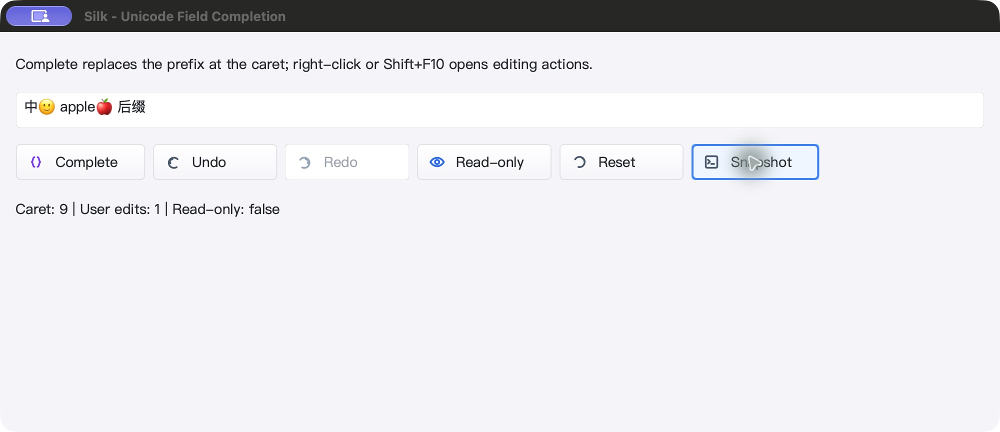

### Field context menus and safer editing

- Unicode field completion now preserves the suffix, checks edit permissions
  and validation, and participates in local Undo/Redo. Prefix extraction avoids
  copying the remainder of a long field. The Go-to-Line bar delegates field
  history without allowing an empty Undo to modify the document behind it.
- Context menus retain the target selection highlight without drawing an
  unfocused caret. See the [completion example](examples/edit-completion) and
  [follow-up QA](EDIT_COMPLETION_QA_20261025.md) for current verification boundaries.
- SDK `Edit` now provides an owned, reusable right-click / Shift+F10 menu with
  vector icons, platform shortcut hints and state-aware actions. Read-only
  fields retain Copy; dismissed menus release their temporary callbacks.
- Field Undo/Redo stores changed spans, bounded to 256 entries / 1 MiB of text.
  Empty history does not undo the host document. Programmatic `SetText` resets
  field history; derived controls may still override shortcut routing.
- Cut deletes only after a successful clipboard write and revalidates the
  selection after native callbacks. Failed writes preserve text and history.
- Appearance settings have measured label gutters and row spacing, with room
  for the final hint and action buttons.
- macOS race-short regression: **5,342 pass / 42 skip / 0 fail** across seven
  packages, plus three forced bundled-gopls integrations. Native menu Delete,
  Undo/Redo, read-only behavior and settings save/readback were checked.
  Windows repeated targeted race tests and native SDK/IDE interactions also
  passed; these do not supersede the recorded full-suite/modal failures.
  See [initial field menu QA](EDIT_MENU_QA_20261025.md) and
  [current completion QA](EDIT_COMPLETION_QA_20261025.md).

### Predictable ComboBox selection and popup focus

- Appearance settings now use selection-only language, theme and indentation
  fields: typed matching labels update the value that Apply actually saves.
- SDK `ComboBox.SetEditable(false)` renders the committed label and optional
  icon, with clipped/elided text. Free-text editing remains the default.
- Keyboard and mouse share a visible pending selection. Enter/Space commits;
  Escape cancels only the dropdown, and Tab cancels its preview and leaves the
  composite field. Arrow/Page/Home/End navigation shares the list selection model.
- Editable fields have one automatic Tab stop on their actual editor, rather
  than trapping typing on the outer ComboBox frame.
- Committed Unicode input is handled independently of an outer modal shortcut's
  modifier state. Search and label caching add no polling or background worker.
- Dropdowns now size the actual viewport before allocating the native surface,
  with a default 10-row preference and `SetMaxVisibleItems`. Work-area limits,
  fractional metrics and changing an open preview have regression coverage.
- Windows modal teardown returns native activation before hiding the dialog,
  guarded against overriding an independent foreground window.
- macOS dropdown mouse selection restores native focus before hiding the popup,
  so an ongoing modal settings dialog does not fall behind the main window.
  This uses no new timer, polling loop or background worker.
- See the [SDK example](examples/combobox), [API notes](docs/SDK_FEATURES.md#combobox-选择模式与弹窗契约),
  [earlier interaction QA](COMBOBOX_QA_20261025.md),
  [viewport/focus QA](POPUP_VIEWPORT_QA_20261025.md) and
  [native mouse follow-up](POPUP_MOUSE_QA_20261025.md). These are development
  changes, not a release: Windows full gates/native-modal tests and macOS
  standalone SDK capture still have explicitly recorded failures or limitations.

### Readable command palette and SDK list rows

- Command names, descriptions and unavailable states now occupy separate,
  measured slots instead of competing for one clipped line. Full descriptions
  remain available in a selectable, read-only, scrollable detail pane.
- Keyboard selection updates details, empty searches clear stale descriptions,
  and unavailable commands remain guarded before and after modal dismissal.
- SDK `ListWidget.SetItemPresenter` adds opt-in two-line rows without changing
  `ListItem`. Visible-row caching is bounded to 128 entries, with no polling or
  animation timers. Padding is shared by drawing and hit testing.
- Verification and limitations: [command palette QA](PALETTE_DETAILS_QA_20261025.md)
  · [macOS](screenshots/palette-details-20261025-mac.png) /
  [Windows screenshots](screenshots/palette-details-20261025-windows.png).

### Caret visibility and continuous property editing

- Narrow SDK input fields now reveal the active caret horizontally, keep text
  inside their padding and reset scrolling when values shrink or fields widen.
  Navigation reuses shaped glyphs rather than reshaping on every arrow key.
- Designer Undo/Redo retains a live property editor's focus, so the next input
  edits that property instead of reaching the canvas. Removed, hidden, disabled
  or rebound controls are not revived. Retired property rows reject late writes
  from old blur/dialog callbacks, preventing them from undoing Undo.
- Input validators use rune-based replacement ranges for Chinese and emoji.
- Tests, native UI checks and limitations: [input and focus QA](EDIT_FOCUS_QA_20261025.md).

### Precision-safe properties and compact input rows

- Floating-point properties show compact values at rest, but preserve exact
  editable text and saved geometry. Up/Down supports grouped changes and Undo;
  invalid/infinite input is rejected without changing the bound property.
- Mixed-selection hints are readable in both themes. Common property labels
  follow the locale without changing IDs; narrow labels and hints are elided
  and clipped, with full values available in tooltips.
- SDK single-line inputs no longer scroll their only line out of view when
  fractional font metrics exceed a compact row's height.
- Verification and remaining limitations: [property UI QA](PROPERTY_POLISH_QA_20261025.md).

### Native dialog focus and contextual commands

- macOS file sheets restore keyboard focus to their live, enabled owner after
  Save/Open/Cancel; they do not activate a background app or override another
  key window or sheet. No extra timer or render loop is introduced.
- Designer palette commands share toolbar availability checks. Unavailable
  commands stay open on Enter, and deferred execution rechecks current state.
  The status has a separate measured slot; full explanations remain accessible.
- Reproduction, native UI checks and remaining gaps:
  [shortcut and command-state QA](SHORTCUT_ROUTING_QA_20261025.md).

### Designer chrome and recent-file consistency

- Quick Open, file-tree/native opens and source navigation share successful-open
  MRU tracking; restoring a session no longer rewrites recent-file order.
- Palette icons are bounded to their own square and scale consistently. Rating's
  compact stars no longer overlap its label; plugin drag identities are unchanged.
- Layout actions, palette categories and property-sheet chrome now follow the
  selected English/Chinese locale; duplicate Fit to View commands are removed.
- Evidence and remaining gaps: [designer details QA](DESIGNER_DETAILS_QA_20261025.md).

### Responsive, keyboard-accessible Welcome

- Welcome now uses real SDK buttons and a virtualized recent-file list, with
  Tab/Enter, Home/End and page navigation, disabled states and full-path hints.
- Narrow windows stack content and scroll instead of overlapping. Unicode
  names are measured and safely elided; light/dark themes and font scaling
  are supported without animation timers or background polling.
- The IDE labels its action **New Form**, with host-configured Cmd/Ctrl shortcut
  hints. See [implementation and native UI verification](WELCOME_UI_QA_20261025.md).

### Window-scoped native text input

- GLFW character callbacks now use the same eligible-focus lookup as Win32
  text input. Hidden/disabled controls and their logical ancestors, detached
  controls and unrelated windows cannot consume characters.
- Owned non-activating popup chains still receive their owner's input;
  independent Forms keep their own input scope. Characters never fall back to
  an unfocused root editor. Invalid Unicode scalars are discarded by GLFW.
- Regression evidence and the Cocoa automation control experiment are recorded
  in [input routing verification](INPUT_ROUTING_QA_20261025.md).

### Visible, event-driven navigation history

- Toolbar Back / Forward buttons mirror the editor's location history, with
  shortcut hints and immediate disabled states. The same navigation commands
  work from Welcome / Design, revealing the target editor instead of rejecting
  the command in the palette.
- Edit menu and Command Palette include **Clear Navigation History**. This only
  clears visited locations, never document text, caret, dirty state or Undo.
- SDK `NavigationStack` adds `Len`, `Clear` and `SubscribeChanged`: bounded to 256
  positions, UI-thread-owned, one notification per completed jump, no polling.
  See [verification](NAVIGATION_ACTIONS_QA_20261025.md).

### Quick Open at a line and column

- Quick Open accepts `file.go:line[:column]`, using one-based Unicode code-point
  columns in the live, unsaved document. Successful jumps participate in Back /
  Forward history. Invalid syntax stays in the finder; out-of-range destinations
  show a warning without moving the destination caret or recording a jump.
- Absolute paths are limited to indexed files. Quote colon-bearing filenames,
  e.g. `"report:2026":3:2`. The SDK exposes `locator.ParseFileQuery` without I/O or
  GUI dependencies. See [verification](QUICK_OPEN_LOCATION_QA_20261025.md).

### Keyboard-driven search results

- Command Palette, Quick Open and Workspace Symbols now let **Up / Down /
  PageUp / PageDown** navigate results while the query field keeps focus.
  Continue typing to refine, then Enter accepts the highlighted result rather
  than always executing the first command. Unavailable/stale/empty results
  remain guarded; Home/End still edit the query.
- SDK `Edit.SetNavigationList` composes existing input/list controls without
  polling, background work or replacing host callbacks. See the
  [SDK guide](docs/SDK_FEATURES.md) and [verification](FINDER_INPUT_QA_20261025.md).

### Non-blocking feedback and notification history

- IDE banners now stay at the bottom-right, above the status bar, instead of
  covering document tabs. They never create a floating native window or steal
  focus. Clicking a banner opens its details; the close button only dismisses it.
- **View → Show Notifications**, the Command Palette and the status-bar bell
  open session history with full-message copying, keyboard selection, unread
  counts, selected-item removal and Clear All. History retains 200 messages,
  capped at 64 KiB each with an explicit truncation marker.
- The SDK gains actionable toast handles/placement and bounded, keyboard-accessible
  `NotificationPanel` state. Previews are bounded before shaping and updates are
  event-driven, with no new idle polling. See [SDK guide](docs/SDK_FEATURES.md)
  and [verification / limits](NOTIFICATIONS_QA_20261025.md).

### Explicit text cleanup

- **Edit → Text Cleanup** and the Command Palette now share **Trim Trailing
  Whitespace** and **Ensure Final Newline**, with dedicated theme-aware vector
  icons and document/focus/read-only guards.
- Trimming handles spaces/tabs before CRLF as well as LF/EOF, retains directed
  selections and multiple carets, and records only changed suffixes for Undo.
  Bookmarks stay on their rows. Final-newline insertion uses the current Enter
  preference, leaves existing blank lines alone and does not jump to EOF.
- No automatic cleanup on Save. These are explicit textual operations, not
  syntax-aware formatting. Unsafe standalone-CR ambiguity is rejected atomically.
  See `examples/editor-cleanup`, [SDK guide](docs/SDK_FEATURES.md) and
  [verification / limits](EDITOR_CLEANUP_QA_20261025.md).

### Unified, edit-aware bookmarks

- **Edit → Bookmarks** and the Command Palette share live editor anchors:
  **Cmd/Ctrl+F2** toggles, **Alt+F2 / Alt+Shift+F2** navigate across files;
  plain F2 remains Rename Symbol. Add Bookmark stays an idempotent palette alias.
- Bookmarks follow insert/delete, line movement and text Undo/Redo. Explicitly
  removed marks are not resurrected by later text Undo. Jumps reveal folded
  targets, retire extra carets and integrate with the IDE's Back/Forward history.
- The gutter, keyboard-accessible Bookmarks panel and persisted preferences now
  stay in sync, including closed files and file/folder rename. Dark/light panel
  colors, scalable icons, font sizing and clipped visible-row drawing are shared.
- Updates are event-driven, using the existing coalesced preference writer.
  Whole-buffer reload/external edits use bounded context matching, not semantic
  tracking. See `examples/editor-bookmarks`, [SDK guide](docs/SDK_FEATURES.md),
  and [verification / limits](EDITOR_BOOKMARKS_QA_20261025.md).

### Validated Go to Line / Column

- **Edit → Go to Line / Column**, the Command Palette and **Cmd/Ctrl+G** share
  an editor-owned input with selection, clipboard, validation and Escape cancellation.
  Enter accepts `line` or `line:column`; invalid targets no longer silently jump to EOF.
- Columns count Unicode code points, with CRLF excluded from line content. Read-only
  navigation is supported; editing shortcuts in the input cannot undo source text.
- The bar stacks below Find, adapts to narrow panes and retires with its editor.
  Invalid Edit fields preserve light/dark theme contrast instead of painting white.
- SDK APIs and sample: `examples/editor-goto`, [SDK guide](docs/SDK_FEATURES.md)
  and [verification / limitations](EDITOR_GOTO_QA_20261025.md).

### Explicit line endings and compact editing menus

- **Edit → Line Endings** and the Command Palette convert LF/CRLF as one
  undoable operation; the status bar reports LF, CRLF or Mixed. Enter follows
  the detected/selected style, and CRLF boundary Delete/Backspace stays atomic.
- Go save formatting respects the selected CRLF style. Paste and host reload
  remain byte-verbatim; converting a document preserves its final-newline state.
- Line/caret actions now live under **Edit → Lines and Cursors**, retaining
  their icons, shortcuts and command IDs without extending the root menu.
- SDK metadata subscriptions need no polling; conversion history uses one bit
  per separator. See `examples/editor-line-endings` and
  [verification and limitations](EDITOR_LINE_ENDINGS_QA_20261025.md).

### Real read-only code previews

- `CodeEditor.SetReadOnly` now locks editing commands, replacement, paste,
  completion and formatting while preserving Copy, Find, navigation and history.
  Pending editor-owned work is retired when locking, including lock/unlock races.
- Designer CodeEditor widgets expose a persisted **只读** property and generate
  `SetReadOnly(true)`. Generated-code viewers use the same SDK protection rather
  than a keyboard allowlist, with disabled edit actions and a Read-only indicator.
- Focused generated previews consume mutating host shortcuts so Undo cannot
  silently modify the source document behind them. `SetText` remains the explicit
  host reload API, not a user edit. See [QA and scope](EDITOR_READONLY_QA_20261025.md)
  and `examples/editor-readonly`.


### Discoverable platform shortcuts

- Windows menus now recommend **Ctrl+Shift+Alt+Up/Down** for adding carets;
  macOS keeps **Cmd+Alt+Up/Down**. The old Windows chord remains an alias, but
  the test desktop consumed its key-down before it reached the editor.
- Editor context menus now show shortcut columns for clipboard and multi-caret
  commands. Main menus and the palette share `gui.CodeEditorShortcuts()` metadata
  instead of maintaining separate platform strings.
- [Native tracing, regression results and limits](EDITOR_SHORTCUT_HINTS_QA_20261025.md).

### Safe clipboard commands

- **Edit → Cut / Copy / Paste / Select All** now have shortcuts, scalable icons
  and Command Palette entries, using the same SDK operations as the keyboard
  and editor context menu. Clipboard commands bind to the focused editor;
  opening a menu while a search/property field owns focus cannot cut the document.
- Failed clipboard writes no longer delete source text. Copy/Cut return errors,
  reject embedded NUL and payloads over 16 MiB, and do not clear the clipboard
  before validation. Paste keeps the existing asynchronous macOS target guards.
- `examples/editor-clipboard` demonstrates the SDK commands and state snapshots.
  Menu availability never reads native clipboard content.
  [Verification and limitations](EDITOR_CLIPBOARD_ACTIONS_QA_20261025.md).

### History-aware editor actions

- Undo/Redo now reflect the visible document's actual history in the menu and
  toolbar; palette entries explain when an action is unavailable. Stale menus
  cannot undo a different editor after a tab switch.
- SDK `CanUndo` / `CanRedo` and `SubscribeHistoryChanged` let tools bind history
  controls without polling the text or replacing `SigChanged`. Availability
  notifications are transition-only; save and caret movement remain silent.
- Designer drafts remain undoable before explicit commit. An outstanding draft
  disables Redo rather than accidentally replacing its existing redo branch.
  [Verification details](EDITOR_HISTORY_STATE_QA_20261025.md).

### Atomic duplicate/delete line commands

- **Edit → Lines and Cursors → Duplicate Lines / Delete Lines** and the Command Palette now share
  SDK transactions with Cmd/Ctrl+Shift+D and Cmd/Ctrl+Shift+K. Selected blocks
  exclude a next-line column-zero endpoint; multi-caret rows are grouped once.
- One Undo restores original bytes, selection direction and all caret positions.
  Empty-document Delete is disabled and does not create history. EOF duplication
  follows the preceding line's LF/CRLF style instead of inserting a stray LF.
- Batch line splices rebuild the line index once and retain only affected line
  bodies in history. Unaffected collapsed folds track their new line numbers.
- Cancelling a mouse-opened menu returns keyboard input to its previous content;
  normal buttons and explicit keyboard focus keep their existing behavior.
  Example: `go run ./examples/editor-lines`;
  [verification details](EDITOR_LINE_COPY_DELETE_QA_20261025.md).

### Reversible line-block movement

- **Edit → Lines and Cursors → Move Lines Up / Down**, the Command Palette and Alt+↑/↓ share the
  same SDK operation. Selected blocks and contiguous multi-caret groups move
  together; one Undo restores text, caret positions and selection direction.
- Moving lines keeps LF/CRLF separator slots and an existing final-newline sentinel.
  The terminal empty row after a newline is not swapped into the document.
  Groups already at a boundary stay put; other groups can still move.
- History stores rotations and separator bits, not copies of whole documents.
  New theme-aware vector icons remain distinct from the add-caret commands.
  SDK example: `go run ./examples/editor-lines`; [verification details](EDITOR_LINE_MOVE_QA_20261025.md).

### Consistent indentation and reversible line edits

- **Appearance & Editor → Indent using** chooses Tabs or Spaces; the existing
  tab width controls soft-tab stops, line indent/outdent and Enter indentation.
  Preferences persist and apply to open and newly opened editors without
  rewriting their contents. The status bar shows the policy when space permits.
- **Indent Lines / Outdent Lines** are available in Edit and Command Palette.
  Selected lines and distinct caret lines form one Undo transaction, preserving
  selection direction, existing history and untouched bytes. A selection ending
  at column zero does not indent that excluded line.
- Shift+Tab now outdents without requiring a multiline selection, rather than
  inserting another Tab. Long indentation prefixes no longer build strings
  quadratically. SDK usage and verification: [indentation QA](EDITOR_INDENT_QA_20261025.md).

### Background Go and JSON formatting

- **Edit → Format Document** and Ctrl/Cmd+Shift+I format JSON locally; Go keeps
  gopls when connected and has a local fallback. **Compact JSON** is also
  available in the Edit menu and Command Palette.
- SDK editor shortcuts and code-panel buttons no longer wait for external
  `gofmt` on the UI thread. Formatting preserves earlier Undo history and adds
  one undoable edit; stale results cannot overwrite subsequent typing.
- Local jobs are bounded and cancellable, with input/depth/output limits and no
  idle timer. JSON preserves duplicate keys, number spelling and string escapes.
  See [formatting SDK](formatx/README.md) and [formatting QA](EDITOR_FORMAT_QA_20261025.md).

### Predictable dialog keyboard focus

- Label-only confirmations focus the default action when opened: the first
  **Tab** advances to the next button, **Shift+Tab** wraps backwards, and Enter
  activates the focused choice. Forms with input fields start in usable content;
  an explicit `Dialog.SetInitialFocus` remains authoritative.
- Dialog and message-box roots no longer add invisible Tab stops. Hidden or
  disabled subtrees are skipped, and detached, foreign, hidden or disabled
  default buttons cannot be activated through the default-action fallback.
- Initial focus uses an early-exit traversal, without a timer or idle polling.
  Validation and remaining limits: [dialog focus QA](DIALOG_FOCUS_QA_20261025.md).

### JSON document mode

- `.json` files now have their own lexical highlighting, status label and minimap
  colors, with `true` / `false` / `null` completion instead of Go keywords.
- Language-aware caches prevent colors, symbols and Go snippets from leaking
  between JSON, plain text and Go. Renaming a document preserves its text and undo
  history. Highlighting is line-local and retains the existing long-line fallback.
- Highlighting is not a JSON schema service, live validator or JSONC implementation.
  Explicit formatting is available separately as described above.
  See [JSON editor QA](EDITOR_JSON_QA_20261024.md) for tests and platform limits.

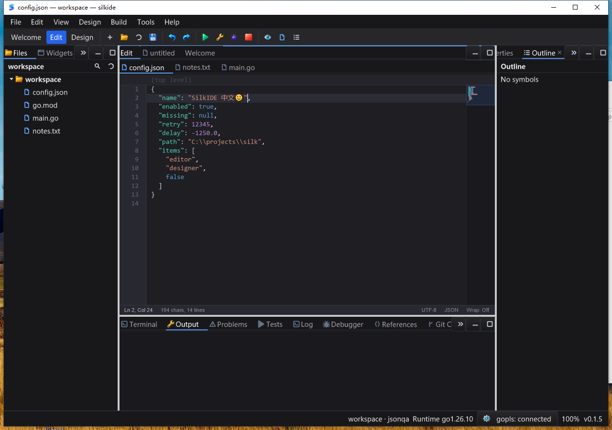

### Safe background batch close

- Tab menus now provide **Close Other Editors**, **Close Editors to the Right**
  and **Close All Editors**. File menu and Command Palette include batch close
  and **Cancel Closing Editors**.
- Disk checks, Go formatting and conflict-checked saves run off the UI thread;
  Save All / Discard All / Cancel is asked before removing any document. New or
  changed buffers are not silently closed. Saved-state updates and removals yield
  between editors instead of running one large UI loop.
- Cancellation stops closing; an already-running disk commit may finish.
  One worker, bounded snapshots, shared file-operation reservations and existing
  reopen history keep the workflow controlled. Individual Save/Close still use
  their previous synchronous I/O path.
- Validation and limitations: [batch-close QA](EDITOR_BATCH_CLOSE_QA_20261024.md).
  The [dialog-focus follow-up](DIALOG_FOCUS_QA_20261025.md) adds fresh Windows
  Cancel / Save All / Discard All, inactive-tab ownership, reopen history,
  File-menu / Palette batch-close, 64-document stress and normal-exit checks
  with exact readback.
  This is not a full-platform release gate.

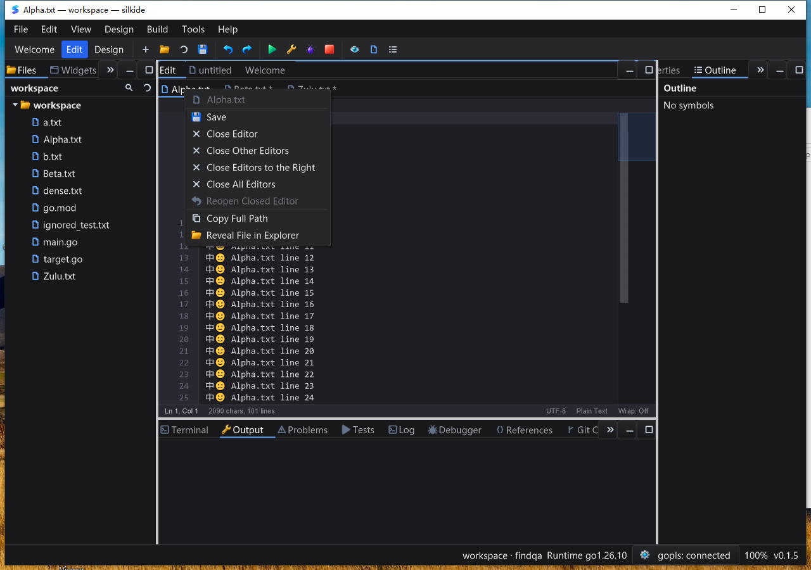

### Tab context menus

- Right-click an editor tab for **Save**, **Close Editor**, **Reopen Closed Editor**,
  **Copy Full Path** and **Reveal File in Explorer**; the header identifies the
  target. Opening an inactive tab's menu does not select it.
- **Shift+F10** opens the active tab's menu while the tab strip has keyboard focus.
  Actions revalidate editor identity after moves/renames instead of trusting old
  numeric positions. Close reuses Save / Discard / Cancel and reopen history.
- SDK `TabBar.SetContextMenuCallback` owns one reusable popup and releases its
  command captures when dismissed. Menu construction adds no document reads,
  tree scans, timers or polling; icons use the existing resource cache, and
  save/close retain their existing file-I/O behavior.
- Validation: [tab context-menu QA](TAB_CONTEXT_QA_20261024.md).

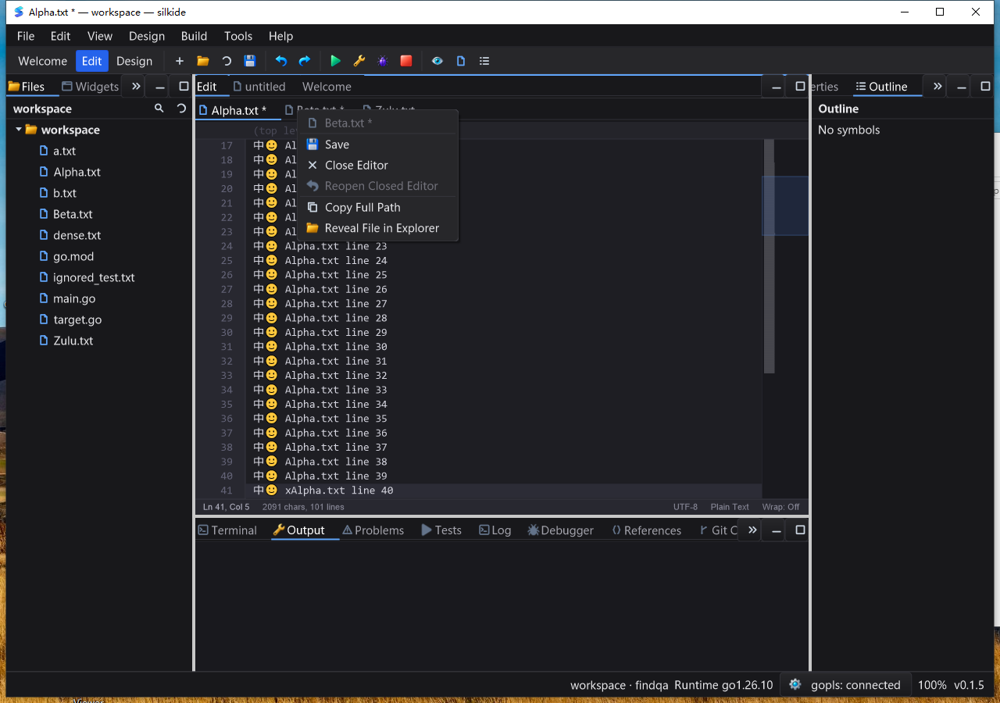

### Consistent tab switching

- **View → Next Editor / Previous Editor** and the Command Palette switch
  existing buffers without reopening files, including from Welcome/Design.
- Within a tabbed page, **Ctrl+Tab / Ctrl+Shift+Tab** and **Ctrl+PageDown /
  Ctrl+PageUp** navigate the nearest tab group and focus its first enabled input.
  Ctrl is physical Control on macOS too, not Cmd. Ordinary Tab still edits or
  traverses fields; explicit host shortcuts retain priority.
- `TabWidget.NavigateTab(previous)` exposes the same SDK behavior. Current-page
  notifications fire once after coherent selection, removal or drag reorder;
  reselecting the same page is a no-op, and reentrant callbacks are respected.
- Runnable SDK sample: `go run ./examples/tab-navigation` (temporary page values).
  Validation scope: [tab navigation QA](TAB_NAVIGATION_QA_20261024.md).

### Reopen closed editors

- **File → Reopen Closed Editor**, the Command Palette and **Ctrl/Cmd+Shift+T**
  restore a closed file's caret and vertical viewport, reveal Edit mode and
  focus the editor for immediate typing. This also works from Welcome after
  closing every editor.
- The workbench keeps at most 32 distinct closed-file locations in memory;
  it does not retain editor instances or resurrect explicitly discarded text.
  Reopening reads current disk contents. Cancelled closes and failed saves
  do not enter the history; manual reopen removes stale entries, and IDE file
  renames update remembered paths.
- Shortcut change: **Ctrl/Cmd+Shift+T** now reopens an editor instead of running
  tests. **F7**, Build → Run Tests and the Run Tests palette command remain.
- Validation: [editor reopen QA](EDITOR_REOPEN_QA_20261024.md).

### Pixel-safe popup sizing

- Popup menus round their natural dimensions up before native window creation,
  preventing fractional font metrics from adding scroll arrows and hiding the
  final command on otherwise short menus.
- Long menus still round the monitor work-area limit down and keep natural row
  heights. No polling, timers or animation were added.
- Regression and native UI evidence: [menu pixel sizing QA](MENU_PIXEL_QA_20261024.md).

### Scrollable long menus and immediate editor input

- Long popup menus keep natural row heights but cap their height to the anchor
  monitor's work area. Wheel scrolling, clickable scroll arrows, Page Up/Down, Home/End and
  label typeahead keep the current keyboard target visible. Scrolling a parent
  closes its anchored submenu instead of leaving a detached popup behind.
- Reopening a menu lays out its rows again even when native pixel rounding suppresses
  a resize event. Stationary cursor notifications caused by popup capture no
  longer cancel keyboard navigation; actual pointer motion restores hover.
- SDK `gui.IChildViewport` gives inline child painting and pointer hit-testing
  the same clipping rectangle. Win32 and GLFW wheel dispatch now use the current
  pointer/capture and bubble through non-scrollable children, not stale hover.
- Choosing a document from **All Tabs** transfers typing focus to its live page,
  including when the chosen tab was already active. Activation callbacks that
  remove a tab cannot focus the removed page.
- No scroll polling, idle animation or hover timer was added. Try the 80-command,
  nested-menu example with `go run ./examples/menu-scroll`.

Verification and limits: [Long-menu and viewport QA](MENU_SCROLL_QA_20261024.md).

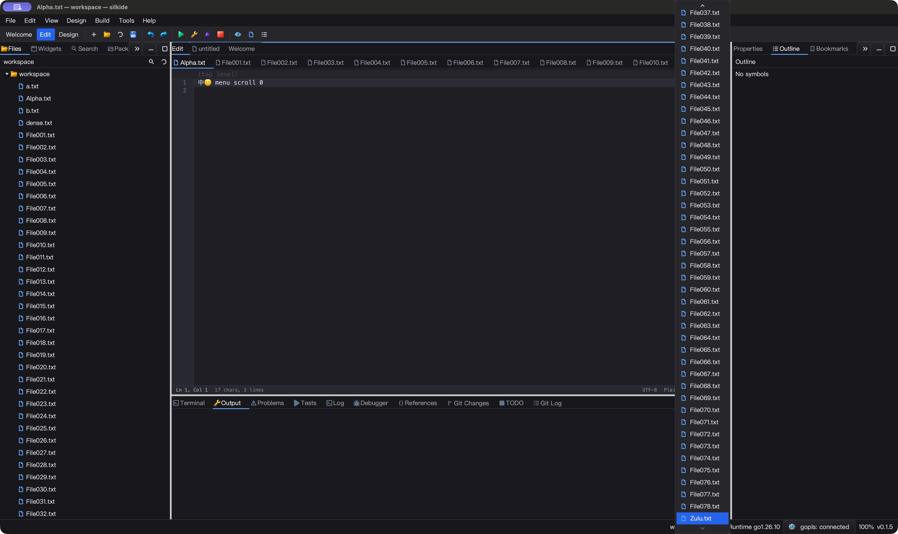

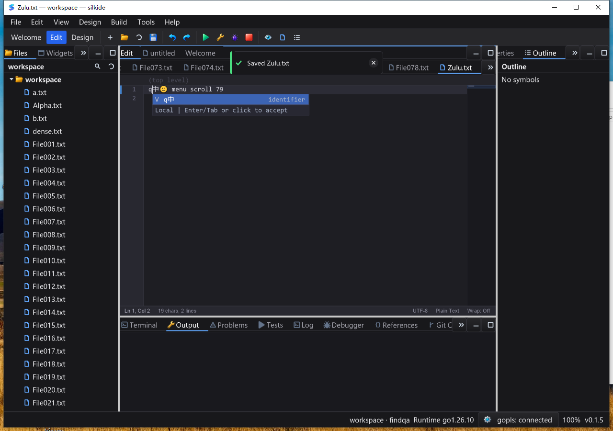

### Keyboard-searchable menus and consistent tool-panel actions

- In popup menus, type the start of a label to select it, then press Enter or
  Space to confirm. Repeating one letter cycles matching commands; Backspace
  corrects the prefix. Hidden/disabled entries are skipped. Unicode committed
  text is supported without introducing polling or idle repaint timers.
- Prefixes expire after one second of inactivity (checked on the next input),
  with bounded input length. Arrow navigation and closing the menu reset them.
- Checked menu entries now use a quiet tint and a separate checkmark, so the
  active keyboard/mouse target remains distinct even when many panels are open.
- Properties tabs and the panel chooser now fall back to their registered icon
  when the widget has no custom icon. Explicit host icons remain authoritative.
- Opening Properties, Objects or Widgets from **Welcome → View → All Panels**
  enters Design, consistently with the dedicated panel actions; opening tools
  from an existing Edit/Design workspace preserves the selected mode.

Verification and limits: [Menu navigation QA](MENU_NAVIGATION_QA_20261024.md).

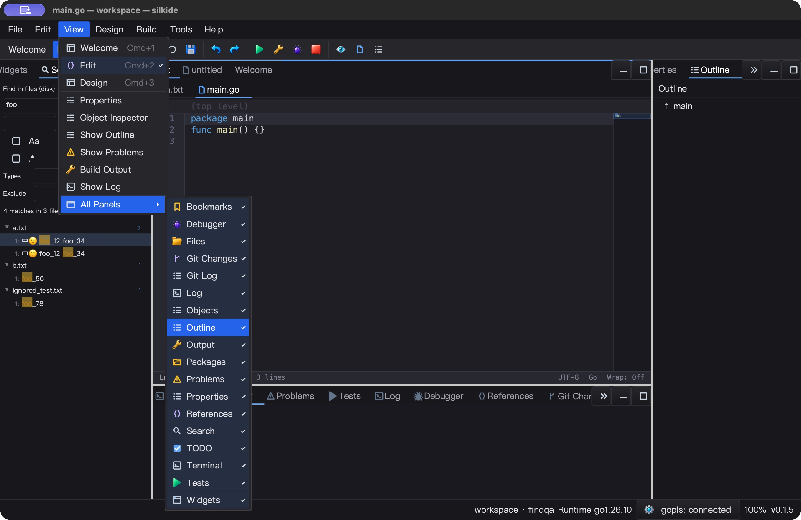

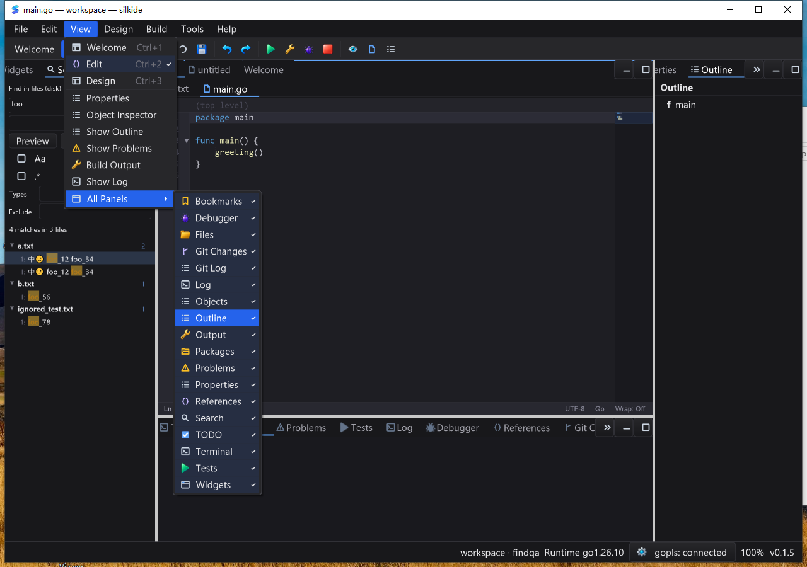

### Recoverable tool panels and non-overlapping dock layouts

- Closing a tool tab now **hides its configured instance** instead of losing its
  state and callbacks. Search / Outline shortcuts and **View → All Panels** can
  restore it, even after the last tab in a tool dock is closed.
- Minimize releases document space; explicitly revealing a panel restores it.
  Maximize uses the split tree instead of overlapping siblings with saved pixel
  bounds. Restore preserves split ratios and manually hidden panels.
- Added a theme-aware, DPI-rasterized **Restore** icon, panel tooltips and a complete
  panel chooser using the same titles/icons as the dock tabs. Background mode
  memory does not resurrect closed tabs; application teardown disposes hidden tools.
- SDK: `Dock.SetRetainClosedViews`, `HideView`, `RevealView`, `AvailableViews`,
  `SetMinimized`, `SetMaximized`, and `Frame.RestoreDockLayout` are UI-thread APIs.
  Retention is opt-in for tool docks; document save/close behavior is unchanged.

Verification and limits: [Dock lifecycle QA](DOCK_LIFECYCLE_QA_20261024.md).

macOS: maximized Search using the split layout, with an explicit Restore action.

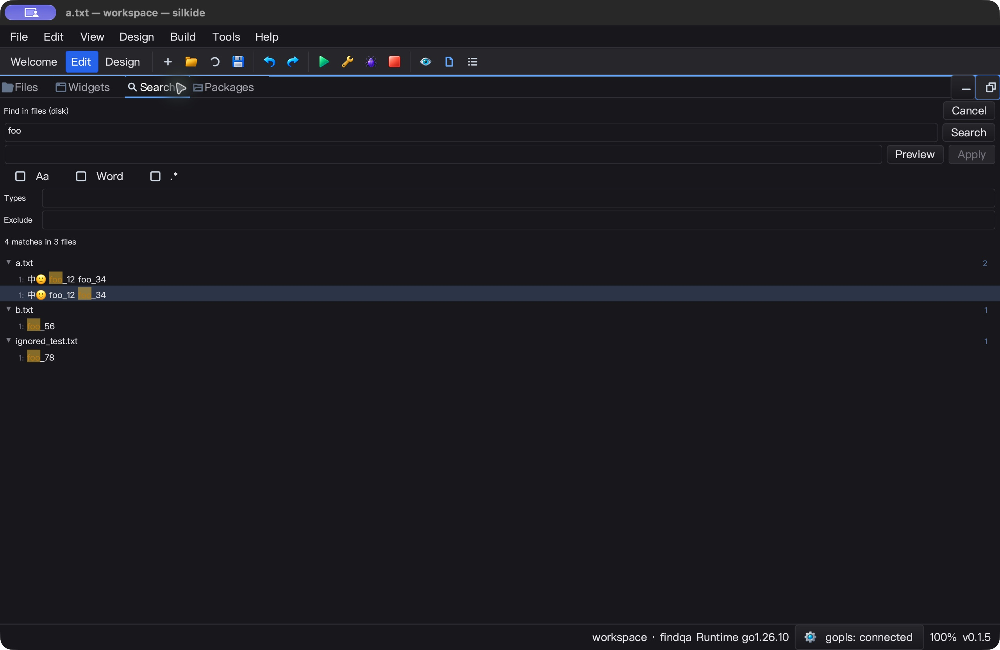

Windows 10: all 18 default tool panels remain accessible from the panel chooser.

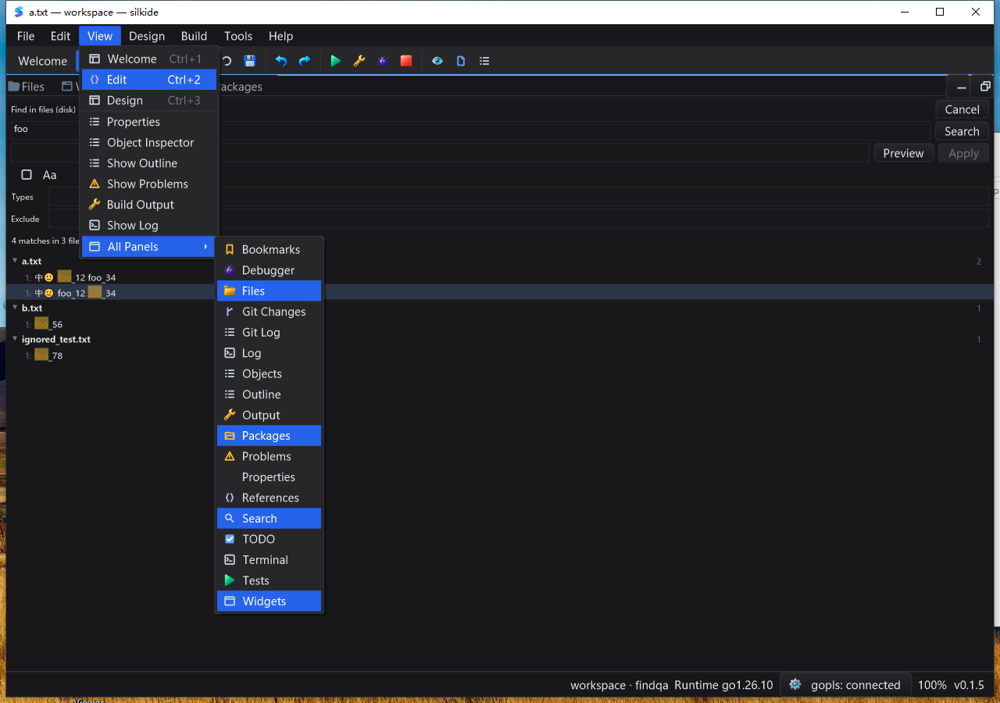

### Workbench continuity and search-result navigation

- Opening a search hit or quick-open file keeps the chosen side panels. Edit and
  Design remember their tool tabs independently; Welcome preserves manual visibility.
- Find in Files / Show Outline and explicit panel commands reveal their dock from
  Welcome or a hidden state instead of focusing an invisible widget.
- **F4 / Shift+F4**, Edit menu and Command Palette navigate workspace matches,
  wrap around, expand collapsed groups, scroll the selection into view, and use
  the existing source-validation / Go Back history. Replacement previews disable
  these source-navigation actions. SDK: `CanNavigateMatches` / `NavigateMatch`.

Verification and platform limits: [Workbench navigation QA](WORKBENCH_NAVIGATION_QA_20261024.md).

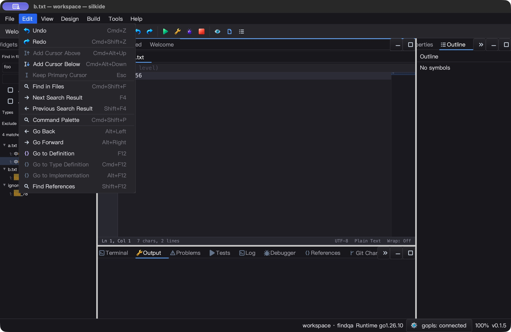

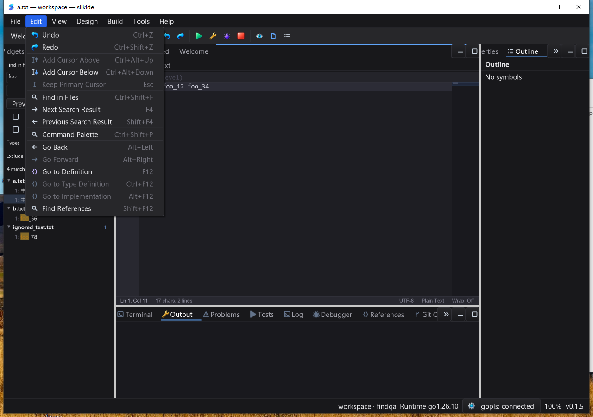

### Cancellable workspace search and previewed replacement

- Find in files has real text inputs, case/Unicode-word/regex switches, type and
  exclusion filters, cancellation, keyboard result navigation and UTF-8-safe snippets.
- Background work is latest-only and bounded. Old roots/options cannot publish
  stale results; incomplete scans clearly show **partial** and disable replacement.
- **Preview** is read-only and opens the existing diff viewer. **Apply** checks
  disk snapshots and unsaved buffers, writes off-thread, and synchronizes open
  editors with one Undo step. External changes are not silently overwritten.
- SDK: `filesearch.SearchContext`, `ReplaceTextContext`, `ContextOptions` and
  `SearchLimits`. This is disk, line-local, positive-width search; legacy synchronous
  APIs remain available. Transactions are optimistic, not multi-file crash-atomic.
- Defaults: 10,000 matches/files, 8 MiB/file, 256 KiB/line, 128 MiB total read,
  16 MiB result budget; native proposal snapshots/output share a 32 MiB budget.

Tests, native UI evidence and limitations:
[Workspace search QA](WORKSPACE_SEARCH_QA_20261024.md).

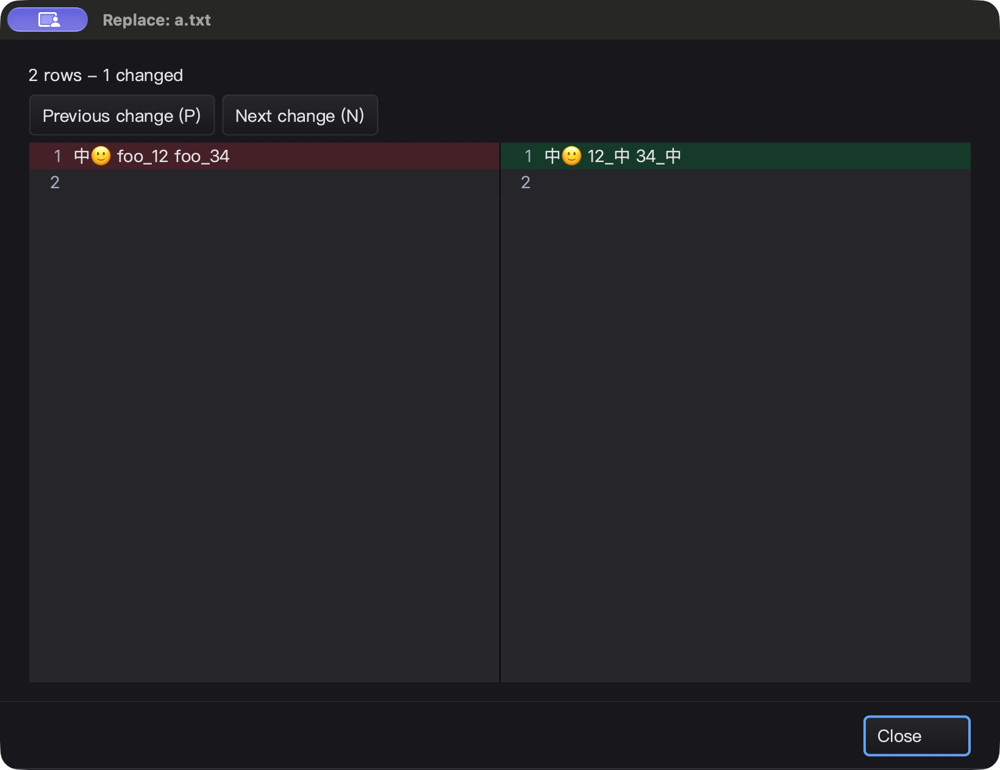

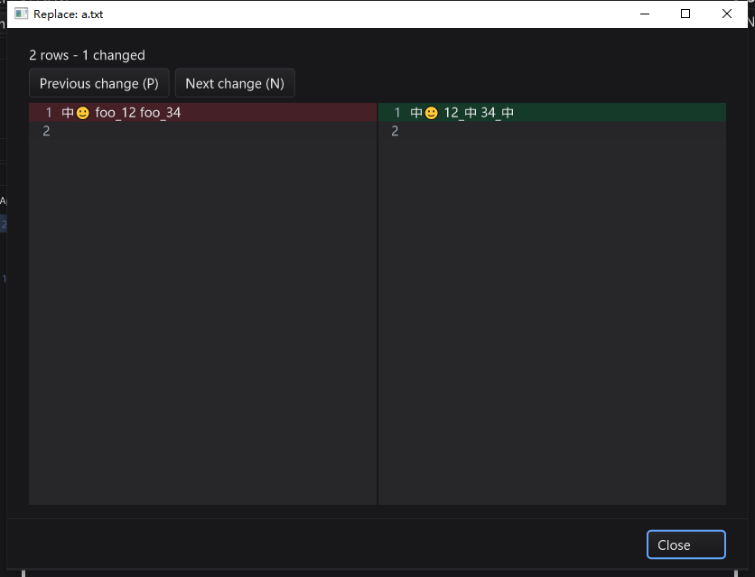

### Safe, responsive Find / Replace with regular expressions

- Find and replacement fields are real editor-owned widgets: selection,
  copy/paste, Delete, keyboard focus and platform CJK fonts work consistently.
  Buttons and checkboxes use actual theme measurements and wrap in narrow panes.
- Added **Match case** and **Whole word** Unicode literal matching. F3 / Shift+F3
  navigate; Enter in replacement replaces the current match and Shift+Enter
  replaces all. Clicking the document lets you edit while search remains open.
- Document revisions invalidate old ranges. Large searches and replacement
  proposals run off-thread with debounce, cancellation, latest-only requests and
  a two-worker process-wide compute limit. Obsolete results cannot overwrite edits.
- Counts remain complete; highlights/navigation retain at most 100,000 hits.
  Replace All still processes every match and commits one Undo transaction.
  Repainting visits only matches intersecting visible lines and columns.
- **Regex (`.*`)** supports Go/RE2 expressions, multiline matches, zero-width
  markers, numbered/named captures (`$1`, `${name}`) and literal dollars (`$$`).
  Regex compilation, searching and replacement proposals always run off-thread.
  Invalid or timed-out expressions never apply partial replacements.
- Hidden editors do not restart searches after external edits. Cancellation clears
  stale counts/actions; `FindSnapshot().Ready` and `Revision` expose result validity.
- **Selection** freezes the selection captured when Find opens. Literal/regex
  search and replacement stay inside it; navigation does not change the scope.
  The selected fragment is a separate search subject: regex anchors and whole-word
  boundaries are local to it. Find-owned replacements and Undo/Redo track its extent;
  unrelated edits invalidate the scope and disable replacement instead of widening it.
  SDK hosts can use `SetFindInSelection` and the selection fields in `FindSnapshot`.
- Long highlight/selection fills no longer measure invisible suffixes. Certified
  fixed-width ASCII uses cached column geometry; Unicode and tabs retain shaping.
  Fractional-scale raster parity tests protect visible highlight edges.
- Limits: literal queries are single-line, at most 1 MiB; regex patterns at most
  64 KiB / 128 captures / 32,768 estimated expansion cost, with a 5-second compute
  deadline. Regex replacement templates are at most 1 MiB, output at most 128 MiB.
  Go syntax does not support look-around or pattern backreferences. Applying the
  completed edit still uses the UI thread; this is not a universal latency bound.

Verification: [Find / Replace QA](EDITOR_FIND_QA_20261024.md),
[Regex and lifecycle QA](EDITOR_REGEX_QA_20261024.md),
[Selection scope and long-span QA](EDITOR_SELECTION_QA_20261024.md).

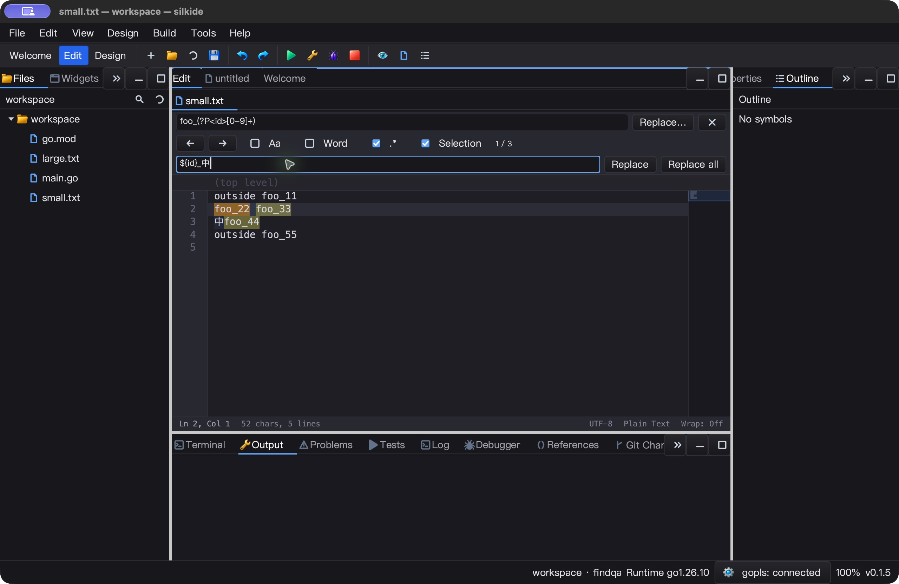

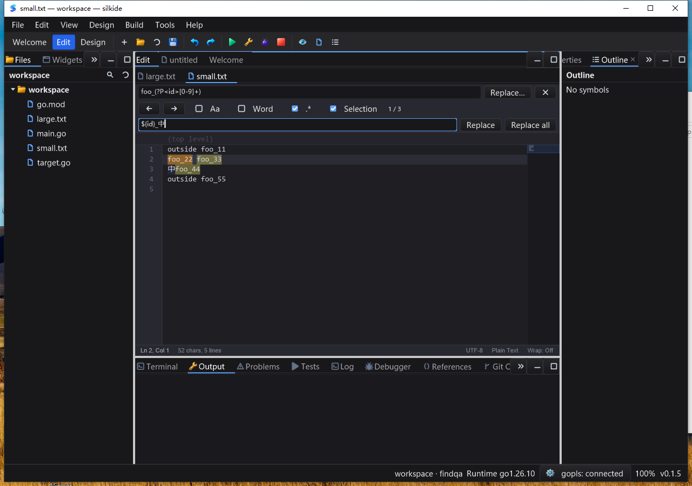

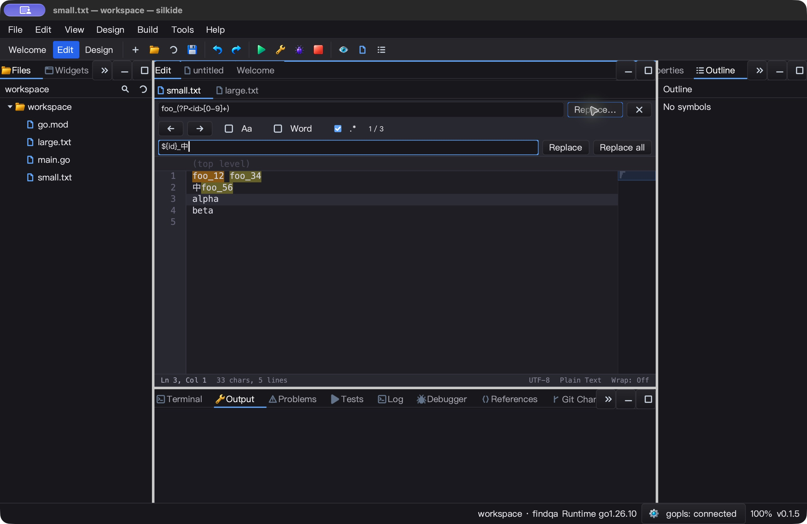

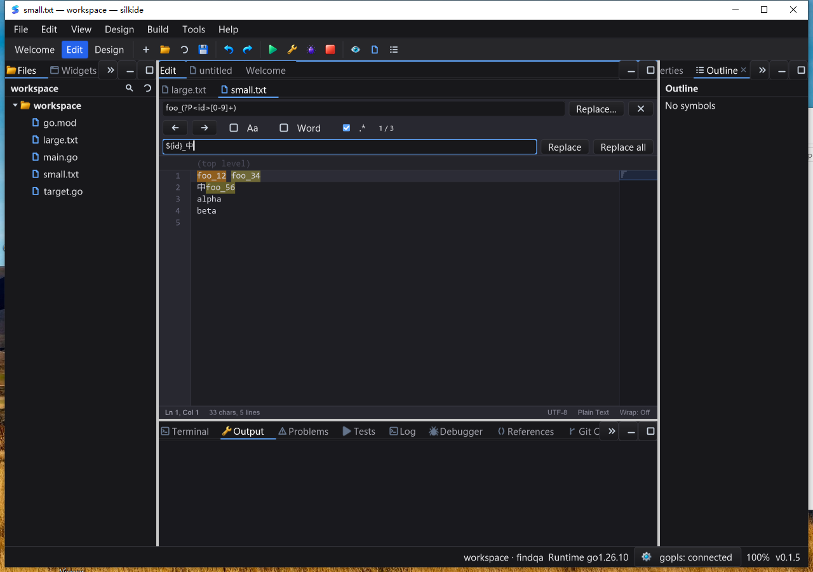

### Clipboard responsiveness and honest empty states

- macOS editor, single-line Edit, TextArea and SearchBox paste no longer call
  GLFW's potentially blocking clipboard getter from the UI thread. A bounded
  `/usr/bin/pbpaste` helper reads text off-thread, with cancellation, a 10-second
  timeout and a 16 MiB limit; opening an editor context menu does not read data.
- Pending paste results are fenced by the target's focus, visibility, ownership,
  text and caret/selection state. Repeated keys at an unchanged anchor coalesce
  into one insertion/Undo group (maximum 64); oversized/busy/failed requests
  report an error instead of silently inserting truncated text.
- SDK `Clipboard.ReadTextAsync`, `Widget.PastePending` and `CancelPendingPaste`
  are UI-thread APIs. Windows/Linux retain their existing native clipboard
  behavior: callback scheduling alone does **not** promise nonblocking reads.
- macOS packaging builds a fresh `.app` before replacing the old bundle, rather
  than overwriting executable inodes or retaining obsolete signatures/tools.
  Copy failures leave the previous bundle intact; final-package gopls is tested.
- Empty Git comparisons show **No text changes to compare**, not a load failure.
  Quiet logging suppresses actual debug severity, not warnings whose message
  happens to mention `SILK_DEBUG` or a debugger.

Tests, native save/readback evidence and limits:
[clipboard and integrated commit QA](EDITOR_PASTE_QA_20261024.md).

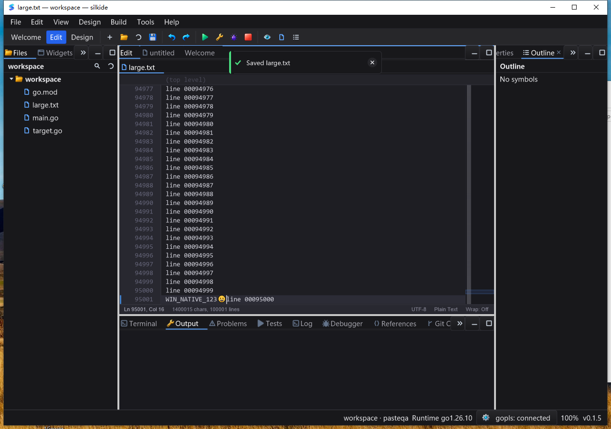

### Dock overflow and readable diffs

- Dock headers reserve space for their window controls. Overflowing document
  and panel tabs share a clipped viewport, keep the active tab visible, and
  expose every full title through **All tabs**. Keyboard navigation, hit-testing,
  close targets and drag insertion use the same scrolling coordinates.
- The chooser reuses an owned popup; checked menu actions now have a visible,
  readable selection state instead of an invisible action flag.
- Diff rows, gutters and actions use distinct light/dark semantic colors. Long
  lines are clipped to their own column; cached line numbers and visible-only
  tab painting avoid full-list work on each repaint. Full-file comparison is
  now linear-space and cancellable in the IDE; see the asynchronous Diff section below.

Verification and platform limits: [Dock/Diff QA](DOCK_DIFF_QA_20261024.md).

<p>
  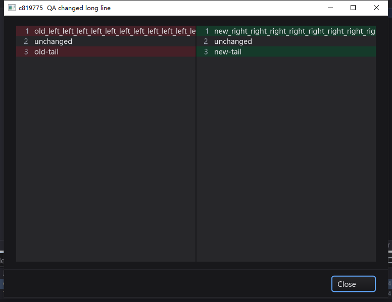
  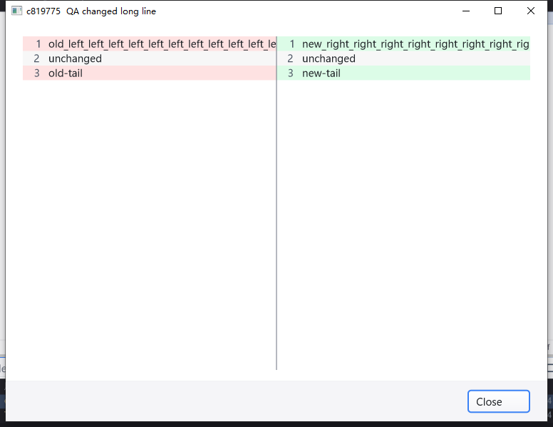
</p>

### Cancellable large-file comparison

- Exact, linear-space Myers comparison replaces the full quadratic LCS matrix.
  Sparse edits and complete replacements avoid the old allocation explosion;
  worst-case CPU time still depends on edit distance (it is not universally linear).
- **Diff vs Saved**, **Diff vs HEAD**, and commit comparisons open a dialog before
  disk/Git loading and compute off the UI thread. Status, changed-row counts,
  Previous/Next change buttons and cancellation remain available. Closed or
  superseded requests cannot overwrite a newer view.
- SDK hosts can use `DiffView.SetTextsAsync(ctx, oldText, newText)`, `CancelDiff`,
  `DiffPending`, `DiffError`, `DiffSummary` and `SetDiffStateChanged` on the UI
  thread. Each view retains one active/one latest pending request, with at most
  two background comparisons process-wide; no idle worker timer is added.
  Hosts must cancel on disposal. The existing `SetTexts` stays synchronous.
- Git comparison reads are context-cancellable, timeout/output-bounded, and
  disable external diff/textconv helpers. Saved-file I/O is off the UI thread,
  but a blocked kernel read itself cannot be forcibly cancelled.

Evidence and remaining limits: [asynchronous Diff QA](DIFF_ASYNC_QA_20261024.md).

<p>
  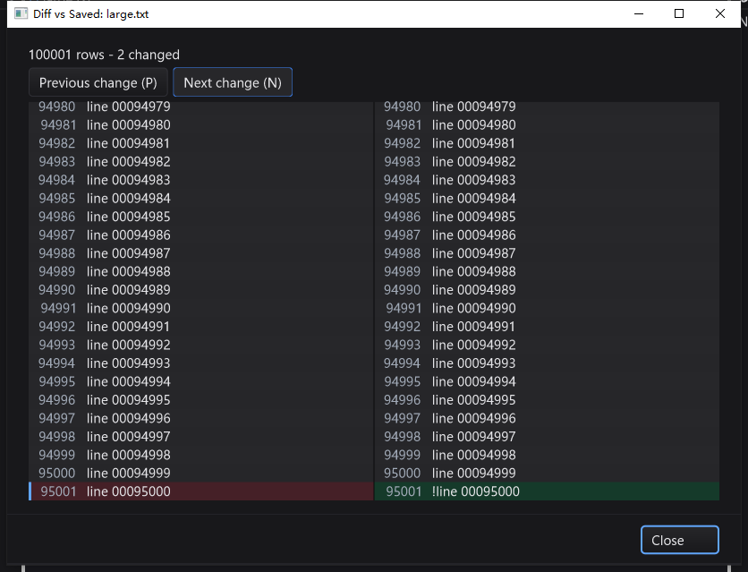
  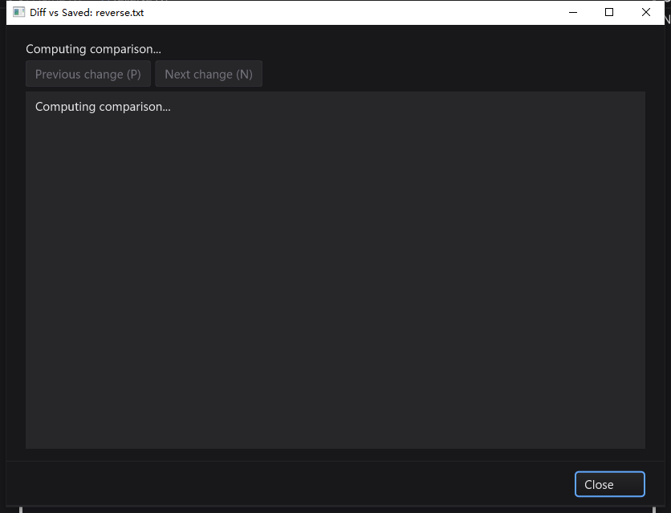
</p>

### Semantic navigation and coordinated panels

- **Edit** menu and the command palette expose Go to Definition (`F12`),
  Go to Type Definition (`Cmd/Ctrl+F12`), Go to Implementation (`Alt+F12`),
  and Find References (`Shift+F12`). Multiple destinations stay selectable
  in the References panel rather than silently choosing the first result.
- **Back/Forward** (`Alt+Left/Right`, or `Cmd/Ctrl+[/]` in the editor) share
  a bounded cross-file location history. Diagnostics, outline, references and
  macro jumps join that history; closed targets can reopen and successful
  file renames migrate the stored paths. Navigation preserves unsaved buffers,
  clears stale selections, reveals folds and handles UTF-16/rune conversion.
- Navigation requests are single-flight/latest-wins, with cancellation and
  document/caret/session guards. SDK hosts can reuse precise navigation hooks,
  `NavigationStack`, and cancellable definition/type/implementation APIs.
- The designer event-code panel retains drafts on repeated selection,
  unsubscribes from old designs, and saves handler changes into design Undo/Redo.
  Narrow panels wrap their actions instead of overlapping the editor tabs.
- Status-bar cells stay inside narrow windows, elide long text and keep readable
  gaps. Placeholder branch/caret/version values are removed; the displayed runtime
  version comes from the running IDE, not an assumed workspace toolchain.

Verification and remaining gaps: [navigation/SDK iteration report](NAVIGATION_SDK_QA_20261022.md).

### Designer event handlers and draft safety

- Double-click a supported control to create or locate its default event handler.
  **Design → Event Handlers** and the control context menu expose its registered
  events with their actual Go signatures. Reopening an existing handler does not
  duplicate it; creation and binding share one design Undo/Redo operation.
- The embedded handler editor's unsaved text now participates in the design's
  dirty state, Save/Save All, recovery snapshots and Save/Discard/Cancel guard.
  Saving the design no longer requires clicking the code panel's separate Save
  button, and successful companion generation does not steal panel focus or erase
  unrelated build diagnostics.
- SDK strong-typed export supports multiple methods per control, preserves user
  handler files on regeneration and rebinds method receivers to the exported UI
  type. Hosts can use `SaveDesignWithPendingEdits()` for a checked draft-inclusive
  snapshot; `SaveDesign()` remains a committed-model-only snapshot.
- Scope: this navigation edits **embedded design handlers**, not external `.go`
  files. IDE Save now preserves an existing split SDK export and its user-owned
  handlers. New designs still use the declarative tree builder; automatic migration
  and default preview execution of embedded handlers are not yet implemented.

Verification, usage and remaining gaps:
[designer event workflow report](DESIGNER_EVENTS_QA_20261023.md).

### Small-tool SDK: async work and HTTP controls

- New dependency-free `async` and `httpx` packages provide bounded cancellable
  jobs, synchronous/asynchronous HTTP requests, response size/time limits and
  strict JSON Pointer extraction into string, JSON, int64, float64 or bool.
- `gui.RunAsync` dispatches completion through the UI queue. The designer's
  **Network & Tools → HTTPButton** offers explicit requests, cancellation,
  typed signals, persisted configuration and strong-typed code generation;
  constructors and property edits never send requests.
- Start a local-only demo with `go run ./examples/http-tool`. See the
  [SDK feature/API list and recipes](docs/SDK_FEATURES.md) and
  [HTTP SDK validation report](SDK_HTTP_QA_20261023.md) for lifecycle contracts,
  platform coverage and remaining IDE-generation gaps.

### Native text and safe designer regeneration

- macOS native Cairo text now resolves missing CJK / emoji glyphs against installed
  system fonts, using the same font runs for measurement and drawing. ASCII stays
  on its existing path; icon-font private-use glyphs are not substituted.
- Split SDK exports preflight both files, preserve existing user code, permissions
  and unchanged-file mtimes, and use staged replacement with conflict checks and
  best-effort rollback. Unrecognized or standalone outputs are not overwritten;
  form-title edits preserve the existing generated UI type.
- IDE Save recognizes an existing typed split export rather than overwriting it
  with a `decl.Node` builder. New handler imports are reported, not silently added
  to user source. LF / CRLF generated headers are accepted.
- This is not full complex-script shaping, crash-atomic multi-file storage or a
  completed preview/export unification. See [native text and regeneration QA](FONT_GENERATION_QA_20261023.md).

### JSON inspector and reusable JSON SDK

- New `jsonx` package parses bounded, immutable JSON documents with precise
  `json.Number` values, typed lookup, RFC 6901 paths, child paging, bounded previews
  and a bounded-executor `ParseAsync` helper.
- `httpx.Response.Document()` bridges API responses to reusable documents without
  changing existing extraction APIs. Parse in a worker, then reuse the document.
- **Data → JSONView** displays key/type/value columns, lazily expands grouped large
  arrays/objects, reveals a JSON Pointer, and copies a selected node or path.
  Ctrl/Cmd+C copies JSON; adding Shift copies its pointer. Columns follow resizing.
- Designer drag/drop, persisted sample properties, `OnSelected` / `OnError`, typed
  export and `decl.JSONView` are connected. Runtime response data is not persisted
  as the designer sample.
- Try `go run ./examples/json-inspector` for a local-only API browser, including
  grouped data, error preservation and cancellation. See [JSON SDK APIs](jsonx/README.md),
  [SDK recipes](docs/SDK_FEATURES.md) and [validation / platform limits](JSON_INSPECTOR_QA_20261023.md).

### Streaming downloads and coalesced progress

- `httpx.Client.DownloadTo/DownloadToAsync` streams to a caller-owned `io.Writer`
  with a fixed 32 KiB copy buffer, cancellation, a separate download-size limit,
  SHA-256 calculation/verification and throttled progress. It never chooses a
  filename or automatically overwrites/closes the destination.
- `async.Latest[T]` coalesces replaceable snapshots into one queued/running
  dispatch. Intermediate progress does not flood the UI queue; Close suppresses
  not-yet-started deliveries. It is not a lossless event log.
- **Network & Tools → TransferProgress** shows known/unknown totals and explicit
  running/succeeded/failed/cancelled states, without a timer or busy animation.
  Designer persistence, generated state-change handlers and `decl.TransferProgress`
  are connected; runtime counts/state are not saved as design properties.
- Try `go run ./examples/download-monitor`: local streamed data goes to
  `io.Discard`, with known/unknown length, checksum failure, HTTP error and cancel
  presets. Compact layouts reflow buttons and hide optional footer text.
- Ordinary ProgressBar also rejects NaN instead of passing invalid geometry to
  the renderer. See [SDK recipes](docs/SDK_FEATURES.md) and
  [transfer QA and limitations](TRANSFER_SDK_QA_20261023.md).

Open **Tools → Appearance & Editor** (or the command palette) to select English
or 简体中文, dark/light theme, UI/editor font families and sizes, tab width,
accent color, and editor background/text/keyword/comment/string colors. Empty
colors restore theme defaults. Font/color changes apply immediately; the UI
language is saved and applied on restart. `SILKIDE_LOCALE` overrides the saved
language when explicitly set.

- Source tabs render as real tab stops, not missing-glyph boxes; caret, selection
  and mouse positioning use the same widths without rewriting the source.
- Windows declares **system DPI awareness before creating windows** and uses
  grayscale, fully hinted text. This prevents primary/system-DPI bitmap
  virtualization; mixed-DPI per-monitor scaling is still not implemented.
- gopls document open/change/close are ordered. A 90 ms quiet-period worker keeps
  only the latest edit, cancels obsolete completion requests, and rejects stale
  document/session results. Explicit commands flush unsaved text first.
- Completion respects UTF-16 text edits and auto-import edits as one undoable
  change with correct redo caret restoration. Semantic candidates rank before
  local guesses; long signatures are clipped/elided without overlapping labels.
  The IDE requests plain-text completions, not LSP snippets.
  The shared popup supports hover/click, wheel scrolling and PageUp/PageDown;
  it fits whole rows around the caret without covering the editor chrome.
  Its footer distinguishes local/provider candidates and reports gopls waiting
  or timeout without a spinner. Escape dismissal is respected by late replies.
  Local prefix completion is also one undo/redo step.
  Documents above 32 KiB index and rank local identifiers off the UI thread,
  retaining the complete document rather than truncating the search range.
  Superseded jobs are cancelled/coalesced; closing a tab releases its index.
  An undrawable popup cannot silently consume Enter/Tab after a resize.
  Filename-aware modes distinguish Go, SilkGo and plain text. Unknown named
  formats no longer receive Go syntax colors, symbols, folds, keyword seeds or
  default Go snippets; lexical word completion remains available. Switching
  dialect invalidates old projections and pending local results, not the text.
  The editor claims ordinary Tab before native-window focus traversal, so
  indentation, completion, find/replace and snippet stops work from real keys;
  Ctrl+Tab navigates the nearest TabWidget, or retains host focus traversal
  when the editor is not inside a tab group.
  Snippet expansion is one atomic undoable replacement, including indentation
  and Unicode-safe caret restoration; undo retires stale placeholder ranges.
  Ctrl+Space requests fresh candidates without inserting a space on Windows;
  informational diagnostics no longer paint red error markers. Complete IDE builds now include pinned `gopls` in `tools/`; see the bundled
  language-server section below.

See [verification and remaining limits](EDITOR_LSP_QA_20261020.md).
The [2026-10-23 completion interaction follow-up](EDITOR_COMPLETION_QA_20261023.md)
records the native Windows checks and [provider-status screenshot](screenshots/silkide-completion-windows-20261023.png).
The [background local-index follow-up](EDITOR_INDEX_QA_20261023.md) separates
UI-path benchmarks, full background work and native Windows readback tests.
The [document-mode follow-up](EDITOR_DOCUMENT_MODE_QA_20261023.md) covers plain
text isolation, explicit SDK providers and native Go/SilkGo regression checks.
The [incremental lexical-state follow-up](EDITOR_LEXICAL_QA_20261023.md) removes
repeated offscreen-prefix tokenization from Go redraws and fixes multiline raw
strings, long-comment termination and coloring after folded lines. State is
updated when text changes, without a new repaint timer or worker.
The [LSP snapshot and outline follow-up](EDITOR_LSP_POSITION_QA_20261024.md)
adds allocation-free [rune/byte/UTF-16 position reads](gui/CODE_EDITOR_POSITIONS.md)
and [symbol-change subscriptions](gui/CODE_EDITOR_SYMBOLS.md) for independently
cached panels. Native Windows checks cover Chinese/emoji completion, single-step
undo/redo, disk readback and cross-file navigation in a 100k-line file; the report
records the defects found at that checkpoint and the remaining long-line costs.
The [byte-preserving edit follow-up](EDITOR_BYTE_EDITS_QA_20261024.md) repairs
standard input/history paths and adds atomic multi-caret typing, multiline paste,
Enter, Backspace and Delete with caret restoration. It also fixes Windows
opt-in system-key routing and prevents malformed UTF-8/NUL from blanking or
truncating native text rendering without rewriting the source bytes. See the
[SDK edit contract](gui/CODE_EDITOR_EDITS.md) for exact scope and history semantics. Windows QA now also covers
34 exact-byte save/undo/redo stages and bundled-gopls completion/navigation.
The standard multi-caret arrow did not reach the app in this test environment; the verified
Ctrl+Alt+Shift+Down fallback and remaining coverage limits are recorded explicitly.

The [caret-command follow-up](EDITOR_CARET_COMMANDS_QA_20261024.md) exposes
Add Cursor Above/Below and Keep Primary Cursor through Edit, the command palette
and the SDK context menu, with theme-aware vector icons and caret-count status.
Commands reveal folded/offscreen targets without editing the document or history.
Caret visibility now scans only the requested prefix instead of allocating a rune
copy of the full line; the report separates this microbenchmark from remaining
long-line rendering costs and native UI coverage. See the
[Windows caret-command screenshot](screenshots/silkide-caret-commands-windows-20261024.png).

The [viewport rendering follow-up](EDITOR_VIEWPORT_QA_20261024.md) removes
whole-line copies from caret/selection drawing and hit testing, replaces the
quadratic backward bracket scan, and bounds certified fixed-cell ASCII text and
decorations to the viewport. Pixel parity checks include fractional scrolling,
100/125/200% scaling, tabs, Unicode fallback and antialiased edge ink; font-width
exceptions such as Menlo `#` use their measured advances. The report distinguishes
raster microbenchmarks from native Windows input/save and memory measurements,
and records the remaining full-layout costs for non-fixed-cell long lines.
Offscreen bracket boxes are rejected before reaching native fixed-point paths;
selection/find/caret geometry is bounded without manufacturing new stroke edges.
The pure-Go renderer also preserves device coordinates under non-origin clips
instead of shifting its raster mask with the clip rectangle.

[Native Windows 4 MB line and bracket rendering](screenshots/silkide-editor-viewport-windows-20261024.png)

The [language-service activity follow-up](LSP_ACTIVITY_QA_20261024.md) adds a
keyboard-accessible gopls status action and an owned, bounded
[SDK progress snapshot API](core/LSP_PROGRESS.md). Work-done bursts coalesce
outside the diagnostics queue; old-session updates cannot overwrite a restarted
server. The status distinguishes starting/connected/reported work/offline and
incomplete progress, without polling or equating silence with zero CPU usage.

[Native Windows language-service status and recovery](screenshots/silkide-lsp-activity-windows-20261024.png)

The [Git availability follow-up](GIT_AVAILABILITY_QA_20261024.md) adds recoverable
loading/error/empty states to Changes and History, bounded latest-request refresh,
and [cancelable SDK Git reads](core/GIT_READ.md). Git pane reads no longer retry
on every save when Git is missing; explicit Retry can recover without a new IDE session when the
existing process PATH becomes usable. Status paths use NUL-delimited porcelain
and resolve against the actual repository root, preserving Unicode filenames.
SDK labels now render explicit line breaks and wrapped text with cached layout,
per-line alignment and visible-row clipping; the recovery panel also exercises
this path on native Windows.

[Native Windows Git recovery and bundled language service](screenshots/silkide-git-recovery-windows-20261024.png)

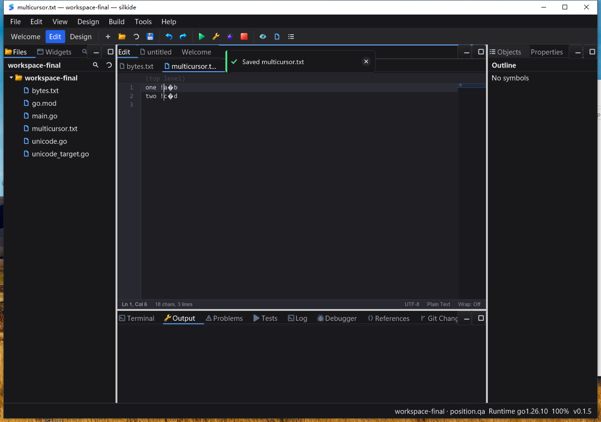

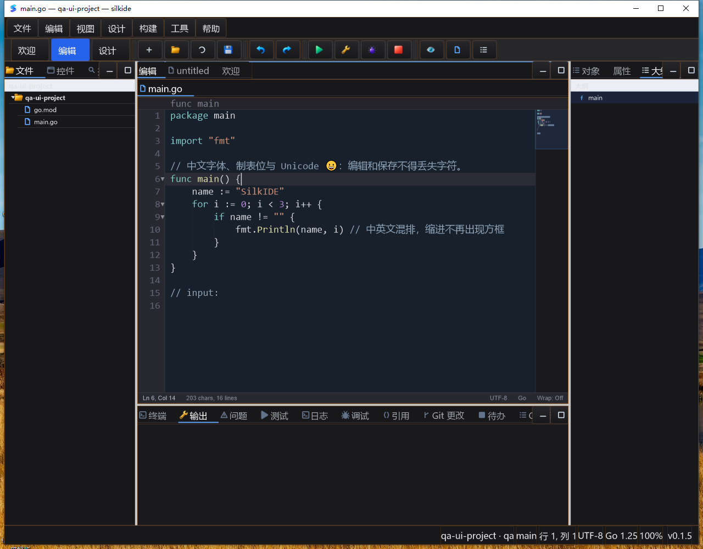

*Windows 10 native desktop, 2026-10-21 PDT; persisted custom fonts/colors.
[Appearance settings](screenshots/silkide-appearance-windows.png),
[completion](screenshots/silkide-completion-windows.png), and
[English workbench with gopls hover](screenshots/silkide-hover-windows.png).
Win11 and mixed-DPI monitor transitions remain unverified.*

## Current development iteration: satin sprites, HMI and macros

This work is **not part of the published v0.1.5 package**.

- Image-model-generated [16-icon satin atlas](paint/assets/README.md), embedded
  unchanged with calibrated crops, bounded device-resolution caches and neutral
  disabled rendering. Common IDE actions use it by default; set
  `SILK_ICON_STYLE=vector` before launch to retain the vector action theme.
  Structural glyphs stay vector. Idle buttons gain a cached, subtle material
  gradient and border rather than a per-frame image effect.
- Designer **SpriteView** and **ProcessValue** components: Tag binding,
  properties, drag/drop, persistence, preview and Go generation. Gauge also
  exposes `TagName`. Try the [hardware-free HMI example](examples/satin-dashboard).
- Visual Tag updates coalesce bursts to the latest UI value; unbinding retires
  queued updates and running animation. This is not a lossless event pipeline.
- Experimental [Silk macros](macro/README.md): `.silkgo` → ordinary Go via
  `silkgen -macro` or **Tools → Expand Silk Macros**. Explicit generation,
  bounded expansion and overwrite guards; no Go compiler fork or runtime code
  execution. See the [runnable accessor example](examples/silk-macros).

See [iteration QA and remaining limits](SPRITE_MACRO_QA_20261020.md).

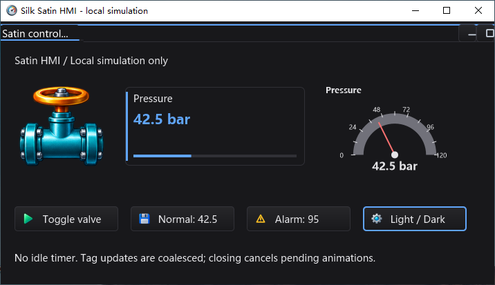

*Native Windows 10 window, local simulated Tags, 2026-10-20 PDT. Button-driven
42.5/95 pressure and dark/light transitions were exercised; this is not a mockup
or a hardware/PLC certification. [Light-theme alarm state](screenshots/silk-satin-dashboard-windows-light.png).*

---

## Table of Contents

- [Integrated Go Designer / IDE](#integrated-go-designer--ide) — screenshot and workflow
- [Validation Status](#validation-status) — tested platforms and remaining gaps
- [Quick Start](#quick-start) — build and launch
- [Development Setup](#development-setup) — prerequisites by OS
- [Project Structure](#project-structure) — what lives where
- [Your First App](#your-first-app) — hello world with the SDK
- [Using the Designer](#using-the-designer) — visual form design
- [Building & Running](#building--running) — all the common commands
- [Features](#features) — what's included
- [Troubleshooting](#troubleshooting) — common issues

---

## Integrated Go Designer / IDE

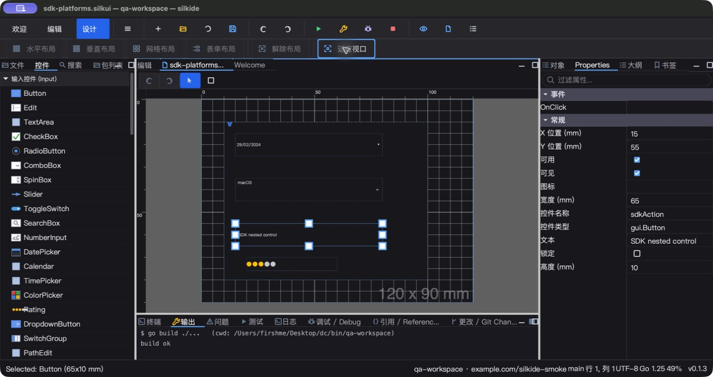

*Actual macOS arm64 window captured on 2026-09-11, using the dark theme and an isolated demo project. This is a running application, not a mockup.*

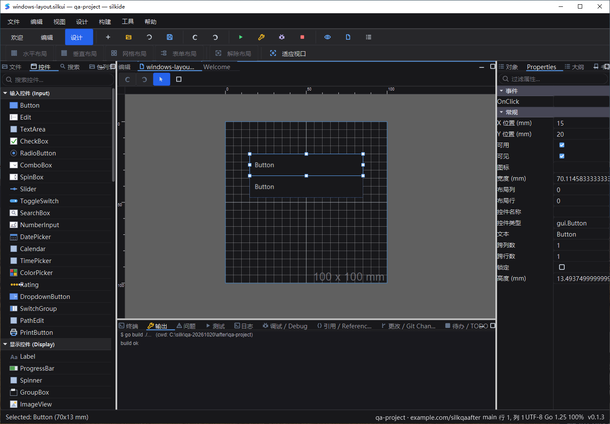

*Actual Windows 10 interactive desktop capture from the 2026-10-20 iteration (PDT), limited to the application frame. See [Windows rendering and SDK QA](WINDOWS_RENDERING_QA_20261020.md) for reproducible steps and remaining issues.*

[Actual Windows menu capture](screenshots/silkide-menu-windows.png).
[Latest Windows font / menu QA capture](screenshots/silkide-windows-visual.png) (debug outlines enabled).
[v0.1.5 actual Windows release-package capture](screenshots/silkide-v0.1.5-windows.png) (debug outlines enabled).
[Windows IME positioning and Unicode input follow-up](WINDOWS_INPUT_QA_20261020.md).

```bash
make run-ide     # Qt Creator-style Go editing + visual design workbench
make test-ide    # IDE, designer, widgets and tool-engine regression tests
```

- **Welcome / Edit / Design** modes: `Cmd+1/2/3` on macOS, `Ctrl+1/2/3` elsewhere.
- Save and undo/redo always target the **visible document**, from the toolbar,
  command palette or keyboard. `Cmd/Ctrl+Shift+S` saves all changed documents.
- Real file tabs only: edits show `*`; undoing back to the saved text clears it.
- Restart restores tab order, active file, cursor, vertical scroll and mode.
  Missing files are skipped; older path-only sessions still load. Unsaved code
  buffers are **not** crash backups: save/discard/cancel remains the quit guard.
- Saving `.silkui` regenerates a companion `.silk.go`: nested widgets, logical
  geometry, empty captions, scalar properties and exact RGBA colors are preserved.
  Declarative output describes structure; wire event handlers with `BuildWithIndex`
  in host code, or use the imperative exporter for handler bodies.
- Live preview: `Cmd/Ctrl+Shift+R`, or the eye button; export is a separate action.
- Built-in satin action sprites and fallback vector icons require no external
  directory. Vector glyphs use exact sRGB
  theme/semantic palettes and rasterize at the device transform for Retina and
  fractional scaling; disabled icons have their own neutral palette.
- Build / Run infer the nearest `go.mod` for forms stored in subdirectories;
  explicit project and run-directory settings take precedence.
- Drag-and-drop respects nested container ownership and form bounds. HBox, VBox,
  Grid and Form layouts share selection/locking rules with the context menu.
- File / Edit / View / Design / Build / Tools / Help menus group related actions,
  show shortcuts in a separate column, and support Alt accelerators and arrows.
  The searchable widget palette retains factory identity and drag/drop behavior.
  Search fields support selection replacement and clipboard editing, with long
  queries clipped away from the search/clear icons.
- Menus support keyboard navigation, disabled actions and nested popup dismissal.
  Properties and View Code activate the corresponding dock instead of silently
  doing nothing; export reports the actual output path or an error.
- Stop terminates the active Run command and its child processes as well as the
  debugger; independently opened terminal sessions are left alone.
- Project settings use the selected project root and persist Kit changes.
  About separates IDE and SDK versions, shows runtime/build details, and wraps or
  scrolls long content without overlapping its right-aligned Close button.
- Fit canvas: `Cmd/Ctrl+Shift+0` (plain `F` remains available for code input).

For desktop verification, use a disposable project and an isolated settings
home. Complete IDE builds (`make ide`, `make bundle-ide`, and release archives)
include pinned `gopls`; `go build ./cmd/silkide` alone builds only the executable.
Go SDK remains required for Go project analysis/builds. Git and `dlv` are separate
optional external tools; bundling gopls does not claim debugger availability.

### Bundled Go language server

`make test-ide` now requires the bundled-language-server integration tests;
`make test-ide-lsp` runs that gate independently. A missing server cannot pass
this gate as a skipped test. Portable tool builds pin `GOAMD64=v1` /
`GOARM64=v8.0`, and reject binaries requiring a newer CPU instruction baseline.
`make bundle-ide` also verifies the tool directory inside the macOS `.app`.
See [the bundle audit and native recovery QA](GOPLS_AUDIT_QA_20261024.md).


- `make ide-tools` builds/repairs **gopls v0.24.0** into `bin/tools`, with a
  SHA-256/platform/compiler manifest and linked-module licenses. Tool sources and
  checksums are pinned in `tools/gopls-module/go.mod` / `go.sum`; no `@latest` install.
  The source module is intentionally separate from the runtime `tools/gopls`
  executable so a checkout-root developer build cannot mistake it for a broken bundle.
  The security workflow scans this separate binary as well as the SDK.
- The gopls build uses **Go 1.27.3** in an isolated tool module. Go may download
  that compiler into its normal cache on first build; the SDK/IDE stays on the
  root module's Go 1.26.10. End users do **not** need the gopls build compiler.
  Current gopls supports Go 1.26/1.27 project toolchains; Go itself is not bundled.
  Desktop startup also checks stable official/Homebrew Go installation locations,
  without changing machine PATH or overriding an explicit user PATH.
- Windows/Linux resolve `<executable-dir>/tools/gopls[.exe]`; macOS includes
  `SilkIDE.app/Contents/MacOS/tools`. Moving the complete application works
  without a terminal PATH setup. Never copy only the IDE executable.
- `SILKIDE_GOPLS=/absolute/path/to/gopls[.exe]` explicitly overrides the bundle.
  Otherwise a validated bundle wins over PATH; complete builds require it even
  if the entire tools directory is missing. Source-only builds may fall back
  to an absolute PATH installation. Broken bundles fail visibly instead of
  silently choosing another server. No workspace-relative executable search,
  automatic startup downloads, or machine PATH modifications are performed.
- **Tools → Toolchain Status** reports selected paths, versions and live LSP
  connection state, and distinguishes Go/gopls from optional Git/Delve.
  **Tools → Restart LSP** restarts after configuration changes.
- `bash scripts/test-bundled-gopls.sh bin` requires actual bundled-server
  completion/formatting, unsaved Unicode navigation, and rename integration.
  Release checks fail on a missing binary, bad manifest, wrong architecture,
  missing license, or unavailable real server; they do not count skips as success.
- For cross-target packaging use `go run ./cmd/silktools -goos windows -goarch
  amd64 -out bin/windows/tools`. `-verify` never downloads or builds tools.

Git and Delve are deliberately **not** auto-installed. Missing Go is an explicit
error even when gopls is present; see the toolchain status dialog for recovery.


### Validation Status

The 2026-10-20 race/render follow-up bounds UI callback turns, prevents native
Windows input/paint/timer starvation during callback bursts, joins outstanding
GLFW wakeups before shutdown, and serializes build-progress delivery. The
optional pure-Go backend no longer shares mutable glyph buffers across separate
canvases, and its dash, exact-color, disabled-icon and high-DPI stroke regressions
are covered. Raster/custom icons now select device-resolution sources, Windows offscreen
text uses neutral grayscale antialiasing, and the GL blit respects premultiplied
alpha instead of darkening translucent edges. These fixes do not add Windows
per-monitor DPI awareness. See [race and rendering QA](RACE_RENDER_QA_20261020.md) for actual
commands, evidence and remaining backend limits.


The 2026-10-11 core iteration adds zero-allocation RGBA/NRGBA image uploads,
damage-sized GLFW texture transfers, draw-time invalidation retention, and
in-place activation of an existing free layout container. Real macOS GL texture
readback covers PBO and direct-upload paths. See [Rendering QA](RENDERING_QA.md)
for measurements, reproduction commands, and platform/UI verification limits.
The Windows UI iteration adds owned native Open/Save dialogs, theme-aware object
inspection, process-local Go tool discovery, and deterministic retirement of
native paint resources. It also removes translation-only scaled-font cache keys.
Integer properties now use an exact, registered editor; generated companions
follow the neighboring Go package. Background Windows tool commands no longer
open an intrusive console window.
The 2026-10-20 native audit fixes `EndPaint` accidentally calling `BeginPaint`,
owned window-icon retirement, and two additional misrouted SDK API wrappers.
The reproduced repeated-menu GDI growth now plateaus in the bounded native run.
The editor also supports document-boundary Ctrl/Cmd+Home/End navigation and
Shift selection, including Unicode, folded EOF and viewport following.
The input follow-up anchors Windows IME composition/candidates to the focused
editor, handles UTF-16 surrogate pairs and `WM_UNICHAR`, and verifies actual
Pinyin commit/cancel plus supplementary Unicode save/readback. The text follow-up
adds coverage-checked Windows CJK/emoji font runs with matching drawing/caret
metrics, while retaining ASCII monospace rendering. Native file chooser waits
no longer produce false UI-stall dumps. This is not full IME or complex-script
shaping certification; see [Windows text QA](WINDOWS_TEXT_QA_20261020.md).

| Environment | Latest local evidence | Not established by this check |
| --- | --- | --- |
| macOS arm64 / Go 1.26.5 | 2026-10-20 18-package race regression (4,885 pass / 9 skip), pure-Go rendering and strict real GL readback; later GUI/task-runner deltas retested; earlier desktop QA remains dated evidence | New seven-group menu desktop QA on macOS, every secondary panel action, real gopls/dlv workflows, mixed-DPI multi-monitor behavior |
| Linux arm64 / Go 1.26.0 | Earlier Debian 12 build, four-package tests, vet and non-root Xvfb window-startup smoke; not rerun this iteration | Interactive desktop/IME/font coverage; a portable dependency-free binary |
| Windows 10 22H2 amd64 / Go 1.26.5 / Cairo 1.18.4 | Thirteen-package native and race regression (4,638 pass / 39 skip), pure-Go rendering, race/normal GUI input/save/resize and background-output checks; later native task-tree cancellation regressions; earlier bounded GDI plateau, paint pairing, accelerator dispatch, icon lifetime, layout persistence/resize and F6 build; real Pinyin commit/cancel, Unicode save/readback, visible CJK/emoji/Ext-B glyphs, caret geometry and scaled pixel comparisons | Startup/input-latency certification, complex shaping and raw-glyph rich text fallback, full IME, mixed-DPI/multi-monitor, all widget/menu combinations, real gopls/dlv, physical printing and unbounded resource stability |

Run/Build currently use **saved files on disk**; save edits before running.
2026-10-23 follow-up: packaged gopls delivery and native protocol coverage are
tracked separately in [gopls bundle QA](GOPLS_BUNDLE_QA_20261023.md); the table
above retains its original dated evidence rather than implying all LSP/debugger
workflows were retested.

IDE symbol actions require `gopls` and report when it is unavailable. Some panels
still have incomplete localization/font fallback. Passing tests or installing
external tools alone is not a full desktop compatibility claim.
The earlier `silk_pure_go` dash, icon color/path and allocation failures are
fixed and its 192-case rendering run passes on macOS and Windows. This does not
certify complete native Cairo parity, complex shaping or every desktop path.

2026-10-22 review/security follow-up: [15-finding fixes and CVE audit](REVIEW_FIXES_20261022.md).
The module now requires **Go 1.26.10**; use a security-patched toolchain
(1.26.10, or at least 1.27.3 on the 1.27 branch). Upgraded Go networking/image/system
modules and a pinned `govulncheck` workflow check for the audited vulnerable versions.
Existing binaries must be rebuilt; the historical platform evidence above is not automatically upgraded.

Detailed, dated verification records:
[workbench](WORKBENCH_QA.md) · [menus and About](MENU_QA.md) ·
[SDK/platform compatibility](SDK_COMPATIBILITY.md) ·
[popup ownership](POPUP_AUDIT.md) · [designer gaps](DESIGNER_GAPS.md) ·
[Windows desktop iteration](WINDOWS_UI_QA.md) ·
[Windows rendering/SDK verification](WINDOWS_RENDERING_QA_20261020.md) ·
[Windows input follow-up](WINDOWS_INPUT_QA_20261020.md).
Local `bin/qa-artifacts/` evidence mentioned in those records is not shipped in Git.

### Rendering performance

Static UI no longer requests frames just to maintain a refresh rate. Ongoing
quiet animation is capped at 25 FPS; input briefly raises the ceiling to 60 FPS,
with extra recovery time after expensive frames. Windows rendering uses a
coalesced deadline timer rather than a paint-to-animation feedback loop;
custom modal dialogs block waiting for messages instead of polling every 1 ms.
Hidden busy widgets stop their animation. Text/modified-state/outline caches
avoid repeated full-document work while idle. These are code-level fixes;
Windows native idle/resource samples are recorded in [Windows UI QA](WINDOWS_UI_QA.md);
**a full before/after CPU reduction or input-latency improvement is not established**.

Windows previously requested macOS's Menlo font and resolved a proportional
fallback, disabling the editor's ASCII measurement fast path. Platform defaults
are now Consolas / Menlo / monospace. On the Windows QA machine, the isolated
48-character measurement benchmark drops from 4.96–5.55 µs and 2 allocations
to 77–97 ns and zero allocations. This is **one hot path**, not whole-IDE FPS;
non-ASCII text and non-monospaced overrides retain native shaping.

See [bounded CPU capture and Windows verification](PERFORMANCE-CAPTURE.md).
Profiling is opt-in, local-only, and stops automatically after 30 seconds.

## Quick Start

```bash
# 1. Clone
git clone https://github.com/uk0/silk.git
cd silk

# 2. Install system dependencies (macOS)
brew install cairo pkg-config

# 3. Build and run the integrated Go designer / IDE
make run-ide

# 4. Or run the widget gallery demo
CGO_CFLAGS="-I/opt/homebrew/include" go run demo.go
```

Drag widgets from the left panel onto the canvas, press **F5** to compile & run.

---

## Development Setup

### Prerequisites

| Dependency | Minimum Version | Purpose |
|------------|----------------|---------|
| **Go** | 1.26+ | Compiler |
| **CGO** | enabled | Required for Cairo |
| **Cairo** | 1.16+ | 2D rendering backend |
| **pkg-config** | any | Find Cairo headers |
| **GLFW 3.3** | auto-downloaded | Window management (macOS/Linux) |

### macOS

```bash
# Install Homebrew (if not installed)
/bin/bash -c "$(curl -fsSL https://raw.githubusercontent.com/Homebrew/install/HEAD/install.sh)"

# Install Cairo and pkg-config
brew install cairo pkg-config

# Verify
pkg-config --cflags --libs cairo
# Should output: -I/opt/homebrew/Cellar/cairo/.../include -L/opt/homebrew/Cellar/cairo/.../lib -lcairo
```

If `go build` can't find `cairo/cairo.h`, export the include path:

```bash
export C_INCLUDE_PATH=/opt/homebrew/include
export CGO_CFLAGS="-I/opt/homebrew/include"
export CGO_LDFLAGS="-L/opt/homebrew/lib -lcairo"
```

Add these to your `~/.zshrc` or `~/.bashrc` for persistent use.

### Windows

silk's Cairo bindings need `gcc + pkg-config + cairo` from MSYS2's UCRT64
toolchain. Once those are on `PATH`, `go build` / `go run` / `go test` work
from any of the three common Windows shells. Pick the one you prefer; the
build flow is identical, only the env-var syntax differs.

#### One-time setup

1. Install **MSYS2** from <https://www.msys2.org/>.
2. Open the **MSYS2 UCRT64** shell (Start → "MSYS2 UCRT64").
3. Install the toolchain:
   ```bash
   pacman -S mingw-w64-ucrt-x86_64-gcc \
             mingw-w64-ucrt-x86_64-pkgconf \
             mingw-w64-ucrt-x86_64-cairo
   ```

#### Build & run from each shell

**MSYS2 UCRT64** (recommended — `PATH` is already set):
```bash
cd /c/path/to/silk
go run ./cmd/silktools -out bin/tools
go build -ldflags="-X github.com/uk0/silk/internal/idetools.RequireBundle=1" -o bin/silkide.exe ./cmd/silkide/
./bin/silkide.exe
go test ./gui/ ./ged/ ./paint/ ./graph/ ./geom/
```

**PowerShell**:
```powershell
$env:PATH = "C:\msys64\ucrt64\bin;$env:PATH"
cd C:\path\to\silk
go run ./cmd/silktools -out bin/tools
go build -ldflags="-X github.com/uk0/silk/internal/idetools.RequireBundle=1" -o bin\silkide.exe .\cmd\silkide\
.\bin\silkide.exe
go test .\gui\ .\ged\ .\paint\ .\graph\ .\geom\
```

**Command Prompt (cmd.exe)**:
```cmd
set PATH=C:\msys64\ucrt64\bin;%PATH%
cd C:\path\to\silk
go run ./cmd/silktools -out bin/tools
go build -ldflags="-X github.com/uk0/silk/internal/idetools.RequireBundle=1" -o bin\silkide.exe .\cmd\silkide\
bin\silkide.exe
go test .\gui\ .\ged\ .\paint\ .\graph\ .\geom\
```

#### Verify

```bash
go env CGO_ENABLED   # 1
gcc --version        # ucrt64 gcc, 13.x or newer
pkg-config --modversion cairo  # 1.18.x
```

If `go build` errors with `'cairo.h' file not found`, the UCRT64 `bin/`
isn't on `PATH` — re-run the env-var line for your shell. The `win32`
package is compile-tagged Windows-only so it only enters the build on
this platform; on macOS/Linux it's a no-op.

### Linux (Ubuntu/Debian)

```bash
sudo apt update
sudo apt install -y \
    build-essential \
    pkg-config \
    libcairo2-dev \
    libx11-dev \
    libxcursor-dev \
    libxi-dev \
    libxinerama-dev \
    libxrandr-dev \
    libxxf86vm-dev \
    libgl1-mesa-dev

# Verify
pkg-config --libs cairo
```

### Linux (Fedora/RHEL)

```bash
sudo dnf install -y \
    gcc pkgconfig \
    cairo-devel \
    libX11-devel libXcursor-devel libXi-devel \
    libXinerama-devel libXrandr-devel libXxf86vm-devel \
    mesa-libGL-devel
```

---

## Project Structure

```
silk/
├── core/             Foundation layer
│   ├── factory.go        Object creation from registered types
│   ├── signal-slot.go    Event binding mechanism
│   ├── tdoc.go           Tree-structured persistence
│   └── shell.go          Platform file paths
│
├── gui/              Widgets + theming + layout engine
│   ├── widget.go         Base widget class
│   ├── button.go, label.go, edit.go, ...
│   ├── hbox.go, vbox.go, gridlayout.go   Layout containers
│   ├── theme.go          Color schemes
│   ├── animation.go      12 easing functions
│   ├── codeeditor.go     Full-featured code editor (~3,300 lines)
│   ├── formloader.go     SDK-level .silkui loader
│   ├── window_glfw.go    macOS/Linux window backend
│   └── window_windows.go Windows window backend
│
├── graph/            Scene graph for design canvas
│   ├── view.go           Graph view with zoom/pan
│   ├── tool.go           Interaction tools
│   └── resize-decor.go   Resize handles
│
├── ged/              Visual designer (GUI Editor)
│   ├── ged-view.go       Design canvas
│   ├── codegen.go        Go code generation
│   ├── code-panel.go     Event handler editor
│   ├── file-explorer.go  Project file tree
│   ├── editor-tabs.go    Multi-tab editor
│   ├── build-output.go   Compile error navigation
│   └── ... (25+ designer panels)
│
├── paint/            Cairo rendering abstraction
├── cairo/            Cairo C bindings (CGO)
├── geom/             2D vectors, matrices, rectangles
├── prop/             Property system
│
├── examples/         Runnable examples
│   ├── calculator/       Calculator app
│   ├── dashboard/        Charts & data binding
│   ├── todoapp/          Todo list
│   ├── texteditor/       Basic text editor
│   ├── showcase/         Widget gallery demo
│   └── load_silkui/      SDK loader example
│
├── icon/             PNG icons (4 sizes × 64 icons)
│
├── design.go         Visual designer entry point
├── demo.go           Widget gallery demo
└── sandbox.go        Test sandbox
```

### Module Layout

```go
// go.mod
module github.com/uk0/silk
```

Internal imports use: `github.com/uk0/silk/core`, `github.com/uk0/silk/gui`, `github.com/uk0/silk/ged`, etc.

---

## 组态 / SCADA & Industrial Platform

Beyond the widget toolkit, Silk ships a full industrial-automation (组态) stack
built on a real-time tag database:

- **Field-bus drivers** — Modbus TCP, Siemens S7, OPC-UA and MQTT, covering every
  PLC data type and all four register/byte orders (ABCD/DCBA/BADC/CDAB), read-only
  or read-write. Wrap two in a **redundant** driver for primary/backup failover, or
  bridge protocols with the **gateway**. A **simulator** driver runs screens without
  hardware.
- **Tags & bindings** — `core.TagDB` streams device values into widgets via
  value-driven bindings, animation, alarms and rolling trends. Configure a device and
  its tag points visually with `DeviceComponent`, or stamp many devices from a
  structured **template**.
- **Data & logic** — **historian** (SQLite history), **reports** (interval
  aggregation → CSV/HTML), **trend playback**, **recipes**, **calc/formula** tags,
  **event log**, live **statistics**, runtime **Go scripting**, and **user auth** with
  login sessions.

```go
tags := core.NewTagDB()
dev := device.NewDeviceComponent()          // Modbus / S7 / OPC-UA / MQTT
dev.SetProtocol("modbus")
dev.SetHost("192.168.0.10")
dev.SetPoints("level, hr:0, Float32, ABCD, RO\npump, coil:0, Bool, ABCD, RW")
dev.Start(tags)                             // poll device -> tags -> screen
```

The `silkide` designer/IDE adds LSP (gopls) code intelligence, a Delve debugger, and
Qt Creator-style **locator**, **find-in-files**, **snippets** and **build-issue**
navigation.

---

## Your First App

### Option 1: Pure SDK (No Designer)

```go
package main

import (
    "github.com/uk0/silk/core"
    "github.com/uk0/silk/gui"
)

func main() {
    // Create main frame
    f := gui.NewFrameWindow()
    f.SetTitle("My First Silk App")
    gui.SetDefaultFrame(f)

    // Create a form with widgets
    form := gui.NewForm()
    form.SetTitle("Hello")

    btn := gui.NewButton1("Click Me", nil)
    btn.SetParent(form)
    btn.SetBounds(20, 20, 100, 30)
    btn.Action().BindFunc0(func() {
        gui.ShowMessageDialog(f, "Hi", "Hello, World!")
    })

    // Attach and show
    f.SuggestDocDock().AddView(form)
    f.SetClosedCallback(func(*gui.Frame) { core.Quit() })
    if w := f.Window(); w != nil {
        w.SetSize(400, 300)
        w.MoveToCenter()
    }
    f.Show()
    core.EventLoop()
}
```

Save as `hello.go` and run:

```bash
CGO_CFLAGS="-I/opt/homebrew/include" go run hello.go
```

### Option 2: Load from Designer File

Design your form visually in the designer, save as `main.silkui`, then:

```go
package main

import (
    "github.com/uk0/silk/core"
    "github.com/uk0/silk/gui"
    "log"
)

func main() {
    // Load design file — produced by the visual designer
    form, err := gui.LoadForm("main.silkui")
    if err != nil {
        log.Fatal(err)
    }

    f := gui.NewFrameWindow()
    gui.SetDefaultFrame(f)
    f.SuggestDocDock().AddView(form)
    f.SetClosedCallback(func(*gui.Frame) { core.Quit() })
    f.Show()
    core.EventLoop()
}
```

No designer code needed at runtime — just `github.com/uk0/silk/core` + `github.com/uk0/silk/gui`.

---

## Using the Designer

### Launch

```bash
CGO_CFLAGS="-I/opt/homebrew/include" go run design.go
```

### Two Modes

| Mode | Shortcut | Purpose |
|------|----------|---------|
| **Design Mode** | `Ctrl+1` | Drag widgets, edit properties, visual layout |
| **Code Mode** | `Ctrl+2` | File explorer, multi-tab code editor |

### Design Workflow

1. **Drag** a widget from the left palette onto the canvas
2. **Click** the widget to see/edit properties on the right
3. **Double-click** to open the event handler code editor
4. Press **F5** to compile and run your app
5. Press **Ctrl+R** for quick preview (no compile)

### Code Workflow

1. **Ctrl+2** to enter Code Mode
2. **Ctrl+P** to quick-open any file
3. **Cmd/Ctrl+Click** on a function → go to definition
4. **Ctrl+Shift+O** → symbol navigation
5. **Ctrl+Shift+F** → format code (gofmt)
6. **F5** → compile, errors shown with clickable navigation

### Full Shortcut Reference

See **Help → Keyboard Shortcuts** in the designer for all 40+ shortcuts.

---

## Building & Running

### Running Examples

```bash
# Set CGO flags once per shell session
export CGO_CFLAGS="-I/opt/homebrew/include"
export CGO_LDFLAGS="-L/opt/homebrew/lib -lcairo"

# Then run any example
go run examples/calculator/main.go
go run examples/dashboard/main.go
go run examples/showcase/main.go
```

Note: Most examples use `//go:build ignore` — they're standalone programs, not part of the package build.

### Building a Release Binary

```bash
go build -v -o myapp hello.go

# Smaller binary (strip debug info)
go build -ldflags="-s -w" -o myapp hello.go

# Cross-compile (static linking may require extra setup)
GOOS=linux GOARCH=amd64 go build -o myapp hello.go
```

### Running Tests

```bash
# All tests
go test -short ./...

# Specific package with verbose output
go test -v ./gui/

# Benchmarks
go test -bench=. -benchmem ./gui/
```

Current test suite: **398+ tests**, 100% pass rate.

### Development Cycle

```bash
# 1. Edit source files
vim gui/button.go

# 2. Build to check
go build ./gui/

# 3. Run relevant tests
go test ./gui/

# 4. Launch designer to verify visually
go run design.go
```

---

## Features

### Built-in Widget Families

- **Input** (15): Button, Edit, CheckBox, RadioButton, ComboBox, SpinBox, Slider, ToggleSwitch, SearchBox, NumberInput, DatePicker, ColorPicker, Rating, DropdownButton, SwitchGroup
- **Display** (12): Label, ProgressBar, GroupBox, ImageView, Tag, Badge, Avatar, Breadcrumb, Link, LabelSeparator, Placeholder, Timeline
- **Layout** (10): VBox, HBox, GridLayout, FormLayout, Splitter, StackedWidget, TabWidget, Card, Accordion, ScrollArea
- **Data** (4): ListWidget, TreeView, Table, NotificationPanel
- **Charts** (5): LineChart, BarChart, PieChart, Gauge, ScatterPlot
- **Window** (6): Form, Dialog, Menu, ToolBar, StatusBar, CodeEditor

### Designer Features

- Smart alignment guides (blue snap lines)
- Ctrl+Scroll zoom, Space+drag pan
- Object inspector, property editor with categories
- Undo/redo with visual history panel
- Code generation for 23+ event types
- Tab order editor, widget locking
- Form size presets (Desktop/Tablet/Phone)
- Theme preview, custom template saving

### Code Editor Features

- Multi-cursor editing (Cmd+Alt+Up/Down)
- Cmd/Ctrl+Click cross-file go-to-definition
- Auto-completion (keywords, types, gui.* API)
- Find/Replace (Ctrl+F), Go to line (Ctrl+G)
- Symbol navigation (Ctrl+Shift+O)
- 14 Go code snippets, bracket matching
- Minimap, bookmarks (Ctrl+B)
- Rename refactoring (F2 in Silk IDE; requires gopls)
- Code formatting via gofmt (Ctrl+Shift+F)
- Error markers with squiggly underlines
- Split editor view (Ctrl+\\)
- Git gutter markers

### IDE Features (silkide)

- **Language server (gopls)** — completion, hover, go-to-definition,
  find-references, rename, format, code actions, signature help, diagnostics,
  plus call hierarchy, type hierarchy, implementations, inlay hints, semantic
  tokens and code lens
- **Debugger (Delve)** — breakpoints with conditions/hit counts/logpoints,
  goroutine- and frame-scoped locals, arguments and watches, lazily expanded
  variables, and a debug console
- **Build & run** — kits (toolchain, GOOS/GOARCH, tags, race/coverage, deploy
  profile), multiple named run/debug configurations, and a cancellable task
  runner with streaming output
- **Testing** — `go test -json` driven results in a package → test → subtest
  explorer with run/debug/rerun-failed and gutter actions
- **Analyzers** — vet, race, coverage, pprof, trace, govulncheck, staticcheck
- **Version control** — branches, remotes, fetch/pull/push, stash, rebase,
  cherry-pick, staged/unstaged/conflict grouping, hunk-level diff staging and a
  three-way merge editor
- **Navigation & search** — fuzzy quick-open, project-wide find/replace with
  regex and transactional preview, grouped references, outline, bookmarks and a
  live TODO index
- **Terminal** — PTY-backed shell session with a full ANSI screen (Unix; ConPTY
  pending on Windows)

---

## Troubleshooting

### `cairo/cairo.h` not found

Set the include path:

```bash
# macOS
export CGO_CFLAGS="-I/opt/homebrew/include"
export CGO_LDFLAGS="-L/opt/homebrew/lib -lcairo"

# Linux
export CGO_CFLAGS="-I/usr/include/cairo"
```

### Icons show as red X

The designer loads icons from the `./icon/` directory. Run from the project root:

```bash
cd /path/to/silk
go run design.go   # from the directory containing icon/
```

### "Duplicate libraries -lcairo" warning

Safe to ignore — it's a linker hint, not an error.

### Windows: "The application was unable to start correctly (0xc000007b)"

Ensure you're using the MSYS2 UCRT64 shell or have `C:\msys64\ucrt64\bin` in PATH so Cairo DLLs are found at runtime.

### F5 compile fails with "gofmt not found"

Install Go's standard tools (usually included with Go, but verify):

```bash
which gofmt
# Should print the gofmt path
```

---

## Cross-Platform Support

| Platform | Window Backend | Rendering | Status |
|----------|---------------|-----------|--------|
| macOS    | GLFW + OpenGL | Cairo     | ✅ Primary |
| Windows  | Win32 native  | Cairo     | ✅ Supported |
| Linux    | GLFW + OpenGL | Cairo     | ✅ Supported |

---

## Tech Stack

- **Go 1.26.10+** — compiler (see `go.mod`)
- **Cairo 2D** — 2D rendering
- **GLFW 3.3** — macOS/Linux window management
- **Win32 API** — Windows window management
- **OpenGL 2.1** — texture upload for back-buffer composition
- **Zero external Go GUI dependencies** — everything built from scratch

---

## Contributing

```bash
# 1. Fork on GitHub
# 2. Clone your fork
git clone https://github.com/YOUR_USERNAME/silk.git
cd silk

# 3. Create a branch
git checkout -b feature/my-feature

# 4. Make changes and test
go test -short ./...

# 5. Commit (no signatures in messages)
git commit -m "Add feature X"

# 6. Push and open a Pull Request
git push origin feature/my-feature
```

---

## File Format

Design files use the `.silkui` extension (TDoc-based tree format). Legacy `.cml`, `.silk`, `.form` files are still accepted on load for backwards compatibility.

Gantt chart regression commands, a reproducible `.silkui` fixture and desktop
verification steps are documented in [GANTT-TESTING.md](GANTT-TESTING.md).

---

## License

AGPL-3.0

---

*Silk — making Go desktop development silky smooth.*
