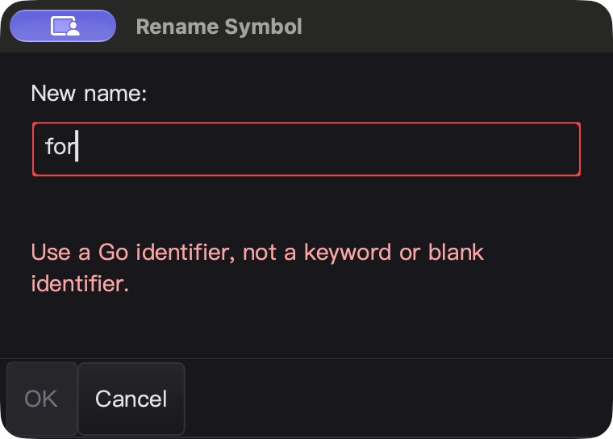
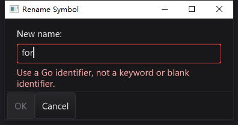

# 重命名弹窗、输入校验与编辑目标保护验收

本轮从实际 F2 流程发现：名称没有预填，关键字 `for` 也会关闭弹窗再向 gopls 提交；SDK 快捷键则绕过宿主语义入口。修复围绕一条完整重命名路径，不代表全部 Qt Creator 功能对齐或发布认证。

## 实现与兼容边界

- IDE 使用当前标识符预填并选中；取消／同名不发送重命名请求。SDK 快捷键与上下文菜单统一经过宿主动作，本地 AST 回退增加一次文本 Undo/Redo。
- `InputBox` 新增校验器与草稿查询 API，`ShowValidatedInputBox` 复用输入、错误标签与按钮子控件；不额外创建子原生窗口。错误可换行，暗／亮主题使用不同对比度颜色，输入与提示均限制在 footer 之上。小尺寸允许内容裁剪，不让内容覆盖按钮。
- 非法值禁用 OK，同时在 Enter 和按钮提交入口再次校验；取消与 Escape 可退出。`ShowInputBox` 继续允许自由输入，没有静默改变旧调用方的校验行为。
- `WordAtCursor()` 只扫描行前缀与相邻词，不复制整行、不移动光标；它是词法查询，不表示语义可重命名。查询时夹取越界列，兼容旧版菜单取词约定。
- IDE 请求前同步全部已打开缓冲区。模态返回及异步结果应用前核对编辑版本、实例、路径、归属与可写状态；编辑后撤销到相同文本也不能通过旧版本检查。RPC 发出后允许正常光标导航，不允许把结果覆盖到已经修改的目标缓冲区。

## 源码与自动测试

证据目录：`bin/qa-artifacts/rename-dialog-20261026/`。冻结 1,782 个源码输入，本阶段 14 个源码／测试文件变化，保留原始备份和阶段 diff，未重置此前的工作树修改。

- 修复前测试证明本地重命名缺少撤销、快捷键绕过宿主、输入框没有统一校验 API；旧实现重放也能复现前两项。
- R1 全回归发现越界列兼容性回退，修复后重新构建。R2 全回归发现旧只读测试直接调用现已变为模态的入口，导致 macOS 在测试 goroutine 创建 NSWindow 而终止。改用输入弹窗 seam 模拟模态期间变为只读，继续断言原文与历史不变，不跳过原有行为测试。
- Windows R2 在进入这一已知无效测试前主动取消，明确记录为取消，不计通过。更新测试后重新构建并启动整套非缓存回归，未把编译静默视为超时或任意重启。
- R3 仅修改该测试；全部生产源码和重建后的 macOS 可执行文件哈希与 R2 原生 UI 测试一致。原生证据没有混用旧生产实现。
- macOS 七包 `go test -race -short -json -count=1 -p 1`：**6,261 pass / 49 skip**，本轮相关 39 个通过事件（含子用例）。定向 race 连跑三遍、纯 Go 路径、构建和随包工具校验均通过。
- 真实 gopls 集成测试强制使用随包工具、禁止因缺少工具跳过，连续三遍通过：两个未保存缓冲区、emoji 前缀的 UTF-16 定位、两文件语义编辑及撤销。第二文件磁盘内容仍仅为包声明，避免把磁盘结果误当成未保存缓冲区支持。
- `go vet -composites=false` 七包通过。默认 vet 前后各 452 项既有 unkeyed-field 诊断，无新增、无移除；不宣称默认 vet 全绿。

Windows 最终同样的七包非缓存 race 回归：**6,049 pass / 71 skip**，本轮 38 个通过事件；定向 race 连跑三遍（强制真实 gopls）、构建和工具校验通过。使用绝对 Go overlay，最终回读确认 1,801 个基线文件保持原样、535 个覆盖输入与本机冻结版本一致。测试统计由下载的 UTF-8 JSONL 解析，不采用 PowerShell 默认 ANSI 解码的临时计数。

## 原生 UI 闭环

macOS 已完成 16 项精确字节断言：预填、关键字 Enter 保持弹窗、禁用按钮点击、空名称、输入框内 Undo、真实跨文件重命名、分别保存两文件、逐文件 Undo/Redo/恢复，以及 macOS Ctrl+F2 同宿主入口取消。每步以文件回读验证，而非只凭截图或 toast。

Windows 首轮桌面脚本误将 `Ctrl+F2` 当成重命名，因未出现弹窗而失败。检查截图与快捷键注册，确认它切换了书签（Windows 的 Action 键为 Ctrl，macOS 为 Cmd），并非产品漏响应。保存这次失败的脚本、截图和状态，关闭测试进程、重置隔离会话后，使用 IDE 正式绑定 `F2` 重跑；未为迁就测试修改书签快捷键。

输入框 `Undo` 在本次逐字符输入中撤销最后一个字符，不宣称一整段键入合并撤销。文档重命名则作为各自缓冲区的一次文本历史操作。两个文件最终回到格式化后的原始基线。

Windows 最终从重置基线完整重放，16 项文件字节断言全部通过。额外检查未手动放大的默认弹窗：两行错误提示完整显示，没有覆盖确认／取消按钮。四个正式交互式计划任务均为 `Ready / Result=0`，执行脚本哈希与本机一致。正常关闭后该 QA 目录 IDE／工具进程为零，未发现 `panic` 或 `DATA RACE`。

macOS QA 主进程正常关闭；自动化关闭后读取 AX 曾重新启动隔离实例，已再次正常关闭并确认同目录 IDE／gopls 无残留。原始主进程和重启实例分别记录，不混算 CPU。

## 性能与尚未覆盖的范围

同机、1.8 MB 单行开头取词、五次固定 20 次迭代的基准中位数：

| 指标 | 修复前 | 最终生产实现 |
| --- | ---: | ---: |
| 耗时 | 3.898 ms/op | 95.85 ns/op |
| 分配 | 14,401,602 B/op | 0 B/op |
| 分配次数 | 3 allocs/op | 0 allocs/op |

这是行首取词专项，不是长行末尾、gopls RPC 或整帧耗时；光标之前的前缀扫描仍有线性成本。新校验没有增加常驻定时器、轮询或后台线程。

macOS 最终版 IDE 主进程稳定空闲采样 20.026 秒，平均单核 **0.85% CPU**；刚结束交互的另一份 5 秒样本约为 3.00%。不包含独立 gopls、GPU 或系统负载，不保证所有输入延迟或帧率。Windows 最终主进程空闲 20.008 秒，平均单核 **1.02% CPU**，`Responding=true`；同样不是全机占用或长期性能保证。

仍未解决／未覆盖：

- SDK 本地 AST 回退按名称处理，不是作用域感知重构。
- 未打开文件的外部写入竞争与多文件磁盘提交原子性；已有写入流程仍可能部分成功。
- 工作区整体撤销、`prepareRename`／重构预览，以及本地回退完整选区／多光标历史恢复。
- 新错误文本经过 `i18n.T`，但尚无内置中文译文；宿主可添加覆盖。
- Linux 桌面、Windows 高 DPI／多显示器、全部 IME、长时高负载时序。

此阶段不 commit、push 或发布，保持原 HEAD。

## 重复验证

- `python3 bin/qa-artifacts/rename-dialog-20261026/verify-local.py`：源码、测试、macOS 文件断言、进程清理、基准与二进制一致性。
- `python3 bin/qa-artifacts/rename-dialog-20261026/verify-final.py`：双端源码、构建、回归、交互任务、文件字节、二进制与归档证据完整性。
- macOS 可执行文件 SHA-256：`373db7b4a284c85f83e95f75cce3d5b0d695b6ff002d5cd4a675c6d83e8e2036`。

- Windows 可执行文件 SHA-256：`b1aeecf6a6a3c9a7a26a26d88ac3eca826831b17eae84dca7553119fa8b3c2b1`。

