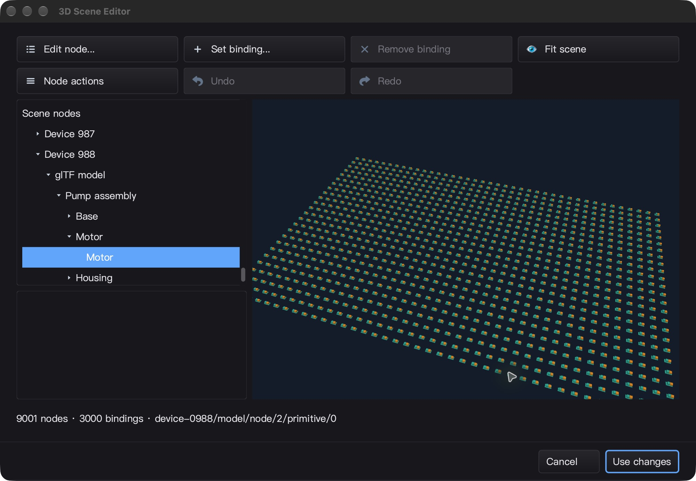
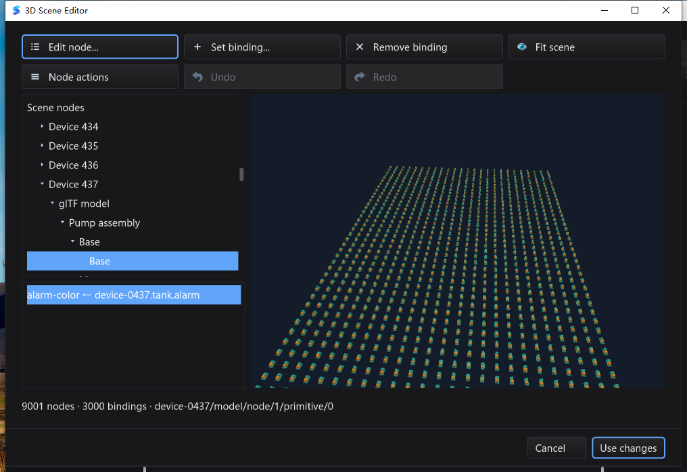

# 空间 BVH 与快照准备缓存验收 — 2026-10-29

基线：`aa66cdee6a00a8a29669ad5f08c35b17781af69f`。
本阶段最终门禁 **FINAL_GATE_PASS**：三平台普通/race 全量、定向/原生/语言服务、
限定范围的实际 UI，以及测试后源码/二进制回读全部通过。未验证范围见下文。
总目标保持 active：本阶段不是完整工业 IDE、完整材质管线或 Qt Creator 功能对等。

## 本轮实现

- 新增纯 Go `scene3d.Culler`：Morton 空间排序、平衡 BVH、可见位集合、稳定原序输出。
  不修改原 Snapshot，不改变拾取 ID、等深度绘制先后或连续共享 mesh 实例化分组。
- 同一 Snapshot 的相机变化复用空间树；新同长度 Snapshot 比较几何变化，颜色/ID 变化
  不改树，变换/mesh 变化仅 refit 相应叶及祖先；实例数变化重建排序。
- 保留消减前的绝对数值幅度，验证 clip 坐标范围后才允许裁剪；不确定输入 fail-open。
  小于 64 实例走线性路径，重叠包围盒退化时限制分层查询开销，剩余区间线性检查。
- CPU/GPU 共用查询器；GPU 只在新 Snapshot 上验证全部矩阵、预算、驻留集。
  相机独立变化的 `ValidatedInstances` 为 0；错误线程拒绝、资源回收及原缓存契约保留。
- `Frame.Stats.Culling` 暴露实际查询/增量更新工作量；Close/Reset 释放旧快照及索引。
- 修复全量验收发现的 **MQTT 测试 broker** 清理死锁；不改生产 MQTT 客户端或依赖版本。
- 更新 SDK 使用示例、性能边界、路线图及真实桌面截图，并修正旧 QA 的 Linux 架构描述。

## 最终源码的完整测试矩阵

Go 1.26.10；从相同 2509 文件冻结快照重跑，不借用第一轮通过结果。
全量均 `-count=1`、独立普通/race 运行；计数包含子测试和 fuzz seeds。

| 平台 | 普通全量 | race 全量 | 包通过 / 无测试包 |
| --- | --- | --- | --- |
| macOS arm64 | 8381 pass / 25 skip | 8381 pass / 25 skip | 92 / 19 |
| Linux arm64 | 8320 pass / 33 skip | 8320 pass / 33 skip | 92 / 19 |
| Windows amd64 | 8158 pass / 77 skip | 8158 pass / 77 skip | 93 / 18 |

完整 skip 名单保存在 `full-suite-skips.json` 和 `final-verdict.json`，不把 skip 或无测试包
算作通过。包括平台专属、权限/POSIX 夹具、未启用的原生用例、gopls/dlv 环境条件等；
所需原生场景与语言服务另外显式开启验证，不能由普通全量的绿色状态代替。

### 定向、原生与语言服务补充门禁

- SDK race、20 轮定向回归、`CGO_ENABLED=0`、`silk_pure_go`、SDK vet 通过；
  GUI/IDE vet 使用 `-composites=false`（不声称默认全部 vet 检查通过）。
- `FuzzCullerConservativeOrder` 60 秒完成 **2,521,605 次执行**，无失败。
  覆盖随机场景、数值极值/NaN/消减、返回切片被调用者修改、容量变化与独立 owner 并发。
- macOS 原生 GL、Linux Xvfb GL race：新增 **21 组 RGBA/拾取 ID 精确对照**，以及既有
  **90 组实例化精确对照**通过；上下文所有权、128 帧、1000 实例 / 1 draw 路径通过。
- 1000 实例 GUI 点位 burst/合并投递/移入视野/拾取/关闭回归通过。
- Windows Session 1：**24 个原生用例、30 次独立进程运行、30 个不同 PID**，全部退出 0；
  包括场景创作菜单/小尺寸布局、模板、BVH、模态焦点/IME 与 WGL 回退生命周期。
- macOS 与 Windows：真实 gopls **5 项 race 集成**，相邻 bundled gopls **3 项 × 3 轮**
  均通过、没有 skip。Linux 本轮不额外宣称真实 gopls 集成覆盖。
- Windows MQTT 原用例 race **2000 次**及新增并发关闭回归 **100 次**全部通过；
  macOS 对两项用例另做 100 次 race 回归。三个平台的嵌套 `mod/map` race 通过。

## 实际桌面闭环

同一隔离夹具：1000 设备、9001 节点、2 个共享 mesh、3000 个**惰性绑定**。
本轮没有连接真实工业硬件或实时现场数据，不把惰性绑定当作硬件互通验收。

### macOS

- 测试二进制 SHA-256：`75d924621343c75aa089493067eaf426946dcde38ca4b35bb9e5211034e649d1`。
- 隔离 HOME/APPDATA/workspace；实际 Tools → Edit 3D Scene，拖动旋转、多次滚轮缩放。
- 拾取 Device 988 / Motor，表单 ID `device-0988/model/node/2/primitive/0`、颜色
  `#35BCA6` 与选择一致；关闭重开恢复初始场景，Cancel、Cmd+Q 正常退出 0。
- 空闲 10 秒 CPU 时间增加约 0.10 秒，RSS 约 304 MiB，仅是本机短时样本。
- **未确认项**：嵌套节点 Cancel 后 CUA 观察到主窗；Window 菜单仍能恢复保留选择/相机的
  场景。未把自动嵌套焦点归还记作通过。退出后的 `getAXState` 又启动 QA 应用；原 PID
  80803 已正常退出 0，重启进程未编辑并已关闭，不借用其会话状态作为证据。



### Windows

- 测试二进制 SHA-256：`c0d8961a8f9923111ada67dfc200bba2bd4c44b54631a029122c9fbb025ce39f`。
- 真实 Session 1，PID 4396。打开场景、命令面板启动场景编辑器、旋转、缩放与拾取；
  Device 437 / Base 的 ID `device-0437/model/node/1/primitive/0`、颜色 `#35BCA6`
  与节点表单一致；树中的 `alarm-color` 绑定对应 `device-0437.tank.alarm`。
- 同一交互任务中 Node actions → Escape 保持场景；节点 Cancel 自动返回场景；场景
  Cancel 返回主 IDE，再通过命令面板重开恢复初始根节点/取景；Alt+F4 正常退出 0。
- 空闲 10.02 秒 CPU 时间增加 **78.125 ms**，RSS **134,549,504 字节**（约 128 MiB）。
  窗口 Responding 为真；这是一次短时样本，不代表 FPS 或全应用性能保证。
- 开关流程未改写文件；两平台最终夹具 SHA-256 均为：
  `391620475836ab1198327373412b41e321c4795ed289abea27ddc7e451f13b90`。



### 桌面自动化失败记录（没有改写成通过）

- Windows 第一轮跨任务打开菜单后，再启动 PowerShell 任务会改变前台并收起瞬态菜单，
  后续 Escape 实际关闭场景；只读检查任务也曾因自身前台激活失败。原 `node`/`inspect`
  日志与 exit 1 保留。更正为同任务内打开菜单、Escape、断言 owner，`node2` 通过；
  不把脚本改法描述为产品菜单修复。
- 首次重开固定等待 1 秒后读取前台失败；随后枚举证明场景已正常打开。改为最多 10 秒的
  状态等待，重复闭环通过，场景在原等待后额外约 580 ms 就绪；保留 `reopen` exit 1。
- Windows 的节点取消即时 owner 检查通过，并不消除上文 macOS 自动焦点验收缺口。

## 性能证据与限制

Apple M2 Max，三次 250–300 ms 微基准。性能候选与最终版的 5 个运行时文件 SHA-256
一致（`performance-source-parity.json`）；期间新增修复只改 MQTT 测试适配器。

| 范围 | 原线性 / 基线 | 本轮空间索引 |
| --- | ---: | ---: |
| 10000 实例，单个可见，热可见性查询 | 约 443 us | 约 1.00 us |
| 10000 实例，左右交错，单个可见，热查询 | 约 436 us | 约 1.05 us |
| 10000 实例，全部在视锥内，热查询 | 约 594 us | 约 4.13 us |
| 10000 实例，颜色更新/单个变换后查询 | — | 约 123 us，0 allocations |
| 10000 实例，冷建索引（不含快照生成） | — | 约 1.51 ms，约 755 KB，4 allocations |
| 1000 柱体、一个可见、160x120 CPU 实际帧 | 约 69 us | 约 25.4 us |

最初按输入顺序分组的原型在交错场景约 482 us，反而退化；原结果保留，随后改为空间
排序 + 稳定原序输出。全可见柱体的 CPU 帧仍约 16 ms，没有宣称加速。热查询可零分配，
但新快照仍需 O(N) 比较，初建含排序。查询微秒不是 GUI FPS，不含 GPU 颜色/ID readback。

## 全量门禁实际发现并修复的 MQTT 清理死锁

第一轮 Windows 普通全量通过，race 卡在 `driver.TestMQTTReadPoint`。没有跳过或延长
超时：原现场保留，额外 2000 次原用例在 1422 次成功后重现，3 分钟超时栈显示：

- 清理线程：`Server.Close → closeListenerClients → Clients.GetByListener → Clients.Len → RLock`。
- 断开线程：`attachClient → Clients.Delete → Lock`。
- mochi v2.7.9 的 `GetByListener` 持读锁后调用同样加读锁的 `Len`；待写锁阻塞新的读锁，
  形成互等。原全量在 30 分钟超时也得到相同栈；不是仅由一次重跑推断。

当前仅 `driver/mqtt_test.go` 使用 mochi，生产 SDK 使用 Paho。修复限于测试生命周期：
先 `Listeners.CloseAll`，以单锁 `Clients.GetAll` 快照在锁外断开匹配客户端，再
`Server.Close` 清理资源。`TCP.Close` 幂等避免重复进入缺陷枚举；新增并发断开、重复
关闭以及监听端口确实关闭的断言。不修改模块缓存、供应商源码、依赖版本或生产实现。
修复后重新冻结并重跑三平台完整普通/race，不拿第一轮结果代替。

### QA 打包问题与修正

Windows 最终轮 full/race/map/build 均退出 0，但 QA 脚本把旧 tools 目录复制进已有 tools，
形成 `tools/tools/gopls.exe`，后续缺文件令 wrapper 退出 1。初次 runner/依赖任务失败均
保留，没有改成 0。补充脚本校验 2509 文件与二进制 hash，隔离错误副本，仅复制固定的
`gopls.exe`/配置/license，重跑真实及 bundled LSP、CGO=0，再校验源码，全部通过。
这不涉及产品源码变化；最终校验同时要求“原失败留存”与“补充门禁通过”。

## 明确没有验收/没有实现的范围

- Windows 驱动实际报告 OpenGL **1.1.0**；`SCENE_WGL_CPU_FALLBACK` 与后续
  `SCENE_WGL_PASS` 证明 CPU 回退、合成、上下文恢复、拾取缓存、切换和关闭，不是硬件 GPU。
- Linux 为 **arm64、Xvfb/Mesa llvmpipe 软件 GL**，不是 amd64、物理桌面或硬件 GPU。
  旧 `SCENE_RELEASE_QA_20261028.md` 的 amd64 误写已勘误，不改变旧测试计数。
- macOS 原生光标可选用例仍 skip；自动嵌套焦点归还未确认；调试器/平台权限条件未全覆盖。
- 不含三角级 BVH、SAH、遮挡剔除、LOD、PBR/纹理/动画、GPU 零读回合成、全应用性能保证。

## 复跑与证据位置

完整本地证据：`bin/qa-artifacts/scene-bvh-final-20261029/`（忽略的 QA 产物，不提交二进制
或整套日志）。其 `src/` 是独立干净 worktree；避免工作区历史 Package/dc 与不可读的
用户 local 数据污染 `./...` 包发现，未删除或修改用户目录权限。

```sh
# 在该轮冻结的干净 src 中运行，原生测试还需平台桌面/GL 环境
go test -json -count=1 -timeout=30m -p 1 ./...
go test -json -race -count=1 -timeout=30m -p 1 ./...
go test -race -count=1 ./scene3d/...
go test -run '^$' -fuzz '^FuzzCullerConservativeOrder$' -fuzztime=60s -parallel=4 ./scene3d
CGO_ENABLED=0 go test -count=1 ./scene3d/...
go test -tags silk_pure_go -count=1 -p 1 ./paint ./gui ./ged ./decl ./scene3d/...
(cd mod/map && go test -race -count=1 ./...)
```

- 最终冻结树：`ae0318d155504d9e3c7961b82b37298ddd7983de`，2509 文件。
- 源码清单 SHA-256：`790737400d47f4d877d35f4f34256250126a5ee4ae17a83d9543062a2ff8d36f`。
- 源码归档 SHA-256：`788c761b59deda16f0a7c3cea07ce4b556222e03866a3fd7b55c5d01a3379ce0`。
- 冻结后主工作区只补文档/截图；提交的运行时与测试源码逐文件对齐冻结版本。
  `core/callback.go.txt` 原 CRLF 文件未改写，Git 规范化 blob 为
  `1d1c08c3623557d34b18426561799f2bdb4b8de4`。
- `mac-{full,race}.jsonl`、`linux/`、`windows/`：原始事件与独立退出码；
  `windows-final-evidence.tar.gz`：Windows 日志/截图/退出码及测试后源码回读归档。
- `mac-native-final.log`、`linux/native.log`、Windows `bvh-native-isolated-*`：原生门禁。
- `mac-lsp*`、`mac-bundled-*`、Windows `lsp*`/`bundled-*`：真实语言服务门禁。
- `ui-mac-verification.json`、`windows/ui-actual-verification.json`：限定范围的 UI verdict。
- `validate-final.py` / `final-verdict.json`：逐文件 hash、计数、必需用例、原生输出、
  语言服务、截图、文件回读、正常退出与保留失败记录的 fail-closed 总校验。
- 第一轮失败与基准保留在 `bin/qa-artifacts/scene-bvh-20261029/`；其中 Windows 原 race
  已超时失败，后续废弃 pipeline 被停止，不把该轮当作最终通过。

源码说明：[scene3d SDK](scene3d/README.md)、[GPU 后端](scene3d/glrender/README.md)。
概念参考：[PBRT BVH / Morton 编码](https://www.pbr-book.org/4ed/Primitives_and_Intersection_Acceleration/Bounding_Volume_Hierarchies)。
