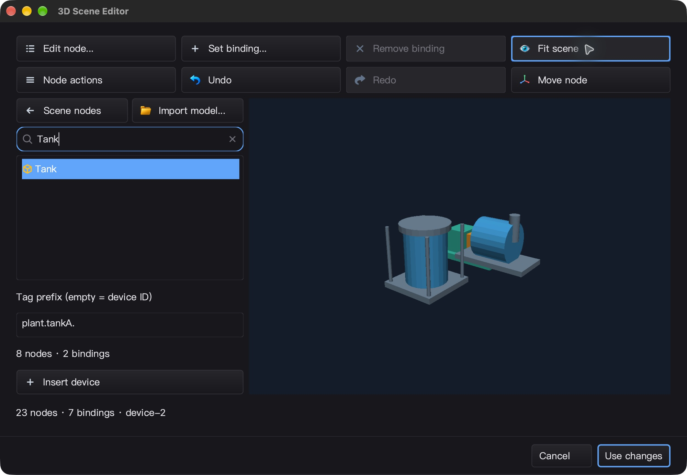
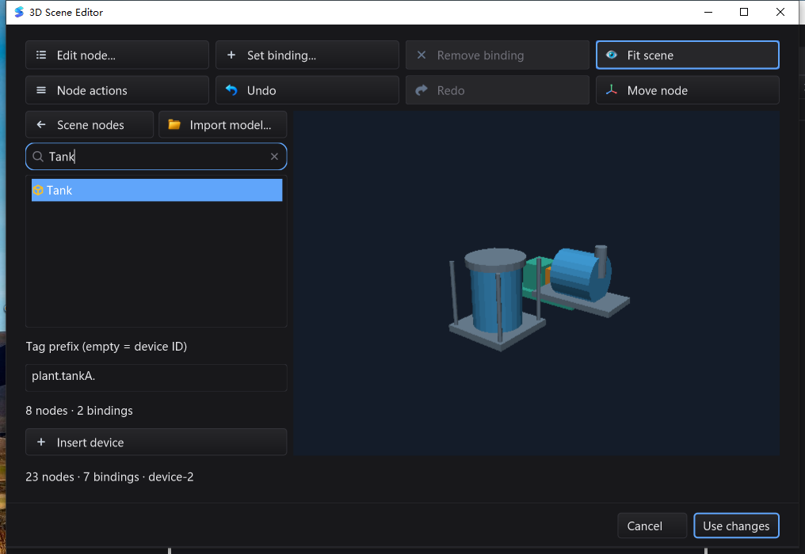

# 设备库、事务放置与原生拖放验收

本轮是工业 3D 编辑能力增量，不代表完整 Qt Creator 同级工业 IDE 已完成。

## 功能与修复

- 内嵌设备库：泵、储罐、输送带示意模型，搜索、图标和可见按钮标签；后台导入 OBJ/glTF/GLB/`.silkscene`，支持取消与过期结果隔离。
- 原生拖入到世界 Y=0 平面，Shift 按 1 单位吸附；可显式指定点位前缀，默认分配不碰撞的设备命名空间。悬停只更新裁剪后的标记，不修改创作状态或重建几何缓存。
- `EditSession.InstantiateTemplate(s)`：单个/批量设备放置为一个 undo 事务；共享不可变网格，合并惰性绑定和导入诊断；冲突、预算或取消失败不发布部分状态。
- 真实 UI 暴露的修复：设备库按钮默认隐藏文字；GLFW 的 `FindTopWindow` 从无序 map 任取窗口，导致对话框内拖放落到后方 `CodeEditor`。修复采用原生遮挡命中、禁用窗口隔离与已聚焦窗口回退，并增加不依赖 map 顺序的回归。

## 冻结源码与复现

基线 `a3230c6d77af48b379d69819439c56698ee965db`。本轮 2,532 个冻结文件逐项 SHA-256 校验，源码归档：

`6ab6ba06546cf3b435d954634291713c38465145e3501a445b1c5bdc80ef53d4`

完整日志、脚本、源码清单、持久化快照与截图：
`bin/qa-artifacts/device-library-final-20261029/`。

测试使用冻结源码而非混入历史 `Package/`、`local/` 的工作目录；未删除用户目录。主模块普通与 race 都使用 `-count=1 -timeout=30m -p 1 ./...`，另测 `mod/map`。Linux 使用 Go 1.26.10 的 Xvfb/Mesa 软件 GL 容器；Windows 在独立 `C:\silk_device_library_final_20261029` 上校验源码后原生编译执行，桌面任务为 Session 1。

## 全量回归

| 平台 | 普通测试通过 / 跳过 | race 通过 / 跳过 | 测试包 / 无测试包 |
|---|---:|---:|---:|
| macOS arm64 | 8460 / 25 | 8460 / 25 | 92 / 19 |
| Linux arm64 | 8399 / 33 | 8399 / 33 | 92 / 19 |
| Windows amd64 | 8227 / 77 | 8227 / 77 | 93 / 18 |

跳过是显式的原生桌面/平台/外部工具夹具条件，不计为通过。最终分类以每个 `*.jsonl` 的 `skip` 事件和最终验收 JSON 为准。

已完成附加门禁：CGO=0 场景 SDK、`silk_pure_go`、SDK/GUI vet、20 轮新增交互/事务 race、60 秒投影 fuzz、macOS/Linux 原生 GL/实例化/BVH/窗口生命周期，以及 macOS 5 项真实 gopls 集成和 3×3 bundled-gopls 用例。Windows 同样完成 5 项真实 gopls 集成、3×3 bundled-gopls、CGO=0、`mod/map` race 和产物构建；工具包的 license 子树与 gopls 哈希通过验证。Session 1 完成 **38 次独立 race 进程 / 32 个原生专项**，覆盖模态窗口、焦点恢复、IME、快捷键、渲染回退与设备放置；三个前台焦点用例各重复三次。

最终机器校验 `final-verdict.json` 为 **PASS**，源码在 macOS/Linux/Windows 测试前后逐项一致。Windows 最终构建与真实 UI 使用的候选二进制完全一致：
`bb5ad97dd170f01ae4a0feb9ae4f86a218210e833510dd25decf2c59683210a5`。

Windows 回收的 184 项证据归档 SHA-256：
`7693e888e26a83db638aed806f018db84418625b2d1f54a9a9b2e4cad5587da7`。
未将平台跳过项、Windows CPU 回退或 Linux 软件 GL 描述为硬件 GPU 通过。

## 真实 UI 与保存回读

macOS 使用 CUA 操作无插桩候选，并与冻结生产源码清单核对：

1. 打开原始 8 节点场景，进入设备库；拖入泵，场景成为 14 节点 / 5 绑定；一次撤销回到 8 / 3，一次重做恢复。
2. 搜索 Tank，输入 `plant.tankA.`，再拖入储罐。Use changes / Save 后回读 **23 节点、6 网格、7 绑定**，原有节点/网格/绑定不变，两个设备根节点精确 Y=0。
3. 宿主 Undo / Save 与原文件逐字节一致；Redo / Save 与设备场景逐字节一致；重开可见已保存设备。
4. 把保存的场景导入设备库：目录新增模板但文档未改变。Insert device 使 23 → 47 节点；一次 Undo 回到 23。Cancel 不改保存文件，Cmd+Q 后已验证的 PID 消失；LaunchServices 启动方式没有取得退出码，不伪称 exit=0。

Windows 真机使用技能脚本、精确 PID/窗口句柄与遮挡检查：菜单 End/Enter 打开设备库；两次真实 OLE 拖放；点位前缀、场景 Undo/Redo、保存回读、宿主逐字节 Undo/Redo 与重开已验证。截图中泵放置与重做后的视口像素完全一致，撤销后视口像素改变，分别显示 14 → 8 → 14 节点；另有保存数据的结构与字节断言。正常 Alt+F4 **exit=0**。静默场景单次采样约 10.22 秒消耗 0.046875 CPU 秒，窗口响应正常；这不是持续帧率或整机 CPU 基准。

## 性能与边界

M2 Max 单次 3 轮基准：创建 edit session 并批量放置 1,000 台泵，约 **10.59 ms/op，18,287,984 B/op，67,852 allocs/op**。包含节点/绑定/事务构建，预编译模板在计时外；不是帧率，也不是无分配承诺。模板网格共享由资源数量与别名隔离断言验证。

- 设备库元数据目前是会话级；已放置的几何/惰性绑定随 `.silkscene` 持久化。64 项 / 64 MiB 估算预算不代表 RSS 上限。
- 内置模型是示意图，不是厂商 CAD；未连接工业硬件或启动真实点位。
- Windows 是 CPU 回退路径，Linux 是软件 GL；Windows 硬件 GPU、Linux 物理桌面、完整材质/纹理、跨会话设备目录和旋转/缩放手柄仍未完成。
- 早期失败及观测保留在 `device-library-20261029/`：夹具断言修正、地面浮点残差修复、按钮文字和模态命中问题，以及 QA app launcher 隔离/关联调整。临时日志插桩已恢复。Windows 一次仅观察的脚本因 PowerShell 获得前台而失败；后续使用精确拥有者窗口，未把启动器退出状态当作 UI verdict。
